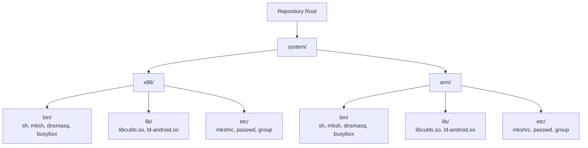
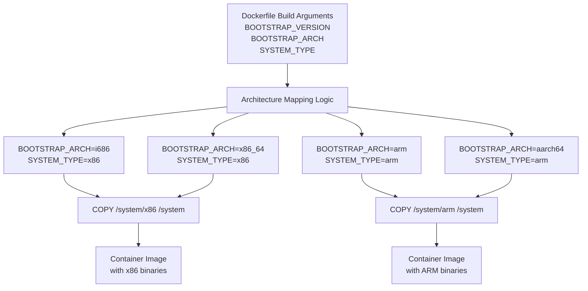
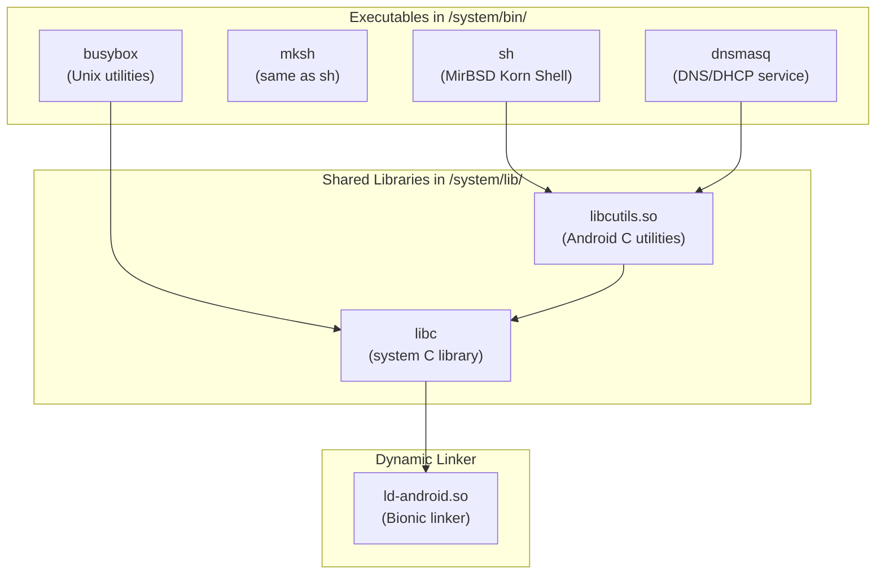
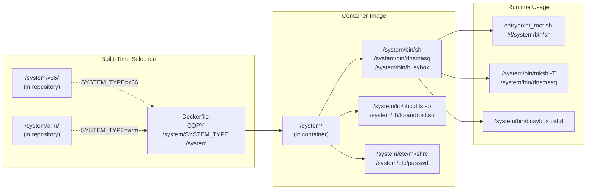
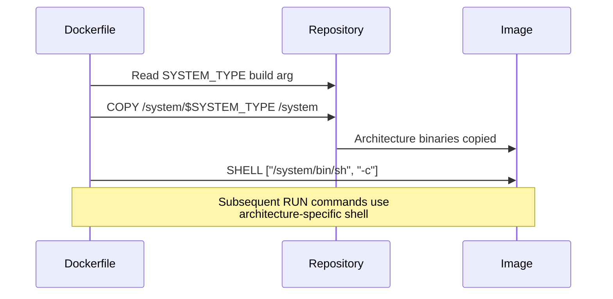
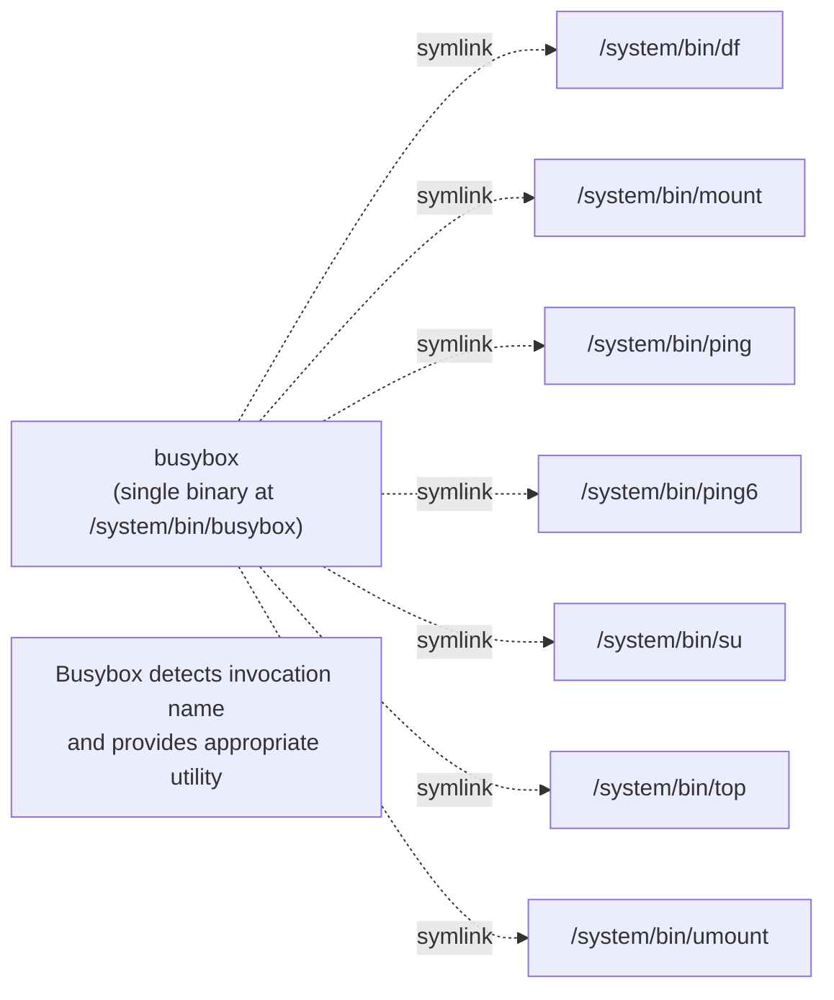
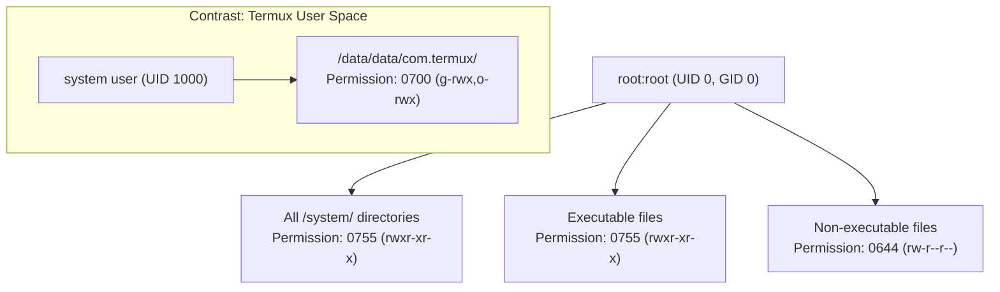
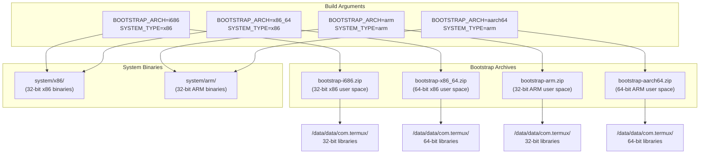
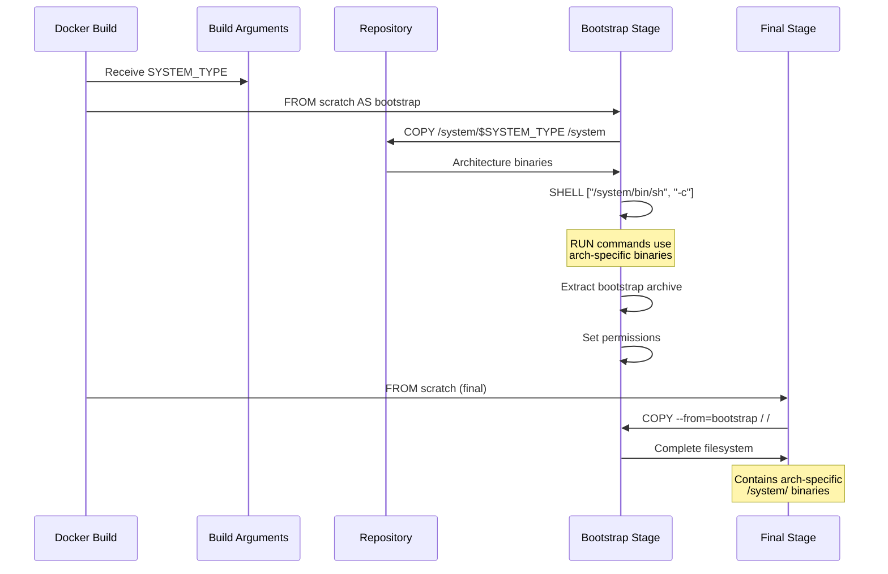

<!-- source: DeepWiki mcp.deepwiki.com · repo termux/termux-docker · page 5.1 Architecture-Specific Binaries · fetched 2026-10-26 -->

# Architecture-Specific Binaries

<details>
<summary>Relevant source files</summary>

The following files were used as context for generating this wiki page:

- [Dockerfile](Dockerfile)
- [entrypoint_root.sh](entrypoint_root.sh)
- [system/arm/bin/sh](system/arm/bin/sh)
- [system/arm/etc/mkshrc](system/arm/etc/mkshrc)
- [system/x86/bin/sh](system/x86/bin/sh)
- [system/x86/etc/mkshrc](system/x86/etc/mkshrc)

</details>


## Purpose and Scope

This page documents how architecture-specific system binaries are organized in termux-docker, including the directory structure, build-time selection mechanism, binary components, and the relationship between different CPU architectures (i686, x86_64, arm, aarch64) and their corresponding system binary sets.

For information about cross-platform execution (QEMU, binfmt_misc), see [Cross-Platform Execution](#5.2). For details on the Termux bootstrap archive download and extraction, see [Bootstrap Process](#8.2).

## Directory Structure Overview

The repository maintains parallel directory trees for x86 and ARM architectures under `/system/`:



Each architecture directory contains a complete, self-contained set of system binaries, libraries, and configuration files compiled for that specific CPU architecture.

**Sources:** [Dockerfile:14](), [system/x86/bin/sh:1](), [system/arm/bin/sh:1]()

## Build-Time Architecture Selection

### Build Argument Flow



**Sources:** [Dockerfile:5-7](), [Dockerfile:14]()

### Architecture Mapping Table

| BOOTSTRAP_ARCH | SYSTEM_TYPE | Bootstrap Archive | System Binaries Source |
|----------------|-------------|-------------------|------------------------|
| `i686` | `x86` | `bootstrap-i686.zip` | `/system/x86/` |
| `x86_64` | `x86` | `bootstrap-x86_64.zip` | `/system/x86/` |
| `arm` | `arm` | `bootstrap-arm.zip` | `/system/arm/` |
| `aarch64` | `arm` | `bootstrap-aarch64.zip` | `/system/arm/` |

**Key Insight:** Both 32-bit and 64-bit variants within the same architecture family (x86/x86_64 or arm/aarch64) share the same system binary directory. The system utilities are 32-bit binaries that execute correctly on both 32-bit and 64-bit hosts.

**Sources:** [Dockerfile:5-7]()

## Core System Binaries

### Binary Components and Dependencies



**Sources:** [Dockerfile:14](), [entrypoint_root.sh:1,8-9]()

### Binary Format Verification

The binaries are native ELF executables for their respective platforms:

**x86 Binary Header (Intel 80386):**
```
ELF header: 32-bit LSB executable, Intel 80386
```

**ARM Binary Header:**
```
ELF header: 32-bit LSB executable, ARM
```

Both sets contain identical binaries by name and function, differing only in their compiled machine code for the target CPU architecture.

**Sources:** [system/x86/bin/sh:1](), [system/arm/bin/sh:1]()

## Runtime Binary Access Pattern

### Container Runtime Path Resolution



**Sources:** [Dockerfile:14](), [entrypoint_root.sh:1,8-9]()

### Dockerfile Shell Configuration

The Dockerfile sets its shell to use the architecture-specific binaries immediately after copying them:



**Sources:** [Dockerfile:10]()

## Configuration File Differences

### mkshrc Architecture-Specific Setup

The shell configuration files differ between architectures to accommodate platform-specific needs:

| Configuration Aspect | x86 Implementation | ARM Implementation |
|---------------------|-------------------|-------------------|
| **HOSTNAME Setup** | Uses default from environment | Queries `getprop ro.product.device` |
| **HOSTNAME Fallback** | None | Falls back to `"android"` |
| **TMPDIR Setup** | Uses default | Explicitly sets `/data/local/tmp` |
| **Variable Exports** | None | Exports `HOSTNAME` and `TMPDIR` |

**ARM-specific initialization ([system/arm/etc/mkshrc:9-12]()**:
```bash
: ${HOSTNAME:=$(getprop ro.product.device)}
: ${HOSTNAME:=android}
: ${TMPDIR:=/data/local/tmp}
export HOSTNAME TMPDIR
```

**x86 configuration ([system/x86/etc/mkshrc:1-17]()** omits these lines because x86 containers typically run in Docker environments without Android properties.

**Sources:** [system/x86/etc/mkshrc:1-17](), [system/arm/etc/mkshrc:1-22]()

## Busybox Multi-Call Binary Integration

### Utility Symlink Creation



These symlinks are created during image build because Termux packages expect certain utilities to be busybox implementations rather than Termux-native versions. The comment in [Dockerfile:39-40]() references `termux-tools/build.sh#L29`, indicating that some Termux utilities are designed as wrappers around `/system/bin/` binaries.

**Sources:** [Dockerfile:41-43]()

## File Ownership and Permission Model

### System Binary Permissions



The permission setup happens in [Dockerfile:49-55]():
1. System binaries owned by `root:root` (immutable system files)
2. Standard Unix permissions (755 for executables/directories, 644 for files)
3. Termux user space owned by UID 1000 with restrictive permissions

This separation ensures system binaries remain immutable while user packages can be modified.

**Sources:** [Dockerfile:49-55]()

## Architecture and Bootstrap Correlation

### Complete Architecture Matrix



**Key Distinction:**
- **System binaries** (`/system/`): Always 32-bit, one set per architecture family
- **Termux user space** (`/data/data/com.termux/`): Matches bootstrap architecture (32-bit or 64-bit)

This hybrid approach allows 32-bit system utilities to manage both 32-bit and 64-bit Termux environments.

**Sources:** [Dockerfile:5-7](), [Dockerfile:21]()

## Multi-Stage Build Integration

### Bootstrap Stage Process



The multi-stage build ensures:
1. Architecture selection happens early ([Dockerfile:14]())
2. Correct binaries available for all subsequent operations
3. Clean final image with only selected architecture

**Sources:** [Dockerfile:3-14](), [Dockerfile:74-85]()

## Summary

The architecture-specific binary system operates on these principles:

1. **Parallel Storage:** Repository maintains complete binary sets under `system/x86/` and `system/arm/`
2. **Build-Time Selection:** `SYSTEM_TYPE` build argument determines which set is copied to `/system/`
3. **32-bit System Binaries:** Both 32-bit and 64-bit variants use 32-bit system utilities
4. **Runtime Transparency:** Container sees only `/system/` paths, unaware of source architecture directory
5. **Minimal Configuration Differences:** ARM includes Android-specific setup, x86 remains minimal

This design enables a single Dockerfile to produce images for four CPU architectures (i686, x86_64, arm, aarch64) by changing only build arguments, while maintaining clean separation of platform-specific binaries in the repository structure.

**Sources:** [Dockerfile:5-14](), [system/x86/bin/sh:1](), [system/arm/bin/sh:1](), [system/x86/etc/mkshrc:1-17](), [system/arm/etc/mkshrc:1-22]()

---

