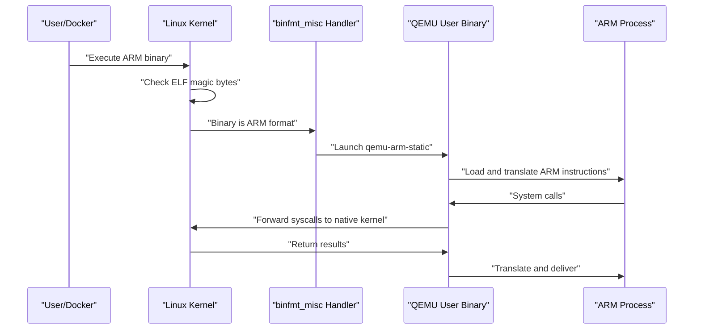
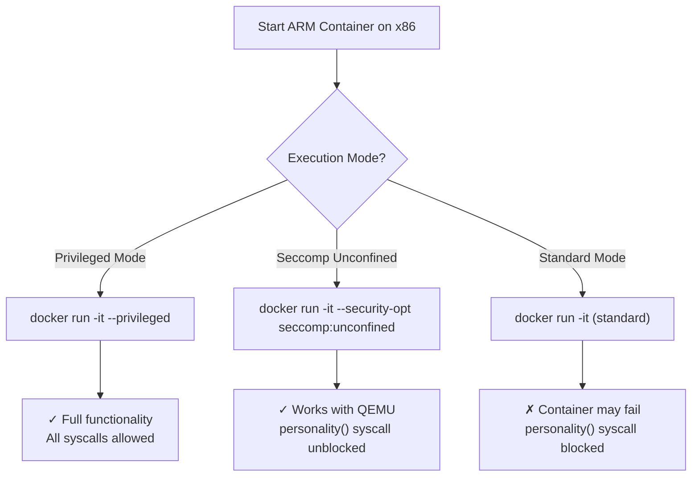
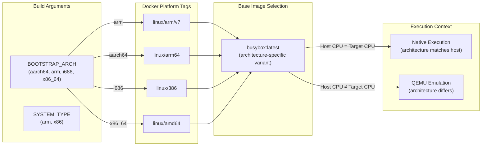
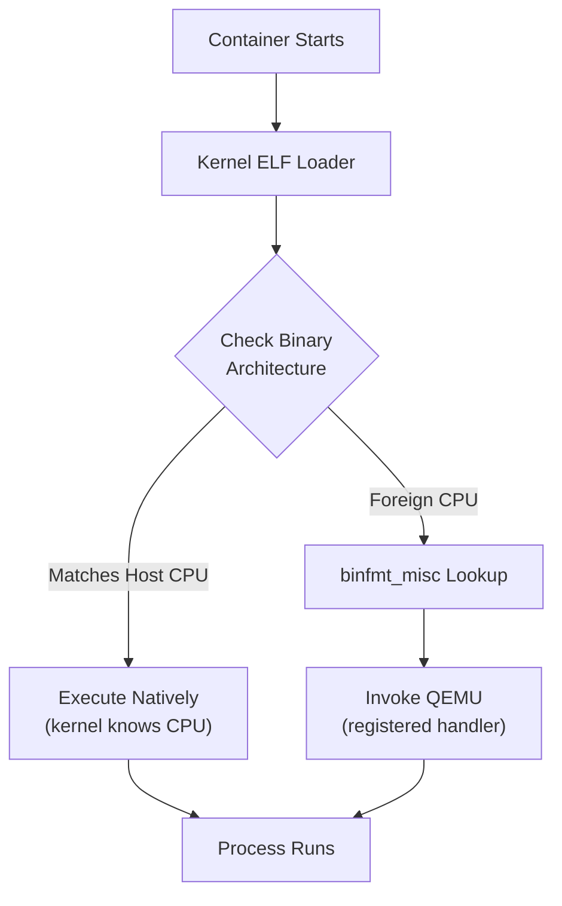

<!-- source: DeepWiki mcp.deepwiki.com · repo termux/termux-docker · page 5.2 Cross-Platform Execution · fetched 2026-10-26 -->

# Cross-Platform Execution

<details>
<summary>Relevant source files</summary>

The following files were used as context for generating this wiki page:

- [.github/workflows/docker_build.yml](.github/workflows/docker_build.yml)
- [README.md](README.md)

</details>


This document explains how termux-docker enables containers built for one CPU architecture (e.g., ARM) to execute on hosts running a different architecture (e.g., x86_64). This cross-platform execution capability is achieved through QEMU user-mode emulation integrated with the Linux kernel's `binfmt_misc` mechanism.

For information about the organization of architecture-specific binaries within the container image, see [Architecture-Specific Binaries](#5.1). For details on the CI/CD build process that produces multi-architecture images, see [CI/CD Pipeline](#3.3).

## Overview of Cross-Architecture Execution

Cross-architecture execution allows Docker containers compiled for one CPU instruction set to run on hosts with different CPUs. The termux-docker project supports four target architectures:

| Architecture | System Type | Docker Platform Tag | Typical Use Case |
|--------------|-------------|---------------------|------------------|
| `aarch64` | arm | `linux/arm64` | 64-bit ARM servers, Apple Silicon Macs |
| `arm` | arm | `linux/arm/v7` | 32-bit ARM devices, Raspberry Pi |
| `i686` | x86 | `linux/386` | Legacy 32-bit x86 systems |
| `x86_64` | x86 | `linux/amd64` | Modern x86_64 servers and desktops |

When the host CPU architecture matches the container architecture, binaries execute natively. When they differ, QEMU provides transparent binary translation.

Sources: [.github/workflows/docker_build.yml:37-48](), [README.md:26-36]()

## QEMU User-Mode Emulation

QEMU (Quick Emulator) provides user-mode emulation that translates foreign CPU instructions to the host's native instruction set. Unlike full system emulation, user-mode QEMU only emulates the CPU and forwards system calls directly to the host kernel, resulting in better performance.

### The binfmt_misc Mechanism

Linux's `binfmt_misc` kernel feature allows arbitrary executable file formats to be interpreted by userspace programs. When enabled for QEMU, the kernel automatically invokes the appropriate QEMU binary whenever it encounters an executable compiled for a foreign architecture.



Sources: [README.md:42-50]()

## CI/CD Cross-Architecture Build Configuration

The GitHub Actions workflow sets up cross-architecture support during automated builds for ARM targets (`aarch64` and `arm`).

### binfmt_misc Registration

Before building ARM images on x86_64 GitHub runners, the workflow registers QEMU handlers:

```yaml
- name: Setup binfmt_misc
  if: (matrix.CPU_ARCH == 'aarch64') || (matrix.CPU_ARCH == 'arm')
  run: docker run --rm --privileged aptman/qus -s -- -p aarch64 arm
```

This step executes the `aptman/qus` container, which configures the host kernel to recognize ARM binaries. The `-p aarch64 arm` arguments register handlers for both 64-bit and 32-bit ARM executables.

**Key Points:**
- Only runs for ARM architectures ([.github/workflows/docker_build.yml:32]())
- Requires `--privileged` mode to modify kernel configuration
- Uses the `aptman/qus` utility container for simplified setup
- Persists for the lifetime of the runner, enabling subsequent operations

Sources: [.github/workflows/docker_build.yml:31-33]()

### Architecture-to-Platform Mapping

The build process maps Termux architecture names to Docker platform tags:

```bash
case '${{ matrix.CPU_ARCH }}' in
  arm)     SYSTEM_TYPE=arm; PLATFORM_TAG="linux/arm/v7";;
  aarch64) SYSTEM_TYPE=arm; PLATFORM_TAG="linux/arm64";;
  i686)    SYSTEM_TYPE=x86; PLATFORM_TAG="linux/386";;
  *)       SYSTEM_TYPE=x86; PLATFORM_TAG="linux/amd64";;
esac
```

The `PLATFORM_TAG` is passed to `docker buildx build --platform`, instructing Docker BuildKit to produce binaries for the specified architecture. When cross-compiling, BuildKit automatically invokes QEMU through the registered `binfmt_misc` handlers.

Sources: [.github/workflows/docker_build.yml:37-48]()

## Running ARM Containers on x86 Hosts

End users must perform the same `binfmt_misc` setup to run ARM containers on x86_64 systems.

### One-Time Host Configuration

Execute the QEMU registration command once per host system:

```bash
docker run --rm --privileged aptman/qus -s -- -p aarch64 arm
```

This command:
1. Runs a privileged container that mounts `/proc/sys/fs/binfmt_misc`
2. Registers QEMU interpreters for ARM ELF binaries
3. Cleans up automatically (`--rm`)

After registration, the host can execute ARM binaries transparently for all subsequent container runs.

Sources: [README.md:44-50]()

### Container Execution Modes

ARM containers on x86 hosts require special execution privileges due to how QEMU handles certain system calls.



**Privileged Mode (Recommended for Testing):**
```bash
docker run -it --privileged termux/termux-docker:aarch64
```

Grants the container full access to the host kernel, bypassing all seccomp restrictions. Use only in trusted environments.

**Seccomp Unconfined (Production Alternative):**
```bash
docker run -it --security-opt seccomp:unconfined termux/termux-docker:aarch64
```

Disables seccomp filtering without granting other privileged capabilities. This allows QEMU's `personality()` syscall while maintaining other security boundaries.

**Why Standard Mode Fails:**

Docker's default seccomp profile blocks the `personality()` system call, which QEMU uses to set the execution domain for emulated ARM binaries. Without this call, process creation fails inside the container.

Sources: [README.md:51-66](), [README.md:115-116]()

## Running x86 Containers on ARM Hosts

The inverse scenario—running x86 containers on ARM hosts—follows the same principles with different QEMU binaries.

### Setup Command for ARM Hosts

```bash
docker run --rm --privileged aptman/qus -s -- -p x86_64 i386
```

This registers `qemu-x86_64-static` and `qemu-i386-static` interpreters for x86 ELF binaries on ARM systems.

### Performance Characteristics

Cross-architecture execution incurs performance overhead:

| Scenario | Relative Performance | Notes |
|----------|---------------------|-------|
| Native execution | 100% | No emulation overhead |
| QEMU user-mode | 50-80% | Depends on instruction mix, system calls |
| QEMU with JIT | 70-90% | Better but requires TCG caching |

CPU-bound workloads experience the most degradation, while I/O-bound operations (package installation, file operations) show less impact.

## Platform Tag Resolution

Docker BuildKit uses platform tags to select the correct base image layers and configure the build environment for the target architecture.



The `--platform` flag passed to `docker buildx build` ensures all subsequent `RUN` commands in the Dockerfile execute in the correct architecture context, either natively or through QEMU.

Sources: [.github/workflows/docker_build.yml:43-48]()

## Verification of Cross-Architecture Execution

The CI/CD pipeline validates that built images execute correctly by running a test command:

```yaml
- name: Export container as tar archive
  run: |
    docker run \
      --privileged \
      --name termux-docker-${{ matrix.CPU_ARCH }} \
      termux/termux-docker:${{ matrix.CPU_ARCH }} \
      uname -a
```

The `uname -a` command reports the emulated architecture from inside the container. For an ARM container on an x86 host, this outputs ARM architecture information, confirming QEMU is correctly translating instructions.

Sources: [.github/workflows/docker_build.yml:69-73]()

## Architecture Detection at Runtime

When a container starts, the system automatically selects the appropriate architecture binaries from `/system/arm/` or `/system/x86/` based on the CPU type. This selection happens through the ELF loader and does not require manual configuration.



The container image contains binaries for both architectures ([Architecture-Specific Binaries](#5.1)), but only the matching set executes. For example, on an x86_64 host running an `aarch64` tagged image, binaries from `/system/arm/` execute through QEMU emulation.

## Known Limitations and Issues

### Seccomp Profile Requirements

**Issue:** ARM containers fail on x86 hosts with default Docker seccomp profile.

**Cause:** The `personality()` system call (required by QEMU) is blocked by Docker's default seccomp filter.

**Solutions:**
1. Use `--privileged` mode (bypasses seccomp entirely)
2. Use `--security-opt seccomp:unconfined` (disables seccomp only)
3. Create custom seccomp profile that allows `personality()` while blocking dangerous syscalls

Sources: [README.md:115-116]()

### PID Exhaustion in 32-bit Containers

**Issue:** Multi-threaded applications in 32-bit containers (i686, arm) may exhaust PID space.

**Cause:** 32-bit libc implementations use thread IDs as PIDs, consuming the limited PID range faster.

**Mitigation:** Increase the host kernel's PID limit:
```bash
echo 65535 | sudo tee /proc/sys/kernel/pid_max
```

This change persists only until reboot. For permanent configuration, modify `/etc/sysctl.conf`.

Sources: [README.md:118-120]()

### Performance Degradation

QEMU user-mode emulation is significantly slower than native execution. For production workloads requiring high performance, use architecture-matched containers whenever possible. Cross-architecture containers are most appropriate for development, testing, and CI/CD scenarios where consistency is more important than raw speed.

## Summary

Cross-platform execution in termux-docker relies on three key components:

1. **QEMU user-mode emulation** - Translates foreign CPU instructions to host architecture
2. **binfmt_misc kernel feature** - Automatically invokes QEMU for foreign binaries
3. **Docker BuildKit platform support** - Handles cross-compilation during image builds

Setup requires a one-time privileged container run to register QEMU handlers. After registration, ARM containers run on x86 hosts (and vice versa) transparently, though with reduced performance and special privilege requirements for ARM targets.

Sources: [.github/workflows/docker_build.yml:31-48](), [README.md:42-66]()

---

