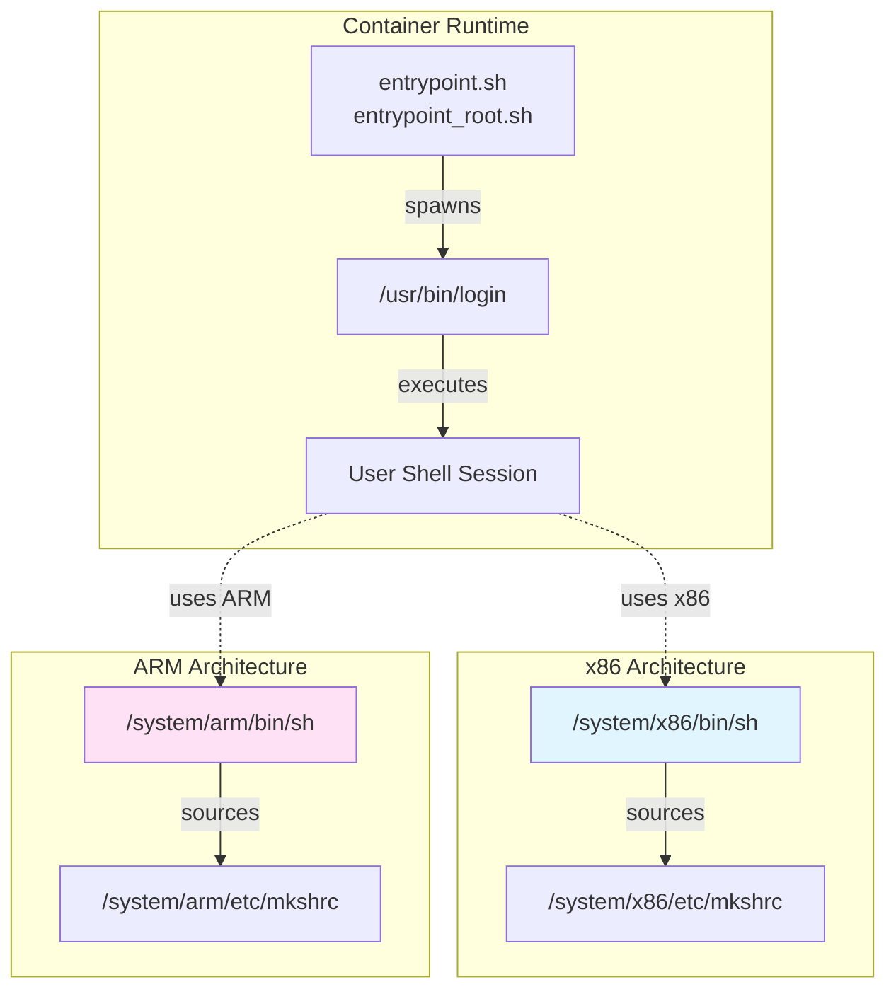
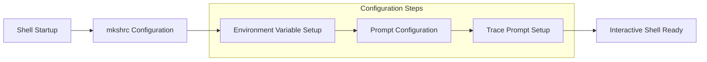
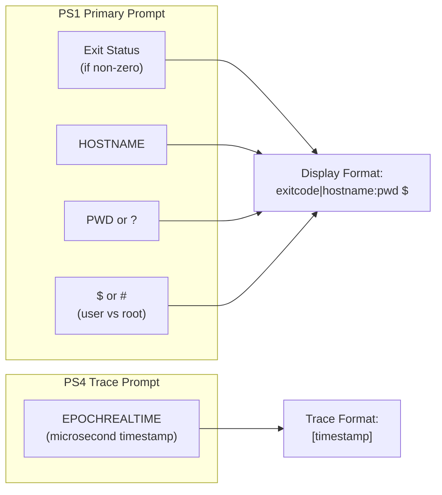
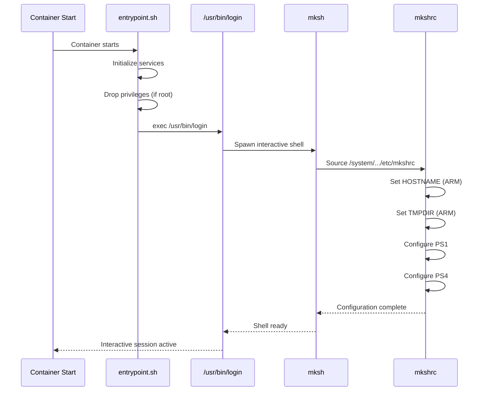

<!-- source: DeepWiki mcp.deepwiki.com · repo termux/termux-docker · page 6.1 Shell Environment · fetched 2026-10-26 -->

# Shell Environment

<details>
<summary>Relevant source files</summary>

The following files were used as context for generating this wiki page:

- [system/arm/bin/sh](system/arm/bin/sh)
- [system/arm/etc/mkshrc](system/arm/etc/mkshrc)
- [system/x86/bin/sh](system/x86/bin/sh)
- [system/x86/etc/mkshrc](system/x86/etc/mkshrc)

</details>


## Purpose and Scope

This document describes the shell environment provided by termux-docker, including the shell binaries, configuration files, prompt setup, and environment variables. The shell environment is the primary user interface for interacting with Termux containers.

For information about how the shell is invoked during container startup, see [Entrypoint System](#4.1). For user account configuration that affects shell sessions, see [User and Group Configuration](#6.4).

---

## Shell Binary Architecture

The termux-docker image includes the **mksh** (MirBSD Korn Shell) as the primary shell implementation. Shell binaries are provided for multiple architectures in a parallel directory structure:



**Sources:** [system/x86/bin/sh:1](), [system/arm/bin/sh:1](), high-level architecture diagrams

### Shell Binary Locations

| Architecture | Shell Binary Path | Configuration File Path |
|--------------|------------------|------------------------|
| x86/x86_64 | `/system/x86/bin/sh` | `/system/x86/etc/mkshrc` |
| arm/aarch64 | `/system/arm/bin/sh` | `/system/arm/etc/mkshrc` |

The `sh` binary is the mksh implementation. At runtime, the appropriate architecture's binary is selected based on the host CPU architecture (with QEMU emulation enabling cross-architecture execution when necessary).

**Sources:** [system/x86/bin/sh:1](), [system/arm/bin/sh:1]()

---

## mksh Shell Features

The **mksh** (MirBSD Korn Shell) is a DFSG-free Korn Shell implementation that combines features from both the Korn Shell (ksh) and the Bourne Shell (sh) families. It is chosen for termux-docker due to its:

- **Lightweight footprint**: Suitable for container environments
- **POSIX compliance**: Compatible with standard shell scripts
- **Modern features**: Job control, command-line editing, history
- **Android compatibility**: Commonly used in Android system shells

The shell binaries are statically compiled ELF executables that require minimal system dependencies.

**Sources:** [system/x86/bin/sh:1](), [system/arm/bin/sh:1](), [system/x86/etc/mkshrc:1-8]()

---

## Shell Configuration Files

Each architecture maintains its own mkshrc configuration file that is sourced when an interactive shell starts.

### Configuration File Structure



**Sources:** [system/x86/etc/mkshrc:1-17](), [system/arm/etc/mkshrc:1-22]()

### x86 Configuration

The x86 mkshrc configuration is minimal, focusing only on prompt setup:

```
# Minimal /system/etc/mkshrc for Android
```

**Key settings:**
- Prompt character set based on `USER_ID` (root vs non-root)
- Trace prompt (`PS4`) configured with epoch timestamps
- Primary prompt (`PS1`) includes exit status and working directory

**Sources:** [system/x86/etc/mkshrc:1-17]()

### ARM Configuration

The ARM mkshrc configuration includes additional environment variable setup:

```
: ${HOSTNAME:=$(getprop ro.product.device)}
: ${HOSTNAME:=android}
: ${TMPDIR:=/data/local/tmp}
export HOSTNAME TMPDIR
```

**Key differences from x86:**
- Attempts to retrieve hostname from Android system properties using `getprop`
- Falls back to `android` if property retrieval fails
- Explicitly sets `TMPDIR` to `/data/local/tmp`
- Exports `HOSTNAME` and `TMPDIR` to child processes

**Sources:** [system/arm/etc/mkshrc:9-12]()

---

## Prompt Configuration

Both architectures implement a dynamic, information-rich prompt system.

### Prompt Components Diagram



**Sources:** [system/x86/etc/mkshrc:9-16](), [system/arm/etc/mkshrc:14-21]()

### Privilege-Based Prompt Character

The prompt character changes based on effective user ID:

```bash
if (( USER_ID )); then PS1='$'; else PS1='#'; fi
```

| Condition | USER_ID | Prompt Character | Meaning |
|-----------|---------|------------------|---------|
| Root | 0 | `#` | Superuser privileges |
| Non-root | ≠ 0 | `$` | Regular user privileges |

**Sources:** [system/x86/etc/mkshrc:9](), [system/arm/etc/mkshrc:14]()

### Dynamic Prompt Evaluation

The prompt uses mksh's `${| ... }` command substitution feature to dynamically include the exit status of the previous command:

```bash
PS1='${|
	local e=$?
	
	(( e )) && REPLY+="$e|"
	
	return $e
}$HOSTNAME:${PWD:-?} '"$PS1 "
```

**Prompt format:** `[exitcode|]hostname:directory $ `

**Example outputs:**
- Successful command: `android:/data/data/com.termux/files/home $ `
- Failed command: `1|android:/data/data/com.termux/files/home $ `

**Sources:** [system/x86/etc/mkshrc:10-16](), [system/arm/etc/mkshrc:15-21]()

### Trace Prompt (PS4)

The `PS4` variable controls the prompt displayed during shell tracing (when `set -x` is active):

```bash
PS4='[$EPOCHREALTIME] '
```

This produces timestamps with microsecond precision for debugging shell scripts.

**Example trace output:**
```
[1234567890.123456] + echo 'Hello, World!'
```

**Sources:** [system/x86/etc/mkshrc:10](), [system/arm/etc/mkshrc:15]()

---

## Environment Variables

### Standard Environment Variables

The shell configuration sets or uses the following environment variables:

| Variable | Set By | Purpose | Default Value |
|----------|--------|---------|---------------|
| `USER_ID` | System | Numeric user ID for prompt logic | (inherited) |
| `HOSTNAME` | mkshrc (ARM only) | System hostname for prompt | `android` |
| `TMPDIR` | mkshrc (ARM only) | Temporary file directory | `/data/local/tmp` |
| `PWD` | Shell | Current working directory | (dynamic) |
| `EPOCHREALTIME` | Shell | Microsecond epoch timestamp | (dynamic) |
| `PS1` | mkshrc | Primary prompt | (see above) |
| `PS4` | mkshrc | Trace/debug prompt | `[$EPOCHREALTIME] ` |

**Sources:** [system/x86/etc/mkshrc:9-16](), [system/arm/etc/mkshrc:9-21]()

### Android Property Integration (ARM Only)

The ARM configuration attempts to integrate with Android system properties:

```bash
: ${HOSTNAME:=$(getprop ro.product.device)}
: ${HOSTNAME:=android}
```

**Behavior:**
1. Attempts to execute `getprop ro.product.device` to retrieve device name
2. If successful, sets `HOSTNAME` to the device identifier
3. If `getprop` fails or is unavailable, falls back to `android`

This provides device-specific hostnames on ARM containers running on Android devices, while gracefully degrading to a default on non-Android hosts.

**Sources:** [system/arm/etc/mkshrc:9-10]()

---

## Architecture-Specific Differences

### Feature Comparison Table

| Feature | x86 Implementation | ARM Implementation |
|---------|-------------------|-------------------|
| Shell binary | `/system/x86/bin/sh` | `/system/arm/bin/sh` |
| Config file | `/system/x86/etc/mkshrc` | `/system/arm/etc/mkshrc` |
| HOSTNAME setup | Not configured | Reads from `getprop` |
| TMPDIR setup | Not configured | Set to `/data/local/tmp` |
| Prompt format | Identical | Identical |
| PS4 format | Identical | Identical |
| File size | Minimal | Minimal |

**Sources:** [system/x86/etc/mkshrc:1-17](), [system/arm/etc/mkshrc:1-22]()

### Rationale for ARM Extensions

The ARM configuration includes additional environment setup because ARM containers are more likely to run on Android devices (or Android emulators) where:

- The `getprop` command is available for reading system properties
- `/data/local/tmp` is the standard temporary directory location
- Device-specific hostnames improve shell prompt clarity on physical devices

The x86 configuration assumes a more traditional Linux environment where these Android-specific features are unavailable.

**Sources:** [system/arm/etc/mkshrc:9-12]()

---

## Integration with Container Runtime

### Shell Invocation Flow



**Sources:** High-level runtime architecture diagrams

### Default Shell Behavior

When no command is specified to the container, the entrypoint scripts execute `/usr/bin/login`, which spawns an interactive shell session. The shell:

1. **Reads mkshrc**: Sources the architecture-appropriate configuration file
2. **Configures environment**: Sets up variables (HOSTNAME, TMPDIR on ARM)
3. **Sets up prompts**: Configures PS1 and PS4 with dynamic content
4. **Becomes interactive**: Waits for user input with configured prompt

**Sources:** High-level container runtime diagram, [system/x86/etc/mkshrc:1-17](), [system/arm/etc/mkshrc:1-22]()

### Non-Interactive Shell Usage

When the container is invoked with a command argument, the shell may run in non-interactive mode:

```bash
docker run termux/termux-docker:latest echo "Hello"
```

In non-interactive mode:
- mkshrc is **not sourced** (only read by interactive shells)
- Prompt variables are irrelevant
- The command executes and the container exits

**Sources:** High-level container runtime diagram

---

## Technical Implementation Notes

### Binary Format

Both x86 and ARM shell binaries are ELF (Executable and Linkable Format) executables:

- **x86 binary**: 32-bit ELF executable, dynamically linked
- **ARM binary**: 32-bit ARM ELF executable, dynamically linked

The binaries are extracted from Termux bootstrap archives during image build and placed in architecture-specific directories.

**Sources:** [system/x86/bin/sh:1](), [system/arm/bin/sh:1]()

### Configuration File Format

The mkshrc files follow standard shell script syntax:
- Comments begin with `#`
- Variable assignments use standard shell syntax
- Conditional expressions use `(( ))` arithmetic evaluation
- String concatenation uses `+=` operator
- Command substitution uses `$()`

**Sources:** [system/x86/etc/mkshrc:1-17](), [system/arm/etc/mkshrc:1-22]()

### Portability Considerations

The ARM configuration's use of `getprop` is wrapped in defensive variable assignment:

```bash
: ${HOSTNAME:=$(getprop ro.product.device)}
```

The `:` null command ensures the script continues even if `getprop` fails, maintaining compatibility across different execution environments (Android devices, Linux hosts, emulators).

**Sources:** [system/arm/etc/mkshrc:9]()

---

