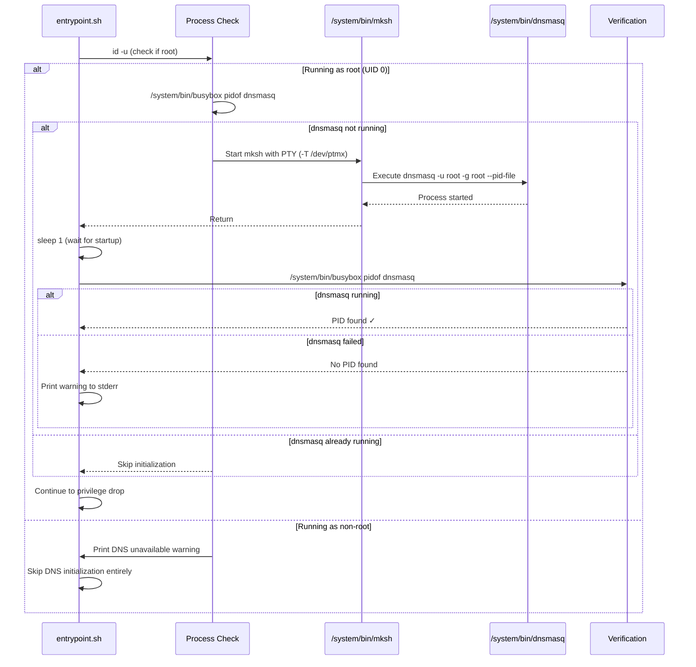
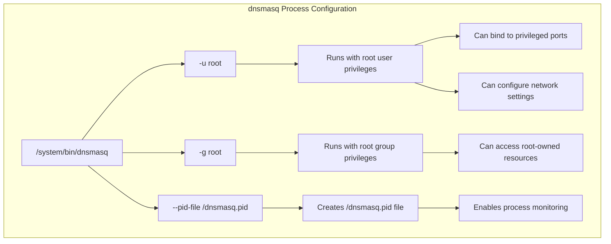
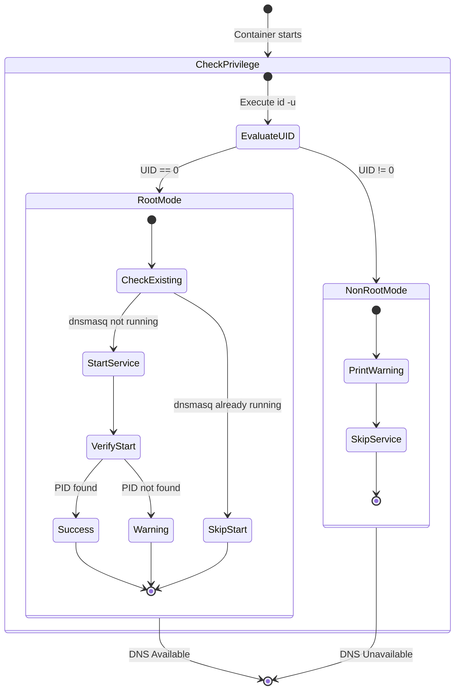
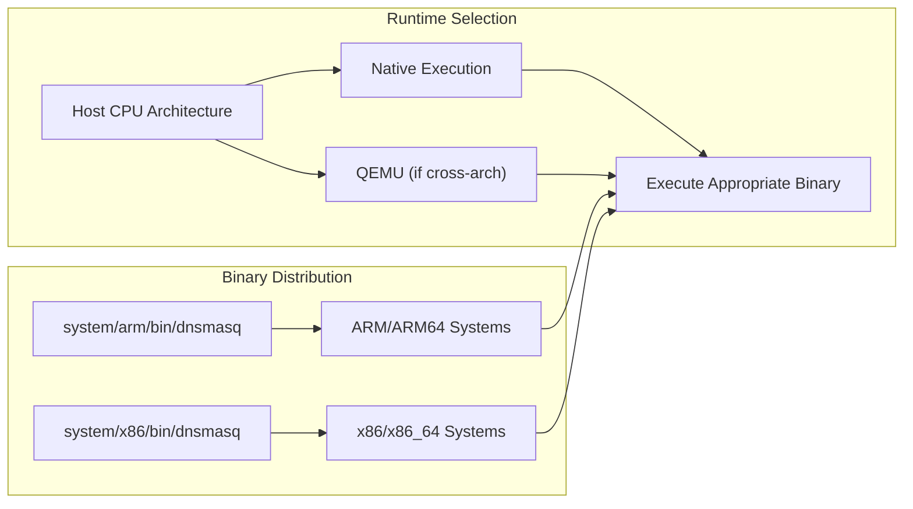
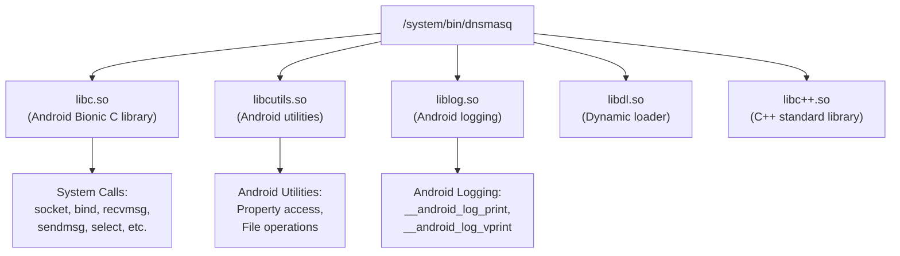
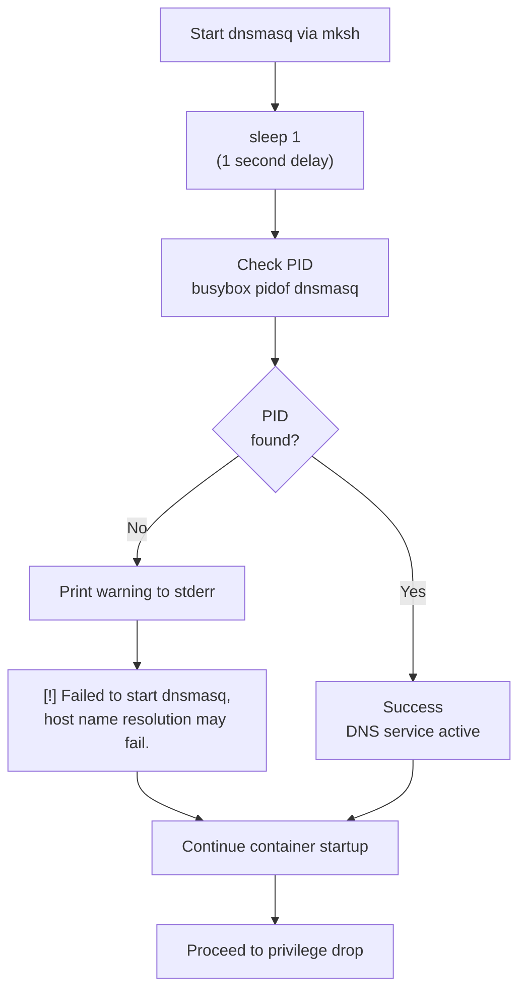
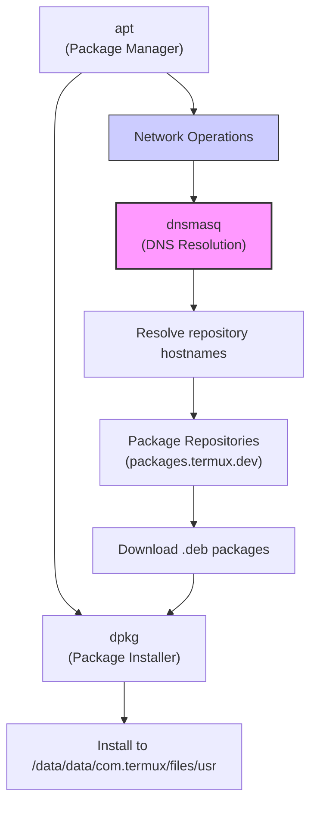

<!-- source: DeepWiki mcp.deepwiki.com · repo termux/termux-docker · page 6.2 Network Services · fetched 2026-10-26 -->

# Network Services

<details>
<summary>Relevant source files</summary>

The following files were used as context for generating this wiki page:

- [entrypoint.sh](entrypoint.sh)
- [system/arm/bin/dnsmasq](system/arm/bin/dnsmasq)
- [system/arm/bin/mksh](system/arm/bin/mksh)
- [system/arm/lib/libcutils.so](system/arm/lib/libcutils.so)
- [system/x86/bin/dnsmasq](system/x86/bin/dnsmasq)
- [system/x86/bin/mksh](system/x86/bin/mksh)
- [system/x86/lib/libcutils.so](system/x86/lib/libcutils.so)

</details>


## Purpose and Scope

This page documents the network service infrastructure in termux-docker, specifically the `dnsmasq` DNS forwarding service. It covers how DNS resolution is initialized, configured, and managed during container startup, and why this service is critical for package management functionality.

For information about the overall container initialization sequence, see [Container Runtime](#4). For details on privilege management and the root vs non-root startup modes, see [Privilege Management](#4.3).

---

## DNS Service Overview

The primary network service in termux-docker is **dnsmasq**, a lightweight DNS forwarder and DHCP server. In this environment, dnsmasq serves exclusively as a DNS resolver, providing name resolution services to containerized processes.

### Role and Criticality

DNS resolution is essential for the Termux package manager (`apt`) to function correctly. Without functioning DNS:
- Package repository URLs cannot be resolved
- Package installations and updates fail
- Network-dependent applications cannot resolve hostnames

The container implements a **best-effort DNS initialization** strategy: if DNS setup fails, the container continues operating but warns the user about the degraded functionality.

**Sources:** [entrypoint.sh:1-35](), High-level diagrams (Diagram 3, Diagram 5)

---

## Service Initialization Process

### Initialization Sequence

The following diagram illustrates the complete dnsmasq initialization flow:



**Sources:** [entrypoint.sh:3-18]()

### Code Implementation

The initialization logic is implemented in `entrypoint.sh`:

```bash
# Check if running as root
if [ "$(id -u)" = "0" ]; then
    # Check if dnsmasq is already running
    if [ -z "$(/system/bin/busybox pidof dnsmasq)" ]; then
        # Start dnsmasq via mksh with PTY allocation
        /system/bin/mksh -T /dev/ptmx -c "/system/bin/dnsmasq -u root -g root --pid-file /dnsmasq.pid" >/dev/null 2>&1
        sleep 1
        
        # Verify startup succeeded
        if [ -z "$(/system/bin/busybox pidof dnsmasq)" ]; then
            echo "[!] Failed to start dnsmasq, host name resolution may fail." >&2
        fi
    fi
else
    # Non-root: DNS unavailable
    echo "[!] Container is running as non-root, unable to start dnsmasq. DNS will be unavailable." >&2
fi
```

**Key Implementation Details:**

1. **Root Check (`id -u`)**: Service initialization only proceeds if the effective UID is 0
2. **Idempotency Check (`busybox pidof`)**: Prevents duplicate dnsmasq instances
3. **PTY Allocation (`mksh -T /dev/ptmx`)**: Ensures proper terminal handling for the subprocess
4. **Startup Delay (`sleep 1`)**: Allows time for the daemon to initialize before verification
5. **Output Suppression (`>/dev/null 2>&1`)**: Keeps initialization quiet unless there's an error

**Sources:** [entrypoint.sh:3-10]()

---

## Configuration and Command-Line Options

### Command-Line Arguments

dnsmasq is invoked with the following flags:

| Flag | Value | Purpose |
|------|-------|---------|
| `-u` | `root` | Run as user `root` (UID 0) |
| `-g` | `root` | Run as group `root` (GID 0) |
| `--pid-file` | `/dnsmasq.pid` | Write process ID to specified file |

### Configuration Analysis



**Notable Characteristics:**

- **No explicit configuration file**: dnsmasq runs with default settings
- **Minimal options**: Only user/group identity and PID file are specified
- **Default DNS behavior**: Forwards queries to system-configured nameservers (typically from `/etc/resolv.conf`)
- **No DHCP functionality**: Only DNS forwarding is enabled by default

**Sources:** [entrypoint.sh:5]()

---

## Privilege Requirements

### Root vs Non-Root Execution Modes



### Privilege Dependency Table

| Capability | Root Required | Reason |
|------------|---------------|--------|
| Bind to port 53 | Yes | Privileged port (<1024) |
| Write to `/dnsmasq.pid` | Yes* | Root filesystem write access |
| Configure network interfaces | Yes | Network configuration requires CAP_NET_ADMIN |
| Access system resolv.conf | No | Readable by all users |

*Depends on filesystem permissions; in this container, root owns `/`

### Non-Root Limitations

When the container runs as a non-root user:

1. **No DNS service**: dnsmasq cannot be started
2. **Warning message**: `[!] Container is running as non-root, unable to start dnsmasq. DNS will be unavailable.`
3. **Degraded functionality**: Package management will fail without external DNS configuration
4. **Direct execution**: The entrypoint proceeds directly to command execution without service initialization

**Sources:** [entrypoint.sh:11-18](), High-level diagrams (Diagram 6)

---

## Architecture Support

### Multi-Architecture Binary Distribution

termux-docker ships architecture-specific dnsmasq binaries:



### Binary Characteristics

#### ARM Binary (`system/arm/bin/dnsmasq`)

- **Format**: ELF 32-bit LSB executable
- **Machine**: ARM
- **Linker**: `/system/bin/linker` (Android dynamic linker)
- **Size**: ~167 KB
- **Platform**: Android/Bionic

#### x86 Binary (`system/x86/bin/dnsmasq`)

- **Format**: ELF 32-bit LSB executable
- **Machine**: Intel 80386
- **Linker**: `/system/bin/linker` (Android dynamic linker)
- **Size**: ~173 KB
- **Platform**: Android/Bionic

Both binaries are compiled for Android's Bionic C library and use the Android linker, not glibc.

**Sources:** [system/arm/bin/dnsmasq:1-10](), [system/x86/bin/dnsmasq:1-10](), High-level diagrams (Diagram 4)

---

## Dependencies

### Library Dependencies

The dnsmasq binary depends on several Android/Bionic libraries:



### Key Library Functions Used

From the binary symbol tables, dnsmasq utilizes:

#### Network Operations (libc.so)
- `socket`, `bind`, `listen`, `accept`, `connect`
- `setsockopt`, `getsockopt`, `getsockname`, `getpeername`
- `recvmsg`, `sendmsg`, `recvfrom`, `sendto`
- `select` (I/O multiplexing)

#### DNS Resolution (libc.so)
- `getaddrinfo`, `freeaddrinfo`, `getnameinfo`
- `inet_addr`, `inet_ntoa`, `inet_ntop`, `inet_pton`

#### Process Management (libc.so)
- `fork`, `exit`, `_exit`, `waitpid`
- `getpid`, `getuid`, `setuid`, `setgid`, `setgroups`
- `prctl`, `capget`, `capset` (Linux capabilities)

#### Android-Specific (libcutils.so)
- Property system access
- Atomic operations
- Configuration handling

**Sources:** [system/arm/bin/dnsmasq](), [system/x86/bin/dnsmasq](), [system/arm/lib/libcutils.so](), [system/x86/lib/libcutils.so]()

---

## Error Handling and Diagnostics

### Failure Detection Mechanism



### Error Messages

| Scenario | Message | Destination |
|----------|---------|-------------|
| Non-root startup | `[!] Container is running as non-root, unable to start dnsmasq. DNS will be unavailable.` | stderr |
| dnsmasq startup failure | `[!] Failed to start dnsmasq, host name resolution may fail.` | stderr |

### Degraded Operation Behavior

When dnsmasq fails to start:

1. **No container termination**: The entrypoint script continues execution
2. **Warning emitted**: Error message printed to stderr for visibility
3. **Continued operation**: User processes are started normally
4. **Limited functionality**: Network operations requiring DNS resolution will fail

This **fail-soft** design prioritizes container availability over complete functionality.

**Sources:** [entrypoint.sh:7-9, 12]()

---

## Integration with Package Management

### Critical Dependency Chain



### Why DNS is Essential

The Termux package manager (`apt`) requires functional DNS resolution to:

1. **Resolve repository URLs**: Default repositories use domain names like `packages.termux.dev`
2. **Download package indexes**: `apt update` fetches package lists from network sources
3. **Retrieve packages**: `apt install` downloads `.deb` files via HTTP/HTTPS

Without DNS:
- `apt update` fails with "Temporary failure resolving 'packages.termux.dev'"
- `apt install` cannot fetch packages
- Manual intervention (editing `/etc/hosts` or using IP addresses) would be required

### Startup Timing

The dnsmasq service starts **before** user processes:

1. Container starts → entrypoint.sh executes
2. dnsmasq initialized (if root)
3. Privileges dropped to system user (UID 1000)
4. User command executed (default: `/usr/bin/login`)

This ensures DNS is available when the package manager is first invoked.

**Sources:** [entrypoint.sh:1-35](), High-level diagrams (Diagram 5)

---

## Summary

The dnsmasq service in termux-docker provides essential DNS forwarding capabilities required for package management. Key characteristics:

- **Lightweight**: Minimal configuration, default settings
- **Privilege-dependent**: Requires root for initialization
- **Best-effort**: Fails gracefully if startup is unsuccessful
- **Multi-architecture**: ARM and x86 binaries provided
- **Android-native**: Built against Bionic C library

The service is automatically managed by the entrypoint script, requiring no user intervention in typical use cases. When running as non-root, DNS must be provided externally or package management functionality will be limited.

**Sources:** All files referenced throughout this document

---

