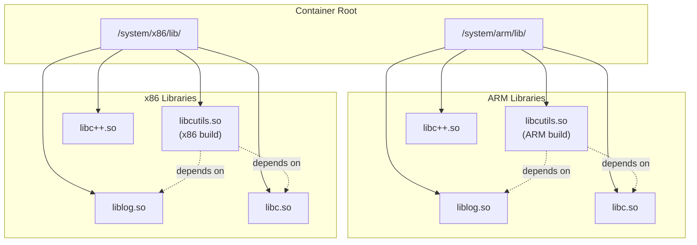
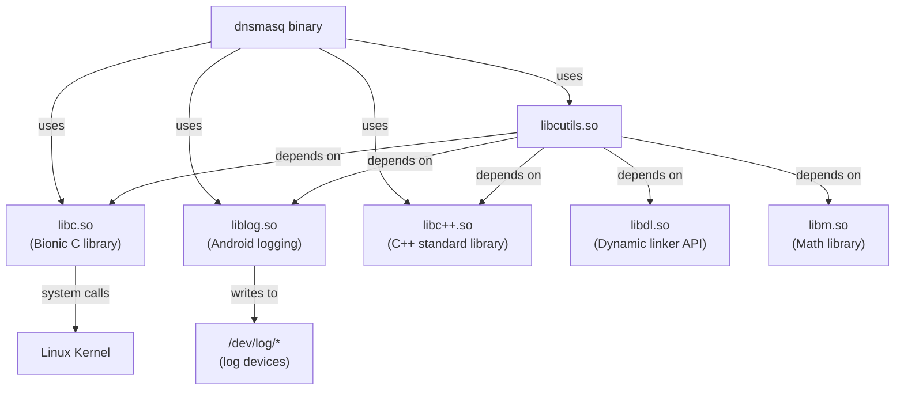
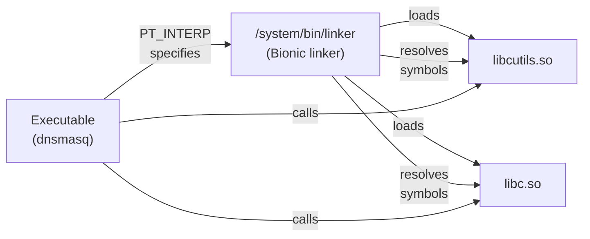
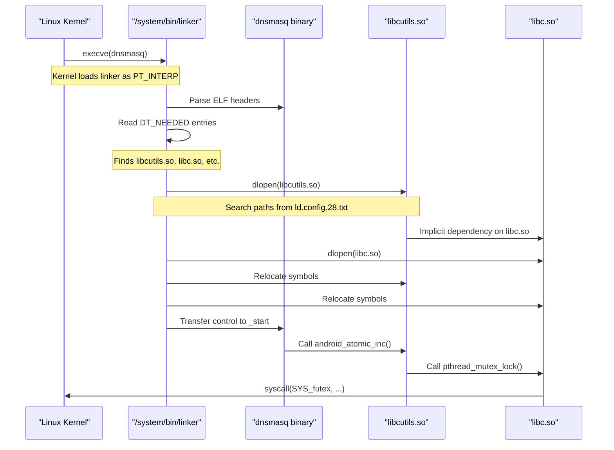
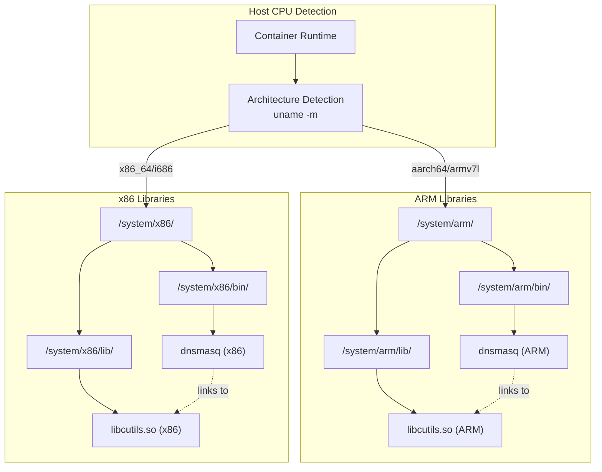

<!-- source: DeepWiki mcp.deepwiki.com · repo termux/termux-docker · page 6.3 System Libraries · fetched 2026-10-26 -->

# System Libraries

Relevant source files

The following files were used as context for generating this wiki page:

- [system/arm/bin/dnsmasq](system/arm/bin/dnsmasq)
- [system/arm/lib/libcutils.so](system/arm/lib/libcutils.so)
- [system/x86/bin/dnsmasq](system/x86/bin/dnsmasq)
- [system/x86/lib/libcutils.so](system/x86/lib/libcutils.so)

This document describes the core system libraries included in the termux-docker container image, focusing on their purpose, functionality, and dependencies. These libraries provide essential Android and POSIX functionality that bridge the gap between the Android userspace environment and the underlying Linux kernel.

For information about the dynamic linker configuration, see [Linker Configuration](#8.1). For details about the system binaries that use these libraries, see [Network Services](#6.2) and [Shell Environment](#6.1).

---

## Overview

The termux-docker container includes a minimal set of system libraries located in architecture-specific directories ([/system/arm/lib/]() and [/system/x86/lib/]()). These libraries originate from Android's system partition and provide:

- **Android-specific utilities** (property system, logging, atomic operations)
- **Filesystem and permission management** (fs_config, multiuser support)
- **Network socket abstractions** (local and network socket helpers)
- **Configuration parsing** (key-value config files)
- **POSIX compatibility layer** (bridging Android to standard Linux)

The primary system library is `libcutils.so` (Android's C utilities library), which serves as the foundation for most system services and utilities.

**Library Organization by Architecture:**

Sources: [system/arm/lib/libcutils.so:1-10]()

---

## libcutils.so: Android C Utilities Library

### Purpose

`libcutils.so` is Android's core C utilities library, providing essential functionality for Android system services and applications. In the termux-docker environment, it enables system binaries like `dnsmasq` to function correctly within Android's execution model.

**Key Characteristics:**
- **Origin**: Android Open Source Project (AOSP) system/core/libcutils
- **Location**: [/system/arm/lib/libcutils.so]() and [/system/x86/lib/libcutils.so]()
- **ABI**: ARM EABI (for ARM) / System V ABI (for x86)
- **Dynamic Linker**: `/system/bin/linker` (Android's Bionic linker)

Sources: [system/arm/lib/libcutils.so:1-100]()

---

### Exported Functionality

The library exports hundreds of functions organized into functional categories:

```mermaid
graph TB
    LIBCUTILS["libcutils.so"]
    
    SOCKET["Socket Utilities"]
    ATOMIC["Atomic Operations"]
    FS["Filesystem Functions"]
    PROPS["Property System"]
    LOG["Logging Functions"]
    CONFIG["Config Parsing"]
    MULTI["Multiuser Support"]
    SCHED["Scheduler Policy"]
    MISC["Miscellaneous"]
    
    LIBCUTILS --> SOCKET
    LIBCUTILS --> ATOMIC
    LIBCUTILS --> FS
    LIBCUTILS --> PROPS
    LIBCUTILS --> LOG
    LIBCUTILS --> CONFIG
    LIBCUTILS --> MULTI
    LIBCUTILS --> SCHED
    LIBCUTILS --> MISC
    
    SOCKET --> SOCKET_LOCAL["socket_local_client<br/>socket_local_server<br/>socket_local_client_connect"]
    SOCKET --> SOCKET_NET["socket_network_client<br/>socket_network_client_timeout<br/>socket_inaddr_any_server"]
    SOCKET --> SOCKET_UTIL["socket_close<br/>socket_peer_is_trusted<br/>socket_get_local_port"]
    
    ATOMIC --> ATOMIC_OPS["android_atomic_inc<br/>android_atomic_dec<br/>android_atomic_add<br/>android_atomic_and"]
    ATOMIC --> ATOMIC_CAS["android_atomic_acquire_cas<br/>android_atomic_release_cas"]
    ATOMIC --> ATOMIC_LOAD["android_atomic_acquire_load<br/>android_atomic_release_load<br/>android_atomic_acquire_store"]
    
    FS --> FS_PERM["fs_config<br/>fs_config_generate<br/>canned_fs_config"]
    FS --> FS_DIR["fs_mkdirs<br/>fs_prepare_dir<br/>fs_prepare_dir_strict"]
    FS --> FS_IO["fs_read_atomic_int<br/>fs_write_atomic_int"]
    
    PROPS --> PROP_GET["property_get<br/>property_get_bool<br/>property_get_int32<br/>property_get_int64"]
    PROPS --> PROP_SET["property_set<br/>property_list"]
    PROPS --> PROP_SYS["__system_property_get<br/>__system_property_set<br/>__system_property_foreach"]
    
    LOG --> LOG_PRINT["__android_log_print<br/>__android_log_vprint<br/>__android_log_write"]
    LOG --> LOG_BUF["__android_log_buf_print<br/>__android_log_buf_write"]
    LOG --> LOG_BINARY["__android_log_bwrite<br/>__android_log_btwrite"]
```

Sources: [system/arm/lib/libcutils.so:1-500]()

---

### Function Categories

#### Socket Utilities

Provides abstractions for creating and managing local (UNIX domain) and network sockets:

| Function | Purpose |
|----------|---------|
| `socket_local_client()` | Create client connection to local socket |
| `socket_local_server()` | Create local server socket |
| `socket_network_client()` | Create TCP client connection |
| `socket_inaddr_any_server()` | Create server socket bound to any interface |
| `socket_get_local_port()` | Retrieve local port number from socket |
| `socket_peer_is_trusted()` | Check if peer has trusted credentials |

These functions abstract POSIX socket APIs with Android-specific behaviors, such as abstract namespace support for UNIX domain sockets and credential checking.

Sources: [system/arm/lib/libcutils.so:1-100](), [system/arm/bin/dnsmasq:1-100]()

#### Atomic Operations

Thread-safe atomic operations for lock-free programming:

| Function | Purpose |
|----------|---------|
| `android_atomic_inc()` | Atomic increment |
| `android_atomic_dec()` | Atomic decrement |
| `android_atomic_add()` | Atomic addition |
| `android_atomic_and()` | Atomic bitwise AND |
| `android_atomic_or()` | Atomic bitwise OR |
| `android_atomic_acquire_cas()` | Atomic compare-and-swap with acquire semantics |
| `android_atomic_release_cas()` | Atomic compare-and-swap with release semantics |
| `android_memory_barrier()` | Full memory barrier |
| `android_compiler_barrier()` | Compiler reordering barrier |

These provide architecture-specific implementations of atomic operations with defined memory ordering semantics.

Sources: [system/arm/lib/libcutils.so:1-100]()

#### Filesystem Operations

Android-specific filesystem utilities for permission management and directory preparation:

| Function | Purpose |
|----------|---------|
| `fs_config()` | Get default Android permissions for path |
| `fs_config_generate()` | Generate filesystem config |
| `fs_mkdirs()` | Create directory hierarchy |
| `fs_prepare_dir()` | Create and set permissions on directory |
| `fs_prepare_dir_strict()` | Strictly prepare directory with validation |
| `fs_prepare_file_strict()` | Prepare file with strict permissions |
| `fs_read_atomic_int()` | Atomically read integer from file |
| `fs_write_atomic_int()` | Atomically write integer to file |

The `fs_config` family of functions implements Android's permission model, assigning appropriate UIDs, GIDs, and permissions based on path patterns.

Sources: [system/arm/lib/libcutils.so:1-100]()

#### Property System

Android's system-wide key-value property store:

| Function | Purpose |
|----------|---------|
| `property_get()` | Read property value |
| `property_set()` | Write property value |
| `property_get_bool()` | Read boolean property |
| `property_get_int32()` | Read 32-bit integer property |
| `property_get_int64()` | Read 64-bit integer property |
| `property_list()` | Enumerate all properties |
| `__system_property_get()` | Low-level property read |
| `__system_property_set()` | Low-level property write |
| `__system_property_foreach()` | Iterate over properties |

Properties are stored in shared memory and provide a lightweight mechanism for system configuration and inter-process communication.

Sources: [system/arm/lib/libcutils.so:1-100]()

#### Configuration Parsing

Simple configuration file parser for key-value pairs:

| Function | Purpose |
|----------|---------|
| `config_load()` | Load configuration from buffer |
| `config_load_file()` | Load configuration from file |
| `config_find()` | Find configuration node by path |
| `config_bool()` | Get boolean value |
| `config_str()` | Get string value |
| `config_node()` | Get child node |
| `config_set()` | Set configuration value |
| `config_free()` | Free configuration structure |

This provides a tree-structured configuration format used by some Android services.

Sources: [system/arm/lib/libcutils.so:1-100]()

#### Multiuser Support

Android's multiuser UID/GID management:

| Function | Purpose |
|----------|---------|
| `multiuser_get_uid()` | Construct UID from user ID and app ID |
| `multiuser_get_user_id()` | Extract user ID from UID |
| `multiuser_get_app_id()` | Extract app ID from UID |
| `multiuser_get_shared_app_gid()` | Get shared GID for app |

Android uses a UID range system where the first 100,000 UIDs are for the primary user, the next 100,000 for secondary user 1, etc. These functions manipulate UIDs according to this scheme.

Sources: [system/arm/lib/libcutils.so:1-100]()

#### Scheduler Policy

CPU scheduler policy management:

| Function | Purpose |
|----------|---------|
| `set_sched_policy()` | Set thread scheduler policy |
| `get_sched_policy()` | Get thread scheduler policy |
| `get_sched_policy_name()` | Get human-readable policy name |
| `set_cpuset_policy()` | Set thread CPU set |

These functions manage Linux scheduler policies and CPU affinity with Android-specific policy names and behaviors.

Sources: [system/arm/lib/libcutils.so:1-100]()

#### Logging Functions

Android's structured logging system:

| Function | Purpose |
|----------|---------|
| `__android_log_print()` | Print formatted log message |
| `__android_log_vprint()` | Print log message (va_list) |
| `__android_log_write()` | Write raw log message |
| `__android_log_buf_print()` | Print to specific log buffer |
| `__android_log_buf_write()` | Write to specific log buffer |
| `__android_log_bwrite()` | Write binary log event |
| `__android_log_assert()` | Log assertion failure |

Android maintains separate log buffers (main, system, radio, events) with priority levels (VERBOSE, DEBUG, INFO, WARN, ERROR, FATAL).

Sources: [system/arm/lib/libcutils.so:1-100]()

---

### Library Dependencies

**Dependency Details:**

| Library | Role | Key Functions Used by libcutils.so |
|---------|------|-------------------------------------|
| `libc.so` | C standard library | malloc, free, open, close, pthread_*, socket, bind, listen, etc. |
| `liblog.so` | Android logging | __android_log_vprint, __android_log_buf_print |
| `libc++.so` | C++ runtime | C++ exception handling, RTTI |
| `libdl.so` | Dynamic linking | dladdr (symbol lookup) |
| `libm.so` | Math functions | Floating-point math operations |

Sources: [system/arm/lib/libcutils.so:1-100](), [system/arm/bin/dnsmasq:1-50]()

---

## Bionic Dynamic Linker

The Android Bionic dynamic linker (`ld-android.so`) is responsible for loading shared libraries and resolving symbols at runtime. In the termux-docker container, binaries reference `/system/bin/linker` as their interpreter.

**Key Characteristics:**
- **Location**: `/system/bin/linker` (32-bit) or `/system/bin/linker64` (64-bit)
- **Symbol**: `ld-android.so` (library form)
- **Configuration**: Controlled by `ld.config.28.txt` (see [Linker Configuration](#8.1))

**Dynamic Linker Functions:**

The linker exports functions for runtime symbol resolution:

| Function | Purpose |
|----------|---------|
| `dladdr()` | Get information about a symbol address |
| `__gnu_Unwind_Find_exidx()` | ARM exception handling support |

These are used by libcutils.so for introspection and exception unwinding.

Sources: [system/arm/lib/libcutils.so:1-100](), [system/arm/bin/dnsmasq:1-10]()

---

## Other System Libraries

### liblog.so

Android's logging library, providing structured logging to kernel log buffers:

- **Log Buffers**: main, system, radio, events, crash
- **Priority Levels**: VERBOSE (2) through FATAL (6)
- **Output**: Writes to `/dev/log/main`, `/dev/log/system`, etc.

Key exported functions:
- `__android_log_print()` - Printf-style logging
- `__android_log_write()` - Raw message logging  
- `__android_log_buf_print()` - Buffer-specific logging

Sources: [system/arm/lib/libcutils.so:1-100]()

### libc.so (Bionic)

Android's C standard library, based on BSD libc with optimizations:

- **Memory Management**: malloc, free, calloc, realloc
- **String Operations**: Fortified versions (__strcpy_chk, __strlen_chk, etc.)
- **System Calls**: Wrappers for Linux syscalls
- **Threading**: pthread_* family of functions
- **Networking**: socket, bind, listen, connect, etc.

**Fortified Functions**: Bionic provides buffer overflow protection through "checked" variants like:
- `__read_chk()`, `__write_chk()` - Size-checked I/O
- `__strcpy_chk()`, `__strcat_chk()` - Size-checked string operations
- `__FD_SET_chk()`, `__FD_ISSET_chk()` - Size-checked fd_set operations

Sources: [system/arm/lib/libcutils.so:1-100]()

### libc++.so

LLVM's C++ standard library implementation:

- **RTTI**: Runtime Type Information
- **Exceptions**: C++ exception handling
- **STL**: Standard Template Library components
- **Atomics**: C++11 atomic operations

Sources: [system/arm/lib/libcutils.so:1-100]()

### libm.so

Mathematical functions library:

- **Floating Point**: sin, cos, tan, exp, log, etc.
- **Conversions**: Float/integer conversions (__aeabi_f2d, __aeabi_i2f, etc.)
- **ARM EABI Helpers**: Division (__aeabi_uidiv, __aeabi_ldivmod, etc.)

Sources: [system/arm/lib/libcutils.so:1-100]()

---

## Library Loading Process

**Search Path Resolution:**

1. **LD_LIBRARY_PATH** (if set and permitted)
2. **DT_RUNPATH** (if present in ELF)
3. **Linker Config** (`/system/etc/ld.config.28.txt` namespace rules)
4. **Default paths**: `/system/lib`, `/vendor/lib`

In the termux-docker container, libraries are found in architecture-specific directories:
- ARM: `/system/arm/lib/`
- x86: `/system/x86/lib/`

Sources: [system/arm/lib/libcutils.so:1-50]()

---

## Cross-Architecture Support

The container includes parallel library sets for different CPU architectures, allowing the same image to run on ARM and x86 hosts:

**Architecture Mapping:**

| Host Architecture | Container Path Used |
|-------------------|---------------------|
| aarch64 (64-bit ARM) | `/system/arm/` |
| armv7l (32-bit ARM) | `/system/arm/` |
| x86_64 (64-bit x86) | `/system/x86/` |
| i686 (32-bit x86) | `/system/x86/` |

**Binary Compatibility:**
- ARM binaries can run on ARM hosts natively
- x86 binaries can run on x86 hosts natively
- Cross-architecture execution requires QEMU (see [Cross-Platform Execution](#5.2))

Each architecture's libraries are compiled for their respective ABIs:
- **ARM**: ARM EABI (Embedded Application Binary Interface)
- **x86**: System V ABI for i386/x86-64

Sources: [system/arm/lib/libcutils.so:1-10](), [system/arm/bin/dnsmasq:1-10]()

---

## Summary

The termux-docker container includes essential Android system libraries that provide:

1. **libcutils.so** - Core Android utilities for sockets, atomics, filesystem, properties, logging
2. **libc.so** - Bionic C library with fortified functions and system call wrappers
3. **liblog.so** - Structured logging to Android log buffers
4. **libc++.so** - C++ standard library and runtime support
5. **libm.so** - Mathematical functions and ARM EABI helpers

These libraries enable Android-based system services (like `dnsmasq`) to run in a containerized environment while maintaining compatibility with Android's execution model. The multi-architecture design allows the same container image to run on both ARM and x86 hosts by including parallel library sets in `/system/arm/lib/` and `/system/x86/lib/`.

For detailed linker configuration and namespace isolation, see [Linker Configuration](#8.1). For information about how these libraries are used by system services, see [Network Services](#6.2).

Sources: [system/arm/lib/libcutils.so:1-500](), [system/arm/bin/dnsmasq:1-100]()

---

