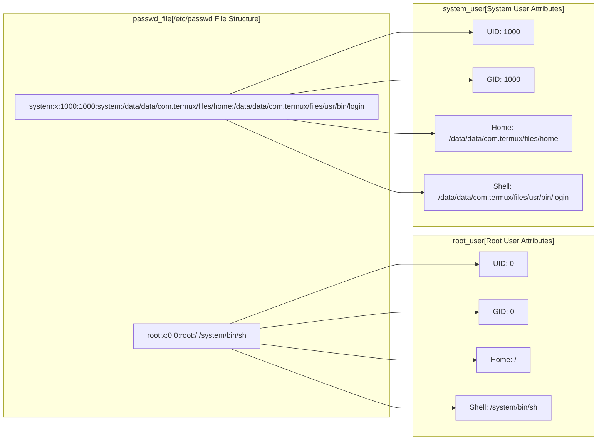
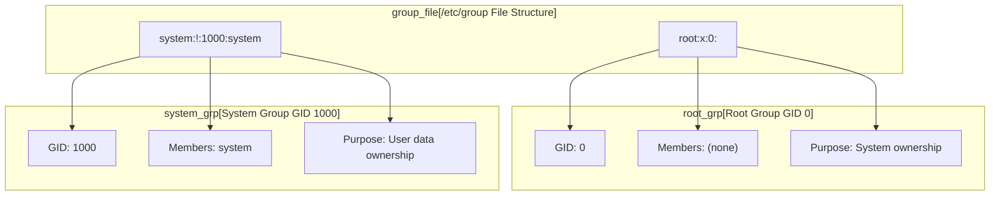
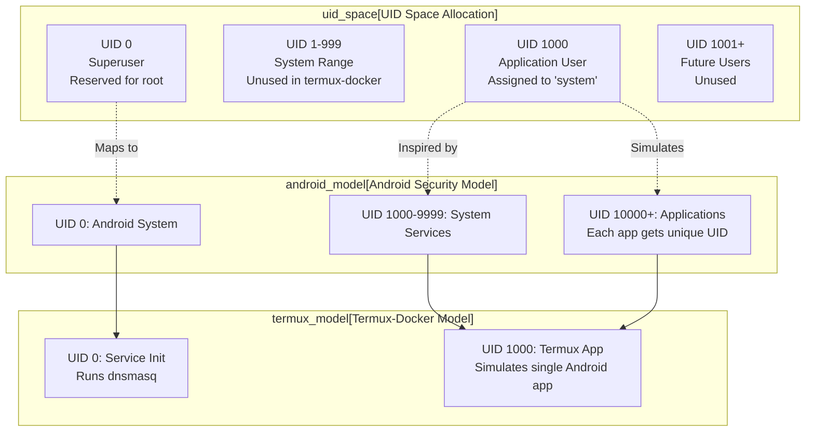
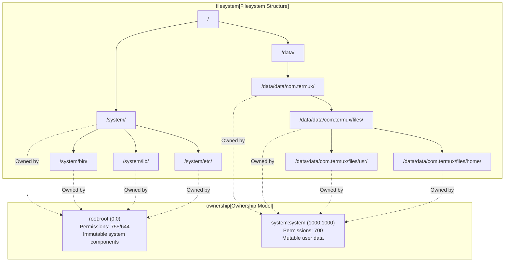
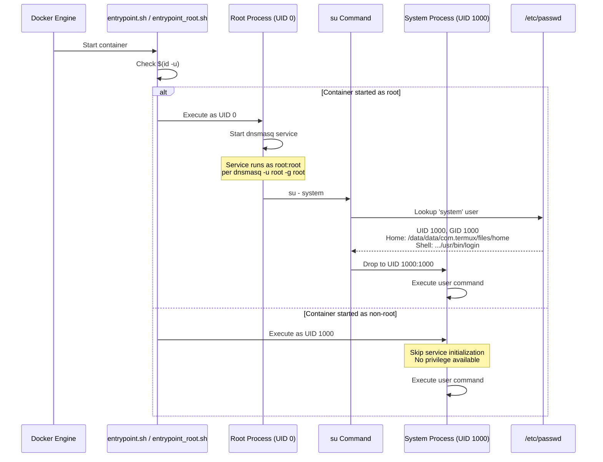

<!-- source: DeepWiki mcp.deepwiki.com · repo termux/termux-docker · page 6.4 User and Group Configuration · fetched 2026-10-26 -->

# User and Group Configuration

<details>
<summary>Relevant source files</summary>

The following files were used as context for generating this wiki page:

- [Dockerfile](Dockerfile)
- [entrypoint_root.sh](entrypoint_root.sh)
- [system/arm/etc/group](system/arm/etc/group)
- [system/arm/etc/passwd](system/arm/etc/passwd)
- [system/x86/etc/group](system/x86/etc/group)
- [system/x86/etc/passwd](system/x86/etc/passwd)

</details>


This document describes the user and group configuration system in termux-docker, including the `/etc/passwd` and `/etc/group` files, UID/GID assignments, and the ownership model that separates system components from user data. This configuration implements a two-user privilege model inspired by Android's application security architecture.

For information about how these users are utilized during container startup, see [Privilege Management](#4.3). For details on filesystem ownership patterns, see [Filesystem Layout](#7).

## Overview

The termux-docker system defines exactly two users and two groups across all architectures. This minimal configuration separates privileged system operations (performed by `root`) from unprivileged user operations (performed by `system`), implementing defense-in-depth security through strict privilege separation.

Both architecture variants (x86 and ARM) use identical user/group configurations, with the files stored in architecture-specific paths:
- `/system/x86/etc/passwd` and `/system/x86/etc/group`
- `/system/arm/etc/passwd` and `/system/arm/etc/group`

During image build, these files are symlinked to `/etc/passwd` and `/etc/group` [Dockerfile:51-52]() to provide standard Unix paths for authentication and authorization operations.

**Sources:** [Dockerfile:45-59](), [system/x86/etc/passwd:1-3](), [system/x86/etc/group:1-3]()

## User Definitions

The `/etc/passwd` file defines two users with the standard Unix passwd format: `username:password:UID:GID:GECOS:home:shell`.



### Root User

The `root` user entry in `/etc/passwd`:
```
root:x:0:0:root:/:/system/bin/sh
```

| Field | Value | Purpose |
|-------|-------|---------|
| Username | `root` | Traditional Unix superuser name |
| Password | `x` | Placeholder (authentication disabled) |
| UID | `0` | Superuser identifier |
| GID | `0` | Root group identifier |
| GECOS | `root` | User description field |
| Home Directory | `/` | Root filesystem (not actively used) |
| Login Shell | `/system/bin/sh` | Basic POSIX shell from Android system |

The root user is used exclusively for system service initialization, specifically starting `dnsmasq` [entrypoint_root.sh:9](). The home directory is set to `/` as root operations do not require a persistent home environment. The shell is `/system/bin/sh` (a basic shell) rather than the full Termux login shell.

**Sources:** [system/x86/etc/passwd:1](), [system/arm/etc/passwd:1]()

### System User

The `system` user entry in `/etc/passwd`:
```
system:x:1000:1000:system:/data/data/com.termux/files/home:/data/data/com.termux/files/usr/bin/login
```

| Field | Value | Purpose |
|-------|-------|---------|
| Username | `system` | Android system service convention |
| Password | `x` | Placeholder (authentication disabled) |
| UID | `1000` | First non-root UID, Android app pattern |
| GID | `1000` | Matching primary group |
| GECOS | `system` | User description field |
| Home Directory | `/data/data/com.termux/files/home` | Persistent user storage |
| Login Shell | `/data/data/com.termux/files/usr/bin/login` | Termux login session manager |

The `system` user represents the unprivileged container user who owns all Termux data and runs all user processes. The UID of 1000 follows Android's convention where application UIDs start at 10000, but this container uses 1000 as the single application user. The login shell is set to `/data/data/com.termux/files/usr/bin/login`, which provides a full Termux interactive session.

**Sources:** [system/x86/etc/passwd:2](), [system/arm/etc/passwd:2](), [Dockerfile:78]()

## Group Definitions

The `/etc/group` file defines two groups with the standard Unix group format: `groupname:password:GID:members`.



### Root Group

The `root` group entry in `/etc/group`:
```
root:x:0:
```

| Field | Value | Purpose |
|-------|-------|---------|
| Group Name | `root` | Superuser group |
| Password | `x` | Placeholder (group passwords unused) |
| GID | `0` | Superuser group identifier |
| Members | (empty) | No additional members beyond root user |

The root group (GID 0) is the primary group for the root user. It owns all system binaries and immutable configuration files under `/system/`.

**Sources:** [system/x86/etc/group:1](), [system/arm/etc/group:1]()

### System Group

The `system` group entry in `/etc/group`:
```
system:!:1000:system
```

| Field | Value | Purpose |
|-------|-------|---------|
| Group Name | `system` | User application group |
| Password | `!` | Locked password field (no group authentication) |
| GID | `1000` | Matches system user's UID |
| Members | `system` | Explicitly lists system user as member |

The system group (GID 1000) is the primary group for the system user and owns all mutable user data under `/data/data/com.termux/`. The password field uses `!` (locked) rather than `x` (shadowed), indicating that group authentication is not permitted.

**Sources:** [system/x86/etc/group:2](), [system/arm/etc/group:2]()

## UID/GID Assignment Strategy



The UID/GID assignment strategy follows these principles:

1. **UID 0 (root)**: Reserved exclusively for privileged system operations, primarily service initialization. This user is never used for interactive sessions or package operations.

2. **UID 1000 (system)**: The single unprivileged user representing the Termux application environment. This UID is chosen to:
   - Follow Unix convention where 1000 is the first regular user UID
   - Reference Android's system service UID range (1000-9999)
   - Simulate Android's per-application UID isolation model with a single application
   - Avoid conflicts with Android's application UID range (10000+)

3. **UIDs 1-999**: Unused system UID range, reserved for potential future system users.

4. **UIDs 1001+**: Unused user UID range, available for future multi-user scenarios.

This minimal two-user model provides the essential privilege separation needed for secure container operation while maintaining simplicity. The system does not support multiple unprivileged users, as the container is designed to simulate a single Android application environment.

**Sources:** [Dockerfile:46-50](), [system/x86/etc/passwd:1-3]()

## Ownership and Permission Model

The image build process establishes strict filesystem ownership boundaries that enforce privilege separation:



### System Component Ownership

All files under `/system/` are owned by `root:root` (0:0) and configured with restrictive permissions [Dockerfile:49]():

- **Directories**: Mode 755 (rwxr-xr-x) - root write, all read/execute [Dockerfile:53]()
- **Executable files**: Mode 755 (rwxr-xr-x) - root write, all read/execute [Dockerfile:54]()
- **Non-executable files**: Mode 644 (rw-r--r--) - root write, all read [Dockerfile:55]()

This ownership pattern ensures that system binaries, libraries, and configuration files cannot be modified by unprivileged users, protecting against accidental or malicious corruption.

**Sources:** [Dockerfile:49](), [Dockerfile:53-55]()

### User Data Ownership

All files under `/data/data/com.termux/` are owned by `system:system` (1000:1000) [Dockerfile:50]():

- **All user files**: Mode 700/600 (restricted to owner only) [Dockerfile:57]()
- **Package executables**: Mode 700 in `usr/bin/`, `usr/lib/apt/`, `usr/libexec/` [Dockerfile:59]()

The restrictive 700 permission (rwx------) on user directories ensures complete isolation from other users, following Android's application sandbox model. The user has full read/write/execute permissions on their own data, while other users (if any existed) would have no access.

**Sources:** [Dockerfile:50](), [Dockerfile:56-59]()

### Ownership Setup Process

The ownership configuration is established during image build through a series of `chown` and `chmod` operations [Dockerfile:45-59]():

1. **Reset system ownership**: `chown -Rh 0:0 /system` sets all system files to root
2. **Set user ownership**: `chown -Rh 1000:1000 /data/data/com.termux` transfers Termux data to system user
3. **Create passwd/group symlinks**: Links architecture-specific files to `/etc/`
4. **Apply system permissions**: Recursively sets 755 for directories, 755 for executables, 644 for others
5. **Restrict user permissions**: Strips group/other permissions (g-rwx,o-rwx) from Termux files
6. **Secure executables**: Sets 700 on critical binary directories

This process ensures a consistent, secure ownership model across all container instances.

**Sources:** [Dockerfile:45-59]()

## Integration with Container Initialization



The user and group configuration directly impacts container initialization behavior:

1. **Root initialization** [entrypoint_root.sh:3-6](): When the container starts as UID 0, the `entrypoint_root.sh` script verifies root privileges, initializes services, then drops to the `system` user using `su`.

2. **User lookup**: The `su` command reads `/etc/passwd` to determine the target user's UID, GID, home directory, and login shell [system/x86/etc/passwd:2]().

3. **Privilege transition**: The kernel changes the process effective UID/GID from 0:0 to 1000:1000, losing all root privileges.

4. **Session initialization**: The `system` user's shell (`/data/data/com.termux/files/usr/bin/login`) is executed, setting up the Termux environment with proper `HOME` and environment variables.

5. **File access**: All subsequent operations are subject to the permission model, with the process able to modify files in `/data/data/com.termux/` but only read files in `/system/`.

**Sources:** [entrypoint_root.sh:1-20](), [Dockerfile:66](), [Dockerfile:91]()

## Android Security Model Mapping

The user and group configuration in termux-docker deliberately mirrors Android's application security architecture:

| Android Concept | Termux-Docker Implementation | Purpose |
|----------------|------------------------------|---------|
| System UID 0 | `root` user (UID 0) | System-level operations, service management |
| Application UID | `system` user (UID 1000) | Represents single Android application (Termux) |
| Application data directory | `/data/data/com.termux/` | Isolated storage for application, owned by app UID |
| Application home | `/data/data/com.termux/files/home/` | User-visible storage within app data |
| System binaries | `/system/bin/`, `/system/lib/` | Android OS components, read-only to apps |
| Per-app isolation | UID 1000 ownership with 700 permissions | No access from other UIDs (if they existed) |

The key difference is that Android uses UIDs 10000+ for applications and would assign unique UIDs to different apps for isolation. Termux-docker uses UID 1000 as it simulates a single application environment, not multiple concurrent applications. The single-user model is sufficient because:

1. Each container instance represents one Termux application environment
2. Multiple users can be isolated by running separate containers
3. The simplified model reduces complexity while maintaining security

This mapping ensures that tools expecting Android's security model (like Termux packages) function correctly within the container environment.

**Sources:** [Dockerfile:76-83](), [system/x86/etc/passwd:1-3](), [Dockerfile:45-59]()

---

