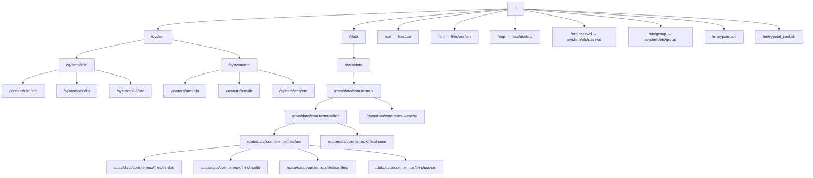
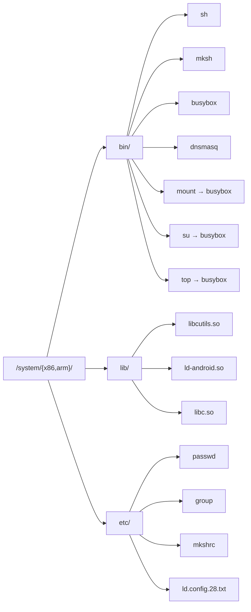
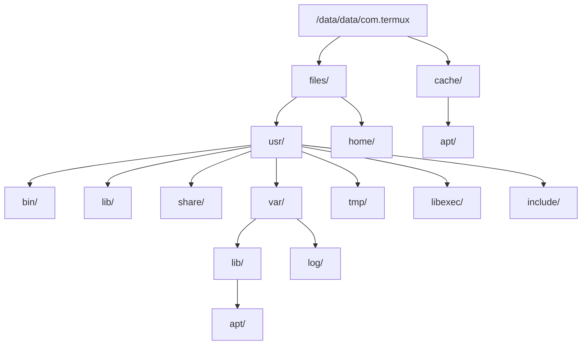
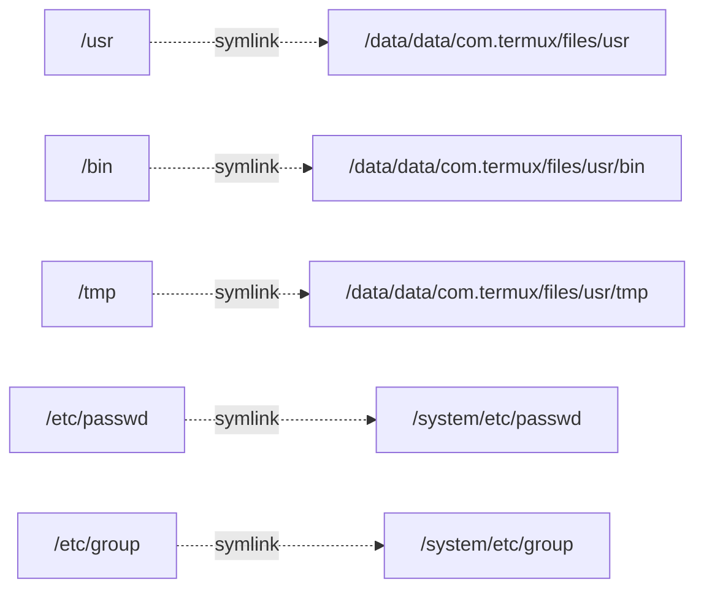
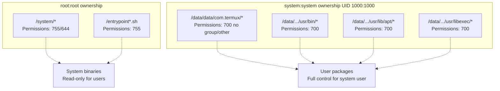
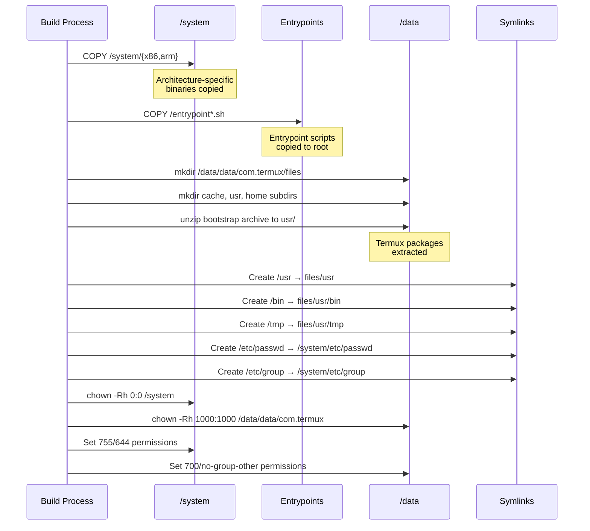

<!-- source: DeepWiki mcp.deepwiki.com · repo termux/termux-docker · page 7 Filesystem Layout · fetched 2026-10-26 -->

# Filesystem Layout

Relevant source files

The following files were used as context for generating this wiki page:

- [Dockerfile](Dockerfile)
- [entrypoint_root.sh](entrypoint_root.sh)
- [system/arm/etc/group](system/arm/etc/group)
- [system/arm/etc/passwd](system/arm/etc/passwd)
- [system/x86/etc/group](system/x86/etc/group)
- [system/x86/etc/passwd](system/x86/etc/passwd)

This document describes the complete filesystem structure of the termux-docker container image. It covers the directory hierarchy, the dual-architecture system layout, the Android-style Termux user space, compatibility symlinks, and the ownership/permission model.

For information about how architecture-specific binaries are selected at runtime, see [Multi-Architecture Support](#5). For details on the user and group definitions that govern filesystem ownership, see [User and Group Configuration](#6.4). For the process that creates this filesystem during image build, see [Bootstrap Process](#8.2).

## Filesystem Overview

The termux-docker container uses a hybrid filesystem architecture that combines:
- **Android system structure**: Architecture-specific binaries under `/system/{x86,arm}/`
- **Android application model**: Termux user space under `/data/data/com.termux/`
- **Linux compatibility**: Symlinks providing standard paths like `/usr`, `/bin`, `/tmp`

This design allows the same container image to support multiple CPU architectures while maintaining Android's security model of per-application directories with strict ownership boundaries.

### Complete Directory Structure

**Sources:** [Dockerfile:14](), [Dockerfile:22-36](), [Dockerfile:51-52]()

## System Directory Hierarchy

The `/system` directory contains architecture-specific binaries and configuration files required for basic system operation before the Termux environment is initialized. The structure follows Android's system partition layout.

### Architecture-Specific Directories

The container includes two complete system trees:

| Directory | Purpose | Owner | Permissions |
|-----------|---------|-------|-------------|
| `/system/x86/` | x86/x86_64 architecture binaries | root:root | 755 (dirs), 755 (exec), 644 (files) |
| `/system/arm/` | ARM/ARM64 architecture binaries | root:root | 755 (dirs), 755 (exec), 644 (files) |

At runtime, the appropriate architecture's binaries are used based on the host system. The unused architecture tree remains in the image but is ignored.

**Sources:** [Dockerfile:14](), [Dockerfile:49](), [Dockerfile:53-55]()

### System Directory Contents

Each architecture directory contains the following structure:

**Sources:** [Dockerfile:14](), [Dockerfile:41-43]()

#### Key Binaries

| Binary | Path | Purpose |
|--------|------|---------|
| `sh` | `/system/{arch}/bin/sh` | POSIX shell, used as SHELL in early build stages |
| `mksh` | `/system/{arch}/bin/mksh` | MirBSD Korn Shell, provides PTY support for dnsmasq |
| `busybox` | `/system/{arch}/bin/busybox` | Multi-call binary providing Unix utilities |
| `dnsmasq` | `/system/{arch}/bin/dnsmasq` | DNS forwarder, critical for package management |

The busybox binary is symlinked to provide additional utilities: `df`, `mount`, `ping`, `ping6`, `su`, `top`, `umount`.

**Sources:** [Dockerfile:41-43]()

#### System Libraries

| Library | Purpose |
|---------|---------|
| `libcutils.so` | Android C utility functions |
| `ld-android.so` | Bionic dynamic linker (loads shared libraries) |
| `libc.so` | Standard C library implementation |

**Sources:** [Dockerfile:14]()

#### Configuration Files

| File | Path | Purpose |
|------|------|---------|
| `passwd` | `/system/{arch}/etc/passwd` | User account definitions (root, system) |
| `group` | `/system/{arch}/etc/group` | Group definitions (root, system) |
| `mkshrc` | `/system/{arch}/etc/mkshrc` | Shell initialization script |
| `ld.config.28.txt` | `/system/{arch}/etc/ld.config.28.txt` | Dynamic linker configuration |

The `/etc/passwd` and `/etc/group` files in the root filesystem are symlinks to the architecture-specific copies.

**Sources:** [Dockerfile:51-52](), [system/x86/etc/passwd:1-2](), [system/x86/etc/group:1-2]()

## Termux User Space

The `/data/data/com.termux` directory contains the complete Termux environment, following Android's application directory structure. This path mirrors the location used by Termux on actual Android devices.

### Directory Structure

**Sources:** [Dockerfile:22-24]()

### Termux Prefix (`$PREFIX`)

The `/data/data/com.termux/files/usr` directory is the Termux "prefix" (stored in the `$PREFIX` environment variable). It contains all user-installed packages and acts as the equivalent of `/usr` on traditional Linux systems.

| Subdirectory | Purpose |
|--------------|---------|
| `bin/` | Executable programs (apt, bash, python, etc.) |
| `lib/` | Shared libraries for Termux packages |
| `share/` | Architecture-independent data files |
| `var/lib/apt/` | APT package manager state |
| `var/log/apt/` | APT operation logs |
| `tmp/` | Temporary files |
| `libexec/` | Internal executables not directly invoked by users |
| `include/` | C/C++ header files |

**Sources:** [Dockerfile:81]()

### User Home Directory

The `/data/data/com.termux/files/home` directory serves as the home directory for the `system` user (UID 1000). It is set via the `$HOME` environment variable and serves as the working directory for user sessions.

**Sources:** [Dockerfile:78](), [Dockerfile:87](), [system/x86/etc/passwd:2]()

### Cache Directory

The `/data/data/com.termux/cache` directory stores temporary cache data, primarily used by the APT package manager to cache downloaded `.deb` files during package operations.

**Sources:** [Dockerfile:24](), [Dockerfile:69]()

## Compatibility Symlinks

To bridge Android's filesystem conventions with standard Linux paths, the container creates several symlinks at the root level:

**Sources:** [Dockerfile:34-36](), [Dockerfile:51-52]()

### Primary Symlinks

| Symlink | Target | Purpose |
|---------|--------|---------|
| `/usr` | `/data/data/com.termux/files/usr` | Standard Unix prefix path |
| `/bin` | `/data/data/com.termux/files/usr/bin` | Standard binary directory |
| `/tmp` | `/data/data/com.termux/files/usr/tmp` | Standard temporary directory |
| `/etc/passwd` | `/system/etc/passwd` | User account database |
| `/etc/group` | `/system/etc/group` | Group database |

These symlinks allow scripts and programs expecting standard Linux paths to function correctly within the Android-style filesystem structure.

**Sources:** [Dockerfile:34-36](), [Dockerfile:51-52]()

### Bootstrap Symlinks

During the bootstrap extraction process, additional symlinks are created within the Termux prefix based on the `SYMLINKS.txt` file included in the bootstrap archive. These symlinks connect alternative installation directories and provide command aliases.

**Sources:** [Dockerfile:28-33]()

## Ownership and Permissions Model

The filesystem uses a strict two-tier ownership model that separates system files from user content:

**Sources:** [Dockerfile:45-59]()

### Ownership Rules

The ownership is set during image build as follows:

| Path | Owner:Group | Set By |
|------|-------------|--------|
| `/system/**` | `root:root` (0:0) | [Dockerfile:49]() |
| `/data/data/com.termux/**` | `system:system` (1000:1000) | [Dockerfile:50]() |
| `/entrypoint*.sh` | `root:root` (0:0) | Default (copied before chown) |

**Sources:** [Dockerfile:49-50]()

### Permission Model

Permissions are applied in layers:

1. **System directories**: All directories under `/system` receive `755` permissions
2. **System executables**: Executable files under `/system` receive `755` permissions
3. **System non-executables**: Non-executable files under `/system` receive `644` permissions
4. **Data directories**: All directories under `/data` receive `755` permissions
5. **Termux files**: All files and directories under `/data/data/com.termux/files` receive `g-rwx,o-rwx` (removing all group and other permissions)
6. **Critical executables**: Files in `usr/bin`, `usr/lib/apt`, and `usr/libexec` receive `700` permissions

This model ensures:
- System files are immutable to non-root users
- Termux user content is completely isolated (no group or other access)
- Package management tools have restricted execute permissions

**Sources:** [Dockerfile:53-59]()

## Path Resolution and Environment Variables

The container environment is configured with variables that define key filesystem paths:

| Variable | Value | Purpose |
|----------|-------|---------|
| `ANDROID_DATA` | `/data` | Android data partition root |
| `ANDROID_ROOT` | `/system` | Android system partition root |
| `HOME` | `/data/data/com.termux/files/home` | User home directory |
| `PATH` | `/data/data/com.termux/files/usr/bin` | Executable search path |
| `PREFIX` | `/data/data/com.termux/files/usr` | Termux installation prefix |
| `TMPDIR` | `/data/data/com.termux/files/usr/tmp` | Temporary directory |

These environment variables are set in the final image and are available to all processes running in the container.

**Sources:** [Dockerfile:76-82]()

### Shell Configuration

During early build stages (bootstrap phase), the `PATH` is set to `/system/bin` and the shell is `/system/bin/sh`. After bootstrap extraction, the `PATH` changes to `/data/data/com.termux/files/usr/bin` and the shell becomes `/data/data/com.termux/files/usr/bin/sh`.

**Sources:** [Dockerfile:11](), [Dockerfile:62](), [Dockerfile:88]()

## Special Files

### Entrypoint Scripts

Two entrypoint scripts exist at the root level:

| Script | Purpose | Execution |
|--------|---------|-----------|
| `/entrypoint.sh` | Default entrypoint | Handles privilege detection and routing |
| `/entrypoint_root.sh` | Root-only entrypoint | Starts services, drops privileges |

These scripts are not owned by any directory hierarchy; they exist as standalone files in the root filesystem.

**Sources:** [Dockerfile:17-18](), [Dockerfile:90]()

### Working Directory

The container's default working directory is set to the user home directory: `/data/data/com.termux/files/home`

**Sources:** [Dockerfile:87]()

## Filesystem Creation Timeline

The filesystem is assembled during the Docker build process:

**Sources:** [Dockerfile:14](), [Dockerfile:17-18](), [Dockerfile:22-36](), [Dockerfile:49-59]()

---

