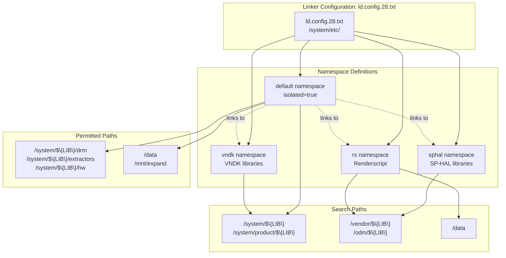
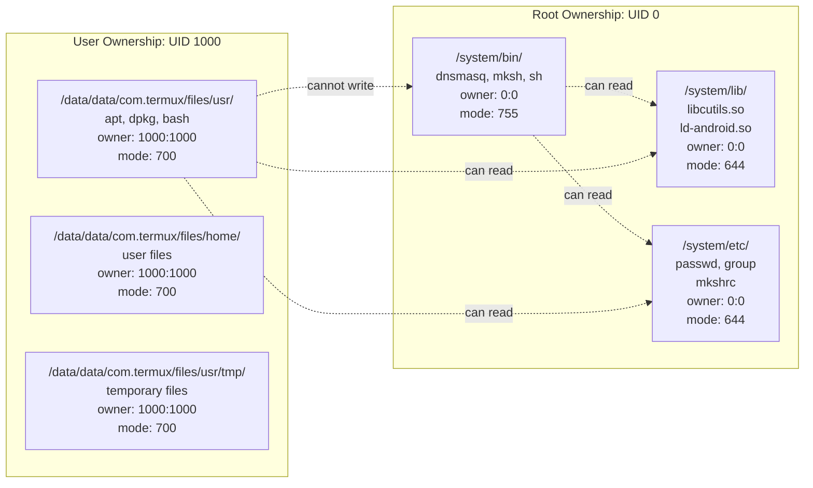
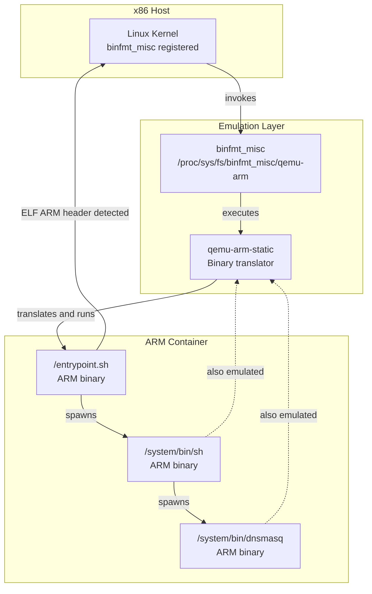
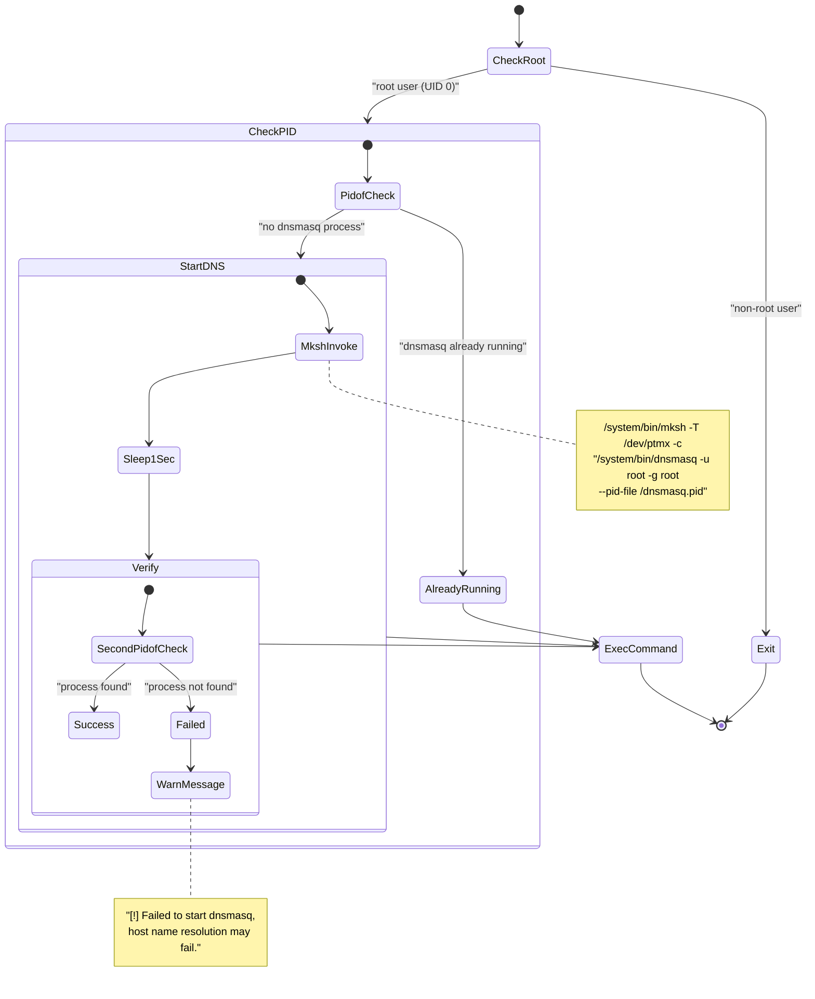

<!-- source: DeepWiki mcp.deepwiki.com · repo termux/termux-docker · page 8 Advanced Topics · fetched 2026-10-26 -->

# Advanced Topics

<details>
<summary>Relevant source files</summary>

The following files were used as context for generating this wiki page:

- [Dockerfile](Dockerfile)
- [entrypoint_root.sh](entrypoint_root.sh)
- [system/arm/etc/hosts](system/arm/etc/hosts)
- [system/arm/etc/ld.config.28.txt](system/arm/etc/ld.config.28.txt)
- [system/arm/lib/ld-android.so](system/arm/lib/ld-android.so)

</details>


## Purpose and Scope

This page covers advanced technical details of the termux-docker system for developers and system administrators who need to understand the underlying implementation, debug complex issues, or extend the system. Topics include the Android Bionic dynamic linker configuration, low-level bootstrap process mechanics, permission model implementation, and architectural constraints that affect system behavior.

For basic usage patterns, see [Getting Started](#2). For general overview of multi-architecture support, see [Multi-Architecture Support](#5). For specific troubleshooting guidance, see [Known Issues and Troubleshooting](#8.3).

---

## Android Bionic Environment in Docker

Termux-docker runs an Android userspace environment inside a Docker container by combining Android system binaries with a standard Linux kernel. This hybrid approach creates several unique technical challenges that don't exist in typical containerized applications.

### Bionic vs GNU libc

The system uses Android's **Bionic C library** rather than GNU libc (glibc) or musl. Bionic is Android's custom C library implementation with several key differences:

| Aspect | Bionic | GNU libc |
|--------|--------|----------|
| Dynamic Linker | `/system/lib/ld-android.so` | `/lib64/ld-linux-x86-64.so.2` |
| Configuration | `/system/etc/ld.config.28.txt` | `/etc/ld.so.conf` |
| Namespace Isolation | Yes (multiple namespaces) | No (single namespace) |
| Library Paths | `/system/lib`, `/data/.../usr/lib` | `/lib`, `/usr/lib` |
| Thread-local Storage | Android-specific TLS model | POSIX TLS model |

The Bionic linker binary is located at `system/arm/lib/ld-android.so` (ARM) or `system/x86/lib/ld-android.so` (x86). This linker is responsible for loading all shared libraries at runtime using configuration rules defined in `ld.config.28.txt`.

**Sources:** [system/arm/lib/ld-android.so:1](), [system/arm/etc/ld.config.28.txt:1-349]()

---

## Namespace Isolation and Library Loading

### Linker Configuration Structure

The Bionic dynamic linker uses a sophisticated **namespace isolation model** to separate system libraries from vendor libraries and application libraries. This isolation is configured through `ld.config.28.txt`, which defines multiple isolated namespaces with explicit linking rules.



**Diagram: Bionic Linker Namespace Architecture**

### Default Namespace Configuration

The **default namespace** is where Termux application code executes. It has strict isolation to prevent loading incompatible libraries:

```
namespace.default.isolated = true

namespace.default.search.paths  = /system/${LIB}
namespace.default.search.paths += /system/product/${LIB}

namespace.default.permitted.paths  = /system/${LIB}/drm
namespace.default.permitted.paths += /system/${LIB}/extractors
namespace.default.permitted.paths += /system/${LIB}/hw
namespace.default.permitted.paths += /data
namespace.default.permitted.paths += /mnt/expand
```

The `isolated = true` setting means that libraries can **only** be loaded from explicitly permitted paths. The `/data` path inclusion is critical - it allows Termux packages under `/data/data/com.termux/files/usr/lib` to be loaded.

**Sources:** [system/arm/etc/ld.config.28.txt:39-70]()

### Namespace Linking

Namespaces can link to each other to share specific libraries. The default namespace links to three other namespaces:

```
namespace.default.links = sphal,vndk,rs

namespace.default.link.sphal.shared_libs  = libEGL.so:libGLESv1_CM.so:...
namespace.default.link.vndk.shared_libs = android.hardware.graphics.common@1.0.so:...
```

This linking allows the default namespace to use graphics libraries from the `sphal` namespace and hardware abstraction libraries from the `vndk` namespace without loading them directly into the default namespace.

**Sources:** [system/arm/etc/ld.config.28.txt:131-139]()

### VNDK (Vendor NDK) Namespace

The **VNDK namespace** contains vendor-native development kit libraries. These are version-specific libraries that allow vendor code to use stable system APIs:

```
namespace.vndk.search.paths  = /odm/${LIB}/vndk-sp
namespace.vndk.search.paths += /vendor/${LIB}/vndk-sp
namespace.vndk.search.paths += /system/${LIB}/vndk-sp-28
```

The `-28` suffix indicates Android API level 28 (Android 9.0 Pie). This versioning ensures ABI stability across Android releases.

**Sources:** [system/arm/etc/ld.config.28.txt:194-206]()

---

## Bootstrap Process Deep Dive

The bootstrap process transforms a minimal `FROM scratch` container into a complete Termux environment. This process is complex because it must operate in a chroot-like environment with no standard utilities available initially.

### Bootstrap Stages

```mermaid
flowchart TD
    START["FROM scratch"]
    
    COPY_SYSTEM["COPY /system/$SYSTEM_TYPE /system<br/>Copies: sh, mksh, dnsmasq, busybox<br/>libc, ld-android.so"]
    
    COPY_ENTRYPOINT["COPY entrypoint.sh<br/>COPY entrypoint_root.sh"]
    
    DOWNLOAD["ADD bootstrap-$BOOTSTRAP_ARCH.zip<br/>from github.com/termux/termux-packages"]
    
    EXTRACT["busybox unzip -d usr /bootstrap.zip<br/>Extracts: apt, dpkg, bash, coreutils"]
    
    CREATE_DIRS["busybox mkdir -p<br/>/data/data/com.termux/files/usr<br/>/data/data/com.termux/files/home<br/>/data/data/com.termux/cache"]
    
    SYMLINKS["Process SYMLINKS.txt<br/>Create package symlinks<br/>busybox ln -s"]
    
    COMPAT_SYMLINKS["Create compatibility symlinks<br/>/usr → /data/.../usr<br/>/bin → /data/.../bin<br/>/tmp → /data/.../tmp"]
    
    BUSYBOX_TOOLS["Link busybox utilities<br/>df, mount, ping, su, top, umount"]
    
    PERMISSIONS["Set ownership and permissions<br/>busybox chown -Rh 0:0 /system<br/>busybox chown -Rh 1000:1000 /data"]
    
    DNSMASQ_START["mksh -T /dev/ptmx -c dnsmasq<br/>Start DNS service for apt"]
    
    APT_UPDATE["su - system -c apt update<br/>su - system -c apt upgrade"]
    
    CLEANUP["Remove apt cache<br/>rm -rf .../var/lib/apt/*<br/>rm -rf .../cache/apt/*"]
    
    FINAL["Final image ready"]
    
    START --> COPY_SYSTEM
    COPY_SYSTEM --> COPY_ENTRYPOINT
    COPY_ENTRYPOINT --> DOWNLOAD
    DOWNLOAD --> CREATE_DIRS
    CREATE_DIRS --> EXTRACT
    EXTRACT --> SYMLINKS
    SYMLINKS --> COMPAT_SYMLINKS
    COMPAT_SYMLINKS --> BUSYBOX_TOOLS
    BUSYBOX_TOOLS --> PERMISSIONS
    PERMISSIONS --> DNSMASQ_START
    DNSMASQ_START --> APT_UPDATE
    APT_UPDATE --> CLEANUP
    CLEANUP --> FINAL
```



**Diagram: Bootstrap Process Execution Flow**

### Initial Shell Configuration

The Dockerfile sets `SHELL ["/system/bin/sh", "-c"]` because Docker requires a shell to execute `RUN` commands, but no shell exists initially in a `FROM scratch` image. The `/system/bin/sh` binary is a minimal shell from the Android system partition that can execute basic commands.

```dockerfile
# Docker uses /bin/sh by default, but we don't have it currently.
SHELL ["/system/bin/sh", "-c"]
ENV PATH /system/bin
```

**Sources:** [Dockerfile:9-11]()

### Bootstrap Archive Download

The Termux bootstrap archive is downloaded directly from GitHub releases using Docker's `ADD` instruction:

```dockerfile
ADD https://github.com/termux/termux-packages/releases/download/bootstrap-$BOOTSTRAP_VERSION/bootstrap-$BOOTSTRAP_ARCH.zip /bootstrap.zip
```

The archive contains a complete Termux package environment including:
- Package manager (`apt`, `dpkg`)
- Core utilities (`bash`, `coreutils`, `findutils`)
- Development tools (`clang`, `make`, `pkg-config`)
- Network utilities (`curl`, `wget`, `openssh`)

**Sources:** [Dockerfile:21]()

### Symlink Processing

The bootstrap archive includes a `SYMLINKS.txt` file that defines all symlinks needed for the package system. This file uses a custom format with `←` as a delimiter:

```bash
busybox cat SYMLINKS.txt | while read -r line; do
  dest=$(echo "$line" | busybox awk -F '←' '{ print $1 }');
  link=$(echo "$line" | busybox awk -F '←' '{ print $2 }');
  busybox ln -s "$dest" "$link";
done
```

Example entries might be:
```
/data/data/com.termux/files/usr/bin/python3.11 ← /data/data/com.termux/files/usr/bin/python
/data/data/com.termux/files/usr/lib/libpython3.11.so.1.0 ← /data/data/com.termux/files/usr/lib/libpython3.so
```

This approach avoids hardcoding symlink paths and allows the bootstrap archive to define its own link structure.

**Sources:** [Dockerfile:28-33]()

### Busybox Utility Linking

Some utilities in Termux are designed to wrap system binaries rather than provide independent implementations. To support this, busybox is linked to provide these utilities during early bootstrap:

```bash
for tool in df mount ping ping6 su top umount; do
    busybox ln -s /system/bin/busybox /system/bin/$tool;
done
```

This creates minimal implementations that can be called by Termux tools before full packages are installed.

**Sources:** [Dockerfile:41-43]()

---

## Permission Model Implementation

### Two-Tier Ownership Structure

The container filesystem uses a **strict two-tier ownership model** that mirrors Android's security architecture:



**Diagram: Filesystem Ownership and Permission Boundaries**

### Permission Setup Commands

The Dockerfile sets permissions in three phases:

1. **System files owned by root:**
```bash
busybox chown -Rh 0:0 /system
```

2. **User files owned by UID 1000:**
```bash
busybox chown -Rh 1000:1000 /data/data/com.termux
```

3. **Restrictive permissions on user files:**
```bash
busybox find /data/data/com.termux/files -type f -o -type d -exec busybox chmod g-rwx,o-rwx "{}" \;
```

This last command removes all group and other permissions, implementing the Android model where each app's data is accessible only to that app (UID 1000 in this case).

**Sources:** [Dockerfile:49-59]()

### Executable Permissions

Package manager executables require special handling to ensure they're executable by the `system` user:

```bash
busybox find ./bin ./lib/apt ./libexec -type f -exec busybox chmod 700 "{}" \;
```

This sets mode `700` (rwx------) on all files in package-critical directories, ensuring only UID 1000 can read, write, or execute them.

**Sources:** [Dockerfile:59]()

---

## Build-Time Optimizations and Constraints

### Conditional Package Updates

The Dockerfile includes a conditional block that skips package updates during ARM builds:

```dockerfile
RUN if [ ${SYSTEM_TYPE} = 'arm' ]; then exit; else \
    /system/bin/mksh -T /dev/ptmx -c "/system/bin/dnsmasq -u root -g root --pid-file /dnsmasq.pid" && sleep 1 && \
    su - system -c "/data/data/com.termux/files/usr/bin/apt update" && \
    su - system -c "/data/data/com.termux/files/usr/bin/apt upgrade -o Dpkg::Options::=--force-confnew -yq" && \
    rm -rf /data/data/com.termux/files/usr/var/lib/apt/* && \
    rm -rf /data/data/com.termux/files/usr/var/log/apt/* && \
    rm -rf /data/data/com.termux/cache/apt/* ;\
    fi
```

**Why ARM builds skip updates:** ARM container builds often run under QEMU emulation on x86 hosts during CI. QEMU emulation has known issues with seccomp system call filtering and pseudoterminal handling that can cause `apt` operations to fail or hang. Skipping updates for ARM builds avoids these issues, though it means ARM images may have slightly older package versions.

**Sources:** [Dockerfile:63-70]()

### PTY Requirement for dnsmasq

The dnsmasq service is started through mksh with pseudoterminal allocation:

```bash
/system/bin/mksh -T /dev/ptmx -c "/system/bin/dnsmasq -u root -g root --pid-file /dnsmasq.pid"
```

The `-T /dev/ptmx` flag allocates a pseudoterminal for the mksh session. This is required because:

1. dnsmasq may check if it's running in an interactive session
2. Some mksh internal operations require a controlling terminal
3. Without a PTY, certain signal handling may not work correctly

**Sources:** [Dockerfile:64](), [entrypoint_root.sh:9]()

### Dpkg Configuration Handling

Package upgrades use `--force-confnew` to automatically use new configuration files:

```bash
apt upgrade -o Dpkg::Options::=--force-confnew -yq
```

This option tells dpkg to replace old configuration files with new versions from packages without prompting. In a containerized environment, this is safe because:
- No user-specific configuration exists yet
- Configuration will be provided through volume mounts or environment variables
- The container is stateless by design

**Sources:** [Dockerfile:66]()

---

## Cross-Architecture Execution Details

### QEMU Integration Points

When running ARM containers on x86 hosts (or vice versa), the Linux kernel's `binfmt_misc` system provides transparent binary format support. The container runtime automatically invokes QEMU to translate instructions.



**Diagram: QEMU Cross-Architecture Execution Flow**

### Known Emulation Limitations

Cross-architecture execution through QEMU has several limitations:

| Issue | Cause | Impact | Workaround |
|-------|-------|--------|------------|
| Seccomp failures | QEMU syscalls don't match native ARM syscalls | Container fails to start with seccomp errors | Use `--security-opt seccomp=unconfined` |
| PTY handling issues | QEMU's pseudoterminal emulation incomplete | Shell prompt corruption, apt hangs | Skip apt operations during ARM builds |
| Performance degradation | All instructions translated | 5-10x slower execution | Use native architecture when possible |
| PID namespace issues | QEMU interferes with PID tracking | Process management may fail | Avoid heavy process spawning |

For detailed troubleshooting, see [Known Issues and Troubleshooting](#8.3).

**Sources:** [Dockerfile:63-70]()

---

## dnsmasq Service Architecture

### Startup Sequence

The dnsmasq service follows a specific startup pattern in `entrypoint_root.sh`:



**Diagram: dnsmasq Service Initialization State Machine**

### PID Detection

The entrypoint uses `busybox pidof` to check if dnsmasq is already running:

```bash
if [ -z "$(/system/bin/busybox pidof dnsmasq)" ]; then
    # Start dnsmasq
fi
```

This check prevents duplicate dnsmasq instances when containers are restarted or when the entrypoint is called multiple times.

**Sources:** [entrypoint_root.sh:8-14]()

### DNS Failure Handling

If dnsmasq fails to start, the container continues to operate but displays a warning:

```bash
if [ -z "$(/system/bin/busybox pidof dnsmasq)" ]; then
    echo "[!] Failed to start dnsmasq, host name resolution may fail." >&2
fi
```

This graceful degradation ensures that DNS failures don't prevent the container from starting. Users will still be able to access the container, though network operations requiring DNS (like `apt update`) will fail.

**Sources:** [entrypoint_root.sh:11-13]()

### Why Root Privileges Required

dnsmasq runs as `root` because it needs to:

1. **Bind to privileged ports:** DNS typically uses port 53, which requires root on Linux
2. **Create PID files:** The `--pid-file /dnsmasq.pid` option writes to the root filesystem
3. **Configure network interfaces:** DNS forwarding may require network configuration capabilities

Running dnsmasq as root is considered acceptable in this context because:
- The container itself is isolated from the host
- dnsmasq is a well-audited, security-focused daemon
- No other services run as root (user sessions drop to UID 1000)

**Sources:** [entrypoint_root.sh:9](), [Dockerfile:64]()

---

## System Integration Points

### Key File Locations

The following table maps functional components to their filesystem locations:

| Component | Path | Purpose | Owner |
|-----------|------|---------|-------|
| Bionic linker (ARM) | `/system/lib/ld-android.so` | Dynamic library loader | root |
| Bionic linker (x86) | `/system/lib/ld-android.so` | Dynamic library loader | root |
| Linker config | `/system/etc/ld.config.28.txt` | Namespace and search path rules | root |
| dnsmasq binary | `/system/bin/dnsmasq` | DNS forwarding service | root |
| mksh shell | `/system/bin/mksh` | MirBSD Korn Shell | root |
| Busybox utilities | `/system/bin/busybox` | Core Unix utilities | root |
| Root entrypoint | `/entrypoint_root.sh` | Privileged container initialization | root |
| User entrypoint | `/entrypoint.sh` | Unprivileged container initialization | root (executable by all) |
| Termux packages | `/data/data/com.termux/files/usr/` | User-installed software | system (1000:1000) |
| User home | `/data/data/com.termux/files/home/` | User data and configuration | system (1000:1000) |
| Hosts file | `/system/etc/hosts` | Static hostname resolution | root |

**Sources:** [Dockerfile:1-92](), [system/arm/etc/ld.config.28.txt:1](), [system/arm/etc/hosts:1-3]()

### Environment Variable Propagation

The final image sets several critical environment variables:

```dockerfile
ENV ANDROID_DATA     /data
ENV ANDROID_ROOT     /system
ENV HOME             /data/data/com.termux/files/home
ENV LANG             en_US.UTF-8
ENV PATH             /data/data/com.termux/files/usr/bin
ENV PREFIX           /data/data/com.termux/files/usr
ENV TMPDIR           /data/data/com.termux/files/usr/tmp
ENV TZ               UTC
```

These variables are used by:
- **ANDROID_DATA/ANDROID_ROOT:** Bionic linker path resolution
- **PREFIX:** Termux package manager installation prefix
- **PATH:** Shell command resolution
- **TMPDIR:** Temporary file location for all packages
- **HOME:** User shell starting directory

**Sources:** [Dockerfile:76-83]()

---

## Next Steps

For detailed information about specific advanced topics:
- **Linker configuration details:** [Linker Configuration](#8.1)
- **Bootstrap process implementation:** [Bootstrap Process](#8.2)
- **Troubleshooting specific issues:** [Known Issues and Troubleshooting](#8.3)

For runtime behavior and service management:
- **Container initialization:** [Entrypoint System](#4.1)
- **Privilege dropping:** [Privilege Management](#4.3)
- **DNS service details:** [Network Services](#6.2)

---

