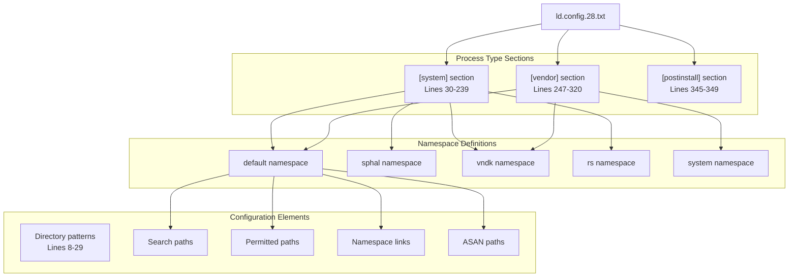
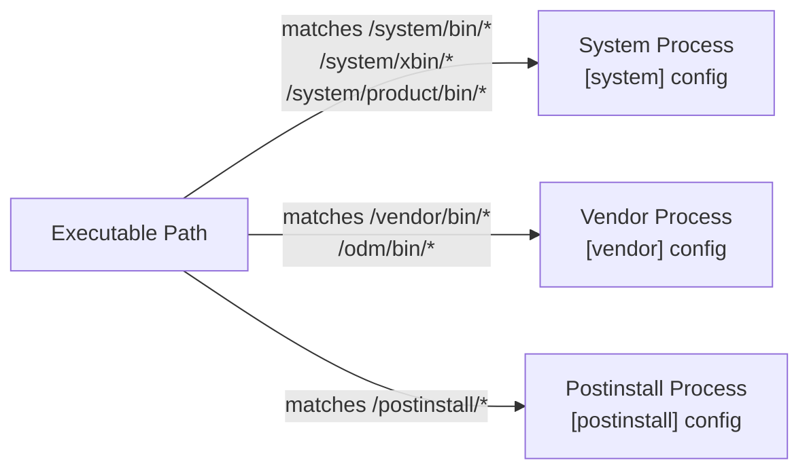
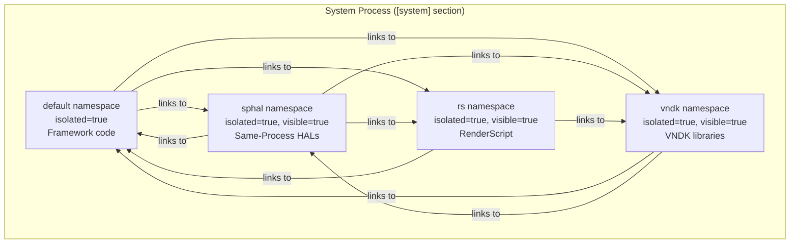
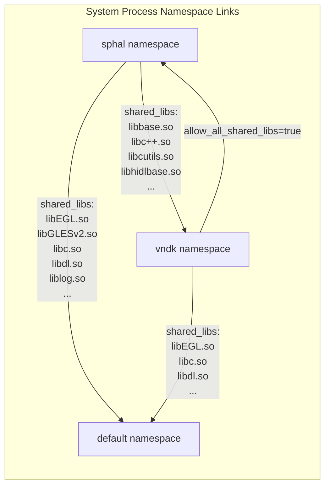
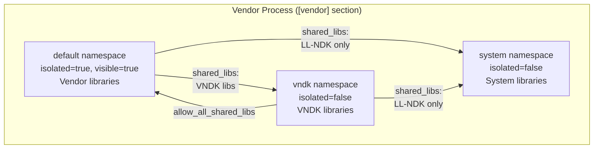
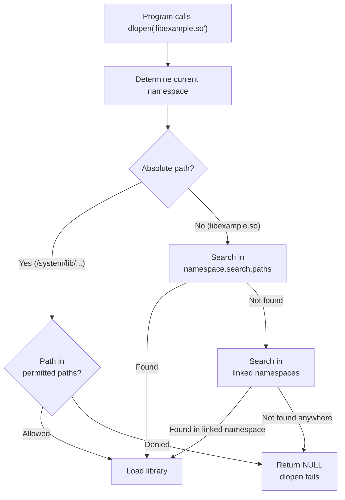

<!-- source: DeepWiki mcp.deepwiki.com · repo termux/termux-docker · page 8.1 Linker Configuration · fetched 2026-10-26 -->

# Linker Configuration

<details>
<summary>Relevant source files</summary>

The following files were used as context for generating this wiki page:

- [system/arm/etc/hosts](system/arm/etc/hosts)
- [system/arm/etc/ld.config.28.txt](system/arm/etc/ld.config.28.txt)
- [system/arm/lib/ld-android.so](system/arm/lib/ld-android.so)

</details>


## Purpose and Scope

This document explains the **Bionic dynamic linker** configuration used in termux-docker, specifically the `ld.config.28.txt` file that controls how shared libraries are loaded at runtime. It covers namespace isolation, library search paths, and the security boundaries that prevent unauthorized library loading between system and vendor partitions.

For information about the libraries themselves (such as `libcutils.so`), see [System Libraries](#6.3). For the filesystem layout that these paths reference, see [Filesystem Layout](#7).

---

## Overview

The termux-docker images include Android's Bionic dynamic linker (`ld-android.so`) and its configuration file (`ld.config.28.txt`) to properly load shared libraries from the `/system` partition. The configuration enforces Android's namespace isolation model, separating system, vendor, and application libraries into distinct security domains.

**Sources:** [system/arm/etc/ld.config.28.txt:1-349](), [system/arm/lib/ld-android.so]()

---

## The Bionic Dynamic Linker

### Linker Binary

The Bionic linker is provided as `ld-android.so` in both x86 and ARM variants:

| Architecture | Binary Location | Purpose |
|--------------|----------------|---------|
| x86 (32-bit) | `/system/x86/lib/ld-android.so` | Dynamic linker for i686 |
| x86 (64-bit) | `/system/x86/lib64/ld-android.so` | Dynamic linker for x86_64 |
| ARM (32-bit) | `/system/arm/lib/ld-android.so` | Dynamic linker for armv7 |
| ARM (64-bit) | `/system/arm/lib64/ld-android.so` | Dynamic linker for aarch64 |

The linker exposes Android-specific extensions through functions prefixed with `__loader_`:

```
__loader_android_dlopen_ext
__loader_android_create_namespace
__loader_android_link_namespaces
__loader_android_get_LD_LIBRARY_PATH
__loader_dl_iterate_phdr
__loader_dladdr
__loader_dlsym
```

These functions enable namespace creation, controlled library loading, and symbol resolution within namespace boundaries.

**Sources:** [system/arm/lib/ld-android.so:1-6]()

---

## Linker Configuration File

### File Location and Version

The linker configuration is specified in `ld.config.28.txt`, where "28" indicates Android API level 28 (Android 9 Pie):

- **ARM:** `/system/arm/etc/ld.config.28.txt`
- **x86:** `/system/x86/etc/ld.config.28.txt`

The linker automatically reads this file at process startup to configure namespace boundaries and library search paths.

### Configuration Structure



**Sources:** [system/arm/etc/ld.config.28.txt:1-349]()

---

## Process Type Classification

The linker configuration begins with directory patterns that classify executables into process types:

### Directory Pattern Matching



**Directory Pattern Definitions:**

```
dir.system = /system/bin/
dir.system = /system/xbin/
dir.system = /system/product/bin/

dir.vendor = /odm/bin/
dir.vendor = /vendor/bin/
```

The **first matching pattern** determines which configuration section applies. Order matters - system patterns are checked before vendor patterns.

**Sources:** [system/arm/etc/ld.config.28.txt:8-29]()

---

## Namespace Architecture

### System Process Namespaces

System processes (executables from `/system/bin/`) operate with four namespaces:



**Sources:** [system/arm/etc/ld.config.28.txt:30-239]()

### Namespace Properties

| Namespace | Isolated | Visible | Purpose |
|-----------|----------|---------|---------|
| `default` | true | false | Framework-side code, prevents vendor library loading |
| `sphal` | true | true | SP-HAL (Same-Process HAL) vendor libraries |
| `vndk` | true | true | VNDK (Vendor NDK) libraries for stable ABI |
| `rs` | true | true | RenderScript internal libraries |

**Isolation:** When `isolated=true`, the namespace cannot load arbitrary libraries - only from configured search/permitted paths.

**Visibility:** When `visible=true`, other namespaces can link to this namespace.

**Sources:** [system/arm/etc/ld.config.28.txt:39-195]()

---

## Library Search Paths

### Default Namespace Search Paths

The `default` namespace for system processes searches these directories:

```
namespace.default.search.paths = /system/${LIB}
namespace.default.search.paths += /system/product/${LIB}
```

The `${LIB}` variable expands to:
- `lib` for 32-bit processes
- `lib64` for 64-bit processes

**Effective Search Paths (32-bit):**
- `/system/lib/`
- `/system/product/lib/`

**Effective Search Paths (64-bit):**
- `/system/lib64/`
- `/system/product/lib64/`

**Sources:** [system/arm/etc/ld.config.28.txt:41-42]()

### Permitted Paths

While search paths determine where the linker automatically looks, **permitted paths** control which directories can be explicitly loaded via `dlopen()`:

```
namespace.default.permitted.paths = /system/${LIB}/drm
namespace.default.permitted.paths += /system/${LIB}/extractors
namespace.default.permitted.paths += /system/${LIB}/hw
namespace.default.permitted.paths += /system/product/${LIB}
namespace.default.permitted.paths += /system/framework
namespace.default.permitted.paths += /data
namespace.default.permitted.paths += /mnt/expand
```

This allows loading libraries from `/data` (for dynamically compiled code) while preventing access to `/vendor` libraries from system processes.

**Sources:** [system/arm/etc/ld.config.28.txt:51-70]()

---

## Namespace Linking

### Link Configuration

Namespaces communicate through explicitly configured links that specify which shared libraries can cross namespace boundaries:



### Shared Library Whitelist

The `sphal` namespace links to `default` with a restricted whitelist:

```
namespace.sphal.link.default.shared_libs = 
  libEGL.so:libGLESv1_CM.so:libGLESv2.so:libGLESv3.so:
  libRS.so:libandroid_net.so:libc.so:libdl.so:liblog.so:
  libm.so:libmediandk.so:libnativewindow.so:...
```

Only libraries in this colon-separated list can be resolved from the `default` namespace when code in the `sphal` namespace needs them.

**Sources:** [system/arm/etc/ld.config.28.txt:131-139]()

### Allow-All Links

Some namespace links permit all shared libraries:

```
namespace.vndk.link.sphal.allow_all_shared_libs = true
```

This allows VNDK-SP extensions to use any vendor library without explicit whitelisting.

**Sources:** [system/arm/etc/ld.config.28.txt:239]()

---

## Vendor Process Configuration

### Vendor Namespace Structure

Processes launched from `/vendor/bin/` use a different namespace configuration:



**Key Difference:** The vendor `default` namespace is isolated but searches `/vendor/lib` instead of `/system/lib`:

```
namespace.default.search.paths = /odm/${LIB}
namespace.default.search.paths += /vendor/${LIB}

namespace.default.permitted.paths = /odm
namespace.default.permitted.paths += /vendor
```

This enforces the **vendor/system partition boundary** - vendor processes cannot directly access system libraries except through explicit LL-NDK links.

**Sources:** [system/arm/etc/ld.config.28.txt:247-320]()

---

## ASAN Configuration

### Address Sanitizer Support

Each namespace includes ASAN (Address Sanitizer) variants of search and permitted paths:

```
namespace.default.asan.search.paths = /data/asan/system/${LIB}
namespace.default.asan.search.paths += /system/${LIB}
namespace.default.asan.search.paths += /data/asan/product/${LIB}
namespace.default.asan.search.paths += /product/${LIB}
```

When ASAN is enabled, the linker searches `/data/asan/` directories first, allowing instrumented library replacements to override system libraries for debugging and testing.

**Sources:** [system/arm/etc/ld.config.28.txt:72-95]()

---

## Path Resolution Flow

### Library Loading Process



**Sources:** [system/arm/etc/ld.config.28.txt:39-70]()

---

## Termux-Docker Context

### Relevance to Termux

In termux-docker, the linker configuration serves several purposes:

1. **System Binary Support:** Enables binaries like `dnsmasq` and `mksh` from `/system/bin/` to load their dependencies (`libcutils.so`, etc.) correctly.

2. **Namespace Isolation:** Prevents conflicts between Android system libraries and Termux packages, which install to `/data/data/com.termux/files/usr/lib/`.

3. **Security Boundaries:** Enforces that Termux user processes (running as UID 1000) cannot load privileged system libraries not exposed through namespace links.

### Active Namespaces

Termux processes typically operate in the **system process `default` namespace** because shells are spawned from `/system/bin/sh`:

| Binary | Path | Namespace Configuration |
|--------|------|------------------------|
| `sh` | `/system/x86/bin/sh` | System `[system]` → `default` namespace |
| `mksh` | `/system/arm/bin/mksh` | System `[system]` → `default` namespace |
| `dnsmasq` | `/system/x86/bin/dnsmasq` | System `[system]` → `default` namespace |

These binaries can load:
- System libraries from `/system/lib/`
- Termux libraries from `/data/` (via permitted paths)

### Library Search Order

When a Termux process loads libraries:

1. **System libraries** (if using Android Bionic): Search `/system/lib/`, `/system/product/lib/`
2. **Termux libraries** (via LD_LIBRARY_PATH): Search `/data/data/com.termux/files/usr/lib/`
3. **Namespace links**: Resolve dependencies across namespace boundaries

**Sources:** [system/arm/etc/ld.config.28.txt:30-70]()

---

## Configuration File Syntax

### Section Format

```
[section_name]
additional.namespaces = namespace1,namespace2

namespace.name.isolated = true|false
namespace.name.visible = true|false
namespace.name.search.paths = path1
namespace.name.search.paths += path2
namespace.name.permitted.paths = path1
namespace.name.links = namespace1,namespace2
namespace.name.link.namespace1.shared_libs = lib1.so:lib2.so
```

### Variables

| Variable | Expansion | Purpose |
|----------|-----------|---------|
| `${LIB}` | `lib` or `lib64` | Architecture-specific library directory |

### Special Syntax

- **Continuation:** Lines ending with `+=` append to the previous directive
- **Colon separator:** Shared library lists use `:` as delimiter (`lib1.so:lib2.so:lib3.so`)
- **Comments:** Lines beginning with `#` are ignored

**Sources:** [system/arm/etc/ld.config.28.txt:1-349]()

---

## Summary Table

### Namespace Configuration Matrix

| Namespace | Process Type | Isolation | Search Paths | Key Purpose |
|-----------|--------------|-----------|--------------|-------------|
| `default` | System | Isolated | `/system/lib`, `/system/product/lib` | Framework code execution |
| `sphal` | System | Isolated | `/vendor/lib`, `/odm/lib` | Same-process HAL loading |
| `vndk` | System | Isolated | `/system/lib/vndk-sp-28` | VNDK library loading |
| `rs` | System | Isolated | `/vendor/lib/vndk-sp` | RenderScript execution |
| `default` | Vendor | Isolated | `/vendor/lib`, `/odm/lib` | Vendor binary execution |
| `vndk` | Vendor | Non-isolated | `/system/lib/vndk-28` | VNDK for vendor processes |
| `system` | Vendor | Non-isolated | `/system/lib` | System lib access from vendor |
| `default` | Postinstall | Non-isolated | `/system/lib` | OTA installation scripts |

**Sources:** [system/arm/etc/ld.config.28.txt:30-349]()

---

