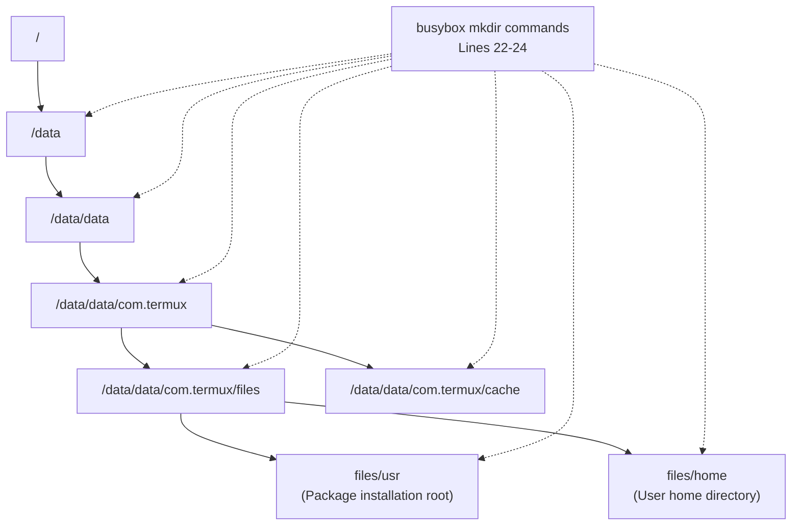
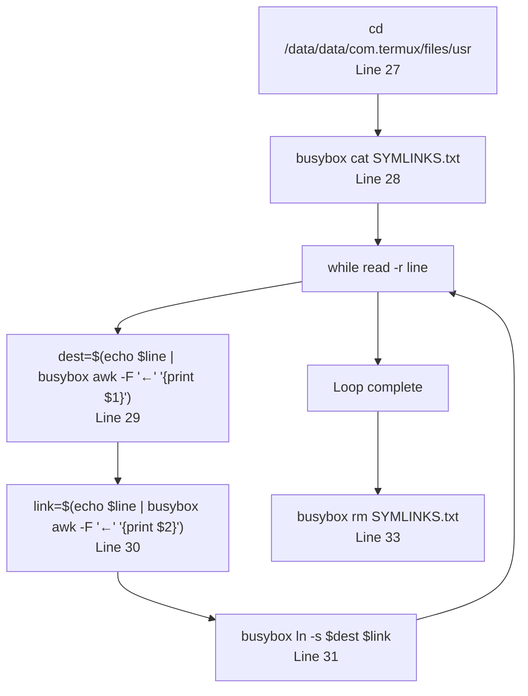
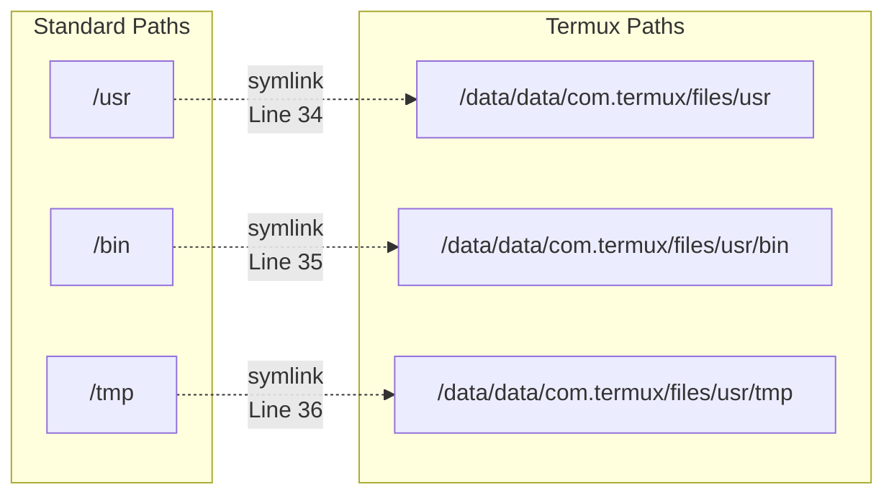
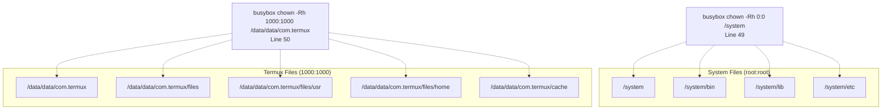
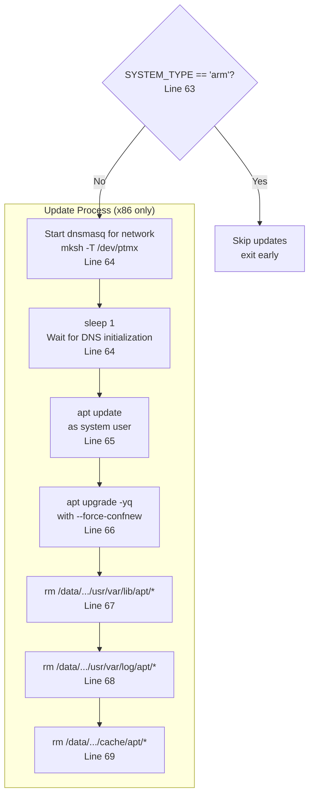
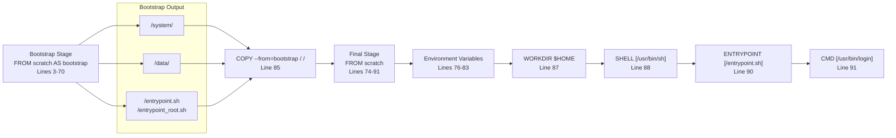

<!-- source: DeepWiki mcp.deepwiki.com · repo termux/termux-docker · page 8.2 Bootstrap Process · fetched 2026-10-26 -->

# Bootstrap Process

<details>
<summary>Relevant source files</summary>

The following files were used as context for generating this wiki page:

- [Dockerfile](Dockerfile)
- [entrypoint_root.sh](entrypoint_root.sh)

</details>


## Purpose and Scope

This document provides a detailed technical explanation of how the Termux bootstrap archive is downloaded, extracted, and configured during the Docker image build process. The bootstrap process occurs at **build time** as part of the multi-stage Dockerfile and establishes the complete Termux package environment within the container image.

For information about runtime initialization (entrypoint scripts, service startup, privilege management), see [Container Runtime](#4) and [Entrypoint System](#4.1). For details about the overall Dockerfile structure and build stages, see [The Dockerfile](#3.1).

---

## Bootstrap Overview

The bootstrap process transforms a minimal scratch container with only system binaries into a fully functional Termux environment. This occurs in the `bootstrap` stage of the multi-stage Dockerfile [Dockerfile:3-71]() and involves several discrete steps:

1. Download the Termux bootstrap archive from GitHub releases
2. Extract the archive to the Termux application directory
3. Process symlink definitions to establish the package ecosystem
4. Create compatibility symlinks for standard paths
5. Configure file ownership and permissions
6. Update packages (x86 architectures only)

The result is a self-contained Linux environment following Android's application directory structure, with a complete package management system ready for use.

### Bootstrap Architecture Flow

```mermaid
flowchart TD
    START["Docker Build Starts<br/>(FROM scratch)"]
    COPY_SYS["COPY /system/$SYSTEM_TYPE<br/>Lines 14"]
    COPY_EP["COPY entrypoint scripts<br/>Lines 17-18"]
    
    subgraph "Bootstrap Archive Acquisition"
        DOWNLOAD["ADD bootstrap-$BOOTSTRAP_ARCH.zip<br/>Line 21<br/>Source: github.com/termux/termux-packages"]
        MKDIR["busybox mkdir<br/>Lines 22-24<br/>Create /data/data/com.termux/files"]
        UNZIP["busybox unzip -d usr<br/>Line 25<br/>Extract to files/usr/"]
        CLEANUP1["busybox rm /bootstrap.zip<br/>Line 26"]
    end
    
    subgraph "Symlink Configuration"
        READ_SYMLINKS["Read SYMLINKS.txt<br/>Lines 28-32<br/>Parse dest←link format"]
        CREATE_SYMLINKS["busybox ln -s<br/>Create package symlinks"]
        REMOVE_SYMLINKS["busybox rm SYMLINKS.txt<br/>Line 33"]
        COMPAT_SYMLINKS["Create /usr /bin /tmp symlinks<br/>Lines 34-36"]
    end
    
    subgraph "System Integration"
        BUSYBOX_TOOLS["Link system tools to busybox<br/>Lines 41-43<br/>df mount ping su top umount"]
    end
    
    subgraph "Permission Setup"
        CHOWN_SYS["chown 0:0 /system<br/>Line 49"]
        CHOWN_DATA["chown 1000:1000 /data/data/com.termux<br/>Line 50"]
        PASSWD_LINK["Link /etc/passwd and /etc/group<br/>Lines 51-52"]
        CHMOD_SYS["chmod 755/644 /system<br/>Lines 53-55"]
        CHMOD_DATA["chmod g-rwx,o-rwx on Termux files<br/>Lines 56-59"]
    end
    
    subgraph "Package Updates (x86 only)"
        CHECK_ARCH{"SYSTEM_TYPE == 'arm'?<br/>Line 63"}
        START_DNS["mksh -T /dev/ptmx dnsmasq<br/>Line 64"]
        APT_UPDATE["su - system apt update<br/>Line 65"]
        APT_UPGRADE["su - system apt upgrade<br/>Line 66"]
        CLEANUP_APT["rm apt caches<br/>Lines 67-69"]
    end
    
    FINAL["FROM scratch (final stage)<br/>COPY --from=bootstrap<br/>Lines 74-85"]
    
    START --> COPY_SYS
    COPY_SYS --> COPY_EP
    COPY_EP --> DOWNLOAD
    DOWNLOAD --> MKDIR
    MKDIR --> UNZIP
    UNZIP --> CLEANUP1
    
    CLEANUP1 --> READ_SYMLINKS
    READ_SYMLINKS --> CREATE_SYMLINKS
    CREATE_SYMLINKS --> REMOVE_SYMLINKS
    REMOVE_SYMLINKS --> COMPAT_SYMLINKS
    
    COMPAT_SYMLINKS --> BUSYBOX_TOOLS
    BUSYBOX_TOOLS --> CHOWN_SYS
    CHOWN_SYS --> CHOWN_DATA
    CHOWN_DATA --> PASSWD_LINK
    PASSWD_LINK --> CHMOD_SYS
    CHMOD_SYS --> CHMOD_DATA
    
    CHMOD_DATA --> CHECK_ARCH
    CHECK_ARCH -->|"Yes"| FINAL
    CHECK_ARCH -->|"No"| START_DNS
    START_DNS --> APT_UPDATE
    APT_UPDATE --> APT_UPGRADE
    APT_UPGRADE --> CLEANUP_APT
    CLEANUP_APT --> FINAL
```



**Sources:** [Dockerfile:1-91]()

---

## Build Arguments and Bootstrap Archive Selection

The bootstrap process is parameterized through Docker build arguments that control which Termux bootstrap archive is downloaded and how the system is configured.

### Bootstrap Build Arguments

| Argument | Default Value | Purpose |
|----------|---------------|---------|
| `BOOTSTRAP_VERSION` | `2023.02.19-r1%2Bapt-android-7` | Specifies the exact bootstrap release version from termux-packages repository |
| `BOOTSTRAP_ARCH` | `i686` | CPU architecture for the bootstrap archive (`aarch64`, `arm`, `i686`, `x86_64`) |
| `SYSTEM_TYPE` | `x86` | System binary directory to use (`x86` or `arm`) |

These arguments are declared at [Dockerfile:5-7]() and used to construct the download URL for the bootstrap archive.

### Bootstrap Archive Download

The bootstrap archive is fetched directly from the Termux packages GitHub releases using Docker's `ADD` instruction:

```
ADD https://github.com/termux/termux-packages/releases/download/bootstrap-$BOOTSTRAP_VERSION/bootstrap-$BOOTSTRAP_ARCH.zip /bootstrap.zip
```

The `ADD` instruction downloads the archive to `/bootstrap.zip` in the container at build time [Dockerfile:21](). The URL format is:

```
https://github.com/termux/termux-packages/releases/download/
  bootstrap-{VERSION}/
  bootstrap-{ARCH}.zip
```

For example, with default arguments:
```
https://github.com/termux/termux-packages/releases/download/
  bootstrap-2023.02.19-r1%2Bapt-android-7/
  bootstrap-i686.zip
```

**Sources:** [Dockerfile:5-7](), [Dockerfile:21]()

---

## Directory Structure Creation

Before extracting the bootstrap archive, the build process creates the Android-style directory hierarchy that Termux expects. This replicates the directory structure of a Termux installation on an Android device.

### Directory Creation Sequence



The directory creation is performed by busybox commands [Dockerfile:22-24]():

```bash
busybox mkdir -p /data/data/com.termux/files
cd /data/data/com.termux/files
busybox mkdir ../cache ./usr ./home
```

This creates:
- `/data/data/com.termux/files` - Main Termux application directory
- `/data/data/com.termux/cache` - APT package cache directory
- `/data/data/com.termux/files/usr` - Package prefix (`$PREFIX`)
- `/data/data/com.termux/files/home` - User home directory (`$HOME`)

**Sources:** [Dockerfile:22-24]()

---

## Bootstrap Archive Extraction

The bootstrap archive contains the complete Termux package ecosystem including the package manager (apt, dpkg), core utilities, and a `SYMLINKS.txt` file that defines symlinks between package files.

### Extraction Process

The archive is extracted to the `usr/` directory using busybox's unzip utility [Dockerfile:25]():

```bash
busybox unzip -d usr /bootstrap.zip
```

This unpacks all files into `/data/data/com.termux/files/usr/`, which becomes the Termux `$PREFIX` directory. The bootstrap archive typically contains:

| Directory/File | Contents |
|----------------|----------|
| `bin/` | Executable commands and utilities |
| `etc/` | Configuration files |
| `include/` | C/C++ header files |
| `lib/` | Shared libraries and library archives |
| `libexec/` | Internal executables not meant for direct user invocation |
| `share/` | Architecture-independent data files |
| `tmp/` | Temporary file directory |
| `var/` | Variable data (logs, package database, etc.) |
| `SYMLINKS.txt` | Symlink definitions in `dest←link` format |

After extraction, the archive file is removed to reduce image size [Dockerfile:26]():

```bash
busybox rm /bootstrap.zip
```

**Sources:** [Dockerfile:25-26]()

---

## Symlink Processing

The bootstrap archive includes a `SYMLINKS.txt` file that defines symlinks within the package ecosystem. These symlinks are necessary for proper package operation, as many commands and libraries are implemented through symlinks to reduce duplication.

### SYMLINKS.txt Format

The `SYMLINKS.txt` file uses a custom format where each line represents a symlink in the form:

```
destination←link_name
```

The `←` character (Unicode U+2190, LEFTWARDS ARROW) separates the target from the link name. For example:

```
/data/data/com.termux/files/usr/bin/less←/data/data/com.termux/files/usr/bin/more
```

This indicates that `more` should be a symlink pointing to `less`.

### Symlink Creation Logic



The symlink processing code [Dockerfile:28-32]():

```bash
busybox cat SYMLINKS.txt | while read -r line; do
  dest=$(echo "$line" | busybox awk -F '←' '{ print $1 }')
  link=$(echo "$line" | busybox awk -F '←' '{ print $2 }')
  busybox ln -s "$dest" "$link"
done
```

This shell loop:
1. Reads each line from `SYMLINKS.txt`
2. Splits the line on the `←` delimiter using awk
3. Extracts the destination (field 1) and link name (field 2)
4. Creates the symlink using `busybox ln -s`

After all symlinks are created, `SYMLINKS.txt` is deleted [Dockerfile:33]() as it is no longer needed.

**Sources:** [Dockerfile:27-33]()

---

## Compatibility Symlinks

After the Termux package symlinks are created, the build process establishes compatibility symlinks that map standard Linux paths to their Termux equivalents. This allows scripts and tools that expect standard FHS (Filesystem Hierarchy Standard) paths to function correctly.

### Standard Path Mapping



The compatibility symlinks are created with these commands [Dockerfile:34-36]():

```bash
busybox ln -s /data/data/com.termux/files/usr /usr
busybox ln -s /data/data/com.termux/files/usr/bin /bin
busybox ln -s /data/data/com.termux/files/usr/tmp /tmp
```

These symlinks ensure that:
- Scripts using `#!/usr/bin/env` shebangs work correctly
- Tools expecting binaries in `/bin` or `/usr/bin` can find them
- Temporary file operations using `/tmp` function properly

**Sources:** [Dockerfile:34-36]()

---

## System Tool Integration

Some system utilities need to be available from both the system partition and the Termux environment. To avoid duplication and ensure consistency, the build process creates symlinks from system binary names to busybox.

### Busybox Tool Linking

The following system tools are linked to busybox [Dockerfile:41-43]():

```bash
for tool in df mount ping ping6 su top umount; do
    busybox ln -s /system/bin/busybox /system/bin/$tool
done
```

| Tool | Purpose | Why Linked to Busybox |
|------|---------|----------------------|
| `df` | Disk space reporting | Termux wrapper delegates to system binary |
| `mount` | Filesystem mounting | Requires privileged operations |
| `ping` | Network connectivity testing | Requires raw socket capabilities |
| `ping6` | IPv6 connectivity testing | Requires raw socket capabilities |
| `su` | Switch user/privilege escalation | Core security tool, must be consistent |
| `top` | Process monitoring | Accesses /proc filesystem |
| `umount` | Filesystem unmounting | Requires privileged operations |

This matches the pattern in Termux's termux-tools package where certain commands are implemented as wrappers that delegate to system binaries for privileged operations.

**Sources:** [Dockerfile:41-43]()

---

## File Ownership and Permission Configuration

A critical step in the bootstrap process is establishing the correct ownership and permission model that mirrors Android's security architecture and ensures proper isolation between system and user spaces.

### Ownership Model



Ownership is set with two commands [Dockerfile:49-50]():

```bash
busybox chown -Rh 0:0 /system
busybox chown -Rh 1000:1000 /data/data/com.termux
```

The `-R` flag recursively changes ownership, and `-h` affects symlinks themselves rather than their targets. This establishes:

- **UID 0, GID 0 (root:root)**: Owns all system binaries and libraries under `/system/`
- **UID 1000, GID 1000 (system:system)**: Owns all Termux application data under `/data/data/com.termux/`

### User Database Symlinks

The `/etc/passwd` and `/etc/group` files are linked to their locations in the system partition [Dockerfile:51-52]():

```bash
busybox ln -s /system/etc/passwd /etc/passwd
busybox ln -s /system/etc/group /etc/group
```

This ensures that the system's user and group definitions are visible at standard locations.

### Permission Configuration Sequence

The permission setup proceeds in four phases [Dockerfile:53-59]():

#### Phase 1: System Directory Permissions
```bash
busybox find /system -type d -exec busybox chmod 755 "{}" \;
```
All directories under `/system/` receive `755` permissions (rwxr-xr-x), allowing read and execute for all users.

#### Phase 2: System Executable Permissions
```bash
busybox find /system -type f -executable -exec busybox chmod 755 "{}" \;
```
Executable files receive `755` permissions, making them executable by all users.

#### Phase 3: System Regular File Permissions
```bash
busybox find /system -type f ! -executable -exec busybox chmod 644 "{}" \;
```
Non-executable files receive `644` permissions (rw-r--r--), readable by all but writable only by root.

#### Phase 4: Termux Directory Permissions
```bash
busybox find /data -type d -exec busybox chmod 755 "{}" \;
```
Directories receive `755` to allow traversal.

#### Phase 5: Termux File Isolation
```bash
busybox find /data/data/com.termux/files -type f -o -type d -exec busybox chmod g-rwx,o-rwx "{}" \;
```
Removes all group and other permissions from Termux files, creating complete user isolation (700/600).

#### Phase 6: Termux Executable Permissions
```bash
cd /data/data/com.termux/files/usr
busybox find ./bin ./lib/apt ./libexec -type f -exec busybox chmod 700 "{}" \;
```
Ensures executables and scripts in critical directories have user-only execute permissions.

### Permission Summary Table

| Path | Owner | Permissions | Rationale |
|------|-------|-------------|-----------|
| `/system/*` directories | root:root | 755 | System binaries accessible to all |
| `/system/*` executables | root:root | 755 | Executables runnable by all users |
| `/system/*` regular files | root:root | 644 | Configuration readable by all |
| `/data/data/com.termux/*` directories | 1000:1000 | 755 then 700 | User isolation, no cross-user access |
| `/data/data/com.termux/files/*` files | 1000:1000 | 700/600 | Complete user privacy |
| `$PREFIX/bin/*` executables | 1000:1000 | 700 | User-only execution |

**Sources:** [Dockerfile:49-59]()

---

## Package Update Process (x86 Architectures)

For x86-based architectures (i686 and x86_64), the bootstrap process includes an additional step that updates all packages to their latest versions. This is performed during the build to ensure users start with current software.

### Update Conditional Logic



The conditional check [Dockerfile:63]() determines whether to proceed with updates:

```bash
if [ ${SYSTEM_TYPE} = 'arm' ]; then exit; else
```

ARM architectures **skip the update process** due to known issues with seccomp profiles during emulated builds. See [Known Issues and Troubleshooting](#8.3) for details on ARM emulation limitations.

### DNS Service Startup for Updates

Package updates require network connectivity. The build process temporarily starts dnsmasq [Dockerfile:64]():

```bash
/system/bin/mksh -T /dev/ptmx -c "/system/bin/dnsmasq -u root -g root --pid-file /dnsmasq.pid"
sleep 1
```

Key aspects of this command:
- **`mksh -T /dev/ptmx`**: Uses the Korn shell with a pseudo-TTY for proper signal handling
- **`dnsmasq -u root -g root`**: Runs DNS service as root (necessary during build, no privilege dropping available yet)
- **`--pid-file /dnsmasq.pid`**: Creates PID file for process tracking
- **`sleep 1`**: Brief pause to allow dnsmasq to initialize before proceeding

### Package Manager Invocation

Package updates execute as the unprivileged system user [Dockerfile:65-66]():

```bash
su - system -c "/data/data/com.termux/files/usr/bin/apt update"
su - system -c "/data/data/com.termux/files/usr/bin/apt upgrade -o Dpkg::Options::=--force-confnew -yq"
```

The `su - system -c` wrapper ensures:
- Commands run with UID 1000 (system user)
- Environment is properly initialized (via `-` flag)
- Package files are owned by the correct user

The upgrade command uses specific options:
- **`-o Dpkg::Options::=--force-confnew`**: Automatically use new configuration files from packages, overwriting local changes
- **`-y`**: Automatically answer yes to prompts
- **`-q`**: Quiet mode, minimal output

### Cache Cleanup

After updates complete, the build process removes cached package data to reduce image size [Dockerfile:67-69]():

```bash
rm -rf /data/data/com.termux/files/usr/var/lib/apt/*
rm -rf /data/data/com.termux/files/usr/var/log/apt/*
rm -rf /data/data/com.termux/cache/apt/*
```

This removes:
- `/var/lib/apt/*`: Package lists and status databases (can be regenerated)
- `/var/log/apt/*`: Installation logs (not needed in final image)
- `cache/apt/*`: Downloaded .deb package files (no longer needed after installation)

**Sources:** [Dockerfile:63-70]()

---

## Bootstrap Stage Output

The bootstrap stage produces a complete filesystem structure that is copied into the final image. The multi-stage build ensures that build-time artifacts (the downloaded .zip file, intermediate files) are not included in the final image.

### Final Image Assembly



The final stage copies the entire bootstrap filesystem [Dockerfile:85]():

```bash
COPY --from=bootstrap / /
```

This brings in:
- System binaries from `/system/`
- Termux environment from `/data/`
- Entrypoint scripts
- All symlinks and permissions configured during bootstrap

### Environment Variable Configuration

The final image sets critical environment variables [Dockerfile:76-83]():

| Variable | Value | Purpose |
|----------|-------|---------|
| `ANDROID_DATA` | `/data` | Android data partition mount point |
| `ANDROID_ROOT` | `/system` | Android system partition mount point |
| `HOME` | `/data/data/com.termux/files/home` | User home directory |
| `LANG` | `en_US.UTF-8` | Locale setting for UTF-8 support |
| `PATH` | `/data/data/com.termux/files/usr/bin` | Search path for executables |
| `PREFIX` | `/data/data/com.termux/files/usr` | Termux installation prefix |
| `TMPDIR` | `/data/data/com.termux/files/usr/tmp` | Temporary file directory |
| `TZ` | `UTC` | Timezone setting |

These variables establish the Termux environment that all processes inherit at runtime.

**Sources:** [Dockerfile:74-91]()

---

## Bootstrap Process vs Runtime Initialization

It is important to distinguish between the bootstrap process described in this document and the runtime initialization handled by entrypoint scripts.

### Comparison Table

| Aspect | Bootstrap Process | Runtime Initialization |
|--------|------------------|----------------------|
| **When** | During Docker image build | When container starts |
| **Where** | [Dockerfile:3-70]() | [entrypoint_root.sh:1-21](), [entrypoint.sh]() |
| **Purpose** | Create Termux filesystem | Start services, execute user command |
| **Occurs** | Once per image build | Every container start |
| **Operations** | Download packages, extract files, set permissions | Start dnsmasq, drop privileges, exec command |
| **Output** | Complete Docker image | Running container with services |
| **User Impact** | Image size, available packages | Container startup time, service availability |

### Bootstrap Creates, Runtime Uses

The bootstrap process **creates the environment** that runtime initialization **uses**:

1. **Bootstrap** downloads and extracts the package manager (apt/dpkg)
2. **Runtime** uses the package manager to install additional packages if needed

1. **Bootstrap** creates the `/data/data/com.termux` directory structure
2. **Runtime** mounts volumes or creates files within this structure

1. **Bootstrap** sets ownership to UID 1000
2. **Runtime** drops privileges to UID 1000 and executes user processes

1. **Bootstrap** updates packages to latest versions (x86 only)
2. **Runtime** does not update packages automatically

For details on runtime initialization, service startup, and privilege management, see:
- [Container Runtime](#4)
- [Entrypoint System](#4.1)
- [Service Initialization](#4.2)
- [Privilege Management](#4.3)

**Sources:** [Dockerfile:1-91](), [entrypoint_root.sh:1-21]()

---

