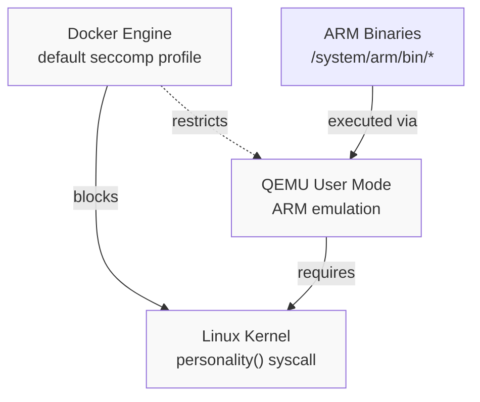
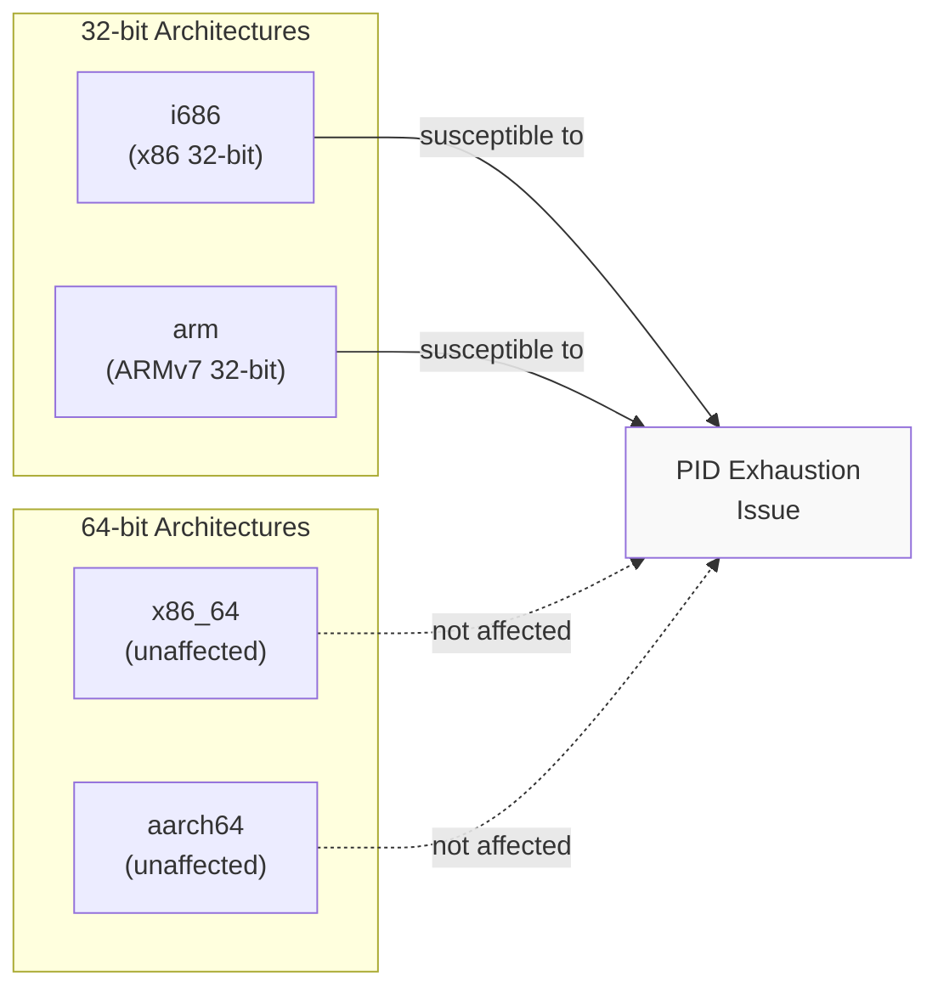
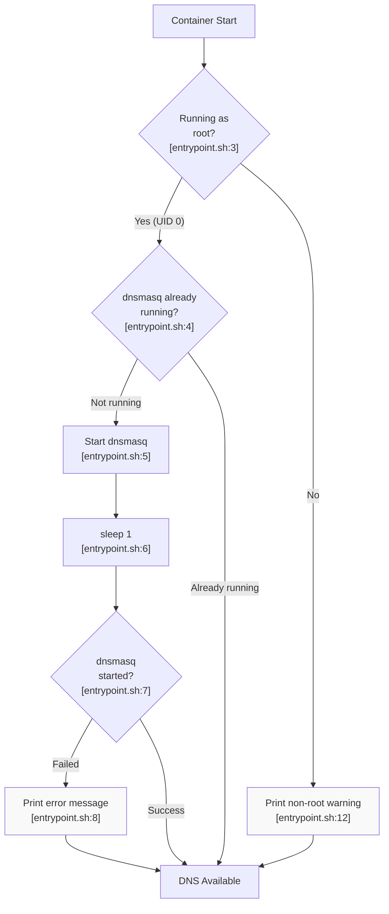
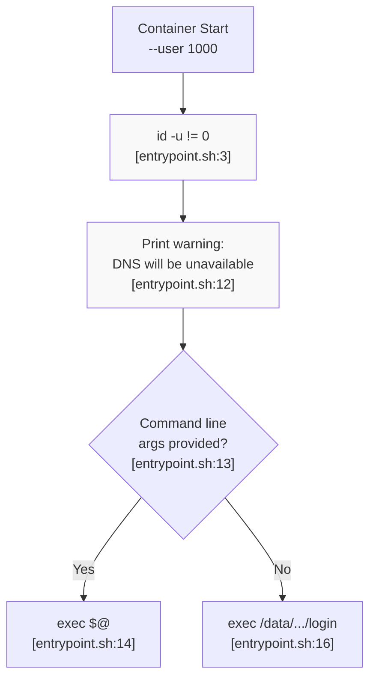
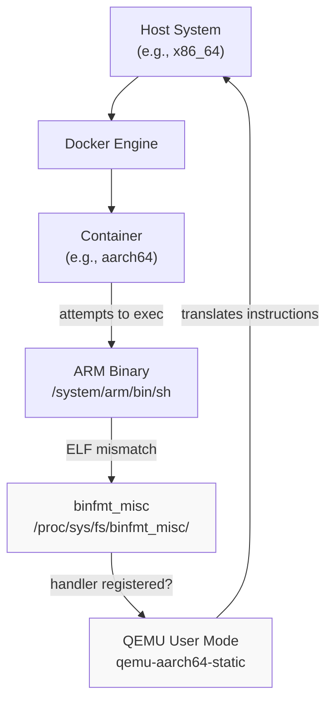
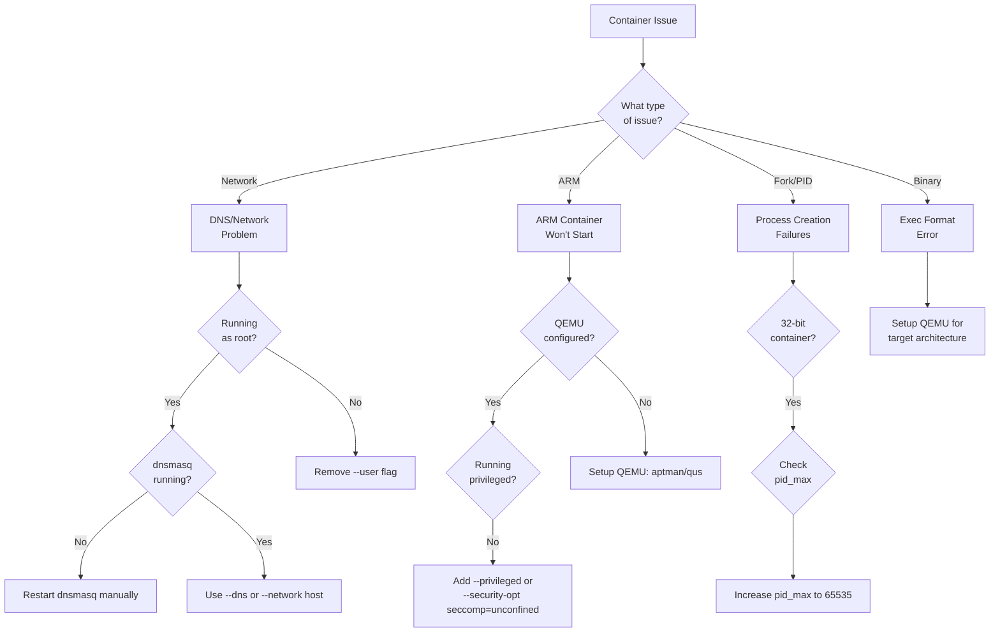

<!-- source: DeepWiki mcp.deepwiki.com · repo termux/termux-docker · page 8.3 Known Issues and Troubleshooting · fetched 2026-10-26 -->

# Known Issues and Troubleshooting

<details>
<summary>Relevant source files</summary>

The following files were used as context for generating this wiki page:

- [README.md](README.md)
- [entrypoint.sh](entrypoint.sh)
- [system/arm/bin/mksh](system/arm/bin/mksh)
- [system/x86/bin/mksh](system/x86/bin/mksh)

</details>


This page documents known issues in termux-docker, their root causes, diagnostic procedures, and workarounds. These issues primarily affect ARM container execution, 32-bit container scalability, and network service initialization.

For information about the service initialization system and how dnsmasq is started, see [Service Initialization](#4.2). For privilege management details, see [Privilege Management](#4.3).

## Overview of Known Issues

The termux-docker project has several documented issues that arise from the intersection of Docker's security model, Linux kernel restrictions, and Termux's Android-based architecture. The following table summarizes the primary issues:

| Issue | Affected Configurations | Severity | Workaround Available |
|-------|------------------------|----------|---------------------|
| ARM seccomp restrictions | ARM/AArch64 on x86 hosts | High | Yes (privileged or custom seccomp) |
| PID exhaustion | 32-bit containers (i686, arm) | Medium | Yes (increase pid_max) |
| dnsmasq startup failure | Non-root containers | Medium | No (requires root) |
| DNS unavailability | Non-root user mode | Low | Limited (manual DNS config) |
| QEMU compatibility | Cross-architecture execution | Medium | Yes (privileged mode) |

Sources: [README.md:111-121]()

## Issue 1: ARM Container Seccomp Restrictions

### Problem Description

ARM and AArch64 containers running on x86/x86_64 hosts through QEMU emulation may fail to start or crash unexpectedly due to Docker's default seccomp profile blocking the `personality()` system call. This syscall is used by QEMU to handle architecture-specific behavior emulation.

### Root Cause

Docker's default seccomp profile (`default.json`) restricts certain system calls for security purposes. The `personality()` syscall, which modifies process execution domain characteristics, is blocked by default. QEMU relies on this syscall when emulating ARM instructions on x86 hardware.

### Symptoms

```
# Typical error output
standard_init_linux.go:XXX: exec user process caused "operation not permitted"
```

Containers may start but certain Termux packages fail to install or execute, particularly compiled binaries.

### Diagnosis

Test if seccomp is the issue by running the container in privileged mode or with seccomp disabled:

```bash
# Test with privileged mode
docker run -it --privileged termux/termux-docker:aarch64

# Test with seccomp disabled
docker run -it --security-opt seccomp=unconfined termux/termux-docker:aarch64
```

If the container works in either mode, seccomp restrictions are the cause.

### Solutions

**Option 1: Run in Privileged Mode** (simplest but less secure)

```bash
docker run -it --privileged termux/termux-docker:aarch64
```

**Option 2: Use Unconfined Seccomp Profile** (recommended)

```bash
docker run -it --security-opt seccomp=unconfined termux/termux-docker:aarch64
```

**Option 3: Custom Seccomp Profile** (most secure)

Create a custom seccomp profile that allows only the `personality()` syscall:

```json
{
  "defaultAction": "SCMP_ACT_ERRNO",
  "architectures": ["SCMP_ARCH_X86_64", "SCMP_ARCH_X86", "SCMP_ARCH_AARCH64", "SCMP_ARCH_ARM"],
  "syscalls": [
    {
      "names": ["personality"],
      "action": "SCMP_ACT_ALLOW"
    }
  ]
}
```

Then run with:
```bash
docker run -it --security-opt seccomp=./custom-seccomp.json termux/termux-docker:aarch64
```

### Affected Components



**Issue Location in Codebase:**
- Container startup: [entrypoint.sh:1-35]()
- ARM binaries referenced: `/system/arm/bin/` directory
- Documentation: [README.md:42-66]()

Sources: [README.md:52-66](), [README.md:115-116]()

## Issue 2: PID Exhaustion in 32-bit Containers

### Problem Description

Multi-threaded applications in 32-bit containers (i686, arm) can cause PID allocation to balloon rapidly, exceeding the default Linux PID limit of 32768. This leads to fork failures and process creation errors.

### Root Cause

This issue stems from how 32-bit libc (bionic) implements thread IDs. In 32-bit systems, the PID namespace can be exhausted more quickly due to:

1. **Thread-to-PID Mapping**: Each thread in Linux is represented by a unique PID (technically TID, but allocated from the same namespace)
2. **32-bit PID Space Limitations**: The default `pid_max` of 32768 is often too low for modern multi-threaded applications
3. **Bionic libc Behavior**: Android's bionic libc has specific PID handling that can accelerate exhaustion

### Symptoms

```
# Typical error messages
bash: fork: retry: Resource temporarily unavailable
bash: fork: retry: No child processes
pthread_create failed: Resource temporarily unavailable
```

Applications fail to spawn new processes or threads. The system appears to hang or become unresponsive.

### Diagnosis

Check current PID usage and limits:

```bash
# Inside the container
ls /proc | grep -E '^[0-9]+$' | wc -l  # Count active PIDs

# On the host
cat /proc/sys/kernel/pid_max  # Check maximum PID value
```

Monitor PID consumption during application execution:

```bash
# Watch PID count in real-time
watch -n 1 'ls /proc | grep -E "^[0-9]+$" | wc -l'
```

### Solutions

**Host-Level Fix** (requires root on host, permanent solution)

Increase the kernel's PID limit to the maximum supported value:

```bash
# On the Docker host (requires root)
sudo sysctl -w kernel.pid_max=65535

# Make it persistent across reboots
echo "kernel.pid_max=65535" | sudo tee -a /etc/sysctl.conf
```

**Docker Compose Configuration**

```yaml
version: '3'
services:
  termux:
    image: termux/termux-docker:i686
    sysctls:
      - kernel.pid_max=65535
    privileged: true  # Required for sysctl modifications
```

**Runtime Docker Command**

```bash
docker run -it --privileged \
  --sysctl kernel.pid_max=65535 \
  termux/termux-docker:i686
```

### Affected Architectures



**Related GitHub Issue**: termux-docker#40

Sources: [README.md:118-121]()

## Issue 3: dnsmasq Startup Failure

### Problem Description

The dnsmasq DNS service may fail to start during container initialization, causing package management operations (`apt update`, `apt install`) to fail due to inability to resolve hostnames.

### Root Cause

dnsmasq startup can fail for several reasons:

1. **Port 53 Already Bound**: Another process (systemd-resolved, another dnsmasq instance) occupies port 53
2. **Insufficient Privileges**: Container not running as root (UID 0)
3. **PTY Allocation Failure**: mksh cannot allocate a pseudo-terminal for dnsmasq
4. **Network Namespace Issues**: Container network configuration is incomplete

### Symptoms

Error message in container logs:
```
[!] Failed to start dnsmasq, host name resolution may fail.
```

Package manager failures:
```bash
$ apt update
Err:1 https://packages.termux.org/apt/termux-main stable InRelease
  Temporary failure resolving 'packages.termux.org'
```

### Diagnosis Flow



### Diagnostic Commands

**Check if dnsmasq is running:**
```bash
# Inside container
/system/bin/busybox pidof dnsmasq
# Empty output means dnsmasq is not running

ps aux | grep dnsmasq
# Should show dnsmasq process if running
```

**Check DNS resolution:**
```bash
# Test hostname resolution
nslookup packages.termux.org
# or
dig packages.termux.org

# Check nameserver configuration
cat /etc/resolv.conf
```

**Check port 53 availability:**
```bash
# On host
sudo netstat -tulpn | grep :53
# or
sudo lsof -i :53
```

**Check container user:**
```bash
# Inside container
id
# Should show uid=0(root) for dnsmasq to start
```

### Solutions

**Solution 1: Ensure Container Runs as Root**

Never use the `--user` flag with termux-docker containers:

```bash
# CORRECT
docker run -it termux/termux-docker:latest

# INCORRECT - will break DNS
docker run -it --user 1000 termux/termux-docker:latest
```

The entrypoint script will drop privileges automatically after starting dnsmasq ([entrypoint.sh:24]()).

**Solution 2: Manual dnsmasq Restart**

If dnsmasq fails after container starts:

```bash
# Inside container as root
/system/bin/mksh -T /dev/ptmx -c "/system/bin/dnsmasq -u root -g root --pid-file /dnsmasq.pid"
```

**Solution 3: Alternative DNS Configuration**

If dnsmasq cannot be started, manually configure DNS:

```bash
# Override resolv.conf
echo "nameserver 8.8.8.8" > /etc/resolv.conf
echo "nameserver 8.8.4.4" >> /etc/resolv.conf
```

**Solution 4: Host Network Mode**

Use host networking to bypass container network namespace issues:

```bash
docker run -it --network host termux/termux-docker:latest
```

### Implementation Details

The dnsmasq startup implementation in the entrypoint:

| Code Element | Purpose | Location |
|--------------|---------|----------|
| `/system/bin/busybox pidof dnsmasq` | Check if dnsmasq is already running | [entrypoint.sh:4]() |
| `/system/bin/mksh -T /dev/ptmx -c "..."` | Start dnsmasq with proper PTY | [entrypoint.sh:5]() |
| `-u root -g root` | Run dnsmasq as root user/group | [entrypoint.sh:5]() |
| `--pid-file /dnsmasq.pid` | Write PID file for process tracking | [entrypoint.sh:5]() |
| `sleep 1` | Wait for dnsmasq to initialize | [entrypoint.sh:6]() |
| Error message to stderr | Alert user of DNS failure | [entrypoint.sh:8]() |

Sources: [entrypoint.sh:3-18](), [README.md:38-40]()

## Issue 4: Non-Root Container DNS Unavailability

### Problem Description

When the container is started as a non-root user (using `--user` flag), dnsmasq cannot be started, resulting in complete DNS unavailability. This is an architectural limitation, not a bug.

### Root Cause

Starting dnsmasq requires:
1. Binding to privileged port 53 (ports < 1024 require CAP_NET_BIND_SERVICE capability)
2. Creating network configuration in `/etc/resolv.conf`
3. Writing PID file to root filesystem locations

All of these operations require root privileges. The entrypoint script detects non-root execution and skips dnsmasq startup entirely ([entrypoint.sh:11-18]()).

### Symptoms

Warning message on container start:
```
[!] Container is running as non-root, unable to start dnsmasq. DNS will be unavailable.
```

All DNS-dependent operations fail:
```bash
$ apt update
Err:1 https://packages.termux.org/apt/termux-main stable InRelease
  Could not resolve 'packages.termux.org'
```

### Non-Root Execution Path



### Solutions

**Solution 1: Do Not Use --user Flag** (recommended)

Simply run the container without `--user`. The entrypoint automatically drops privileges to the `system` user (UID 1000) after starting dnsmasq:

```bash
# RECOMMENDED
docker run -it termux/termux-docker:latest
# Container starts as root, drops to UID 1000 after dnsmasq starts
```

**Solution 2: Use Host DNS**

Mount the host's resolv.conf into the container:

```bash
docker run -it --user 1000 \
  -v /etc/resolv.conf:/etc/resolv.conf:ro \
  termux/termux-docker:latest
```

**Solution 3: Custom DNS Servers**

Specify DNS servers at container runtime:

```bash
docker run -it --user 1000 \
  --dns 8.8.8.8 \
  --dns 8.8.4.4 \
  termux/termux-docker:latest
```

**Solution 4: Host Network Mode**

Use the host's network stack directly:

```bash
docker run -it --user 1000 \
  --network host \
  termux/termux-docker:latest
```

### Comparison: Root vs Non-Root Startup

| Feature | Root Start (Default) | Non-Root Start (--user) |
|---------|---------------------|------------------------|
| dnsmasq service | Started automatically | Not started |
| DNS resolution | Fully functional | Unavailable (unless configured) |
| Package management | Works out of box | Requires manual DNS setup |
| Security | Privilege dropped after init | Already unprivileged |
| Recommended use | General usage | Special security contexts |

Sources: [entrypoint.sh:11-18](), [README.md:38-40]()

## Issue 5: Architecture Incompatibility

### Problem Description

Running a container image built for one CPU architecture on a different host architecture requires additional setup. Without proper QEMU configuration, the container will fail to start with "exec format error".

### Root Cause

Container images contain architecture-specific binaries compiled for a particular CPU instruction set. Docker cannot natively execute binaries compiled for different architectures. For example:
- ARM binaries cannot run on x86 hosts without emulation
- x86 binaries cannot run on ARM hosts without emulation

The error occurs when the kernel attempts to execute a binary with an unsupported ELF machine type.

### Symptoms

```
standard_init_linux.go:XXX: exec user process caused "exec format error"
```

Container exits immediately after start.

### Diagnosis

Check image architecture vs. host architecture:

```bash
# Check image architecture
docker image inspect termux/termux-docker:aarch64 | grep Architecture

# Check host architecture
uname -m
# x86_64 = x86 64-bit
# aarch64 = ARM 64-bit
# armv7l = ARM 32-bit
# i686 = x86 32-bit
```

### Architecture Compatibility Matrix

| Host Architecture | Native Images | Requires QEMU |
|-------------------|---------------|---------------|
| x86_64 | i686, x86_64 | arm, aarch64 |
| aarch64 | arm, aarch64 | i686, x86_64 |
| armv7l | arm | i686, x86_64, aarch64 |
| i686 | i686 | arm, aarch64, x86_64 |

### Solutions

**Solution: Setup QEMU User Mode Emulation**

Configure QEMU with binfmt_misc support using the `aptman/qus` container:

```bash
# Setup QEMU for ARM architectures
docker run --rm --privileged aptman/qus -s -- -p aarch64 arm

# Setup QEMU for x86 architectures (on ARM host)
docker run --rm --privileged aptman/qus -s -- -p x86_64 i686

# Setup all architectures
docker run --rm --privileged aptman/qus -s -- -p --all
```

This command:
1. Registers QEMU binary format handlers with the kernel
2. Installs QEMU static binaries
3. Enables automatic invocation of QEMU for foreign-architecture binaries

After setup, ARM containers can run on x86 hosts transparently.

**Verification:**

```bash
# Check registered binfmt handlers
ls /proc/sys/fs/binfmt_misc/

# Check QEMU registration details
cat /proc/sys/fs/binfmt_misc/qemu-aarch64
```

### Cross-Architecture Execution Flow



Sources: [README.md:42-66]()

## Diagnostic Toolkit

### Essential Diagnostic Commands

```bash
# System Information
uname -m                     # Host architecture
cat /proc/version            # Kernel version
docker version               # Docker version

# Container State
docker ps -a                 # List containers
docker logs <container_id>   # View container logs
docker inspect <container>   # Detailed container config

# Inside Container
id                          # Current user and groups
/system/bin/busybox pidof dnsmasq  # Check dnsmasq
ps aux                      # Process list
cat /etc/resolv.conf        # DNS configuration
ls /proc | grep -E '^[0-9]+$' | wc -l  # PID count

# Network Diagnostics
nslookup packages.termux.org  # Test DNS
ping -c 3 8.8.8.8            # Test network connectivity
netstat -tulpn               # Open ports

# Process and Resource Checks
cat /proc/sys/kernel/pid_max  # Maximum PID value
lsof -i :53                  # What's using port 53
```

### Log Analysis Patterns

| Log Message | Issue | Reference |
|-------------|-------|-----------|
| `Failed to start dnsmasq` | dnsmasq startup failure | [entrypoint.sh:8]() |
| `DNS will be unavailable` | Non-root container | [entrypoint.sh:12]() |
| `exec format error` | Architecture mismatch | N/A |
| `operation not permitted` | Seccomp restriction | N/A |
| `fork: retry: Resource temporarily unavailable` | PID exhaustion | N/A |

### Quick Troubleshooting Decision Tree



Sources: [entrypoint.sh:1-35](), [README.md:111-121]()

## Prevention Best Practices

### Recommended Container Launch Command

```bash
# For x86 hosts running x86 containers
docker run -it termux/termux-docker:latest

# For x86 hosts running ARM containers
docker run --rm --privileged aptman/qus -s -- -p aarch64 arm
docker run -it --privileged termux/termux-docker:aarch64
# OR
docker run -it --security-opt seccomp=unconfined termux/termux-docker:aarch64

# For 32-bit containers with heavy threading
docker run -it --privileged \
  --sysctl kernel.pid_max=65535 \
  termux/termux-docker:i686

# Combined: ARM on x86 with PID fix
docker run -it --privileged \
  --sysctl kernel.pid_max=65535 \
  termux/termux-docker:arm
```

### Configuration Checklist

- [ ] Never use `--user` flag (dnsmasq requires root initialization)
- [ ] Configure QEMU before running cross-architecture containers
- [ ] Use `--privileged` or custom seccomp for ARM on x86
- [ ] Set `kernel.pid_max=65535` for 32-bit containers with multithreading
- [ ] Verify dnsmasq starts successfully after container launch
- [ ] Check container logs if unexpected behavior occurs

Sources: [README.md:38-40](), [README.md:52-66](), [README.md:118-121]()

## Additional Resources

### Related Documentation
- [Service Initialization](#4.2) - Details on dnsmasq startup sequence
- [Privilege Management](#4.3) - Understanding root vs non-root execution
- [Cross-Platform Execution](#5.2) - QEMU and binfmt_misc configuration
- [Entrypoint System](#4.1) - How container initialization works

### External References
- GitHub Issue #40: PID exhaustion in 32-bit containers
- Docker seccomp documentation: Custom security profiles
- QEMU documentation: User mode emulation
- Linux kernel documentation: binfmt_misc and pid_max

Sources: [README.md:1-121](), [entrypoint.sh:1-35]()