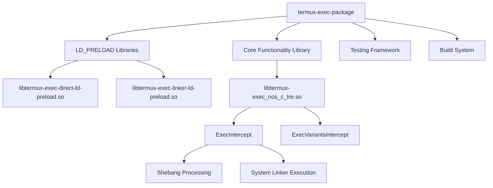
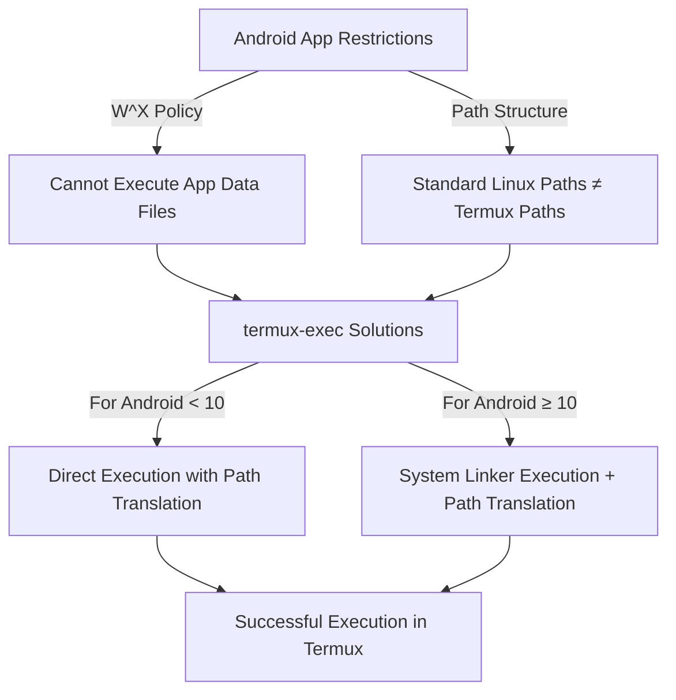
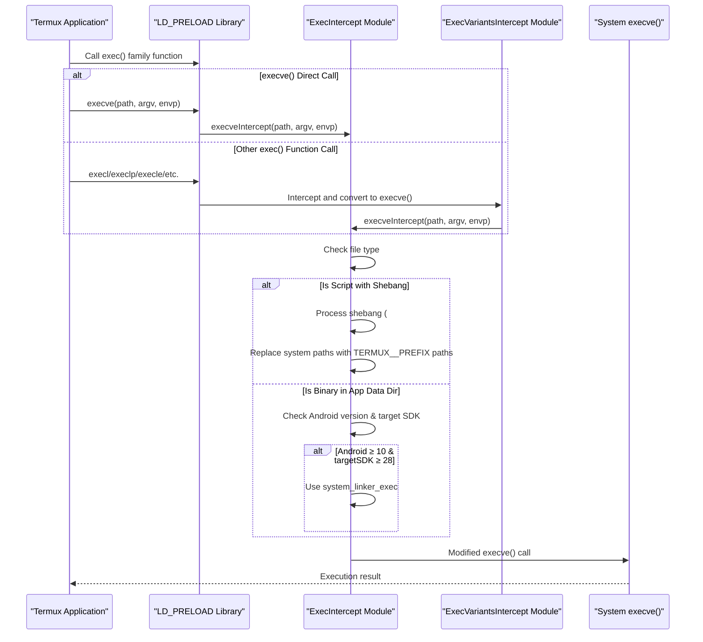
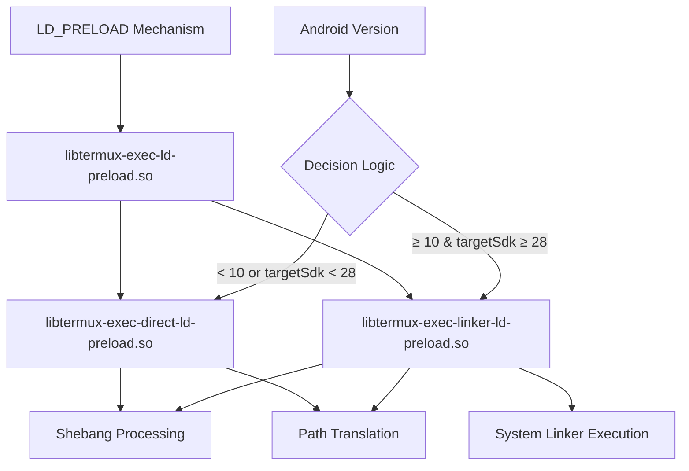
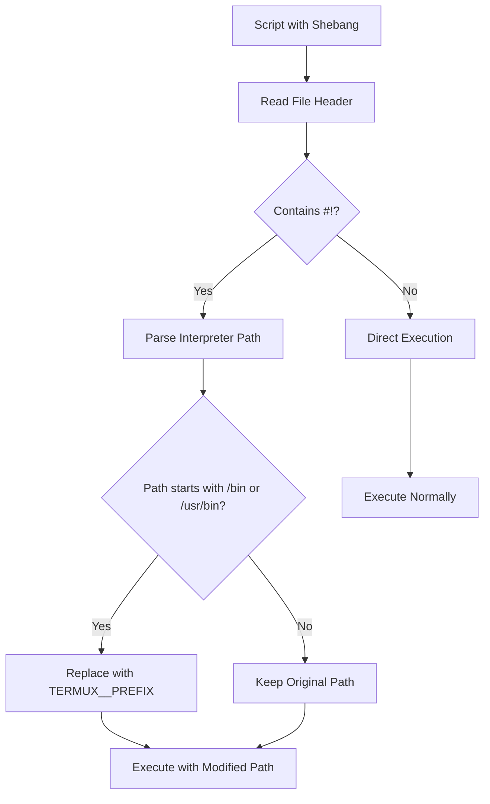
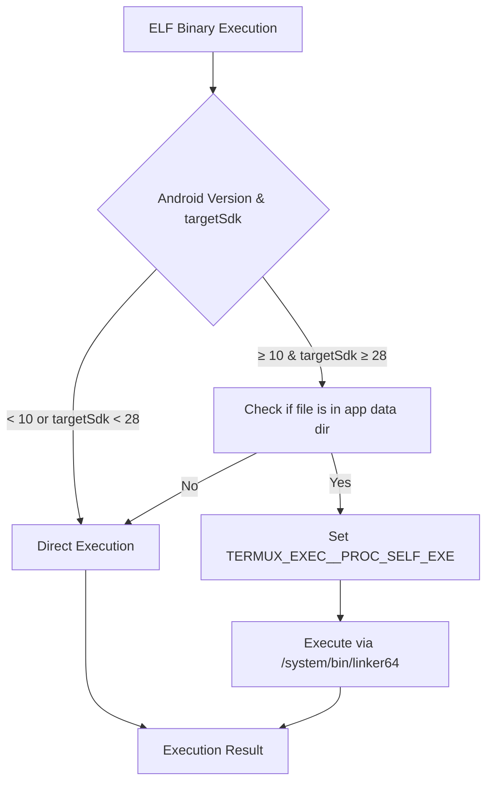
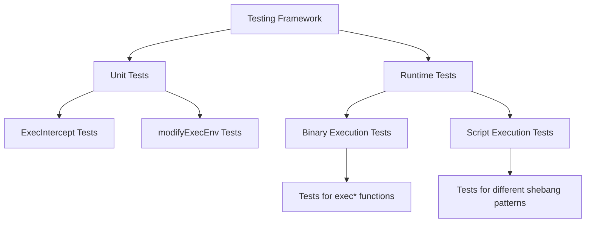

<!-- source: DeepWiki mcp.deepwiki.com · repo termux/termux-exec-package · page 1 Overview · fetched 2026-10-26 -->

# Overview

Relevant source files

The following files were used as context for generating this wiki page:

- [.clang-tidy](.clang-tidy)
- [.gitignore](.gitignore)
- [README.md](README.md)
- [site/pages/en/projects/releases/2/v2.0.0.md](site/pages/en/projects/releases/2/v2.0.0.md)
- [site/pages/en/projects/releases/2/v2.1.0.md](site/pages/en/projects/releases/2/v2.1.0.md)
- [site/pages/en/projects/releases/2/v2.2.0.md](site/pages/en/projects/releases/2/v2.2.0.md)
- [site/pages/en/projects/releases/2/v2.3.0.md](site/pages/en/projects/releases/2/v2.3.0.md)
- [site/pages/en/projects/releases/2/v2.4.0.md](site/pages/en/projects/releases/2/v2.4.0.md)
- [site/pages/en/projects/releases/index.md](site/pages/en/projects/releases/index.md)

## Purpose and Scope

The termux-exec-package is a critical component that enables proper program execution within the Termux environment on Android. It addresses two key challenges:

1. Android's restrictions on executing files in app data directories (W^X policy)
2. Path differences between standard Linux systems and Termux's directory structure

This document provides a comprehensive overview of the termux-exec-package system architecture, core functionality, and key components. For specific installation instructions, see [Installation and Setup](#2). For more detailed technical architecture information, see [System Architecture](#3).

## High-Level Architecture

The termux-exec-package consists of several interconnected components that work together to provide execution capabilities in Termux.

**Termux-Exec System Architecture**

Sources:
- [README.md:1-4]()
- [site/pages/en/projects/releases/2/v2.0.0.md:16-34]()

## Core Problem Addressed

Termux, as an Android application, faces a significant challenge: Android's W^X (Write XOR Execute) security policy prevents executing files located in an app's data directory - exactly where Termux stores its executables. Additionally, Termux needs to handle path translations between standard Linux paths and its own directory structure.

**Problem and Solution Overview**

Sources:
- [site/pages/en/projects/releases/2/v2.0.0.md:28-33]()

## Execution Interception Mechanism

The core functionality of termux-exec is implemented through the interception of the exec() family of functions.

**Execution Flow Diagram**

Sources:
- [site/pages/en/projects/releases/2/v2.0.0.md:21-25]()

## Library Variants

The termux-exec-package provides two different library variants to handle execution on different Android versions:

1. **Direct Execution Variant** (`libtermux-exec-direct-ld-preload.so`): Used on older Android versions or when system_linker_exec is not needed
2. **System Linker Execution Variant** (`libtermux-exec-linker-ld-preload.so`): Used on Android 10+ to bypass W^X restrictions

**Library Variants Architecture**

Sources:
- [site/pages/en/projects/releases/2/v2.0.0.md:19-20]()
- [site/pages/en/projects/releases/2/v2.0.0.md:30-33]()

## Path Translation

One of the key functions of termux-exec is translating standard Linux paths to Termux paths in script shebangs.

**Path Translation Process**

Sources:
- [site/pages/en/projects/releases/2/v2.0.0.md:56-58]()
- [site/pages/en/projects/releases/2/v2.0.0.md:69-70]()

## System Linker Execution

For Android 10 and above (with targetSdkVersion ≥ 28), termux-exec uses the system linker to bypass execution restrictions.

**System Linker Execution Process**

Sources:
- [site/pages/en/projects/releases/2/v2.0.0.md:30-33]()

## Configuration

The behavior of termux-exec can be configured using environment variables.

| Environment Variable | Description | Default | Values |
|---------------------|-------------|---------|--------|
| `TERMUX_EXEC__LOG_LEVEL` | Controls logging verbosity | 1 (NORMAL) | 0 (OFF), 1 (NORMAL), 2 (DEBUG), 3 (VERBOSE), 4 (VVERBOSE), 5 (VVVERBOSE) |
| `TERMUX_EXEC__EXECVE_CALL__INTERCEPT` | Controls whether execve() is intercepted | enable | enable, disable |
| `TERMUX_EXEC__SYSTEM_LINKER_EXEC__MODE` | Controls system_linker_exec usage | enable | disable, enable, force |
| `TERMUX__PREFIX` | Path to Termux installation | /data/data/com.termux/files/usr | Valid path to Termux installation |

Sources:
- [site/pages/en/projects/releases/2/v2.0.0.md:26-27]()
- [site/pages/en/projects/releases/2/v2.0.0.md:33-34]()
- [site/pages/en/projects/releases/2/v2.0.0.md:37-38]()
- [site/pages/en/projects/releases/2/v2.0.0.md:56-57]()

## Version History

The termux-exec-package has evolved over time to support changing Android requirements. The latest stable version is v2.4.0, with significant changes introduced in v2.0.0 that completely redesigned the architecture to better support newer Android versions.

| Version | Major Changes |
|---------|--------------|
| v2.4.0 | Directory structure reorganization, bug fixes |
| v2.3.0 | Standardized version string format, bug fixes |
| v2.2.0 | Bug fixes for system-linker-exec and exec-intercept |
| v2.1.0 | Added riscv64 support, bug fixes |
| v2.0.0 | Major redesign with new library architecture, system_linker_exec support |
| v1.0 | Legacy version before major redesign |

Sources:
- [site/pages/en/projects/releases/index.md:9]()
- [site/pages/en/projects/releases/2/v2.0.0.md:15-47]()
- [site/pages/en/projects/releases/2/v2.1.0.md:15-28]()
- [site/pages/en/projects/releases/2/v2.2.0.md:15-19]()
- [site/pages/en/projects/releases/2/v2.3.0.md:15-33]()
- [site/pages/en/projects/releases/2/v2.4.0.md:15-27]()

## Testing Framework

The termux-exec-package includes a comprehensive testing framework to verify its functionality across different scenarios.

**Testing System Architecture**

Sources:
- [site/pages/en/projects/releases/2/v2.0.0.md:42-43]()
- [site/pages/en/projects/releases/2/v2.1.0.md:15-28]()

## Summary

The termux-exec-package is a critical component for the proper functioning of Termux on Android. It provides solutions for both path translation and execution restrictions through a flexible architecture that adapts to different Android versions and security policies. By intercepting exec() family functions, processing shebangs, and utilizing the system linker when necessary, it ensures that programs can execute properly within the Termux environment despite Android's restrictions.

Sources:
- [README.md:1-4]()
- [site/pages/en/projects/releases/2/v2.0.0.md:15-100]()

---

