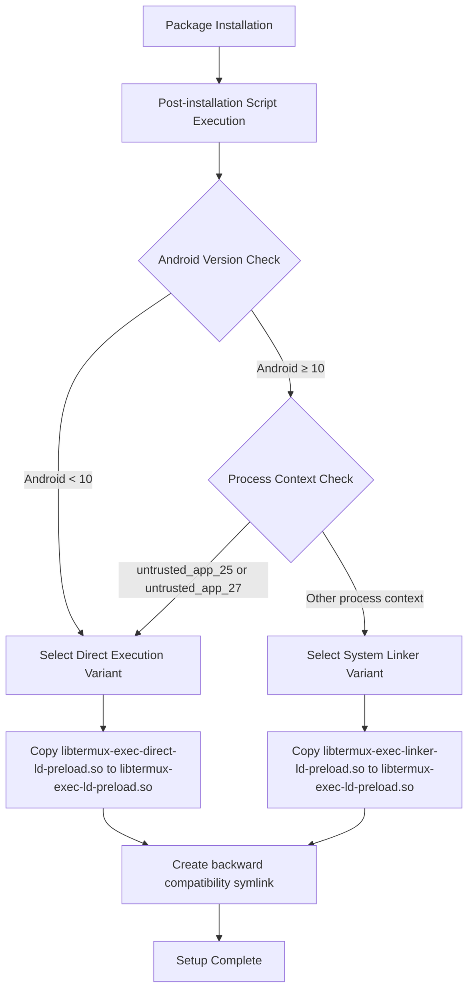
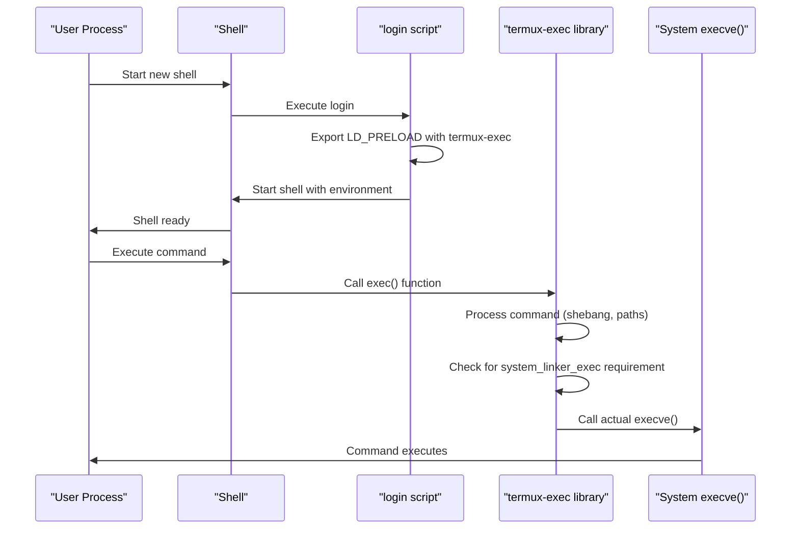

<!-- source: DeepWiki mcp.deepwiki.com · repo termux/termux-exec-package · page 2 Installation and Setup · fetched 2026-10-26 -->

# Installation and Setup

<details>
<summary>Relevant source files</summary>

The following files were used as context for generating this wiki page:

- [.clang-tidy](.clang-tidy)
- [.gitignore](.gitignore)
- [README.md](README.md)
- [packaging/debian/postinst.in](packaging/debian/postinst.in)
- [site/pages/en/projects/docs/technical/index.md](site/pages/en/projects/docs/technical/index.md)
- [site/pages/en/projects/docs/usage/index.md](site/pages/en/projects/docs/usage/index.md)

</details>


This document outlines the installation and configuration procedures for the termux-exec-package, which is essential for proper program execution within the Termux environment. It covers package installation options, environment setup, configuration variables, and verification steps. For information about the underlying technical details of how the execution interception works, see [System Architecture](#3).

## Installation Methods

There are two primary methods to install the termux-exec package in your Termux environment.

### Package Manager Installation

The recommended installation method is using the Termux package manager:

```bash
pkg update
pkg install termux-exec
```

This will download and install the pre-built package along with any dependencies. The post-installation script will automatically configure the appropriate library variant based on your Android version.

### Manual Installation from Source

For advanced users who need to customize the build or work with the latest development version:

```bash
# Clone the repository
git clone https://github.com/termux/termux-exec-package
cd termux-exec-package

# Build the package
make

# Install
make install
```

Sources:
[README.md:3-19]()

## Setup Process

During installation, the termux-exec package automatically configures itself by selecting the appropriate library variant based on your Android version and environment. This setup happens in the post-installation script.

### Library Selection Process

The diagram below illustrates how the system determines which library variant to use:



The setup script:
1. Checks your Android version by examining `ANDROID__BUILD_VERSION_SDK` or using `getprop`
2. For Android 10+, checks your process context to determine if you need the system linker execution variant
3. Sets up the appropriate library by copying it to `$TERMUX__PREFIX/usr/lib/libtermux-exec-ld-preload.so`
4. Creates a backward compatibility symlink from `libtermux-exec.so` to `libtermux-exec-ld-preload.so`

Sources:
[packaging/debian/postinst.in:1-50]()
[site/pages/en/projects/docs/technical/index.md:9-26]()

## LD_PRELOAD Integration

For termux-exec to work, it must be loaded through the `LD_PRELOAD` mechanism. This happens automatically in Termux through the `login` script, which exports the appropriate environment variable.

### How LD_PRELOAD Works with termux-exec



The library is configured in your environment by adding it to the `LD_PRELOAD` environment variable:

```bash
export LD_PRELOAD="$TERMUX__PREFIX/usr/lib/libtermux-exec-ld-preload.so"
```

**Note:** Changes to `LD_PRELOAD` require at least one nested `exec()` call to take effect. When you unset or modify `LD_PRELOAD`, you'll need to start a new shell for changes to be applied.

Sources:
[site/pages/en/projects/docs/usage/index.md:9-11]()
[site/pages/en/projects/docs/technical/index.md:15-26]()

## Configuration Variables

The behavior of termux-exec can be customized through several environment variables.

### Key Environment Variables

| Variable | Type | Default | Description |
|----------|------|---------|-------------|
| `TERMUX_EXEC__EXECVE_CALL__INTERCEPT` | string | `enable` | Controls whether execve() calls are intercepted |
| `TERMUX_EXEC__SYSTEM_LINKER_EXEC__MODE` | string | `enable` | Controls system linker exec usage (`disable`, `enable`, or `force`) |
| `TERMUX_EXEC__LOG_LEVEL` | int | `1` | Controls logging verbosity (0-5) |
| `TERMUX__PREFIX` | string | `/data/data/com.termux/files/usr` | Path to Termux installation |
| `TERMUX__SE_PROCESS_CONTEXT` | string | Varies | SeLinux process context, used to determine execution mode |

#### System Linker Exec Mode Options

The `TERMUX_EXEC__SYSTEM_LINKER_EXEC__MODE` variable controls how the system linker execution mechanism is used:

- `disable`: Never use system linker exec mode, always use direct execution
- `enable`: Use system linker exec only when required (Android 10+ with restrictions)
- `force`: Always use system linker exec when supported (useful for testing)

Sources:
[site/pages/en/projects/docs/usage/index.md:26-290]()

## Verification and Testing

After installation, you should verify that termux-exec is properly installed and functioning.

### Verifying Installation

Check if the library is correctly installed:

```bash
ls -la $TERMUX__PREFIX/usr/lib/libtermux-exec*
```

You should see the appropriate library and symlink:
- `libtermux-exec-ld-preload.so` - The main library file
- `libtermux-exec.so` -> `libtermux-exec-ld-preload.so` - Backward compatibility symlink

### Testing System Linker Exec Mode

You can check if system linker exec is enabled with:

```bash
termux-exec-system-linker-exec is-enabled
```

This command will report whether system linker exec is currently enabled based on your Android version and configuration.

Sources:
[site/pages/en/projects/docs/usage/index.md:257-258]()

## Troubleshooting

### Common Issues

| Issue | Possible Cause | Solution |
|-------|---------------|----------|
| Permission denied when executing binaries | Executing binaries in app data directory on Android 10+ without termux-exec | Ensure termux-exec is installed and LD_PRELOAD is set correctly |
| Wrong interpreter used for scripts | Shebang points to `/bin` or `/usr/bin` paths | Ensure termux-exec is in LD_PRELOAD or use `termux-fix-shebang` |
| Errors about missing environment variables | TERMUX__PREFIX or other variables not set | Verify the Termux environment is properly set up |
| Library not loaded | Some devices don't support LD_PRELOAD | Try alternative methods like proot |

### Manual System Linker Execution

If termux-exec is not working correctly, you can manually use the system linker to execute binaries on Android 10+:

```bash
/system/bin/linker64 $TERMUX__PREFIX/bin/your-binary [args]
```

For script files:

```bash
/system/bin/linker64 $TERMUX__PREFIX/bin/interpreter /path/to/script.sh [args]
```

Sources:
[site/pages/en/projects/docs/technical/index.md:25-125]()

## Execution Types

The termux-exec package provides two primary execution methods, selected automatically based on your Android version and configuration.

### Direct vs System Linker Execution

```mermaid
flowchart TB
    subgraph "Direct Execution (Android < 10)"
        A1["Application"] --> B1["exec() call"]
        B1 --> C1["termux-exec intercept"]
        C1 --> D1["Process shebang & paths"]
        D1 --> E1["Direct execve() call"]
        E1 --> F1["Executable runs"]
    end
    
    subgraph "System Linker Execution (Android ≥ 10)"
        A2["Application"] --> B2["exec() call"]
        B2 --> C2["termux-exec intercept"]
        C2 --> D2["Process shebang & paths"]
        D2 --> E2["Set TERMUX_EXEC__PROC_SELF_EXE"]
        E2 --> F2["Prepare /system/bin/linker64 execution"]
        F2 --> G2["execve(/system/bin/linker64, [linker64, executable, args])"]
        G2 --> H2["Executable runs"]
    end
```



The system automatically selects the appropriate execution method based on:
1. Android version (10+ requires system linker for apps with targetSdkVersion ≥ 29)
2. Process context (untrusted_app_25 and untrusted_app_27 are exempt from restrictions)
3. Location of the executable (files in app data directory require special handling)

Sources:
[site/pages/en/projects/docs/technical/index.md:63-116]()
[site/pages/en/projects/docs/usage/index.md:222-255]()

---

