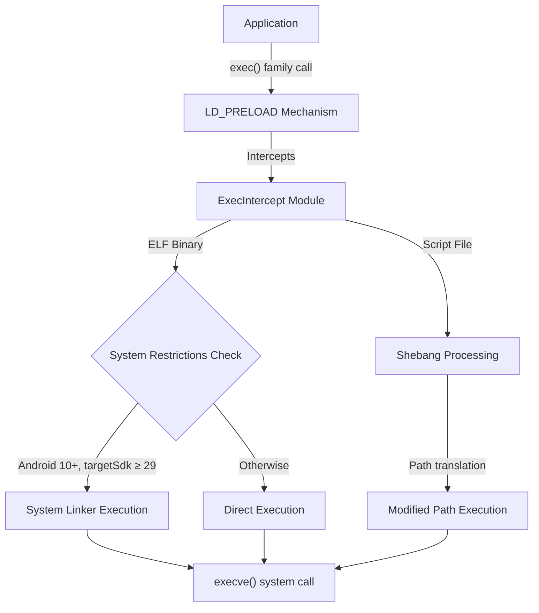
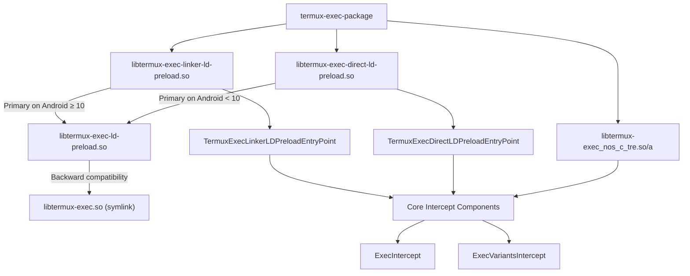
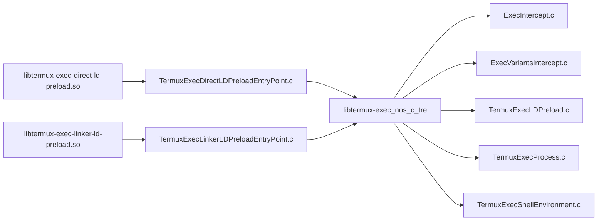
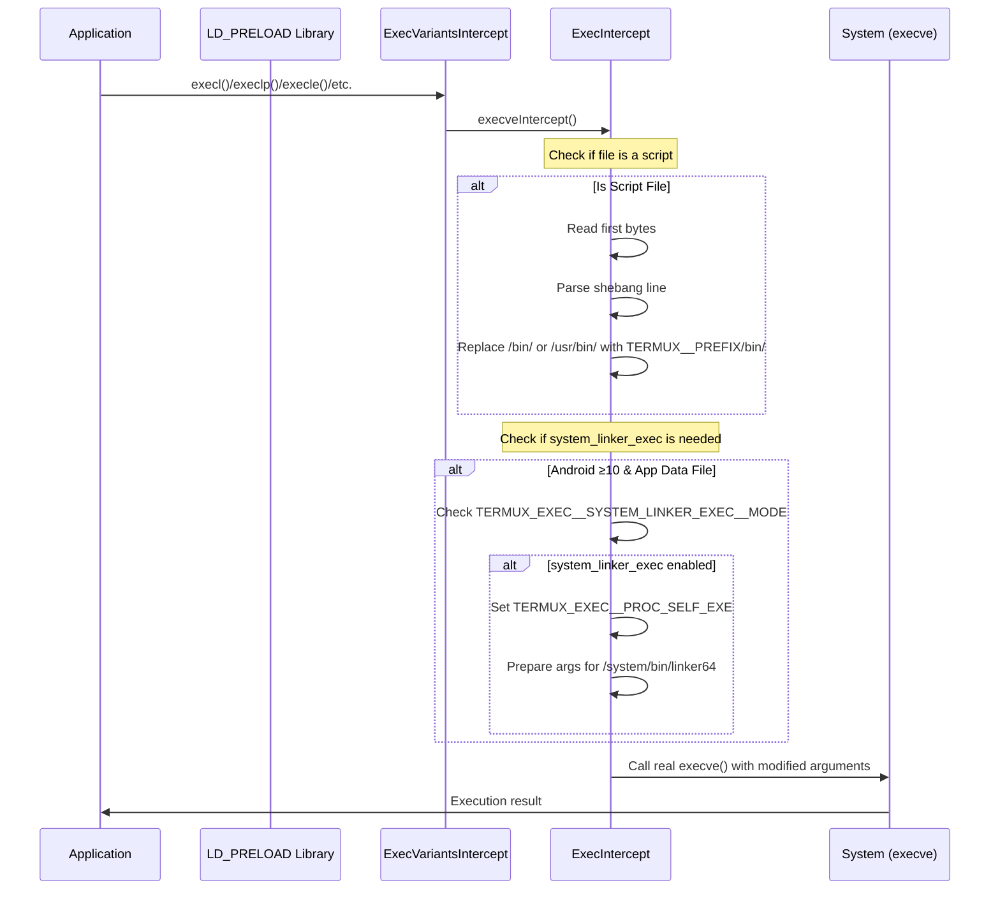
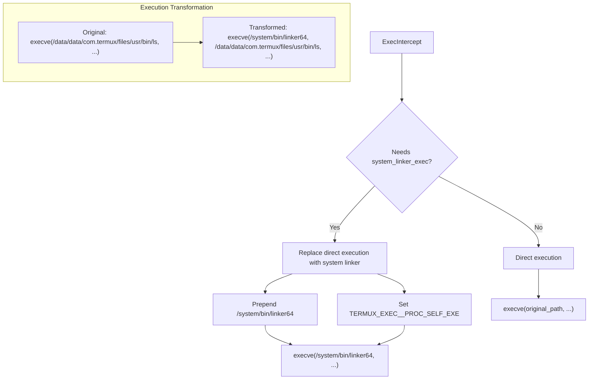
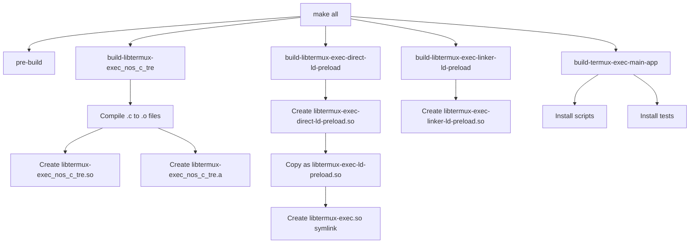
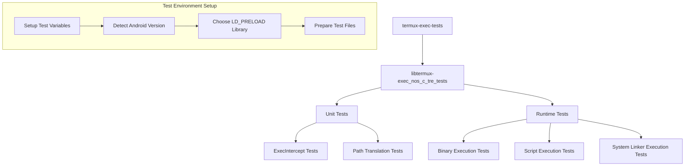
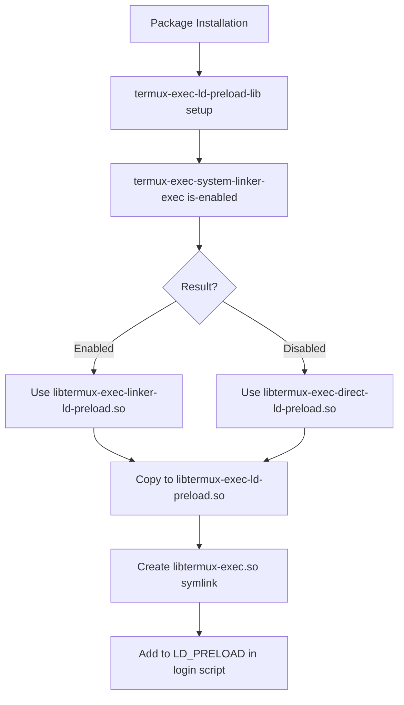
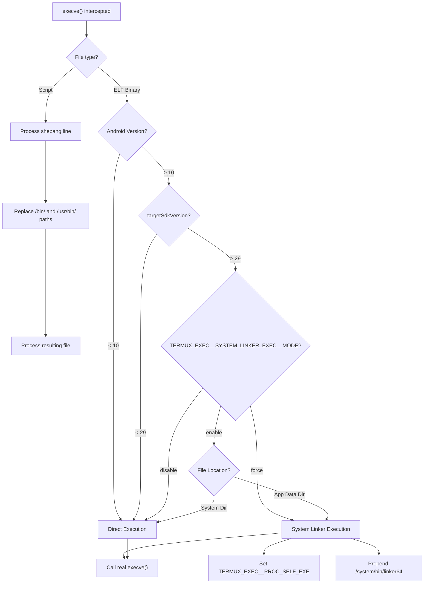
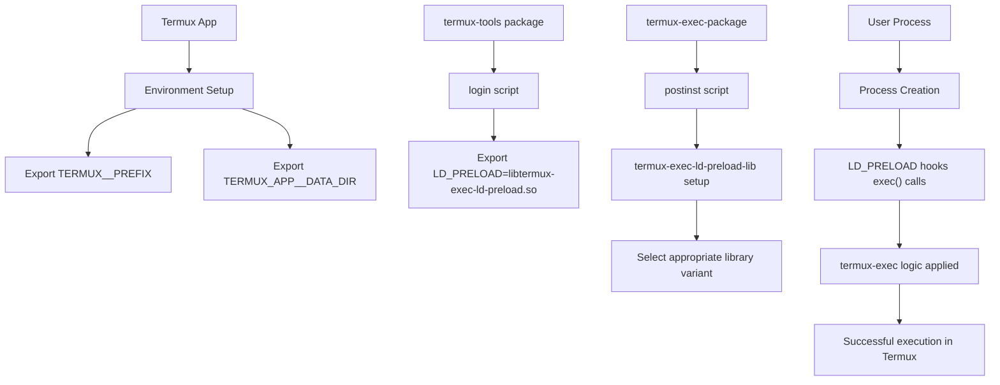

<!-- source: DeepWiki mcp.deepwiki.com · repo termux/termux-exec-package · page 3 System Architecture · fetched 2026-10-26 -->

# System Architecture

Relevant source files

The following files were used as context for generating this wiki page:

- [Makefile](Makefile)
- [app/main/tests/termux-exec-tests.in](app/main/tests/termux-exec-tests.in)
- [site/pages/en/projects/docs/technical/index.md](site/pages/en/projects/docs/technical/index.md)
- [site/pages/en/projects/docs/usage/index.md](site/pages/en/projects/docs/usage/index.md)

This document provides a comprehensive overview of the architectural design and components of the termux-exec package. It explains how the system intercepts execution requests, handles Android's restrictions, and ensures proper program execution within the Termux environment. For installation instructions, see [Installation and Setup](#2), and for detailed execution interception mechanisms, see [Execution Interception Mechanism](#3.2).

## Core System Overview

The termux-exec package is designed to solve two critical issues in the Termux environment:

1. **Android's W^X Restrictions**: On Android 10 and higher with targetSdkVersion ≥ 29, execution of files in app data directories is restricted
2. **Path Differences**: Standard Linux versus Termux path differences (e.g., `/bin/sh` vs. `$TERMUX__PREFIX/bin/sh`)

The system achieves this through an LD_PRELOAD library that intercepts execution requests and applies the necessary modifications before actual execution.

Sources: [lib/termux-exec_nos_c/tre/src/termux/api/termux_exec/service/ld_preload/direct/exec/ExecIntercept.c](), [lib/termux-exec_nos_c/tre/src/termux/api/termux_exec/service/ld_preload/TermuxExecLDPreload.c]()

## Library Variants Architecture

The system provides two primary library variants that serve different execution scenarios:

Sources: [Makefile:394-420](), [Makefile:422-438]()

### Component Relationships

The following diagram shows the relationship between source files and functional components:

Sources: [Makefile:194-200](), [Makefile:386-402](), [Makefile:422-438]()

## Execution Interception Process

The core functionality of the package is the interception and processing of execution requests. This is implemented as an LD_PRELOAD library that hooks into the exec() family of functions.

Sources: [lib/termux-exec_nos_c/tre/src/termux/api/termux_exec/service/ld_preload/direct/exec/ExecIntercept.c](), [lib/termux-exec_nos_c/tre/src/termux/api/termux_exec/service/ld_preload/direct/exec/ExecVariantsIntercept.c]()

## System Linker Execution Mechanism

On Android 10+ with targetSdkVersion ≥ 29, direct execution of files in app data directories is restricted (W^X policy). The termux-exec package implements a bypass using the system linker:

Sources: [lib/termux-exec_nos_c/tre/src/termux/api/termux_exec/service/ld_preload/TermuxExecLDPreload.c:2137-2247](), [lib/termux-exec_nos_c/tre/src/termux/api/termux_exec/service/ld_preload/direct/exec/ExecIntercept.c:216-259]()

## Build System Architecture

The build system is orchestrated by the Makefile, which creates different library variants and installs them appropriately:

Sources: [Makefile:251-264](), [Makefile:289-316](), [Makefile:386-420](), [Makefile:422-438](), [Makefile:271-287]()

## Environment Variables and Configuration

The system's behavior is controlled by several environment variables:

| Environment Variable | Purpose | Default | Options |
|---------------------|---------|---------|---------|
| TERMUX_EXEC__SYSTEM_LINKER_EXEC__MODE | Controls system linker execution | enable | disable, enable, force |
| TERMUX_EXEC__EXECVE_CALL__INTERCEPT | Controls whether execve() is intercepted | enable | disable, enable |
| TERMUX__PREFIX | Path to Termux installation | /data/data/com.termux/files/usr | Any valid path |
| TERMUX_EXEC__LOG_LEVEL | Controls logging verbosity | 1 | 0 (OFF) to 5 (VVVERBOSE) |
| TERMUX_EXEC__PROC_SELF_EXE | Set by system when using system_linker_exec | - | Path to actual executable |

Sources: [site/pages/en/projects/docs/usage/index.md:158-241]()

## Testing Architecture

The package includes a comprehensive testing framework to verify functionality across different execution scenarios:

Sources: [app/main/tests/termux-exec-tests.in:220-261](), [app/main/tests/termux-exec-tests.in:140-215]()

## Installation Flow

Sources: [site/pages/en/projects/docs/technical/index.md:15-16]()

## System Structures

The core library `libtermux-exec_nos_c_tre` consists of several key components:

| Component | Purpose | Source Files |
|-----------|---------|--------------|
| ExecIntercept | Main execution interception logic | lib/termux-exec_nos_c/tre/src/termux/api/termux_exec/service/ld_preload/direct/exec/ExecIntercept.c |
| ExecVariantsIntercept | Handles different exec variants (execl, execlp, etc.) | lib/termux-exec_nos_c/tre/src/termux/api/termux_exec/service/ld_preload/direct/exec/ExecVariantsIntercept.c |
| TermuxExecLDPreload | Provides core LD_PRELOAD functionality | lib/termux-exec_nos_c/tre/src/termux/api/termux_exec/service/ld_preload/TermuxExecLDPreload.c |
| TermuxExecProcess | Process-related utilities | lib/termux-exec_nos_c/tre/src/termux/os/process/termux_exec/TermuxExecProcess.c |
| TermuxExecShellEnvironment | Shell environment handling | lib/termux-exec_nos_c/tre/src/termux/shell/command/environment/termux_exec/TermuxExecShellEnvironment.c |

Sources: [Makefile:194-200]()

## Decision Tree for Execution Method

Sources: [lib/termux-exec_nos_c/tre/src/termux/api/termux_exec/service/ld_preload/TermuxExecLDPreload.c:2137-2247](), [lib/termux-exec_nos_c/tre/src/termux/api/termux_exec/service/ld_preload/direct/exec/ExecIntercept.c:216-259](), [site/pages/en/projects/docs/usage/index.md:222-256]()

## System Files and Their Roles

The following table provides an overview of the key files in the system and their roles:

| File Path | Role |
|-----------|------|
| libtermux-exec-ld-preload.so | Primary LD_PRELOAD library (copy of one of the variants) |
| libtermux-exec-direct-ld-preload.so | Direct execution variant (for Android < 10) |
| libtermux-exec-linker-ld-preload.so | System linker execution variant (for Android ≥ 10) |
| libtermux-exec.so | Backward compatibility symlink |
| libtermux-exec_nos_c_tre.so | Core library implementing execution logic |
| termux-exec-ld-preload-lib | Script to configure the primary LD_PRELOAD library |
| termux-exec-system-linker-exec | Script to check if system_linker_exec is needed |

Sources: [Makefile:386-420](), [Makefile:422-438](), [Makefile:289-316](), [site/pages/en/projects/docs/technical/index.md:11-20]()

## Integration with Termux Environment

The termux-exec package integrates with the broader Termux environment through several mechanisms:

Sources: [site/pages/en/projects/docs/technical/index.md:15-16](), [site/pages/en/projects/docs/usage/index.md:47-116]()

---

