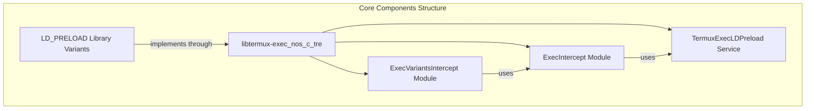
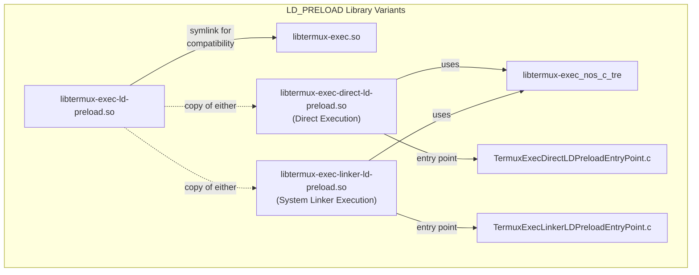
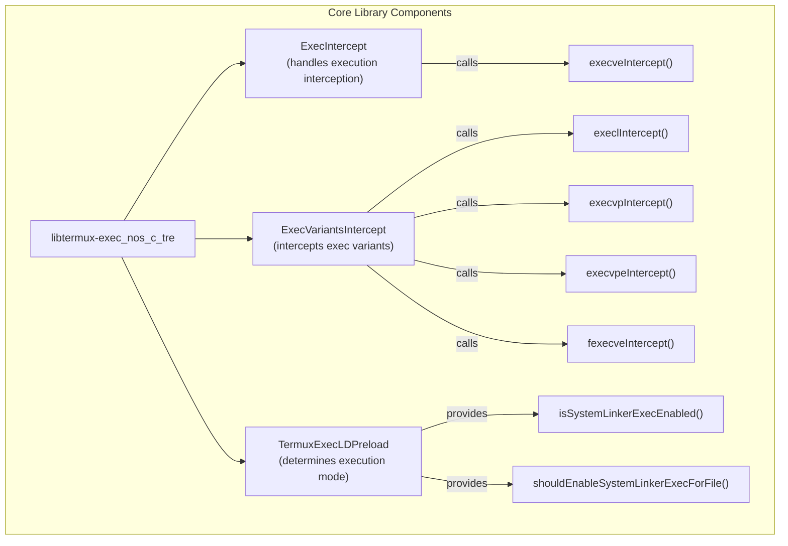
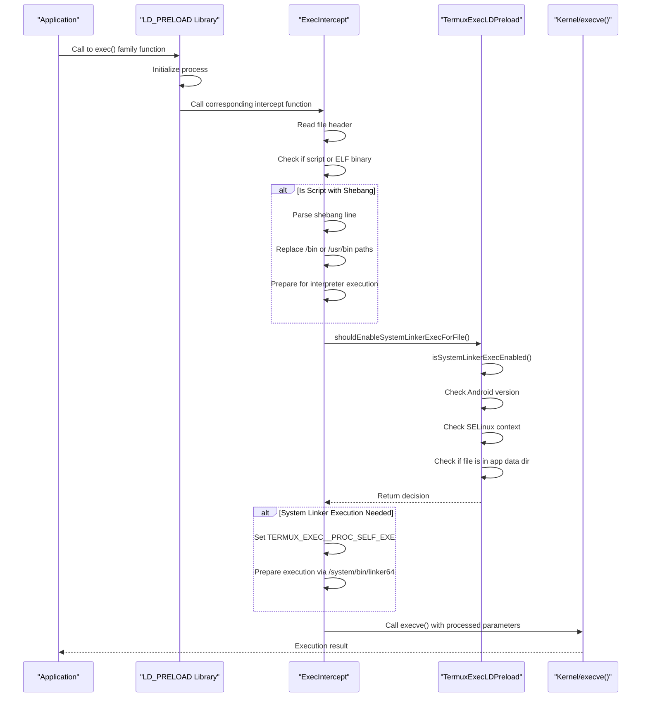
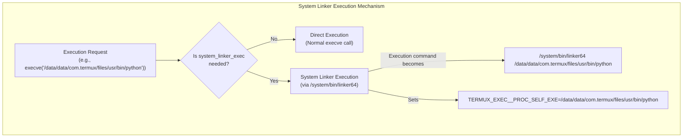

<!-- source: DeepWiki mcp.deepwiki.com · repo termux/termux-exec-package · page 3.1 Core Components · fetched 2026-10-26 -->

# Core Components

Relevant source files

The following files were used as context for generating this wiki page:

- [app/termux-exec-direct-ld-preload/src/termux/api/termux_exec/service/ld_preload/direct/TermuxExecDirectLDPreloadEntryPoint.c](app/termux-exec-direct-ld-preload/src/termux/api/termux_exec/service/ld_preload/direct/TermuxExecDirectLDPreloadEntryPoint.c)
- [app/termux-exec-linker-ld-preload/src/termux/api/termux_exec/service/ld_preload/linker/TermuxExecLinkerLDPreloadEntryPoint.c](app/termux-exec-linker-ld-preload/src/termux/api/termux_exec/service/ld_preload/linker/TermuxExecLinkerLDPreloadEntryPoint.c)
- [lib/termux-exec_nos_c/tre/src/termux/api/termux_exec/service/ld_preload/TermuxExecLDPreload.c](lib/termux-exec_nos_c/tre/src/termux/api/termux_exec/service/ld_preload/TermuxExecLDPreload.c)
- [site/pages/en/projects/docs/technical/index.md](site/pages/en/projects/docs/technical/index.md)
- [site/pages/en/projects/docs/usage/index.md](site/pages/en/projects/docs/usage/index.md)

This page documents the core components of the termux-exec package, which are essential for enabling proper program execution within the Termux environment on Android. The components described here form the foundation of the execution interception system that handles Android's restrictions on executing files in app data directories and resolves path differences between standard Linux and Termux environments.

For information about how to interact with these components as a user, see [Installation and Setup](#2). For details on how execution interception works, see [Execution Interception Mechanism](#3.2).

## Component Overview

The termux-exec package consists of several interconnected core components that work together to provide execution capabilities in the Termux environment.

Sources:
- [lib/termux-exec_nos_c/tre/src/termux/api/termux_exec/service/ld_preload/TermuxExecLDPreload.c]()
- [app/termux-exec-direct-ld-preload/src/termux/api/termux_exec/service/ld_preload/direct/TermuxExecDirectLDPreloadEntryPoint.c]()
- [app/termux-exec-linker-ld-preload/src/termux/api/termux_exec/service/ld_preload/linker/TermuxExecLinkerLDPreloadEntryPoint.c]()

## LD_PRELOAD Library Variants

The termux-exec package provides two variants of the LD_PRELOAD library to intercept execution requests:

### Direct Execution Variant

The direct execution variant (`libtermux-exec-direct-ld-preload.so`) is used when:
- Running on Android versions below 10
- Running with targetSdkVersion < 28
- W^X restrictions don't apply or are exempted

This variant directly intercepts the exec() family of functions and handles path translations, shebang processing, and direct execution.

Sources:
- [app/termux-exec-direct-ld-preload/src/termux/api/termux_exec/service/ld_preload/direct/TermuxExecDirectLDPreloadEntryPoint.c:1-100]()

### System Linker Execution Variant

The system linker execution variant (`libtermux-exec-linker-ld-preload.so`) is used when:
- Running on Android 10 or above
- Running with targetSdkVersion ≥ 28
- W^X restrictions apply and require bypassing

This variant uses the `/system/bin/linker64` (or `/system/bin/linker` on 32-bit systems) to execute files in app data directories, bypassing Android's W^X restrictions.

Sources:
- [app/termux-exec-linker-ld-preload/src/termux/api/termux_exec/service/ld_preload/linker/TermuxExecLinkerLDPreloadEntryPoint.c:1-100]()

## Core Library: libtermux-exec_nos_c_tre

The core functionality of both LD_PRELOAD variants is implemented in a shared library called `libtermux-exec_nos_c_tre`. This library contains the implementation for:

### ExecIntercept Module

The ExecIntercept module is responsible for intercepting execution requests and processing them according to Termux requirements. It:

1. Reads the file header to determine if it's a script or ELF binary
2. Processes shebang lines in scripts to replace `/bin` or `/usr/bin` paths with Termux paths
3. Determines whether system linker execution is needed
4. Modifies arguments and environment variables as needed
5. Calls the appropriate execution function

Sources:
- [lib/termux-exec_nos_c/tre/src/termux/api/termux_exec/service/ld_preload/TermuxExecLDPreload.c:31-140]()

### ExecVariantsIntercept Module

The ExecVariantsIntercept module implements interception for all variants of the exec() family of functions:
- `execl()`, `execlp()`, `execle()`
- `execv()`, `execvp()`, `execvpe()`
- `fexecve()`
- `execve()`

These functions are intercepted by the LD_PRELOAD library and redirected to their corresponding intercept functions.

Sources:
- [app/termux-exec-direct-ld-preload/src/termux/api/termux_exec/service/ld_preload/direct/TermuxExecDirectLDPreloadEntryPoint.c:33-99]()
- [app/termux-exec-linker-ld-preload/src/termux/api/termux_exec/service/ld_preload/linker/TermuxExecLinkerLDPreloadEntryPoint.c:33-99]()

### TermuxExecLDPreload Service

The TermuxExecLDPreload service provides functionality to determine whether system linker execution should be enabled. Key functions include:

- `isSystemLinkerExecEnabled()`: Determines whether system linker execution should be used based on:
  - Android version
  - The value of `TERMUX_EXEC__SYSTEM_LINKER_EXEC__MODE`
  - SELinux process context
  - Effective user ID

- `shouldEnableSystemLinkerExecForFile()`: Determines whether system linker execution should be used for a specific file based on:
  - Whether system linker execution is generally enabled
  - Whether the file is under a Termux app data directory

Sources:
- [lib/termux-exec_nos_c/tre/src/termux/api/termux_exec/service/ld_preload/TermuxExecLDPreload.c:31-170]()

## Execution Flow

The following diagram illustrates the execution flow when a program is executed through termux-exec:

Sources:
- [lib/termux-exec_nos_c/tre/src/termux/api/termux_exec/service/ld_preload/TermuxExecLDPreload.c:31-170]()
- [app/termux-exec-direct-ld-preload/src/termux/api/termux_exec/service/ld_preload/direct/TermuxExecDirectLDPreloadEntryPoint.c:33-99]()
- [app/termux-exec-linker-ld-preload/src/termux/api/termux_exec/service/ld_preload/linker/TermuxExecLinkerLDPreloadEntryPoint.c:33-99]()

## Key Environment Variables

The behavior of the core components is controlled by several environment variables:

| Environment Variable | Purpose | Possible Values |
|---------------------|---------|----------------|
| `TERMUX_EXEC__EXECVE_CALL__INTERCEPT` | Controls whether execve() calls are intercepted | `enable` (default), `disable` |
| `TERMUX_EXEC__SYSTEM_LINKER_EXEC__MODE` | Determines system linker execution usage | `enable` (default), `disable`, `force` |
| `TERMUX__PREFIX` | Path to Termux installation | typically `/data/data/com.termux/files/usr` |
| `TERMUX_EXEC__LOG_LEVEL` | Controls logging verbosity | 0 (OFF) to 5 (VVVERBOSE) |
| `TERMUX_EXEC__PROC_SELF_EXE` | Set to the actual executable path when using system linker execution | Path to executable |
| `TERMUX_APP__DATA_DIR` | Non-legacy Termux app data directory path | Path to data directory |
| `TERMUX_APP__LEGACY_DATA_DIR` | Legacy Termux app data directory path | Path to legacy data directory |
| `TERMUX__SE_PROCESS_CONTEXT` | SELinux process context | SELinux context string |

Sources:
- [site/pages/en/projects/docs/usage/index.md:27-286]()
- [site/pages/en/projects/docs/technical/index.md:220-227]()

## System Linker Execution Mechanism

The system linker execution mechanism is a key component that allows Termux to bypass Android's W^X restrictions on executing files in app data directories.

When system linker execution is enabled and needed, instead of directly executing the target file, termux-exec:

1. Sets the `TERMUX_EXEC__PROC_SELF_EXE` environment variable to the path of the file being executed
2. Prepends `/system/bin/linker64` (or `/system/bin/linker` on 32-bit systems) to the command
3. Executes the file through the system linker instead of directly

This works because the system linker has the privilege to execute files in app data directories, even when Android's W^X restrictions would normally prevent it.

Sources:
- [lib/termux-exec_nos_c/tre/src/termux/api/termux_exec/service/ld_preload/TermuxExecLDPreload.c:31-170]()
- [site/pages/en/projects/docs/technical/index.md:79-106]()

---

