<!-- source: DeepWiki mcp.deepwiki.com · repo termux/termux-exec-package · page 3.2 Execution Interception Mechanism · fetched 2026-10-26 -->

# Execution Interception Mechanism

Relevant source files

The following files were used as context for generating this wiki page:

- [lib/termux-exec_nos_c/tre/include/termux/termux_exec__nos__c/v1/termux/api/termux_exec/service/ld_preload/direct/exec/ExecIntercept.h](lib/termux-exec_nos_c/tre/include/termux/termux_exec__nos__c/v1/termux/api/termux_exec/service/ld_preload/direct/exec/ExecIntercept.h)
- [lib/termux-exec_nos_c/tre/src/termux/api/termux_exec/service/ld_preload/direct/exec/ExecIntercept.c](lib/termux-exec_nos_c/tre/src/termux/api/termux_exec/service/ld_preload/direct/exec/ExecIntercept.c)
- [lib/termux-exec_nos_c/tre/src/termux/api/termux_exec/service/ld_preload/direct/exec/ExecVariantsIntercept.c](lib/termux-exec_nos_c/tre/src/termux/api/termux_exec/service/ld_preload/direct/exec/ExecVariantsIntercept.c)

## Purpose and Scope

This document explains how termux-exec intercepts and processes execution requests in the Termux environment. The execution interception mechanism is the core component that enables proper program execution within Termux by handling path translations, shebang processing, and Android's execution restrictions. For information about the system linker execution specifically, see [System Linker Execution](#3.3).

## Overview

The execution interception mechanism works by hooking into the system's `exec()` family of functions through an `LD_PRELOAD` library. When a program attempts to execute another program, termux-exec intercepts this call, processes it according to Termux's requirements, and then redirects it to the actual system call with the necessary modifications.

```mermaid
flowchart TB
    subgraph "Execution Interception Flow"
        exec["exec() Family Call"] --> intercept["execveIntercept()"]
        intercept --> check_enabled{"Is Intercept\nEnabled?"}
        check_enabled -- "Yes" --> internal["execveInterceptInternal()"]
        check_enabled -- "No" --> syscall["execveSyscall()"]
        
        internal --> process_path["Process Path\n(normalize, absolutize)"]
        process_path --> check_system{"Under System\nDirectory?"}
        
        check_system -- "No" --> read_header["Read File Header"]
        check_system -- "Yes" --> skip_header["Skip Header Read"]
        
        read_header --> inspect["inspectFileHeader()"]
        skip_header --> check_linker
        
        inspect --> check_type{"File Type?"}
        check_type -- "ELF Binary" --> check_linker["Check System Linker Need"]
        check_type -- "Script with Shebang" --> process_script["Process Shebang\nReplace Paths"]
        
        process_script --> check_linker
        
        check_linker --> modify_env["Modify Environment"]
        modify_env --> modify_args["Modify Arguments"]
        modify_args --> exec_call["execveSyscall()"]
    end
```

Sources: [lib/termux-exec_nos_c/tre/src/termux/api/termux_exec/service/ld_preload/direct/exec/ExecIntercept.c:48-79](), [lib/termux-exec_nos_c/tre/src/termux/api/termux_exec/service/ld_preload/direct/exec/ExecIntercept.c:85-442]()

## Key Components

The execution interception mechanism consists of several key components that work together:

```mermaid
classDiagram
    class execveIntercept {
        +int execveIntercept(bool intercept, const char* path, char* const argv[], char* const envp[])
    }
    
    class execveInterceptInternal {
        -int execveInterceptInternal(const char* path, char* const argv[], char* const envp[])
    }
    
    class execveSyscall {
        -int execveSyscall(const char* path, char* const argv[], char* const envp[])
    }
    
    class readFileHeader {
        +int readFileHeader(const char* label, const char* path, char* buffer, size_t bufferSize)
    }
    
    class inspectFileHeader {
        +int inspectFileHeader(const char* prefix, char* header, size_t length, struct TermuxFileHeaderInfo* info)
    }
    
    class modifyExecEnv {
        +int modifyExecEnv(char* const* envp, char*** newEnvpPointer, char** procSelfExe, bool unsetLdVars, bool unsetLdPreload)
    }
    
    class modifyExecArgs {
        +int modifyExecArgs(char* const* argv, const char*** newArgvPointer, const char* origPath, const char* execPath, bool interpreter, bool systemLinker, struct TermuxFileHeaderInfo* info)
    }
    
    class ExecVariantsIntercept {
        +int execlIntercept()
        +int execvIntercept()
        +int execvpIntercept()
        +int execvpeIntercept()
        +int fexecveIntercept()
    }

    execveIntercept --> execveInterceptInternal
    execveIntercept --> execveSyscall
    ExecVariantsIntercept --> execveIntercept
    execveInterceptInternal --> readFileHeader
    execveInterceptInternal --> inspectFileHeader
    execveInterceptInternal --> modifyExecEnv
    execveInterceptInternal --> modifyExecArgs
    execveInterceptInternal --> execveSyscall
```

Sources: [lib/termux-exec_nos_c/tre/include/termux/termux_exec__nos__c/v1/termux/api/termux_exec/service/ld_preload/direct/exec/ExecIntercept.h](), [lib/termux-exec_nos_c/tre/src/termux/api/termux_exec/service/ld_preload/direct/exec/ExecIntercept.c](), [lib/termux-exec_nos_c/tre/src/termux/api/termux_exec/service/ld_preload/direct/exec/ExecVariantsIntercept.c]()

## Interception Process

### Entry Points

The execution interception begins when any of the `exec()` family functions is called. All variants ultimately route to `execveIntercept()`, which is the main interception function.

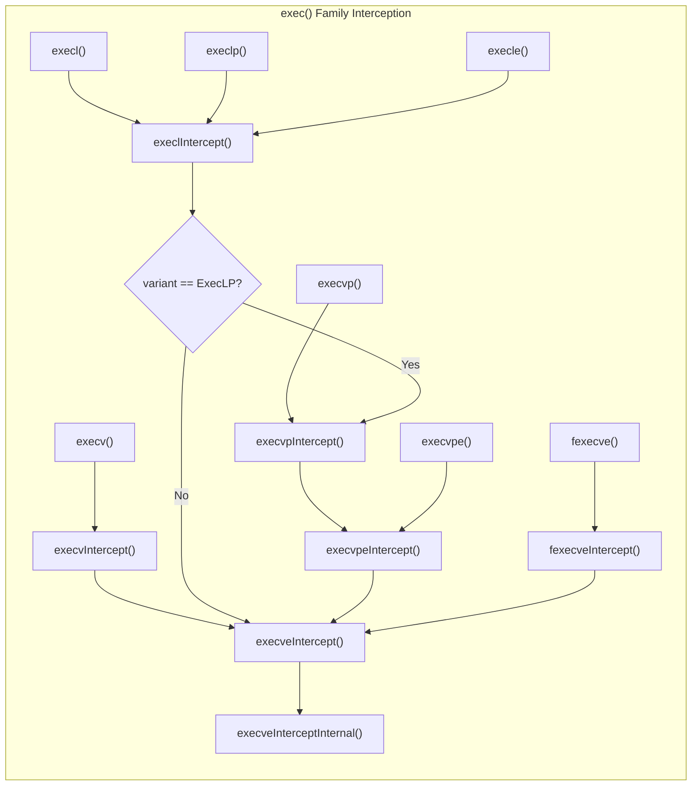

Sources: [lib/termux-exec_nos_c/tre/src/termux/api/termux_exec/service/ld_preload/direct/exec/ExecVariantsIntercept.c:47-185]()

### Path Processing

Once the execution request is intercepted, the path to the executable undergoes several processing steps:

1. **Normalization**: Removes redundant path components like `.` and `..`
2. **Absolutization**: Converts relative paths to absolute paths
3. **Prefix Translation**: Replaces standard Linux paths with Termux-specific paths

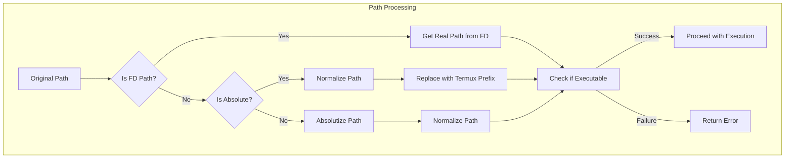

Sources: [lib/termux-exec_nos_c/tre/src/termux/api/termux_exec/service/ld_preload/direct/exec/ExecIntercept.c:124-207]()

### File Header Inspection

For non-system executables, termux-exec reads and inspects the file header to determine how to handle the execution:

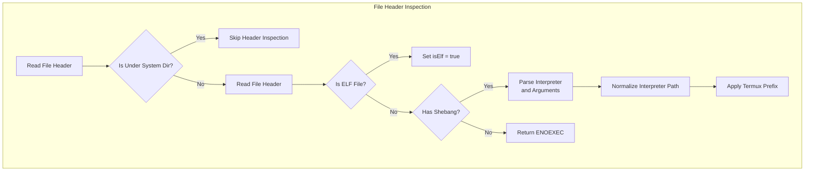

Sources: [lib/termux-exec_nos_c/tre/src/termux/api/termux_exec/service/ld_preload/direct/exec/ExecIntercept.c:219-286](), [lib/termux-exec_nos_c/tre/src/termux/api/termux_exec/service/ld_preload/direct/exec/ExecIntercept.c:447-647]()

## Script Handling

### Shebang Processing

One of the primary functions of the execution interception is handling script files with shebangs (`#!`). The mechanism:

1. Reads the first line of the script file
2. Parses the interpreter path and arguments
3. Normalizes and prefixes the interpreter path
4. Modifies execution arguments to run the script with the appropriate interpreter

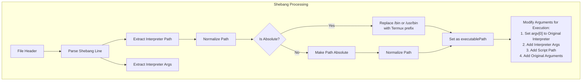

Sources: [lib/termux-exec_nos_c/tre/src/termux/api/termux_exec/service/ld_preload/direct/exec/ExecIntercept.c:471-643](), [lib/termux-exec_nos_c/tre/src/termux/api/termux_exec/service/ld_preload/direct/exec/ExecIntercept.c:757-807]()

The shebang processing has two important features:

1. **Extended Shebang Length**: Termux-exec increases the maximum allowed shebang line length from the kernel's limit (128 or 256 bytes) to 340 bytes, allowing longer interpreter paths.

2. **Path Translation**: It automatically translates standard Linux paths in shebangs (like `/bin/bash`) to their Termux equivalents (like `/data/data/com.termux/files/usr/bin/bash`).

## Environment and Argument Modification

### Environment Variable Handling

The execution interception mechanism modifies environment variables for execution based on various conditions:

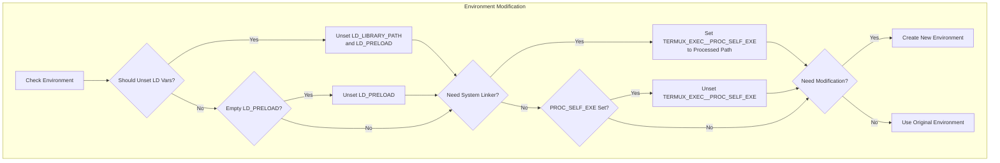

Sources: [lib/termux-exec_nos_c/tre/src/termux/api/termux_exec/service/ld_preload/direct/exec/ExecIntercept.c:314-387](), [lib/termux-exec_nos_c/tre/src/termux/api/termux_exec/service/ld_preload/direct/exec/ExecIntercept.c:676-753]()

### Argument Modification

Arguments are modified based on whether interpreter execution or system linker execution is needed:

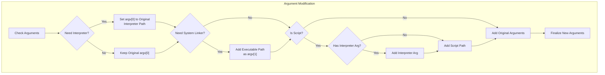

Sources: [lib/termux-exec_nos_c/tre/src/termux/api/termux_exec/service/ld_preload/direct/exec/ExecIntercept.c:757-807]()

## Special Cases and Considerations

### System Executables Detection

Termux-exec has special handling for system executables (under `/system`, `/vendor`, etc.):

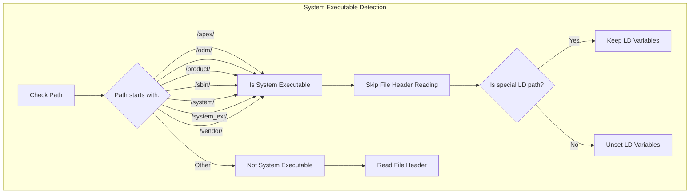

Sources: [lib/termux-exec_nos_c/tre/src/termux/api/termux_exec/service/ld_preload/direct/exec/ExecIntercept.c:651-664](), [lib/termux-exec_nos_c/tre/src/termux/api/termux_exec/service/ld_preload/direct/exec/ExecIntercept.c:668-674]()

### Path Length Considerations

Termux-exec addresses various path length limitations on different Android versions:

| Android Version | Path Length Limit | Description |
|-----------------|------------------|-------------|
| Android < 6     | 128 bytes        | For executable and library paths |
| Android ≥ 6     | PATH_MAX         | Increased limit in newer versions |
| All versions    | 340 bytes        | Termux-exec's extended shebang limit |

The code checks for these limits and handles potential buffer overflows, especially on older Android versions:

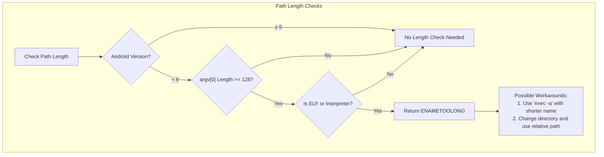

Sources: [lib/termux-exec_nos_c/tre/include/termux/termux_exec__nos__c/v1/termux/api/termux_exec/service/ld_preload/direct/exec/ExecIntercept.h:16-117](), [lib/termux-exec_nos_c/tre/src/termux/api/termux_exec/service/ld_preload/direct/exec/ExecIntercept.c:811-856]()

## Complete Execution Flow

The following diagram shows the complete flow of the execution interception process:

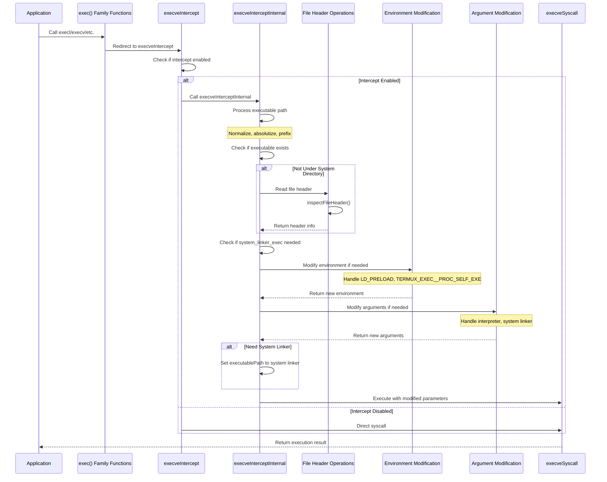

Sources: [lib/termux-exec_nos_c/tre/src/termux/api/termux_exec/service/ld_preload/direct/exec/ExecIntercept.c:48-443]()

## Error Handling

The execution interception mechanism provides thorough error handling for various failure scenarios:

| Error Scenario | Error Code | Description |
|----------------|------------|-------------|
| File not found | ENOENT | Executable or interpreter not found |
| Not executable | EACCES | File exists but is not executable |
| Invalid format | ENOEXEC | Not an ELF file or script with valid shebang |
| Path too long | ENAMETOOLONG | Path exceeds system limits |
| Not a regular file | EACCES | Attempted to execute directory or special file |

The mechanism also correctly handles errors from the system call and preserves the original error codes when passing them back to the application.

Sources: [lib/termux-exec_nos_c/tre/src/termux/api/termux_exec/service/ld_preload/direct/exec/ExecIntercept.c:134-140](), [lib/termux-exec_nos_c/tre/src/termux/api/termux_exec/service/ld_preload/direct/exec/ExecIntercept.c:262-267](), [lib/termux-exec_nos_c/tre/src/termux/api/termux_exec/service/ld_preload/direct/exec/ExecIntercept.c:298-308]()

## Conclusion

The execution interception mechanism is the core component that enables Termux to run programs properly in the Android environment. By intercepting execution requests, it handles path translations, shebang processing, and works around Android's execution restrictions. This allows users to run standard Linux commands and scripts within the Termux environment with proper path handling and execution behavior.

---

