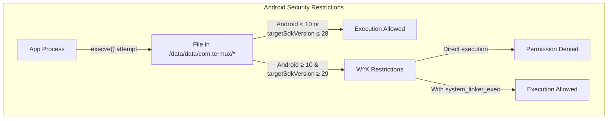
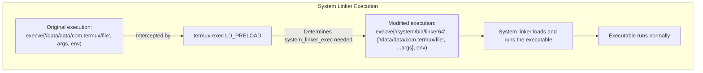
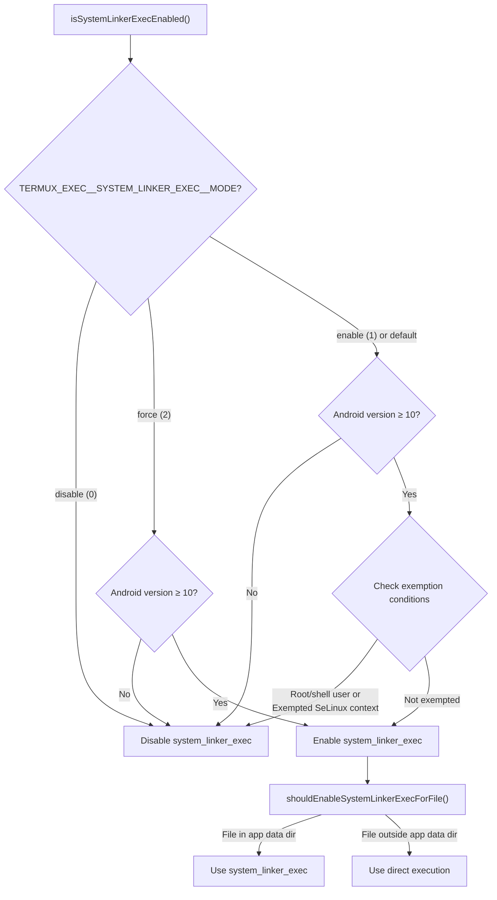
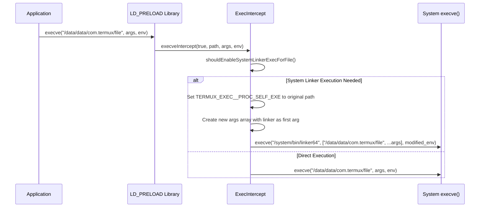
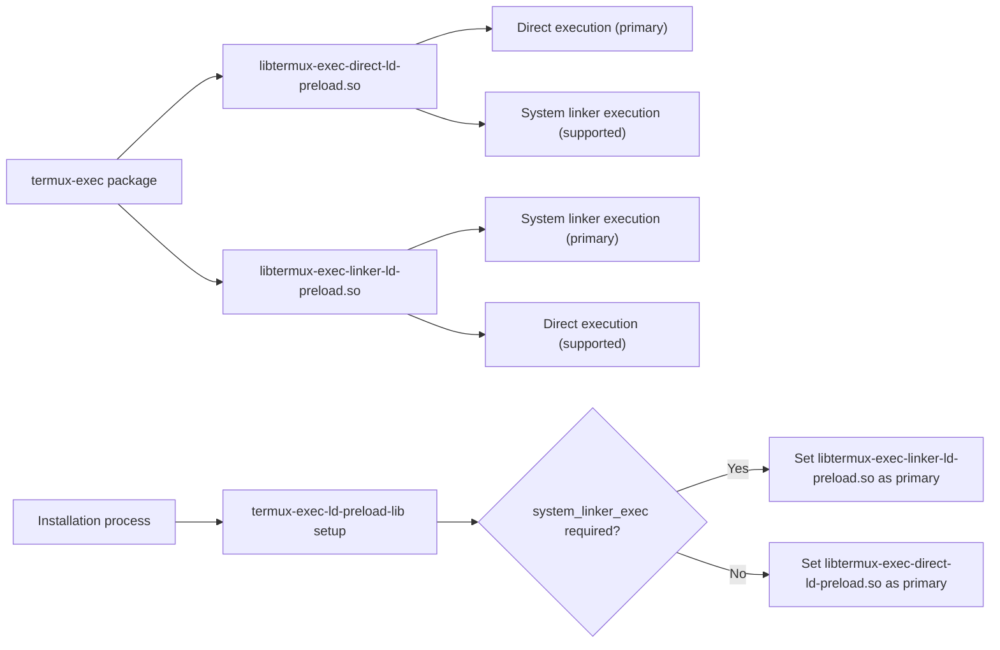

<!-- source: DeepWiki mcp.deepwiki.com · repo termux/termux-exec-package · page 3.3 System Linker Execution · fetched 2026-10-26 -->

# System Linker Execution

Relevant source files

The following files were used as context for generating this wiki page:

- [app/termux-exec-linker-ld-preload/src/termux/api/termux_exec/service/ld_preload/linker/TermuxExecLinkerLDPreloadEntryPoint.c](app/termux-exec-linker-ld-preload/src/termux/api/termux_exec/service/ld_preload/linker/TermuxExecLinkerLDPreloadEntryPoint.c)
- [lib/termux-exec_nos_c/tre/src/termux/api/termux_exec/service/ld_preload/TermuxExecLDPreload.c](lib/termux-exec_nos_c/tre/src/termux/api/termux_exec/service/ld_preload/TermuxExecLDPreload.c)
- [site/pages/en/projects/docs/technical/index.md](site/pages/en/projects/docs/technical/index.md)
- [site/pages/en/projects/docs/usage/index.md](site/pages/en/projects/docs/usage/index.md)

## Purpose and Scope

This document describes the System Linker Execution mechanism in the termux-exec package, which enables execution of files in the Termux environment on Android devices with W^X (Write XOR Execute) restrictions. This mechanism is specifically designed to bypass Android's security restrictions that prevent executing files from app data directories on Android 10 and newer versions with targetSdkVersion ≥ 29.

For information about the general execution interception mechanism, see [Execution Interception Mechanism](#3.2). For details about core components of the termux-exec system, see [Core Components](#3.1).

## Android W^X Restrictions

Starting with Android 10, Google implemented W^X restrictions through SeLinux policies that prevent untrusted apps from executing files stored in their app data directories (like `/data/data/com.termux/`). This creates a significant challenge for Termux, as its entire functionality depends on executing binaries and scripts from its private directories.

Sources: [site/pages/en/projects/docs/technical/index.md:65-102]()

## System Linker Execution Solution

The system linker execution mechanism works by executing the Android system dynamic linker (`/system/bin/linker64` for 64-bit devices or `/system/bin/linker` for 32-bit) and passing the path to the Termux executable as an argument. This bypasses the W^X restrictions because the kernel/SeLinux only sees the system linker (which has the appropriate permissions) being executed, not the actual Termux executable.

Sources: [site/pages/en/projects/docs/technical/index.md:80-106]()

## Implementation in termux-exec

The system linker execution is implemented through the LD_PRELOAD library variants provided by termux-exec, specifically:

1. `libtermux-exec-direct-ld-preload.so` - Used for direct execution but supports system linker execution when needed
2. `libtermux-exec-linker-ld-preload.so` - Specifically optimized for system linker execution

The decision to use system linker execution is controlled by the environment variable `TERMUX_EXEC__SYSTEM_LINKER_EXEC__MODE` and is implemented in the `isSystemLinkerExecEnabled()` and `shouldEnableSystemLinkerExecForFile()` functions.

Sources: [lib/termux-exec_nos_c/tre/src/termux/api/termux_exec/service/ld_preload/TermuxExecLDPreload.c:31-170]()

## Decision Process

The system determines whether to use system linker execution through a multi-step process:

1. First, it checks the `TERMUX_EXEC__SYSTEM_LINKER_EXEC__MODE` environment variable:
   - `0` (disable): Never use system linker execution
   - `1` (enable): Use when needed (default)
   - `2` (force): Use if available, even if not strictly needed

2. If mode is not disabled, it checks Android version:
   - Only Android 10+ supports this mechanism
   
3. It checks exemption conditions (if mode is "enable"):
   - If running as root or shell user, system linker execution is not needed
   - If running with exempted SeLinux context (untrusted_app_25 or untrusted_app_27), it's not needed

4. For each executable, it checks if the file is under the Termux app data directory:
   - Only files under app data directories need system linker execution

This decision process ensures that system linker execution is only used when necessary, optimizing performance while ensuring compatibility.

Sources: [lib/termux-exec_nos_c/tre/src/termux/api/termux_exec/service/ld_preload/TermuxExecLDPreload.c:31-170](), [site/pages/en/projects/docs/usage/index.md:220-256]()

## Execution Flow

When an exec() family function is called, the system intercepts it and modifies the execution parameters if system linker execution is needed:

Sources: [app/termux-exec-linker-ld-preload/src/termux/api/termux_exec/service/ld_preload/linker/TermuxExecLinkerLDPreloadEntryPoint.c:10-99]()

## Configuration Options

The system linker execution behavior can be controlled through environment variables:

| Environment Variable | Purpose | Values |
|---------------------|---------|--------|
| `TERMUX_EXEC__SYSTEM_LINKER_EXEC__MODE` | Controls system linker exec usage | `disable` (0), `enable` (1, default), `force` (2) |
| `TERMUX_EXEC__EXECVE_CALL__INTERCEPT` | Controls whether execve calls are intercepted | `disable`, `enable` (default) |
| `TERMUX_EXEC__LOG_LEVEL` | Controls logging verbosity | 0 (off) to 5 (very verbose) |
| `TERMUX__SE_PROCESS_CONTEXT` | SeLinux process context for determining exemptions | Set by Termux app |

### Output Environment Variables

When system linker execution is used, termux-exec sets:

| Environment Variable | Purpose |
|---------------------|---------|
| `TERMUX_EXEC__PROC_SELF_EXE` | Contains the actual executable path when using system linker execution |

Sources: [site/pages/en/projects/docs/usage/index.md:220-256](), [site/pages/en/projects/docs/usage/index.md:300-339]()

## Library Variants

The termux-exec package includes two library variants that support system linker execution:

The appropriate library is selected at installation time and configured as the primary LD_PRELOAD library at `$TERMUX__PREFIX/usr/lib/libtermux-exec-ld-preload.so`.

Sources: [site/pages/en/projects/docs/technical/index.md:11-21]()

## Limitations and Considerations

The system linker execution approach has several limitations:

1. **Process identification**: The `/proc/self/exe` will point to `/system/bin/linker64` instead of the actual executable, which can cause issues with programs that check this path. To address this, termux-exec sets the `TERMUX_EXEC__PROC_SELF_EXE` environment variable to the actual executable path.

2. **Statically linked binaries**: The system linker execution approach doesn't work with statically linked binaries, as they don't use the dynamic linker.

3. **Direct system calls**: Programs that bypass the exec() wrappers and directly use the execve() system call won't benefit from this mechanism.

4. **Environment variable management**: When unsetting LD_PRELOAD, the `TERMUX_EXEC__PROC_SELF_EXE` environment variable should also be unset to prevent potential issues.

These limitations require careful consideration when developing applications for Termux, particularly those that need to work across different Android versions.

Sources: [site/pages/en/projects/docs/technical/index.md:108-125](), [site/pages/en/projects/docs/usage/index.md:309-325]()

## Internal Implementation Details

The system linker execution mechanism is primarily implemented in:

1. `TermuxExecLDPreload.c` - Contains the decision logic in `isSystemLinkerExecEnabled()` and `shouldEnableSystemLinkerExecForFile()`
2. `ExecIntercept.c` - Implements the actual execution interception and modification
3. `TermuxExecLinkerLDPreloadEntryPoint.c` - Entry point for the linker-specific library variant

The implementation carefully checks various conditions to determine whether system linker execution is needed, considering factors like Android version, SeLinux context, and file location.

Sources: [lib/termux-exec_nos_c/tre/src/termux/api/termux_exec/service/ld_preload/TermuxExecLDPreload.c:31-170](), [app/termux-exec-linker-ld-preload/src/termux/api/termux_exec/service/ld_preload/linker/TermuxExecLinkerLDPreloadEntryPoint.c:10-99]()

---

