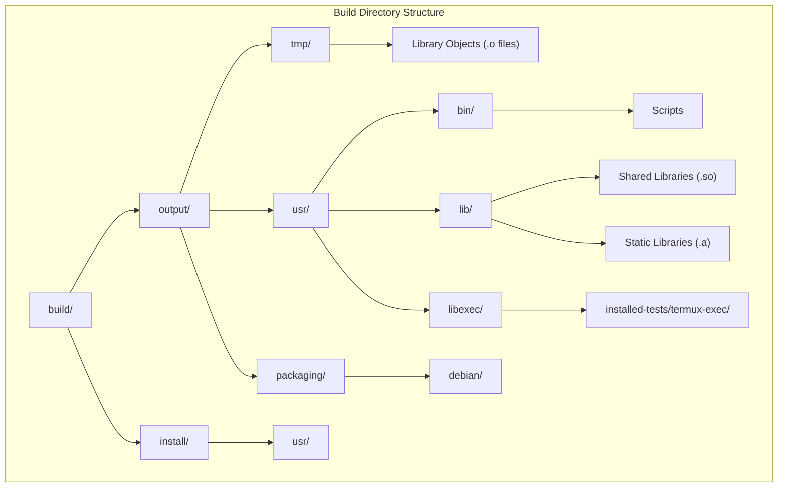
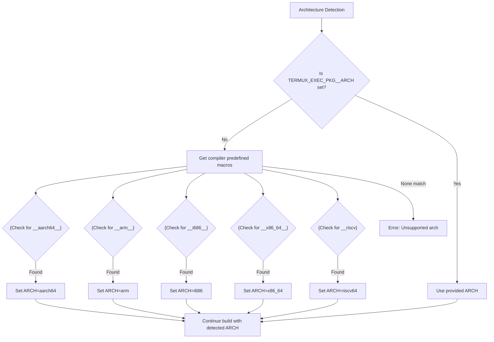
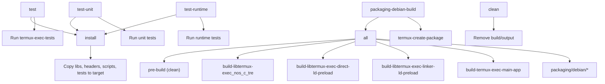
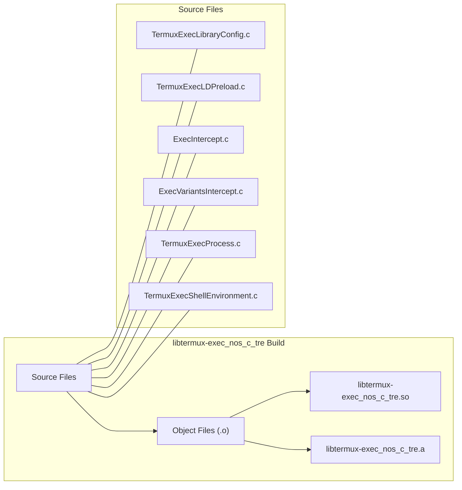
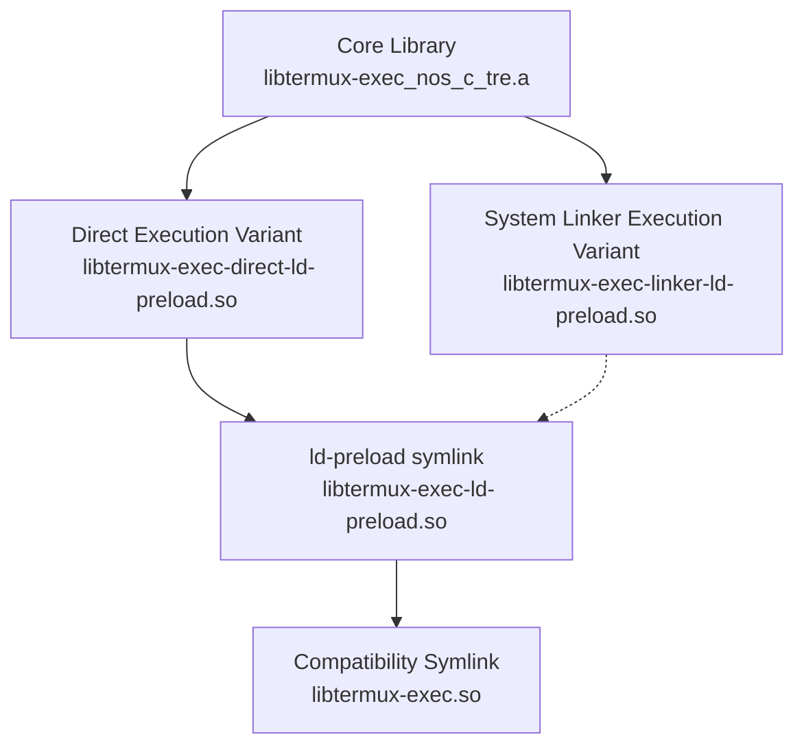
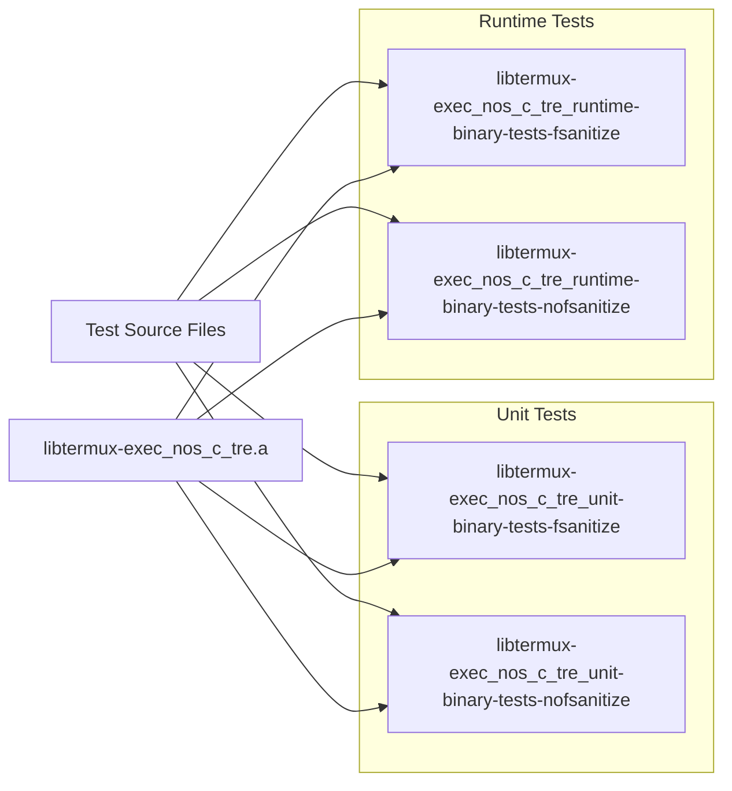
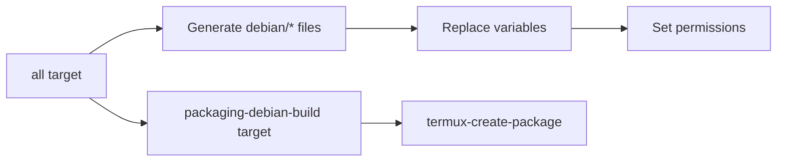
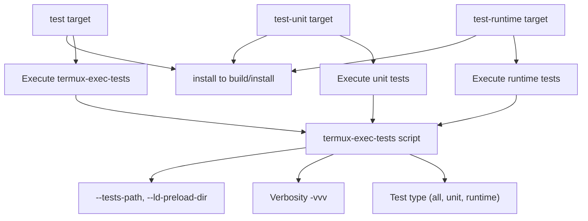
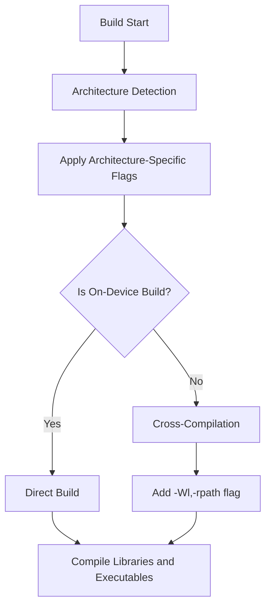

<!-- source: DeepWiki mcp.deepwiki.com · repo termux/termux-exec-package · page 4 Build System · fetched 2026-10-26 -->

# Build System

Relevant source files

The following files were used as context for generating this wiki page:

- [.clang-tidy](.clang-tidy)
- [.gitignore](.gitignore)
- [Makefile](Makefile)
- [README.md](README.md)
- [app/main/tests/termux-exec-tests.in](app/main/tests/termux-exec-tests.in)

This page documents the build system for the termux-exec-package, including its directory structure, configuration options, build targets, and architecture support. For information about the overall system architecture and components, see [System Architecture](#3).

The build system uses GNU Make and is designed to support cross-compilation for multiple architectures, different Android versions, and various execution modes necessary for Termux's environment.

## Directory Structure

The build system organizes output files into a predictable directory structure, separating temporary files, libraries, executables, and packaging artifacts.

Sources: [Makefile:63-76](), [Makefile:80-81]()

## Environment Configuration

The build system defines a comprehensive set of environment variables that control build behavior, paths, and constants. These variables ensure consistent building across different environments.

### Main Configuration Variables

| Variable | Purpose | Default Value |
|----------|---------|---------------|
| `TERMUX_EXEC_PKG__VERSION` | Package version | 2.4.0 |
| `TERMUX_EXEC_PKG__ARCH` | Target architecture | Auto-detected |
| `TERMUX_EXEC_PKG__INSTALL_PREFIX` | Installation prefix | `TERMUX__PREFIX` or `$(DESTDIR)$(PREFIX)` |
| `TERMUX__PREFIX` | Termux installation path | `/data/data/com.termux/files/usr` |
| `TERMUX__PREFIX__BIN_DIR` | Bin directory | `$(TERMUX__PREFIX)/bin` |
| `TERMUX__PREFIX__LIB_DIR` | Library directory | `$(TERMUX__PREFIX)/lib` |

Sources: [Makefile:1-31](), [Makefile:83-90]()

### Architecture Detection

The build system automatically detects the target architecture by examining compiler predefined macros:

Sources: [Makefile:34-56]()

### Compiler Flag Configuration

The build system sets appropriate compiler flags based on the target architecture and build requirements:

| Architecture | Special Flags |
|--------------|--------------|
| arm | `-march=armv7-a -mfpu=neon -mfloat-abi=softfp -mthumb` |
| i686 | `-march=i686 -msse3 -mstackrealign -mfpmath=sse -fPIC` |
| All | `-Wall -Wextra -Werror -Wshadow -O2 -D_FORTIFY_SOURCE=2 -fstack-protector-strong` |

For sanitizer builds: `-fsanitize=address -fsanitize-recover=address -fno-omit-frame-pointer`

Sources: [Makefile:130-191]()

## Build Targets

The build system defines several make targets that handle different aspects of building the package:

Sources: [Makefile:251-265](), [Makefile:446-532]()

## Core Library Build Process

The build system compiles the base libraries that provide the core termux-exec functionality:

Sources: [Makefile:194-202](), [Makefile:289-316]()

## LD_PRELOAD Variants Build

The build system compiles two variants of the LD_PRELOAD library to support different Android versions and execution modes:

Sources: [Makefile:386-438]()

## Test Build Process

The build system compiles separate test binaries for unit testing and runtime testing:

Sources: [Makefile:323-355](), [Makefile:372-383]()

## Installation Process

The `install` target places built files into the target installation directory:

| Source | Destination |
|--------|-------------|
| `$(BIN_BUILD_OUTPUT_DIR)/*` | `$(TERMUX_EXEC_PKG__INSTALL_PREFIX)/bin/` |
| `lib/termux-exec_nos_c/tre/include/termux/termux_exec__nos__c` | `$(TERMUX_EXEC_PKG__INSTALL_PREFIX)/include/termux-exec/termux/termux_exec__nos__c` |
| `$(LIB_BUILD_OUTPUT_DIR)/libtermux-exec_nos_c_tre.so` | `$(TERMUX_EXEC_PKG__INSTALL_PREFIX)/lib/` |
| `$(LIB_BUILD_OUTPUT_DIR)/libtermux-exec-*.so` | `$(TERMUX_EXEC_PKG__INSTALL_PREFIX)/lib/` |
| `$(TESTS_BUILD_OUTPUT_DIR)/*` | `$(TERMUX_EXEC_PKG__INSTALL_PREFIX)/libexec/installed-tests/termux-exec/` |

Sources: [Makefile:446-475]()

## Debian Packaging

The build system supports creating Debian packages with properly formatted control files:

Sources: [Makefile:251-261](), [Makefile:502-503]()

## Testing Framework Integration

The build system integrates with the testing framework through the `test`, `test-unit`, and `test-runtime` targets. Tests are executed using the `termux-exec-tests` script.

Sources: [Makefile:507-531](), [app/main/tests/termux-exec-tests.in:90-227]()

## Cross-Compilation Support

The build system automatically detects the architecture and applies appropriate compiler flags, making it suitable for cross-compilation. It also distinguishes between on-device builds and cross-compiled builds.

Sources: [Makefile:34-56](), [Makefile:59](), [Makefile:150-166]()

## Code Style and Quality Tools

The build system includes targets for code formatting and static analysis:

| Tool | Purpose | Command |
|------|---------|---------|
| clang-format | Code formatting | `make format` |
| clang-format (check) | Code style verification | `make check` |
| clang-tidy | Static analysis | `make check` |

Sources: [Makefile:243-542](), [.clang-tidy:1-3]()

---

