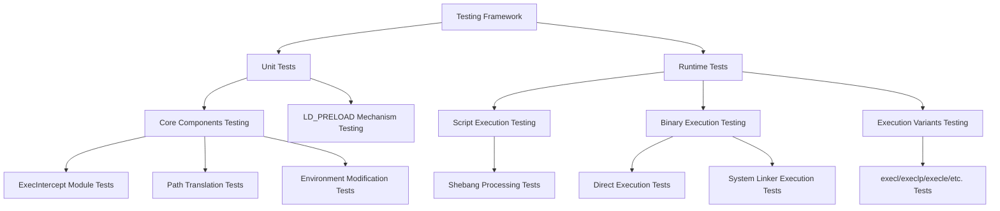
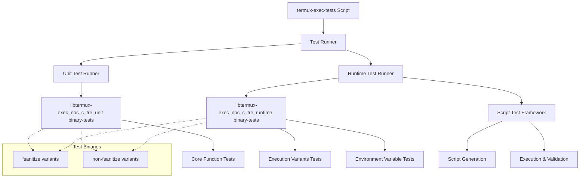
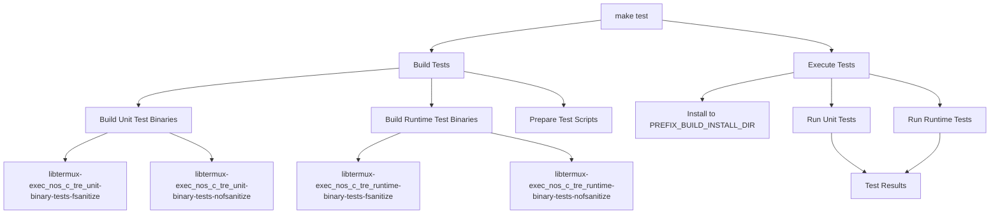
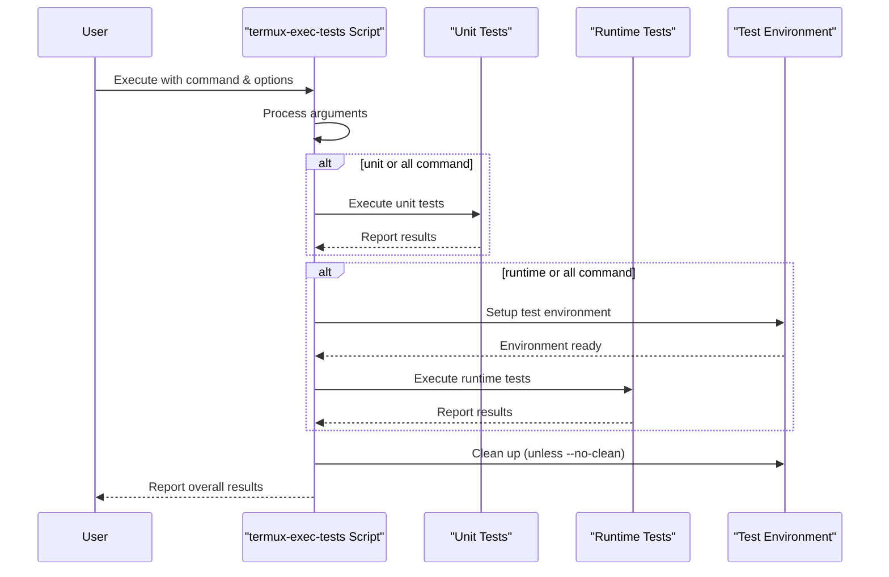
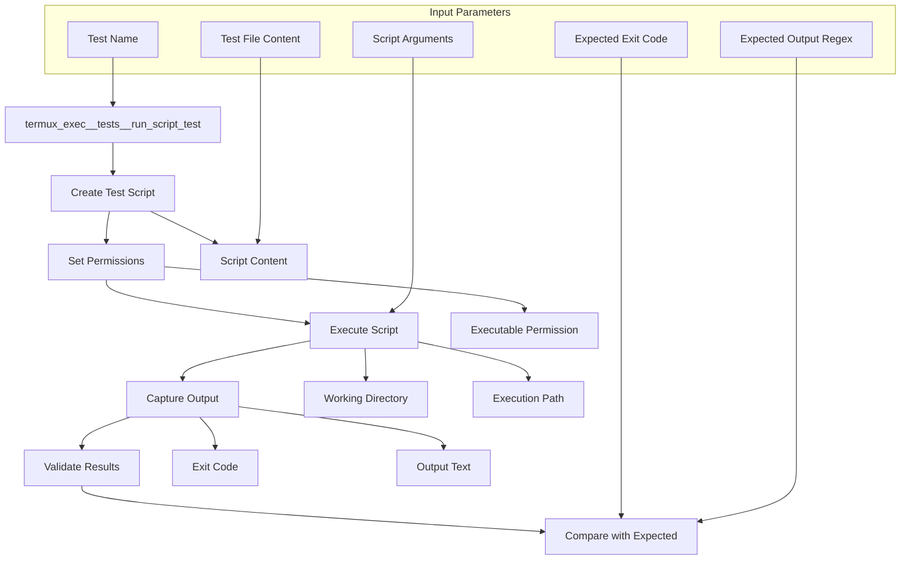
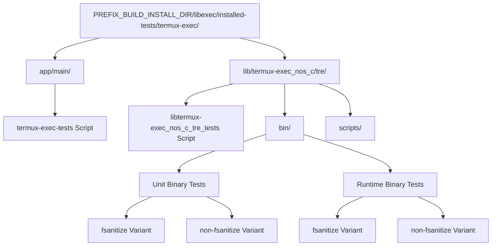
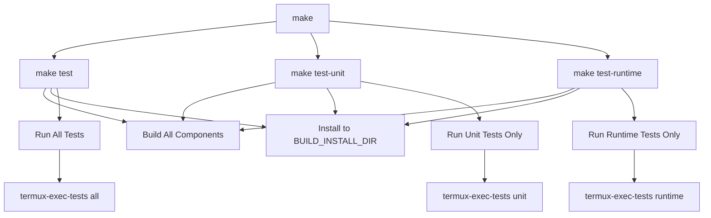

<!-- source: DeepWiki mcp.deepwiki.com · repo termux/termux-exec-package · page 5 Testing Framework · fetched 2026-10-26 -->

# Testing Framework

Relevant source files

The following files were used as context for generating this wiki page:

- [Makefile](Makefile)
- [app/main/tests/termux-exec-tests.in](app/main/tests/termux-exec-tests.in)

This page documents the testing framework for the termux-exec-package, detailing how tests are organized, built, and executed to ensure the reliability of the package across different environments and scenarios. The framework includes both unit tests that verify individual components in isolation and runtime tests that validate behavior in realistic conditions.

For information about the architecture of the execution interception mechanism itself, see [System Architecture](#3) and [Execution Interception Mechanism](#3.2).

## Overview of the Testing Framework

The termux-exec-package includes a comprehensive testing framework designed to verify that the execution interception, shebang processing, and system linker execution functions work correctly. The testing system supports multiple test types, execution environments, and offers various debugging capabilities.

Sources: [Makefile:500-543](), [app/main/tests/termux-exec-tests.in:1-30]()

## Test Components Architecture

The testing system is structured into several key components that work together to provide comprehensive test coverage:

Sources: [Makefile:324-356](), [app/main/tests/termux-exec-tests.in:235-261]()

## Test Types

The testing framework provides two primary types of tests:

### Unit Tests

Unit tests focus on validating individual components in isolation, ensuring that each component works correctly on its own. These tests don't require the full execution environment and can be run without setting up LD_PRELOAD.

| Test Type | Purpose | Implementation |
|-----------|---------|----------------|
| Core Function Tests | Validate core functionality of ExecIntercept | C binary tests |
| Path Translation | Verify correct path mapping between standard Linux and Termux paths | C tests with mock file systems |
| Environment Modification | Test that environment variables are correctly modified | Isolated environment tests |

Sources: [Makefile:516-523](), [app/main/tests/termux-exec-tests.in:97-120]()

### Runtime Tests

Runtime tests validate the behavior of the termux-exec system in realistic conditions, including actual execution of binaries and scripts. These tests require setting up the LD_PRELOAD environment and can only be run on an Android device within the Termux environment.

| Test Type | Purpose | Implementation |
|-----------|---------|----------------|
| Script Execution | Verify correct shebang processing and script execution | Shell script generation and execution |
| Binary Execution | Test direct execution and system linker execution | Native binaries |
| Execution Variants | Validate all exec family functions (execl, execlp, etc.) | C test binaries |

Sources: [Makefile:524-531](), [app/main/tests/termux-exec-tests.in:144-215]()

## Test Build System

The test build system compiles and prepares various test binaries and scripts, ensuring they're ready for execution. Test binaries are built with both standard configurations and with Address Sanitizer enabled for detecting memory issues.

Sources: [Makefile:324-342](), [Makefile:348-356](), [Makefile:507-531]()

## Test Execution Flow

When executing tests, the following sequence of operations occurs:

1. The main script (`termux-exec-tests`) processes command-line arguments
2. Based on the command type (unit, runtime, or all), appropriate test suites are selected
3. For runtime tests, the environment is prepared:
   - Temporary directories are created
   - The appropriate LD_PRELOAD library is identified
   - Test scripts are generated as needed
4. Tests are executed and results are validated
5. Temporary test files are cleaned up (unless `--no-clean` is specified)

Sources: [app/main/tests/termux-exec-tests.in:91-229](), [app/main/tests/termux-exec-tests.in:235-261]()

## Script-Based Testing

A key component of the testing framework is the ability to generate and test scripts with various shebang lines and content. This feature, implemented in the `termux_exec__tests__run_script_test` function, allows testing how the termux-exec system handles different script types and execution paths.

Sources: [app/main/tests/termux-exec-tests.in:267-441]()

## Running Tests

The testing framework can be executed with various options to control test execution behavior, logging level, and test filtering.

### Basic Commands

| Command | Description |
|---------|-------------|
| `termux-exec-tests unit` | Run unit tests only |
| `termux-exec-tests runtime` | Run runtime tests only (requires Android/Termux environment) |
| `termux-exec-tests all` | Run all tests |

### Command-Line Options

| Option | Description |
|--------|-------------|
| `-h, --help` | Display help screen |
| `-q, --quiet` | Set log level to OFF |
| `-v, -vv, -vvv, -vvvv` | Increase verbosity (debug to very verbose) |
| `-f` | Use fsanitize binaries for AddressSanitizer |
| `-l` | Detect memory leaks with LeakSanitizer |
| `--ld-preload-dir=<dir>` | Directory containing LD_PRELOAD libraries |
| `--no-clean` | Do not clean test files on failure |
| `--test-names-filter=<filter>` | Regex to filter tests by name |
| `--tests-path=<path>` | Path to installed-tests directory |

Sources: [app/main/tests/termux-exec-tests.in:587-727](), [Makefile:507-531]()

## Memory Testing Features

The testing framework includes robust memory testing capabilities through integration with Address Sanitizer (ASan) and Leak Sanitizer (LSan).

### Address Sanitizer

Address Sanitizer detects various memory errors including:
- Buffer overflows
- Use-after-free
- Double-free
- Memory leaks (when combined with Leak Sanitizer)

Test binaries are compiled with ASan support when the `-f` option is used.

### Leak Sanitizer

When the `-l` option is specified along with `-f`, the Leak Sanitizer is enabled to detect memory leaks during test execution.

Sources: [Makefile:190](), [Makefile:332-335](), [app/main/tests/termux-exec-tests.in:715-718]()

## Test Structure in the Build System

Tests are built and installed to a specific directory structure in the build system:

Sources: [Makefile:72-73](), [Makefile:73](), [Makefile:207](), [Makefile:323-342](), [Makefile:346-356](), [Makefile:474]()

## Integration with the Makefile System

The test system is deeply integrated with the Makefile build system, with several dedicated targets for building and running tests.

Sources: [Makefile:507-531]()

## Testing Implementation Details

### Unit Test Binary Implementation

Unit tests are implemented as C programs that directly test the internal functions of the termux-exec libraries. These tests validate the core functionality of components like `ExecIntercept` and `ExecVariantsIntercept` without requiring a full execution environment.

The unit test binaries are compiled with:
- Debug flags (`-O0 -g`)
- Optional Address Sanitizer instrumentation
- Direct linkage to the `libtermux-exec_nos_c_tre` library

Sources: [Makefile:332-342]()

### Runtime Test Binary Implementation

Runtime tests focus on the behavior of the system in a realistic environment, including:
- Testing all exec variants (execl, execlp, execle, etc.)
- Validating environment variable handling
- Ensuring proper interception of execution requests

Like unit tests, runtime test binaries are compiled with debug flags and optional sanitizer instrumentation.

Sources: [Makefile:348-356]()

### Script Test Implementation

The script testing framework is particularly powerful for testing shebang handling. It:
1. Creates test scripts with specific content
2. Sets executable permissions
3. Executes the script in a controlled environment
4. Validates that the output and exit code match expectations

This approach allows testing complex scenarios involving shebang line processing, path translation, and interpreter execution.

Sources: [app/main/tests/termux-exec-tests.in:267-441]()

## Android Version-Specific Testing

The testing framework can adapt to different Android versions to ensure proper functionality across the Android ecosystem.

When running on Android, the system:
1. Detects the Android version using `getprop "ro.build.version.sdk"`
2. Identifies the appropriate LD_PRELOAD library variant for the environment
3. Sets up tests to validate functionality specific to that Android version

This ensures that both direct execution (for older Android versions) and system linker execution (for Android 10+) are properly tested.

Sources: [app/main/tests/termux-exec-tests.in:152-157](), [app/main/tests/termux-exec-tests.in:161-185]()

## Conclusion

The termux-exec testing framework provides a comprehensive system for validating all aspects of the package's functionality. By combining unit tests, runtime tests, and script-based testing, it ensures the reliability of the execution interception mechanism across different environments and use cases.

The framework's integration with address sanitizers and leak detection further enhances its ability to catch memory-related issues, while its flexible command-line interface makes it easy to run specific test suites and customize test execution.

---

