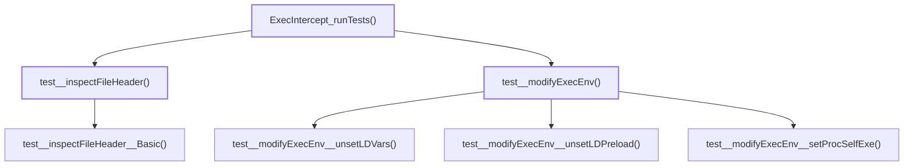
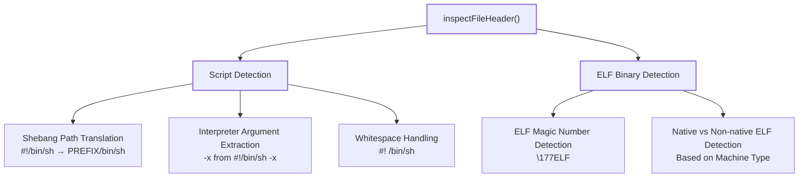
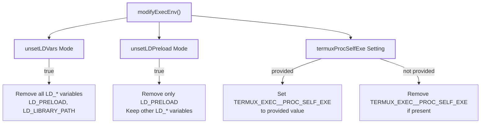
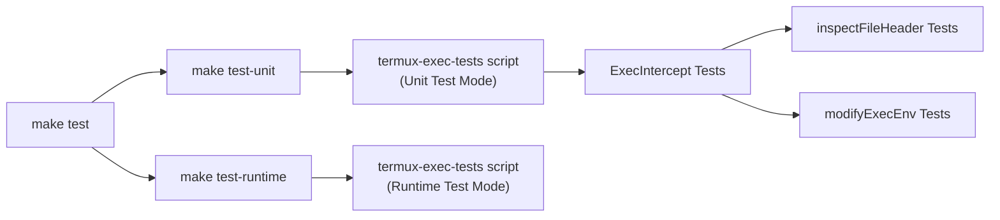

<!-- source: DeepWiki mcp.deepwiki.com · repo termux/termux-exec-package · page 5.1 Unit Tests · fetched 2026-10-26 -->

# Unit Tests

Relevant source files

The following files were used as context for generating this wiki page:

- [lib/termux-exec_nos_c/tre/tests/src/termux/api/termux_exec/service/ld_preload/direct/exec/ExecIntercept_UnitBinaryTests.c](lib/termux-exec_nos_c/tre/tests/src/termux/api/termux_exec/service/ld_preload/direct/exec/ExecIntercept_UnitBinaryTests.c)

This document details the unit testing approach for the core functionality of the termux-exec-package. For information about runtime testing that verifies behavior in realistic environments, see [Runtime Tests](#5.2).

## Unit Testing Structure

The termux-exec unit tests systematically validate the core interceptor functionality, particularly focusing on the `ExecIntercept` module which handles execution interception and environment preparation.

Sources: [lib/termux-exec_nos_c/tre/tests/src/termux/api/termux_exec/service/ld_preload/direct/exec/ExecIntercept_UnitBinaryTests.c:10-17]()

## ExecIntercept Unit Test Cases

The `ExecIntercept` module contains critical functionality for handling different file types and preparing the execution environment.

### File Header Inspection Tests

The `inspectFileHeader()` function analyzes file headers to determine file type and handle script interpreters. The tests verify:

Test cases include:
- Standard shebang lines (`#!/bin/sh`)
- Shebangs with arguments (`#!/bin/sh -x`) 
- Shebangs with extra whitespace (`#! /bin/sh -x`)
- ELF binary detection with magic number `\177ELF`
- Native vs non-native ELF distinction based on machine type

Sources: [lib/termux-exec_nos_c/tre/tests/src/termux/api/termux_exec/service/ld_preload/direct/exec/ExecIntercept_UnitBinaryTests.c:23-103]()

### Environment Modification Tests

The `modifyExecEnv()` function prepares the execution environment by manipulating environment variables. Tests are organized in three categories:

#### 1. Unsetting LD Variables Tests

Tests verify that when `unsetLDVars` is true, all environment variables with prefixes like `LD_PRELOAD` and `LD_LIBRARY_PATH` are properly removed.

Test cases verify:
- Regular environment variables remain intact
- Variables with `LD_` prefixes are removed
- Multiple `LD_` variables are all properly removed

Sources: [lib/termux-exec_nos_c/tre/tests/src/termux/api/termux_exec/service/ld_preload/direct/exec/ExecIntercept_UnitBinaryTests.c:123-157]()

#### 2. Unsetting LD_PRELOAD Tests

Tests ensure that when `unsetLDPreload` is true, specifically the `LD_PRELOAD` environment variable is removed while preserving other variables.

Test cases verify:
- Empty `LD_PRELOAD` variables are properly removed
- Non-empty `LD_PRELOAD` variables are preserved when appropriate
- Other environment variables remain unaffected

Sources: [lib/termux-exec_nos_c/tre/tests/src/termux/api/termux_exec/service/ld_preload/direct/exec/ExecIntercept_UnitBinaryTests.c:159-232]()

#### 3. Setting PROC_SELF_EXE Tests

Tests verify the proper handling of the `TERMUX_EXEC__PROC_SELF_EXE` environment variable.

Test cases verify:
- When a `termuxProcSelfExe` value is provided, `TERMUX_EXEC__PROC_SELF_EXE` is correctly set
- Existing `TERMUX_EXEC__PROC_SELF_EXE` values are properly replaced
- When no `termuxProcSelfExe` is provided, existing `TERMUX_EXEC__PROC_SELF_EXE` is removed

Sources: [lib/termux-exec_nos_c/tre/tests/src/termux/api/termux_exec/service/ld_preload/direct/exec/ExecIntercept_UnitBinaryTests.c:234-284]()

## Test Assertion Methods

The unit tests employ custom assertion functions to verify correctness:

| Assertion Method | Purpose | Usage Example |
|-----------------|---------|---------------|
| `state__ATrue()` | Verify a condition is true | `state__ATrue(!info.isElf)` |
| `state__AFalse()` | Verify a condition is false | `state__ATrue(!info.isNonNativeElf)` |
| `string__AEqual()` | Verify two strings match | `string__AEqual(TERMUX__PREFIX__BIN_DIR "/sh", info.interpreterPath)` |
| `int__AEqual()` | Verify two integers match | `int__AEqual(0, errno)` |

Each test function verifies a specific aspect of the code and checks that no errors occurred with `int__AEqual(0, errno)`.

## Unit Test Integration

Unit tests are part of the broader testing framework, with particular focus on:

The unit tests validate critical functions that underpin the entire execution interception system, ensuring that:

1. Script shebangs are correctly parsed and transformed to use Termux paths
2. ELF binaries are correctly identified (native vs. non-native)
3. Environment variables are properly modified during execution to control LD_PRELOAD behavior
4. The `TERMUX_EXEC__PROC_SELF_EXE` environment variable is correctly managed for system linker execution

These unit tests work alongside the runtime tests (covered in [Runtime Tests](#5.2)) to provide comprehensive verification of the termux-exec-package functionality.

Sources: [lib/termux-exec_nos_c/tre/tests/src/termux/api/termux_exec/service/ld_preload/direct/exec/ExecIntercept_UnitBinaryTests.c:1-285]()

---

