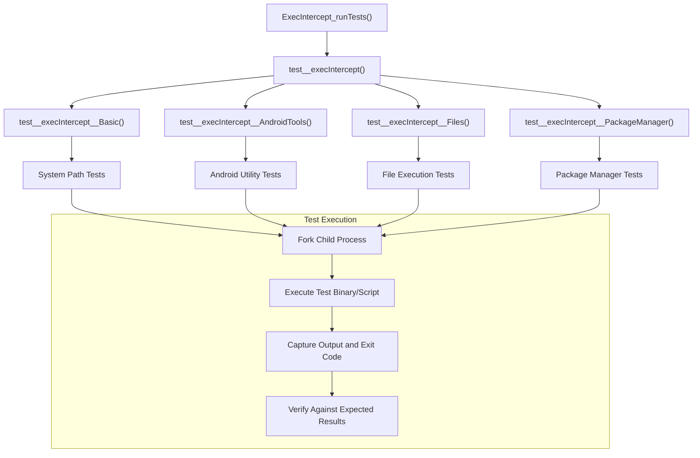
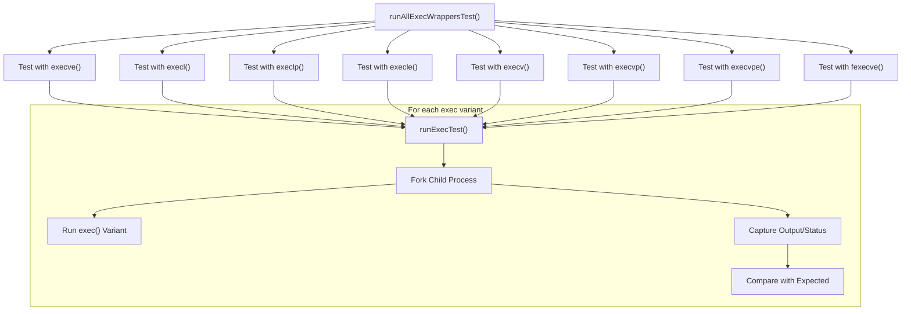
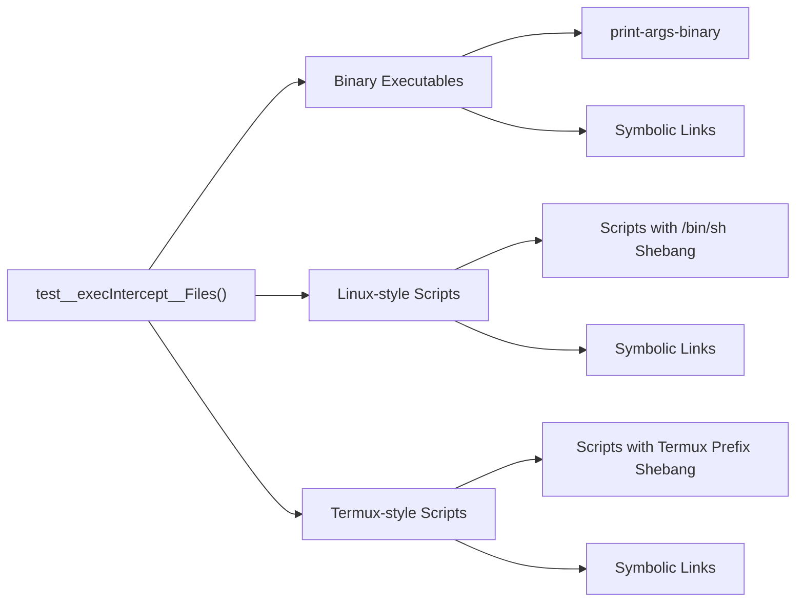
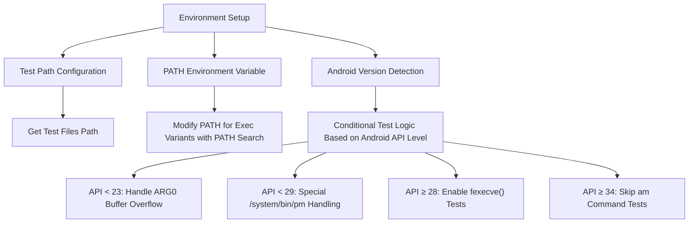

<!-- source: DeepWiki mcp.deepwiki.com · repo termux/termux-exec-package · page 5.2 Runtime Tests · fetched 2026-10-26 -->

# Runtime Tests

Relevant source files

The following files were used as context for generating this wiki page:

- [lib/termux-exec_nos_c/tre/tests/src/termux/api/termux_exec/service/ld_preload/direct/exec/ExecIntercept_RuntimeBinaryTests.c](lib/termux-exec_nos_c/tre/tests/src/termux/api/termux_exec/service/ld_preload/direct/exec/ExecIntercept_RuntimeBinaryTests.c)

## Purpose and Scope

The Runtime Tests section of the Termux-Exec package focuses on verifying the behavioral correctness of the exec interception mechanism in realistic operating conditions. While [Unit Tests](#5.1) verify individual components in isolation, runtime tests examine how the entire system functions as an integrated whole under various execution scenarios.

These tests ensure that the package correctly handles different types of executable files, properly intercepts all exec family functions, performs path translations correctly, and successfully bypasses Android's W^X restrictions when necessary.

Sources: [lib/termux-exec_nos_c/tre/tests/src/termux/api/termux_exec/service/ld_preload/direct/exec/ExecIntercept_RuntimeBinaryTests.c:11-22]()

## Runtime Test Architecture

The runtime tests are designed to comprehensively validate exec interception across various execution paths and Android versions. Tests are organized into categories that verify different aspects of the system and use a fork-execute-verify model to ensure proper behavior.

### Test Execution Flow

Sources: [lib/termux-exec_nos_c/tre/tests/src/termux/api/termux_exec/service/ld_preload/direct/exec/ExecIntercept_RuntimeBinaryTests.c:282-329]()

### Test Wrapper Mechanism

Runtime tests use a comprehensive wrapper system to test all exec variants with a single test definition:

Sources: [lib/termux-exec_nos_c/tre/tests/src/termux/api/termux_exec/service/ld_preload/direct/exec/ExecIntercept_RuntimeBinaryTests.c:52-262]()

## Test Categories

The runtime tests are divided into four main categories, each focused on testing different aspects of the exec interception mechanism:

| Test Category | Purpose | Test Function |
|---------------|---------|--------------|
| Basic System Tests | Test execution with system directories that should have restricted access | `test__execIntercept__Basic()` |
| Android Tools Tests | Test interception of Android system binaries and scripts | `test__execIntercept__AndroidTools()` |
| File Execution Tests | Test various executable types (binaries, scripts) with different shebangs | `test__execIntercept__Files()` |
| Package Manager Tests | Test execution of Termux package manager | `test__execIntercept__PackageManager()` |

Sources: [lib/termux-exec_nos_c/tre/tests/src/termux/api/termux_exec/service/ld_preload/direct/exec/ExecIntercept_RuntimeBinaryTests.c:277-281]()

### Basic System Tests

Basic system tests verify that the exec interception mechanism properly handles system directories that should have restricted access:

- Tests execution attempts on `/proc` directory
- Tests execution attempts on Termux rootfs directory
- Tests execution attempts on `/system/app` directory

These tests ensure that proper access restrictions are maintained and that access errors are correctly reported.

Sources: [lib/termux-exec_nos_c/tre/tests/src/termux/api/termux_exec/service/ld_preload/direct/exec/ExecIntercept_RuntimeBinaryTests.c:341-361]()

### Android Tools Tests

Android Tools tests verify that the exec interception mechanism correctly handles Android system binaries and scripts:

- Tests execution of Android Activity Manager (`am`)
- Tests execution of Android Package Manager (`pm`)
- Tests execution of Dalvik VM (`dalvikvm`)

These tests are designed to be robust across different Android versions with version-specific adjustments (e.g., handling `/system/bin/pm` differently before Android 9 due to missing shebang).

Sources: [lib/termux-exec_nos_c/tre/tests/src/termux/api/termux_exec/service/ld_preload/direct/exec/ExecIntercept_RuntimeBinaryTests.c:363-481]()

### File Execution Tests

File execution tests verify the handling of various executable types:

This test category validates:
- Binary execution (with special handling for older Android versions)
- Script execution with Linux-style shebangs (path translation)
- Script execution with Termux-style shebangs
- Symbolic link handling for all types

Sources: [lib/termux-exec_nos_c/tre/tests/src/termux/api/termux_exec/service/ld_preload/direct/exec/ExecIntercept_RuntimeBinaryTests.c:484-609]()

### Package Manager Tests

Package manager tests verify the execution of the Termux package manager:

- Tests execution of the package manager specified by `TERMUX_ROOTFS__PACKAGE_MANAGER` environment variable
- Verifies version reporting functionality
- Skips tests when running as root or when package manager is not available

Sources: [lib/termux-exec_nos_c/tre/tests/src/termux/api/termux_exec/service/ld_preload/direct/exec/ExecIntercept_RuntimeBinaryTests.c:611-661]()

## Test Execution Variants

All tests verify the eight different exec variants to ensure comprehensive coverage of the exec family functions:

| Variant | Function | Test Implementation | 
|---------|----------|---------------------|
| ExecVE | execve() | Direct execution with path, argv, envp |
| ExecL | execl() | Variable argument list without envp |
| ExecLP | execlp() | Variable argument list with PATH search |
| ExecLE | execle() | Variable argument list with envp |
| ExecV | execv() | Array argument list without envp |
| ExecVP | execvp() | Array argument list with PATH search |
| ExecVPE | execvpe() | Array argument list with PATH search and envp |
| FExecVE | fexecve() | File descriptor-based execution (Android API ≥ 28) |

The test framework uses macros to simplify testing across all variants, and includes specific handling for variants that require PATH searching (execlp, execvp, execvpe).

Sources: [lib/termux-exec_nos_c/tre/tests/src/termux/api/termux_exec/service/ld_preload/direct/exec/ExecIntercept_RuntimeBinaryTests.c:52-96]()

## Test Environment Setup

The runtime tests require careful environment preparation to ensure consistent results across different Android versions:

Key aspects of test environment setup:
- Tests locate their resource files through the `TERMUX_EXEC__TESTS__TESTS_PATH` environment variable
- PATH environment variable is modified to test PATH-search execution variants
- Tests include conditional logic based on Android version to handle version-specific behaviors

Sources: [lib/termux-exec_nos_c/tre/tests/src/termux/api/termux_exec/service/ld_preload/direct/exec/ExecIntercept_RuntimeBinaryTests.c:286-313]()

## Test Execution Process

The test execution follows a fork-execute-verify pattern:

1. A child process is forked from the test runner
2. Child process executes the target binary/script using specified exec variant
3. Parent process captures stdout/stderr and exit code from the child
4. Results are compared with expected values

Each test verifies:
- Return value of the exec call
- Errno value if exec fails
- Exit code of the process
- Output matching against a regular expression

Sources: [lib/termux-exec_nos_c/tre/tests/src/termux/api/termux_exec/service/ld_preload/direct/exec/ExecIntercept_RuntimeBinaryTests.c:97-189]()

## Version-Specific Test Considerations

Runtime tests include special considerations for different Android versions:

| Android Version | API Level | Special Handling |
|-----------------|-----------|------------------|
| Android < 6 | API < 23 | Tests for ARG0 buffer overflow (length >= 128) |
| Android < 9 | API < 29 | Special handling for `/system/bin/pm` without shebang |
| Android ≥ 9 | API ≥ 28 | Support for fexecve() |
| Android ≥ 13 | API ≥ 33 | Dalvik VM path changes to APEX location |
| Android ≥ 14 | API ≥ 34 | Skip AM tests due to permission changes |

This version-specific handling ensures that tests are robust across the wide range of Android versions supported by Termux.

Sources: [lib/termux-exec_nos_c/tre/tests/src/termux/api/termux_exec/service/ld_preload/direct/exec/ExecIntercept_RuntimeBinaryTests.c:28-46](), [lib/termux-exec_nos_c/tre/tests/src/termux/api/termux_exec/service/ld_preload/direct/exec/ExecIntercept_RuntimeBinaryTests.c:416-444](), [lib/termux-exec_nos_c/tre/tests/src/termux/api/termux_exec/service/ld_preload/direct/exec/ExecIntercept_RuntimeBinaryTests.c:534-566]()

## Summary

The runtime tests provide a comprehensive validation of the Termux-Exec package's ability to correctly intercept and handle all exec family functions across different Android versions, executable types, and execution paths. These tests are crucial for ensuring that the package maintains compatibility with the evolving Android ecosystem while providing consistent and reliable execution behavior for Termux users.

Key strengths of the runtime testing approach:
1. Comprehensive testing of all exec variants
2. Version-specific test logic for Android API level differences
3. Testing of both binary and script execution
4. Verification of path translation for shebangs
5. Environment variable handling and validation

Together with the [Unit Tests](#5.1), these runtime tests ensure that the Termux-Exec package remains robust and reliable across the Android ecosystem.

---

