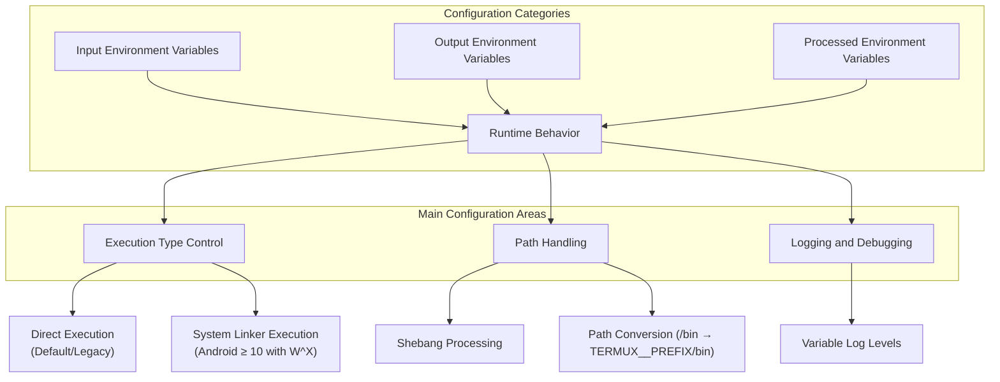
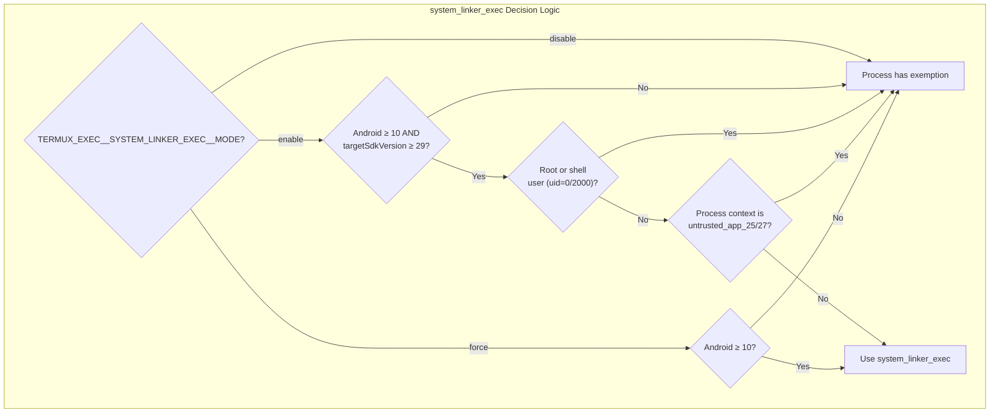
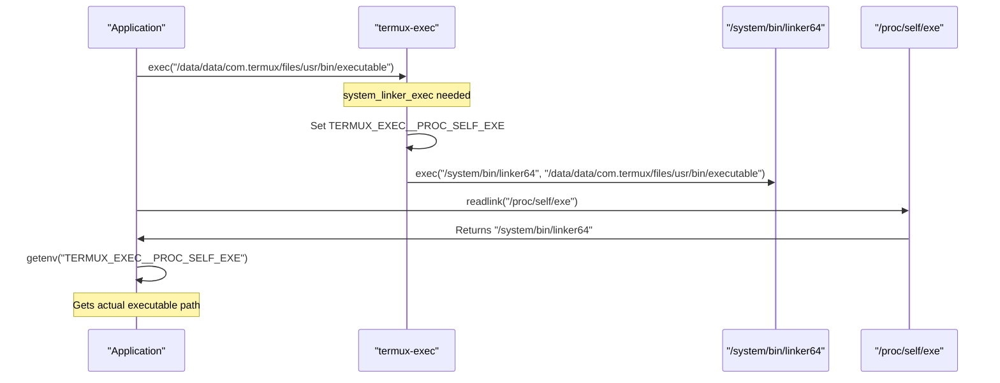
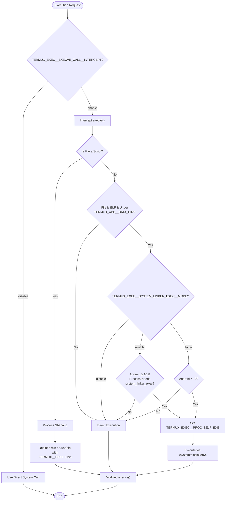
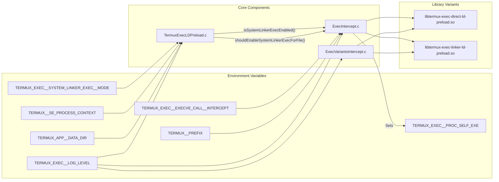

<!-- source: DeepWiki mcp.deepwiki.com · repo termux/termux-exec-package · page 6 Configuration and Environment Variables · fetched 2026-10-26 -->

# Configuration and Environment Variables

<details>
<summary>Relevant source files</summary>

The following files were used as context for generating this wiki page:

- [lib/termux-exec_nos_c/tre/src/termux/api/termux_exec/service/ld_preload/TermuxExecLDPreload.c](lib/termux-exec_nos_c/tre/src/termux/api/termux_exec/service/ld_preload/TermuxExecLDPreload.c)
- [site/pages/en/projects/docs/technical/index.md](site/pages/en/projects/docs/technical/index.md)
- [site/pages/en/projects/docs/usage/index.md](site/pages/en/projects/docs/usage/index.md)

</details>


The termux-exec package relies on a set of environment variables to configure its behavior and adapt to different Android environments. This document details all supported environment variables, their purposes, valid values, and how they affect the execution process in Termux. For information about the technical implementation of system features, see [System Architecture](#3).

## Overview of Configuration System

Termux-exec's configuration system is designed to allow flexible control over execution behavior while maintaining compatibility across different Android versions. The configuration primarily addresses two key challenges:

1. Navigating Android's W^X (Write XOR Execute) restrictions on newer Android versions
2. Handling path differences between standard Linux environments and Termux



Sources: [site/pages/en/projects/docs/usage/index.md:27-340]()

## Input Environment Variables

Input environment variables configure how termux-exec behaves at runtime. They are read when the termux-exec library is loaded and determine its behavior for all subsequent operations.

### Essential Variables

#### TERMUX_EXEC__EXECVE_CALL__INTERCEPT

Controls whether termux-exec should intercept `execve()` wrapper calls.

- **Type**: String
- **Default Value**: `enable`
- **Supported Values**:
  - `disable`: Intercept `execve()` will be disabled
  - `enable`: Intercept `execve()` will be enabled
- **Purpose**: When enabled, termux-exec applies its path conversion and system linker execution logic to solve execution issues in Termux. When disabled, calls go directly to the system execve function.

#### TERMUX_EXEC__SYSTEM_LINKER_EXEC__MODE

Controls the system linker execution mode used to bypass Android's W^X restrictions.

- **Type**: String
- **Default Value**: `enable`
- **Supported Values**:
  - `disable`: System linker execution will never be used
  - `enable`: System linker execution will be used only when required
  - `force`: System linker execution will be used whenever possible
- **Purpose**: Determines how termux-exec handles execution of files in app data directories on Android 10 and newer versions where W^X restrictions apply.



Sources: [lib/termux-exec_nos_c/tre/src/termux/api/termux_exec/service/ld_preload/TermuxExecLDPreload.c:31-139](), [site/pages/en/projects/docs/usage/index.md:220-256]()

#### TERMUX__PREFIX

The path to the Termux prefix directory where all Termux packages are installed.

- **Type**: String
- **Default Value**: `/data/data/com.termux/files/usr`
- **Format**: An absolute path with maximum length of 90 characters
- **Purpose**: Used for path conversion of `/bin` and `/usr/bin` paths to their Termux equivalents

#### TERMUX__SE_PROCESS_CONTEXT

The SELinux process context of the Termux app and its child processes.

- **Type**: String
- **Default Value**: Format like `u:r:untrusted_app_27:s0:cXXX,cXXX,c512,c768` for the Termux process
- **Purpose**: Used to determine if W^X restrictions apply to the current process when deciding whether to enable system linker execution

#### TERMUX_APP__DATA_DIR

The non-legacy Termux app data directory path.

- **Type**: String
- **Default Value**: `/data/user/0/com.termux` (for primary user)
- **Format**: An absolute path with maximum length of 69 characters
- **Purpose**: Used to determine if an executable is under the Termux app data directory for system linker execution decision

#### TERMUX_APP__LEGACY_DATA_DIR

The legacy Termux app data directory path.

- **Type**: String
- **Default Value**: `/data/data/com.termux` (for primary user)
- **Format**: An absolute path with maximum length of 69 characters
- **Purpose**: Alternative data directory path for backward compatibility

### Debugging and Logging Variables

#### TERMUX_EXEC__LOG_LEVEL

Controls the verbosity of termux-exec's logging.

- **Type**: Integer
- **Default Value**: `1`
- **Supported Values**:
  - `0` (`OFF`): Log nothing
  - `1` (`NORMAL`): Log error, warning, and info messages
  - `2` (`DEBUG`): Log debug messages
  - `3` (`VERBOSE`): Log verbose messages
  - `4` (`VVERBOSE`): Log very verbose messages
  - `5` (`VVVERBOSE`): Log very very verbose messages
- **Purpose**: Controls the amount of diagnostic information that termux-exec outputs

#### TERMUX_EXEC__TESTS__LOG_LEVEL

Controls the verbosity of logging for termux-exec tests.

- **Type**: Integer
- **Default Value**: `1`
- **Supported Values**: Same as TERMUX_EXEC__LOG_LEVEL
- **Purpose**: Separate control of logging for test scenarios

Sources: [site/pages/en/projects/docs/usage/index.md:30-290]()

## Output Environment Variables

These variables are set by termux-exec during execution to provide information to child processes.

#### TERMUX_EXEC__PROC_SELF_EXE

Set by termux-exec when system linker execution is used, to provide the correct path to the executable.

- **Type**: String
- **Default Value**: Not set by default
- **Value**: The normalized, absolute path to the executable file being executed
- **Purpose**: Compensates for the fact that `/proc/self/exe` would point to `/system/bin/linker64` rather than the actual executed file when using system linker execution



Sources: [site/pages/en/projects/docs/usage/index.md:299-339]()

## Processed Environment Variables

These existing environment variables are modified by termux-exec during execution.

#### LD_LIBRARY_PATH

- **Type**: String
- **Processing**: Unset by termux-exec when executing a non-native ELF file (like a 32-bit binary on a 64-bit host) if the executable path starts with `/system/` and is not one of `/system/bin/sh`, `/system/bin/linker`, or `/system/bin/linker64`

#### LD_PRELOAD

- **Type**: String
- **Processing**: Same processing as LD_LIBRARY_PATH

Sources: [site/pages/en/projects/docs/usage/index.md:349-400]()

## Configuration Interaction with Execution Pathways

The following diagram illustrates how configuration variables affect the execution pathway in termux-exec:



Sources: [lib/termux-exec_nos_c/tre/src/termux/api/termux_exec/service/ld_preload/TermuxExecLDPreload.c:31-170](), [site/pages/en/projects/docs/technical/index.md:80-108]()

## Component Relationships

The following diagram shows how environment variables relate to the code components that handle them:



Sources: [lib/termux-exec_nos_c/tre/src/termux/api/termux_exec/service/ld_preload/TermuxExecLDPreload.c:31-170](), [site/pages/en/projects/docs/technical/index.md:9-22]()

## Configuration Examples

### Basic Configuration

For most users, the default configuration is sufficient. The termux-exec library is preloaded through the LD_PRELOAD environment variable by the Termux login script:

```
LD_PRELOAD=$TERMUX__PREFIX/usr/lib/libtermux-exec-ld-preload.so
```

### Disabling System Linker Execution

If you want to disable the system linker execution mechanism (useful for debugging or testing):

```
export TERMUX_EXEC__SYSTEM_LINKER_EXEC__MODE=disable
```

### Forcing System Linker Execution

To force system linker execution even when not strictly required:

```
export TERMUX_EXEC__SYSTEM_LINKER_EXEC__MODE=force
```

### Increasing Logging Verbosity

For troubleshooting execution issues:

```
export TERMUX_EXEC__LOG_LEVEL=3  # VERBOSE level
```

### Checking System Linker Execution Status

To determine if system linker execution is enabled at runtime:

```
termux-exec-system-linker-exec is-enabled
```

Sources: [site/pages/en/projects/docs/usage/index.md:257-258](), [site/pages/en/projects/docs/technical/index.md:15-18]()

## Important Considerations

1. **Environment Variable Persistence**: Changes to environment variables only affect new processes. Changes to `LD_PRELOAD` require starting a new shell for the changes to take effect.

2. **TERMUX_EXEC__PROC_SELF_EXE Handling**: If you unset `LD_PRELOAD` in the current process, you should also unset `TERMUX_EXEC__PROC_SELF_EXE` to prevent passing incorrect values to child processes.

3. **Library Selection**: The system automatically selects the appropriate library variant (`libtermux-exec-direct-ld-preload.so` or `libtermux-exec-linker-ld-preload.so`) based on the execution requirements of the host Android device.

4. **Log Levels**: Normal operation uses log level 1, which produces minimal output. For debugging, levels 2-5 provide increasingly detailed information.

Sources: [site/pages/en/projects/docs/usage/index.md:11-12](), [site/pages/en/projects/docs/usage/index.md:308-325]()

---

