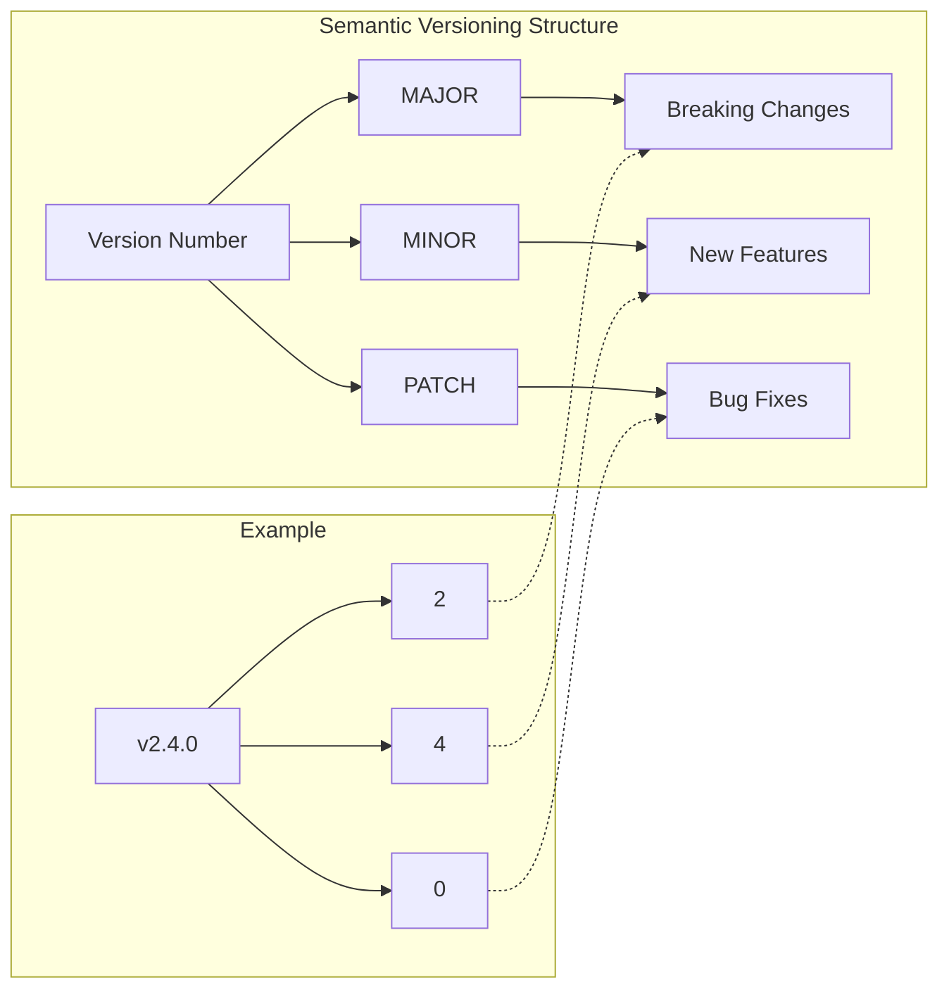
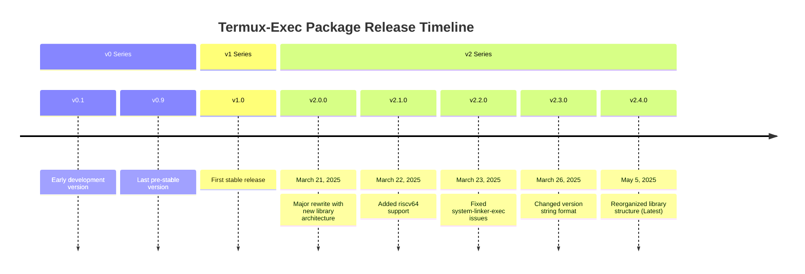
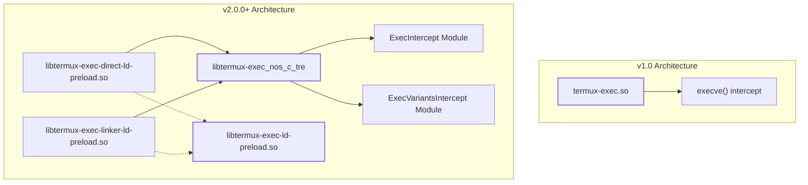
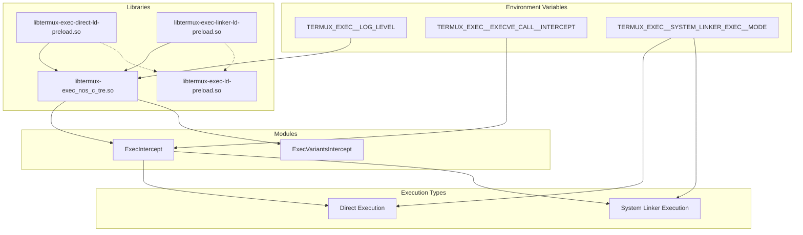

<!-- source: DeepWiki mcp.deepwiki.com · repo termux/termux-exec-package · page 7 Releases and Versioning · fetched 2026-10-26 -->

# Releases and Versioning

Relevant source files

The following files were used as context for generating this wiki page:

- [site/pages/en/projects/releases/2/v2.0.0.md](site/pages/en/projects/releases/2/v2.0.0.md)
- [site/pages/en/projects/releases/2/v2.1.0.md](site/pages/en/projects/releases/2/v2.1.0.md)
- [site/pages/en/projects/releases/2/v2.2.0.md](site/pages/en/projects/releases/2/v2.2.0.md)
- [site/pages/en/projects/releases/2/v2.3.0.md](site/pages/en/projects/releases/2/v2.3.0.md)
- [site/pages/en/projects/releases/2/v2.4.0.md](site/pages/en/projects/releases/2/v2.4.0.md)
- [site/pages/en/projects/releases/index.md](site/pages/en/projects/releases/index.md)

This document provides a comprehensive overview of the release history, version information, and changelogs for the termux-exec-package. It explains the versioning scheme used, highlights key features introduced in each major release, and provides information about where to find official releases.

For information about installing and configuring the package, see [Installation and Setup](#2).

## Versioning Scheme

The termux-exec-package follows semantic versioning principles with the format `MAJOR.MINOR.PATCH`:

- **MAJOR** version (e.g., v0, v1, v2) indicates incompatible API changes or significant architectural changes
- **MINOR** version (e.g., v2.1, v2.2) indicates new functionality added in a backward-compatible manner
- **PATCH** version (for future use) would indicate backward-compatible bug fixes

Beginning with v2.0.0, the project adopted a more formal semantic versioning approach, which is reflected in the version numbering scheme.

**Versioning Diagram**

Sources: [site/pages/en/projects/releases/index.md:34-59]()

## Release Sources

The termux-exec package is officially released through:

- [GitHub Releases](https://github.com/termux/termux-exec-package/releases)

All releases include detailed changelogs documenting new features, changes, and bug fixes following the [Keep a Changelog](https://github.com/olivierlacan/keep-a-changelog) specification.

Sources: [site/pages/en/projects/releases/index.md:19-23]()

## Version History

The project has evolved through three major version series:

**Release Timeline**

### v0 Series (Early Development)

Initial development versions (v0.1 - v0.9) established the core functionality for termux-exec but had limitations in terms of Android version support and configurability.

### v1 Series (Stable Release)

v1.0 marked the first stable release with reliable functionality for the core use cases of the package.

### v2 Series (Current)

The v2 series represents a significant rewrite of the system with a more modular architecture, comprehensive logging, testing, and support for newer Android versions.

Sources: [site/pages/en/projects/releases/index.md:37-59]()

## Major Architectural Evolution

The v2.0.0 release represented a significant architectural evolution for the package, introducing a more modular approach with separate libraries for different execution modes.

Sources: [site/pages/en/projects/releases/2/v2.0.0.md:17-21]()

## Key Features by Major Version

### v2.0.0 (March 21, 2025)

The v2.0.0 release was a major rewrite that introduced several key features:

1. **Modular Library Architecture**:
   - Added `libtermux-exec_nos_c_tre` library for core functionality
   - Created separate variants for different execution modes:
     - `libtermux-exec-direct-ld-preload.so`: For direct execution
     - `libtermux-exec-linker-ld-preload.so`: For system linker execution

2. **Full Exec Family Interception**:
   - Intercepts all functions in the exec() family, not just execve()
   - Required for compatibility with Android 14+

3. **System Linker Execution**:
   - Added support to execute ELF files via `/system/bin/linker*`
   - Bypasses Android app data file execution restrictions on Android 10+ with targetSdkVersion ≥ 28

4. **Configurable Behavior**:
   - Added environment variables for fine-grained control:
     - `TERMUX_EXEC__EXECVE_CALL__INTERCEPT`: Controls execve() interception
     - `TERMUX_EXEC__SYSTEM_LINKER_EXEC__MODE`: Controls system linker execution mode
     - `TERMUX_EXEC__LOG_LEVEL`: Controls logging verbosity

5. **Enhanced Logging Framework**:
   - Multiple log levels (OFF=0, NORMAL=1, DEBUG=2, VERBOSE=3, VVERBOSE=4, VVVERBOSE=5)
   - Detailed logging of execution flow and decisions

6. **Comprehensive Testing Framework**:
   - Unit tests for library components
   - Runtime tests for execution behavior
   - Script execution tests

Sources: [site/pages/en/projects/releases/2/v2.0.0.md:15-46]()

### v2.1.0 (March 22, 2025)

1. **Added riscv64 architecture support**
2. **Fixed system-linker-exec issues** for devices without SeLinux support
3. **Improved postinst script** to handle cases where Android SDK version information is not available

Sources: [site/pages/en/projects/releases/2/v2.1.0.md:15-28]()

### v2.2.0 (March 23, 2025)

1. **Fixed system-linker-exec issues** with non-accessible `/proc/self/attr/current`
2. **Fixed exec-intercept issues** with system executables and file headers

Sources: [site/pages/en/projects/releases/2/v2.2.0.md:15-19]()

### v2.3.0 (March 26, 2025)

1. **Standardized version string output format**
2. **Fixed multiple ExecIntercept issues**:
   - Fixed LD_VARS not being unset for system executables with fexecve() or fd path
   - Fixed issues with empty LD_PRELOAD variable on Android ≤ 7
   - Improved error reporting for non-regular files

Sources: [site/pages/en/projects/releases/2/v2.3.0.md:15-33]()

### v2.4.0 (May 5, 2025)

1. **Reorganized library directory structure**:
   - Moved `lib/termux-exec_nos_c_tre` to `lib/termux-exec_nos_c/tre`
   - Moved `api/termux_exec/ld_preload` sources to `api/termux_exec/service/ld_preload`
2. **Fixed logging output synchronization**

Sources: [site/pages/en/projects/releases/2/v2.4.0.md:15-27]()

## Environment Variable Evolution

The termux-exec package relies on several environment variables for configuration. These have evolved across versions to provide more fine-grained control:

| Environment Variable | Version Introduced | Purpose | Values |
|---------------------|-------------------|---------|--------|
| `TERMUX_EXEC_DEBUG` | Pre-v2.0.0 | Basic debugging (removed in v2.0.0) | N/A |
| `TERMUX_EXEC_OPTOUT` | Pre-v2.0.0 | Opt out of all intercepts (removed in v2.0.0) | N/A |
| `TERMUX_EXEC__LOG_LEVEL` | v2.0.0 | Controls logging verbosity | 0 (OFF) to 5 (VVVERBOSE) |
| `TERMUX_EXEC__EXECVE_CALL__INTERCEPT` | v2.0.0 | Controls execve() interception | "enable", "disable" |
| `TERMUX_EXEC__SYSTEM_LINKER_EXEC__MODE` | v2.0.0 | Controls system linker execution | "disable", "enable", "force" |
| `TERMUX_EXEC__PROC_SELF_EXE` | v2.0.0 | Contains actual executable path when using system linker | Path string |
| `TERMUX__PREFIX` | v2.0.0 | Path to Termux installation | Path string |

Sources: [site/pages/en/projects/releases/2/v2.0.0.md:26-38](), [site/pages/en/projects/releases/2/v2.0.0.md:87-88]()

## Component Relationship

Sources: [site/pages/en/projects/releases/2/v2.0.0.md:17-21](), [site/pages/en/projects/releases/2/v2.0.0.md:30-33]()

## Release Changelog Format

Since v2.0.0, the project has adopted a more structured changelog format following the [Keep a Changelog](https://github.com/olivierlacan/keep-a-changelog) specification. Each release changelog is organized into sections:

- **Added**: New features
- **Changed**: Changes to existing functionality
- **Fixed**: Bug fixes
- **Removed**: Removed features or components

Each change references the relevant commit with a link to the full commit details on GitHub.

Sources: [site/pages/en/projects/releases/2/v2.0.0.md:7-9](), [site/pages/en/projects/releases/index.md:35]()

## Accessing Release Documentation

All release information is accessible through:

1. The GitHub repository releases page
2. The project documentation site under the releases section

For detailed release notes and technical information about specific versions, refer to the individual release pages linked from the main releases index.

Sources: [site/pages/en/projects/releases/index.md:7-9](), [site/pages/en/projects/releases/index.md:19-23]()

---

