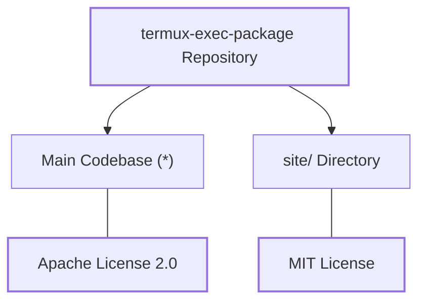
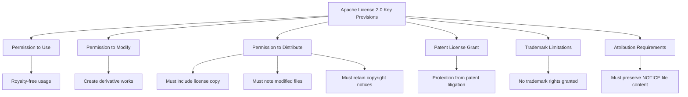
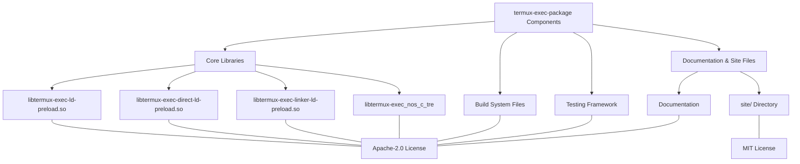

<!-- source: DeepWiki mcp.deepwiki.com · repo termux/termux-exec-package · page 8 Licensing · fetched 2026-10-26 -->

# Licensing

<details>
<summary>Relevant source files</summary>

The following files were used as context for generating this wiki page:

- [LICENSE](LICENSE)
- [licenses/termux__termux-exec-package__Apache-2.0.md](licenses/termux__termux-exec-package__Apache-2.0.md)

</details>


## Purpose and Scope

This document outlines the licensing terms that apply to the termux-exec-package project. It details which licenses cover specific parts of the codebase, summarizes key license provisions, and provides guidance for contributors regarding license compliance. This information is essential for anyone who intends to use, modify, or distribute the termux-exec-package code.

## License Overview

The termux-exec-package is primarily licensed under the Apache License, Version 2.0, with certain specific directories using different licenses. This licensing approach ensures both openness and legal protection for the project and its contributors.



Sources: [LICENSE:5-10]()

## License Applicability

The licensing structure follows a clear pattern with specific licenses applying to different components of the codebase.

| Component | License | File Path Reference |
|-----------|---------|---------------------|
| Main codebase (all files except as noted) | Apache License 2.0 | [LICENSE:5-10]() |
| Site directory | MIT License | [LICENSE:12-14]() |

The project uses the Debian copyright format to specify its licensing terms, which provides a standardized way to document the copyright and license information.

Sources: [LICENSE:1](), [LICENSE:5-14]()

## Apache-2.0 License Key Points

The Apache License 2.0 is a permissive open-source license that allows users to freely use, modify, and distribute the software. Here are the key provisions:



Key requirements when using the termux-exec-package under the Apache 2.0 license:

1. **Distribution Requirements**:
   - Include a copy of the Apache 2.0 license with any distribution
   - Clearly mark any files you modify
   - Retain all copyright, patent, and attribution notices

2. **Patent Provisions**:
   - The license includes a patent grant from contributors
   - The patent license terminates if you initiate patent litigation regarding the covered work

3. **No Warranty**:
   - The software is provided "as is" without warranties or conditions
   - You assume responsibility for determining appropriateness of use or redistribution

Sources: [licenses/termux__termux-exec-package__Apache-2.0.md:66-128](), [licenses/termux__termux-exec-package__Apache-2.0.md:143-173]()

## MIT License for Site Directory

Files in the `site/` directory are covered by the MIT License, which is a permissive license that allows for free use, modification, and distribution with minimal restrictions.

The MIT License is even more permissive than the Apache 2.0 License, requiring only:
- Retention of the copyright and license notices
- No warranty provided (similar to Apache 2.0)

Sources: [LICENSE:12-14]()

## Library Component Licensing



Sources: [LICENSE:5-14]()

## Licensing Considerations for Contributors

When contributing to the termux-exec-package, there are important licensing considerations to keep in mind:

1. **Contribution Agreement**:
   - Any contributions are automatically licensed under the same terms as the files you're modifying (Apache-2.0 for most files, MIT for site files)
   - No additional terms or conditions apply unless explicitly stated

2. **Third-Party Code**:
   - If incorporating third-party code, ensure it has a compatible license
   - Document the source and license of any third-party code

3. **New Files**:
   - Include the appropriate license header in any new files you create
   - For most files, use the Apache 2.0 license header
   - For files in the site/ directory, use the MIT license header

Sources: [licenses/termux__termux-exec-package__Apache-2.0.md:130-136]()

## License Compliance

To ensure compliance when using or distributing termux-exec-package:

1. **Redistribution Requirements**:
   - Include the complete LICENSE file with any distribution
   - Preserve all license and copyright notices in the source code
   - Document any modifications you make to the code

2. **Proper Attribution**:
   - Acknowledge the original copyright holder (termux)
   - Include the Apache 2.0 license text with any distribution
   - For the site/ directory, include the MIT license text

3. **Derivative Works**:
   - You may apply additional or different license terms to your modifications
   - The original code remains under its original license
   - Clearly distinguish between original and modified code

Sources: [licenses/termux__termux-exec-package__Apache-2.0.md:89-128](), [licenses/termux__termux-exec-package__Apache-2.0.md:178-201]()

## Copyright Information

The termux-exec-package is copyrighted by the Termux project:

```
Copyright 2023 termux
```

This copyright notice, along with the license text, should be preserved in all copies or substantial portions of the software.

Sources: [licenses/termux__termux-exec-package__Apache-2.0.md:189]()