# Page: Overview

# Overview

<details>
<summary>Relevant source files</summary>

The following files were used as context for generating this wiki page:

- [.clang-tidy](.clang-tidy)
- [.gitignore](.gitignore)
- [README.md](README.md)
- [site/pages/en/projects/releases/2/v2.0.0.md](site/pages/en/projects/releases/2/v2.0.0.md)
- [site/pages/en/projects/releases/2/v2.1.0.md](site/pages/en/projects/releases/2/v2.1.0.md)
- [site/pages/en/projects/releases/2/v2.2.0.md](site/pages/en/projects/releases/2/v2.2.0.md)
- [site/pages/en/projects/releases/2/v2.3.0.md](site/pages/en/projects/releases/2/v2.3.0.md)
- [site/pages/en/projects/releases/2/v2.4.0.md](site/pages/en/projects/releases/2/v2.4.0.md)
- [site/pages/en/projects/releases/index.md](site/pages/en/projects/releases/index.md)

</details>


## Purpose and Scope

The termux-exec-package is a critical component that enables proper program execution within the Termux environment on Android. It addresses two key challenges:

1. Android's restrictions on executing files in app data directories (W^X policy)
2. Path differences between standard Linux systems and Termux's directory structure

This document provides a comprehensive overview of the termux-exec-package system architecture, core functionality, and key components. For specific installation instructions, see [Installation and Setup](#2). For more detailed technical architecture information, see [System Architecture](#3).

## High-Level Architecture

The termux-exec-package consists of several interconnected components that work together to provide execution capabilities in Termux.

**Termux-Exec System Architecture**

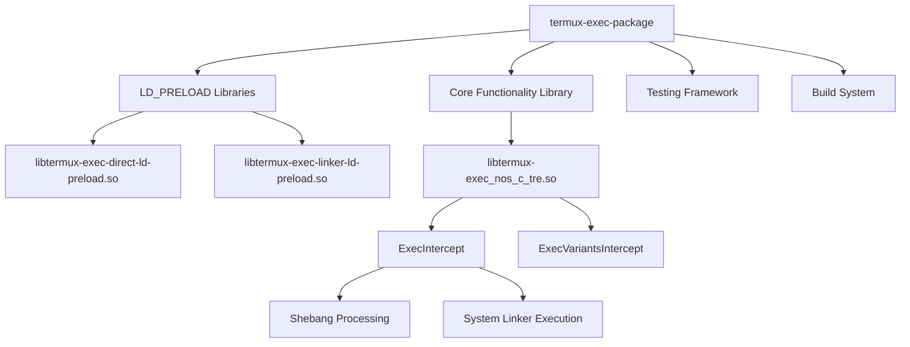

Sources:
- [README.md:1-4]()
- [site/pages/en/projects/releases/2/v2.0.0.md:16-34]()

## Core Problem Addressed

Termux, as an Android application, faces a significant challenge: Android's W^X (Write XOR Execute) security policy prevents executing files located in an app's data directory - exactly where Termux stores its executables. Additionally, Termux needs to handle path translations between standard Linux paths and its own directory structure.

**Problem and Solution Overview**

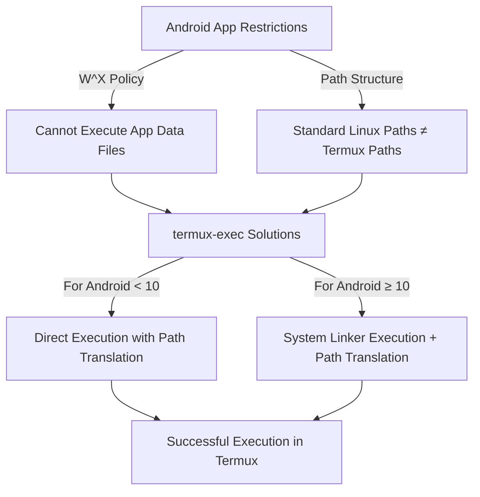

Sources:
- [site/pages/en/projects/releases/2/v2.0.0.md:28-33]()

## Execution Interception Mechanism

The core functionality of termux-exec is implemented through the interception of the exec() family of functions.

**Execution Flow Diagram**

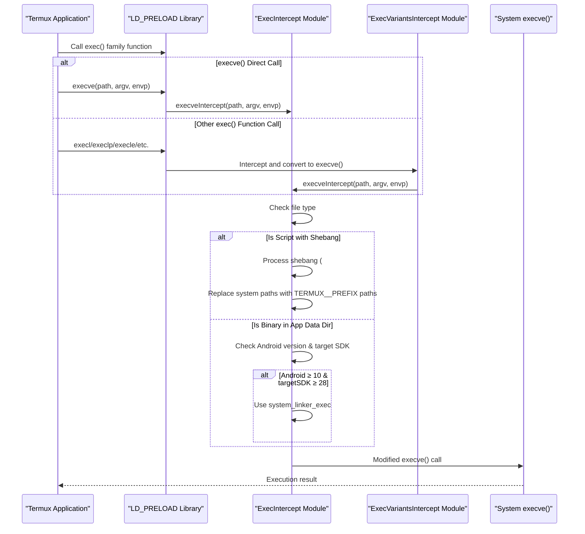

Sources:
- [site/pages/en/projects/releases/2/v2.0.0.md:21-25]()

## Library Variants

The termux-exec-package provides two different library variants to handle execution on different Android versions:

1. **Direct Execution Variant** (`libtermux-exec-direct-ld-preload.so`): Used on older Android versions or when system_linker_exec is not needed
2. **System Linker Execution Variant** (`libtermux-exec-linker-ld-preload.so`): Used on Android 10+ to bypass W^X restrictions

**Library Variants Architecture**

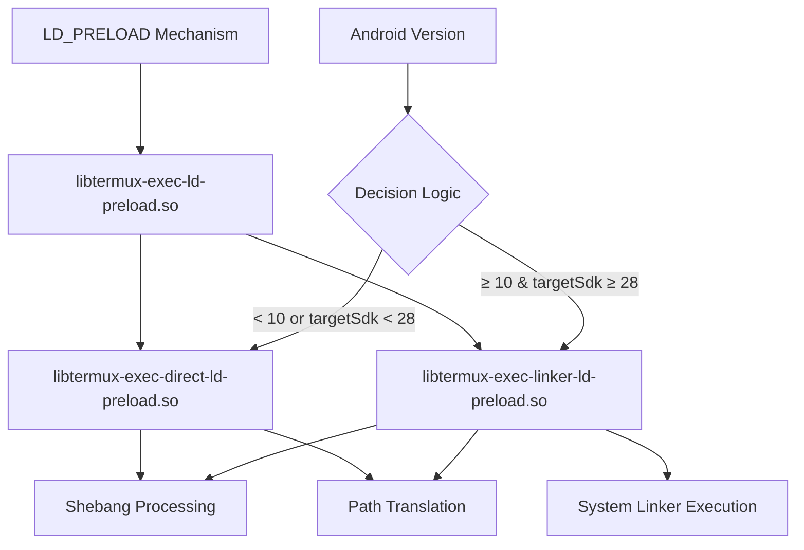

Sources:
- [site/pages/en/projects/releases/2/v2.0.0.md:19-20]()
- [site/pages/en/projects/releases/2/v2.0.0.md:30-33]()

## Path Translation

One of the key functions of termux-exec is translating standard Linux paths to Termux paths in script shebangs.

**Path Translation Process**

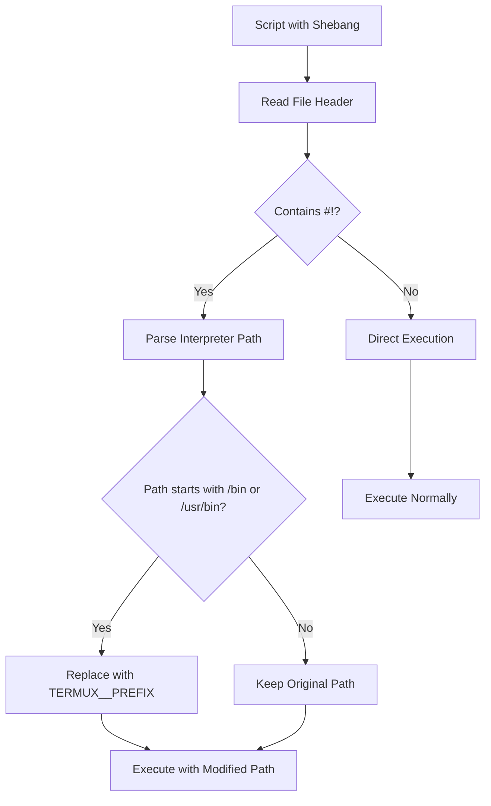

Sources:
- [site/pages/en/projects/releases/2/v2.0.0.md:56-58]()
- [site/pages/en/projects/releases/2/v2.0.0.md:69-70]()

## System Linker Execution

For Android 10 and above (with targetSdkVersion ≥ 28), termux-exec uses the system linker to bypass execution restrictions.

**System Linker Execution Process**

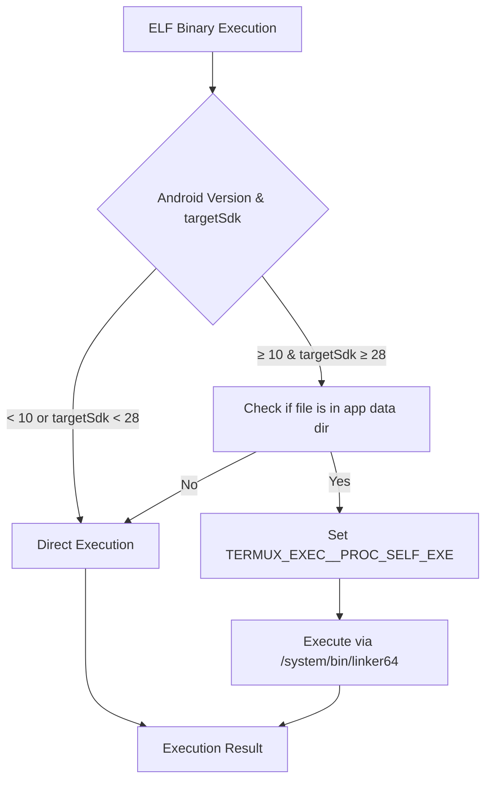

Sources:
- [site/pages/en/projects/releases/2/v2.0.0.md:30-33]()

## Configuration

The behavior of termux-exec can be configured using environment variables.

| Environment Variable | Description | Default | Values |
|---------------------|-------------|---------|--------|
| `TERMUX_EXEC__LOG_LEVEL` | Controls logging verbosity | 1 (NORMAL) | 0 (OFF), 1 (NORMAL), 2 (DEBUG), 3 (VERBOSE), 4 (VVERBOSE), 5 (VVVERBOSE) |
| `TERMUX_EXEC__EXECVE_CALL__INTERCEPT` | Controls whether execve() is intercepted | enable | enable, disable |
| `TERMUX_EXEC__SYSTEM_LINKER_EXEC__MODE` | Controls system_linker_exec usage | enable | disable, enable, force |
| `TERMUX__PREFIX` | Path to Termux installation | /data/data/com.termux/files/usr | Valid path to Termux installation |

Sources:
- [site/pages/en/projects/releases/2/v2.0.0.md:26-27]()
- [site/pages/en/projects/releases/2/v2.0.0.md:33-34]()
- [site/pages/en/projects/releases/2/v2.0.0.md:37-38]()
- [site/pages/en/projects/releases/2/v2.0.0.md:56-57]()

## Version History

The termux-exec-package has evolved over time to support changing Android requirements. The latest stable version is v2.4.0, with significant changes introduced in v2.0.0 that completely redesigned the architecture to better support newer Android versions.

| Version | Major Changes |
|---------|--------------|
| v2.4.0 | Directory structure reorganization, bug fixes |
| v2.3.0 | Standardized version string format, bug fixes |
| v2.2.0 | Bug fixes for system-linker-exec and exec-intercept |
| v2.1.0 | Added riscv64 support, bug fixes |
| v2.0.0 | Major redesign with new library architecture, system_linker_exec support |
| v1.0 | Legacy version before major redesign |

Sources:
- [site/pages/en/projects/releases/index.md:9]()
- [site/pages/en/projects/releases/2/v2.0.0.md:15-47]()
- [site/pages/en/projects/releases/2/v2.1.0.md:15-28]()
- [site/pages/en/projects/releases/2/v2.2.0.md:15-19]()
- [site/pages/en/projects/releases/2/v2.3.0.md:15-33]()
- [site/pages/en/projects/releases/2/v2.4.0.md:15-27]()

## Testing Framework

The termux-exec-package includes a comprehensive testing framework to verify its functionality across different scenarios.

**Testing System Architecture**

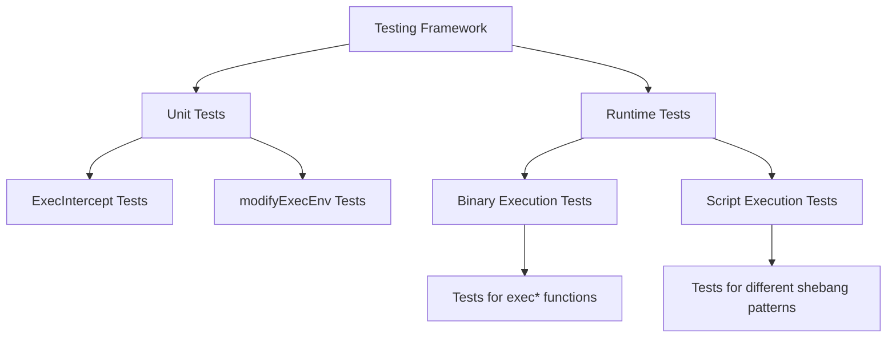

Sources:
- [site/pages/en/projects/releases/2/v2.0.0.md:42-43]()
- [site/pages/en/projects/releases/2/v2.1.0.md:15-28]()

## Summary

The termux-exec-package is a critical component for the proper functioning of Termux on Android. It provides solutions for both path translation and execution restrictions through a flexible architecture that adapts to different Android versions and security policies. By intercepting exec() family functions, processing shebangs, and utilizing the system linker when necessary, it ensures that programs can execute properly within the Termux environment despite Android's restrictions.

Sources:
- [README.md:1-4]()
- [site/pages/en/projects/releases/2/v2.0.0.md:15-100]()

---

# Page: Installation and Setup

# Installation and Setup

<details>
<summary>Relevant source files</summary>

The following files were used as context for generating this wiki page:

- [.clang-tidy](.clang-tidy)
- [.gitignore](.gitignore)
- [README.md](README.md)
- [packaging/debian/postinst.in](packaging/debian/postinst.in)
- [site/pages/en/projects/docs/technical/index.md](site/pages/en/projects/docs/technical/index.md)
- [site/pages/en/projects/docs/usage/index.md](site/pages/en/projects/docs/usage/index.md)

</details>


This document outlines the installation and configuration procedures for the termux-exec-package, which is essential for proper program execution within the Termux environment. It covers package installation options, environment setup, configuration variables, and verification steps. For information about the underlying technical details of how the execution interception works, see [System Architecture](#3).

## Installation Methods

There are two primary methods to install the termux-exec package in your Termux environment.

### Package Manager Installation

The recommended installation method is using the Termux package manager:

```bash
pkg update
pkg install termux-exec
```

This will download and install the pre-built package along with any dependencies. The post-installation script will automatically configure the appropriate library variant based on your Android version.

### Manual Installation from Source

For advanced users who need to customize the build or work with the latest development version:

```bash
# Clone the repository
git clone https://github.com/termux/termux-exec-package
cd termux-exec-package

# Build the package
make

# Install
make install
```

Sources:
[README.md:3-19]()

## Setup Process

During installation, the termux-exec package automatically configures itself by selecting the appropriate library variant based on your Android version and environment. This setup happens in the post-installation script.

### Library Selection Process

The diagram below illustrates how the system determines which library variant to use:

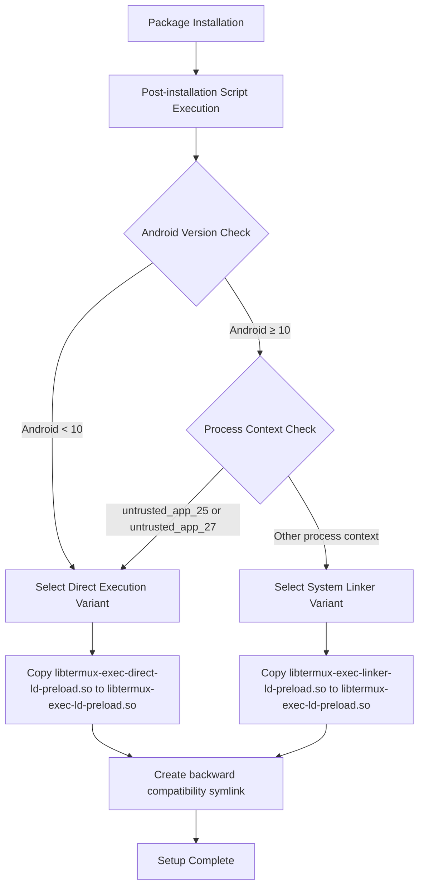

The setup script:
1. Checks your Android version by examining `ANDROID__BUILD_VERSION_SDK` or using `getprop`
2. For Android 10+, checks your process context to determine if you need the system linker execution variant
3. Sets up the appropriate library by copying it to `$TERMUX__PREFIX/usr/lib/libtermux-exec-ld-preload.so`
4. Creates a backward compatibility symlink from `libtermux-exec.so` to `libtermux-exec-ld-preload.so`

Sources:
[packaging/debian/postinst.in:1-50]()
[site/pages/en/projects/docs/technical/index.md:9-26]()

## LD_PRELOAD Integration

For termux-exec to work, it must be loaded through the `LD_PRELOAD` mechanism. This happens automatically in Termux through the `login` script, which exports the appropriate environment variable.

### How LD_PRELOAD Works with termux-exec

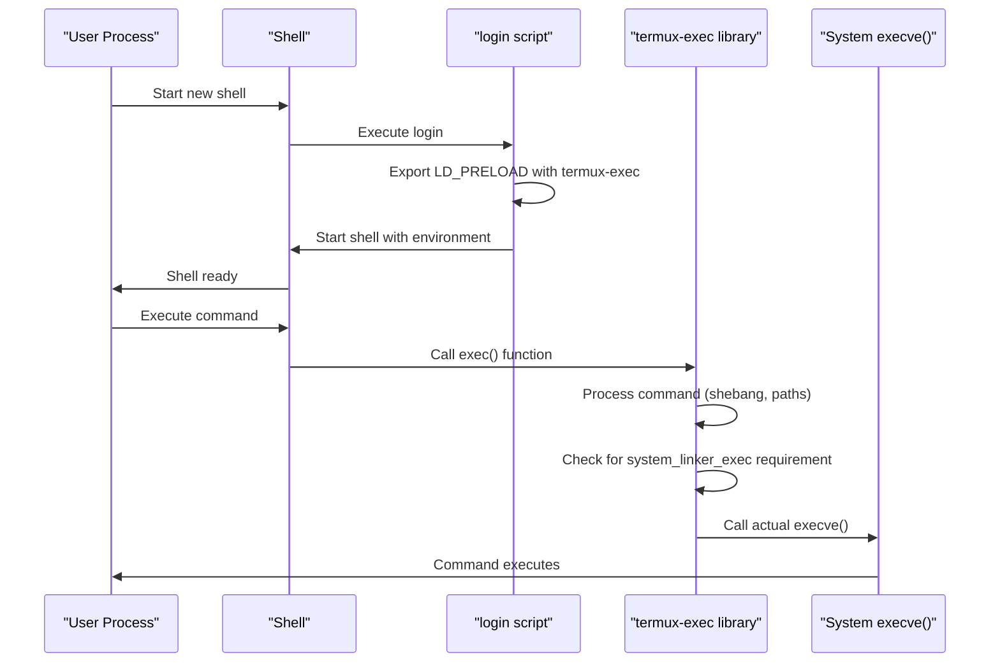

The library is configured in your environment by adding it to the `LD_PRELOAD` environment variable:

```bash
export LD_PRELOAD="$TERMUX__PREFIX/usr/lib/libtermux-exec-ld-preload.so"
```

**Note:** Changes to `LD_PRELOAD` require at least one nested `exec()` call to take effect. When you unset or modify `LD_PRELOAD`, you'll need to start a new shell for changes to be applied.

Sources:
[site/pages/en/projects/docs/usage/index.md:9-11]()
[site/pages/en/projects/docs/technical/index.md:15-26]()

## Configuration Variables

The behavior of termux-exec can be customized through several environment variables.

### Key Environment Variables

| Variable | Type | Default | Description |
|----------|------|---------|-------------|
| `TERMUX_EXEC__EXECVE_CALL__INTERCEPT` | string | `enable` | Controls whether execve() calls are intercepted |
| `TERMUX_EXEC__SYSTEM_LINKER_EXEC__MODE` | string | `enable` | Controls system linker exec usage (`disable`, `enable`, or `force`) |
| `TERMUX_EXEC__LOG_LEVEL` | int | `1` | Controls logging verbosity (0-5) |
| `TERMUX__PREFIX` | string | `/data/data/com.termux/files/usr` | Path to Termux installation |
| `TERMUX__SE_PROCESS_CONTEXT` | string | Varies | SeLinux process context, used to determine execution mode |

#### System Linker Exec Mode Options

The `TERMUX_EXEC__SYSTEM_LINKER_EXEC__MODE` variable controls how the system linker execution mechanism is used:

- `disable`: Never use system linker exec mode, always use direct execution
- `enable`: Use system linker exec only when required (Android 10+ with restrictions)
- `force`: Always use system linker exec when supported (useful for testing)

Sources:
[site/pages/en/projects/docs/usage/index.md:26-290]()

## Verification and Testing

After installation, you should verify that termux-exec is properly installed and functioning.

### Verifying Installation

Check if the library is correctly installed:

```bash
ls -la $TERMUX__PREFIX/usr/lib/libtermux-exec*
```

You should see the appropriate library and symlink:
- `libtermux-exec-ld-preload.so` - The main library file
- `libtermux-exec.so` -> `libtermux-exec-ld-preload.so` - Backward compatibility symlink

### Testing System Linker Exec Mode

You can check if system linker exec is enabled with:

```bash
termux-exec-system-linker-exec is-enabled
```

This command will report whether system linker exec is currently enabled based on your Android version and configuration.

Sources:
[site/pages/en/projects/docs/usage/index.md:257-258]()

## Troubleshooting

### Common Issues

| Issue | Possible Cause | Solution |
|-------|---------------|----------|
| Permission denied when executing binaries | Executing binaries in app data directory on Android 10+ without termux-exec | Ensure termux-exec is installed and LD_PRELOAD is set correctly |
| Wrong interpreter used for scripts | Shebang points to `/bin` or `/usr/bin` paths | Ensure termux-exec is in LD_PRELOAD or use `termux-fix-shebang` |
| Errors about missing environment variables | TERMUX__PREFIX or other variables not set | Verify the Termux environment is properly set up |
| Library not loaded | Some devices don't support LD_PRELOAD | Try alternative methods like proot |

### Manual System Linker Execution

If termux-exec is not working correctly, you can manually use the system linker to execute binaries on Android 10+:

```bash
/system/bin/linker64 $TERMUX__PREFIX/bin/your-binary [args]
```

For script files:

```bash
/system/bin/linker64 $TERMUX__PREFIX/bin/interpreter /path/to/script.sh [args]
```

Sources:
[site/pages/en/projects/docs/technical/index.md:25-125]()

## Execution Types

The termux-exec package provides two primary execution methods, selected automatically based on your Android version and configuration.

### Direct vs System Linker Execution

```mermaid
flowchart TB
    subgraph "Direct Execution (Android < 10)"
        A1["Application"] --> B1["exec() call"]
        B1 --> C1["termux-exec intercept"]
        C1 --> D1["Process shebang & paths"]
        D1 --> E1["Direct execve() call"]
        E1 --> F1["Executable runs"]
    end
    
    subgraph "System Linker Execution (Android ≥ 10)"
        A2["Application"] --> B2["exec() call"]
        B2 --> C2["termux-exec intercept"]
        C2 --> D2["Process shebang & paths"]
        D2 --> E2["Set TERMUX_EXEC__PROC_SELF_EXE"]
        E2 --> F2["Prepare /system/bin/linker64 execution"]
        F2 --> G2["execve(/system/bin/linker64, [linker64, executable, args])"]
        G2 --> H2["Executable runs"]
    end
```

The system automatically selects the appropriate execution method based on:
1. Android version (10+ requires system linker for apps with targetSdkVersion ≥ 29)
2. Process context (untrusted_app_25 and untrusted_app_27 are exempt from restrictions)
3. Location of the executable (files in app data directory require special handling)

Sources:
[site/pages/en/projects/docs/technical/index.md:63-116]()
[site/pages/en/projects/docs/usage/index.md:222-255]()

---

# Page: System Architecture

# System Architecture

<details>
<summary>Relevant source files</summary>

The following files were used as context for generating this wiki page:

- [Makefile](Makefile)
- [app/main/tests/termux-exec-tests.in](app/main/tests/termux-exec-tests.in)
- [site/pages/en/projects/docs/technical/index.md](site/pages/en/projects/docs/technical/index.md)
- [site/pages/en/projects/docs/usage/index.md](site/pages/en/projects/docs/usage/index.md)

</details>


This document provides a comprehensive overview of the architectural design and components of the termux-exec package. It explains how the system intercepts execution requests, handles Android's restrictions, and ensures proper program execution within the Termux environment. For installation instructions, see [Installation and Setup](#2), and for detailed execution interception mechanisms, see [Execution Interception Mechanism](#3.2).

## Core System Overview

The termux-exec package is designed to solve two critical issues in the Termux environment:

1. **Android's W^X Restrictions**: On Android 10 and higher with targetSdkVersion ≥ 29, execution of files in app data directories is restricted
2. **Path Differences**: Standard Linux versus Termux path differences (e.g., `/bin/sh` vs. `$TERMUX__PREFIX/bin/sh`)

The system achieves this through an LD_PRELOAD library that intercepts execution requests and applies the necessary modifications before actual execution.

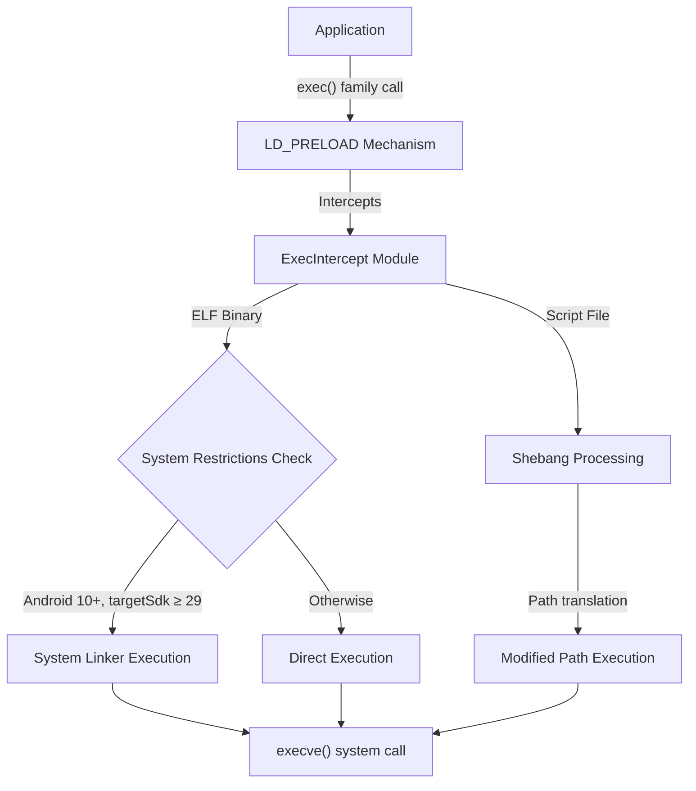

Sources: [lib/termux-exec_nos_c/tre/src/termux/api/termux_exec/service/ld_preload/direct/exec/ExecIntercept.c](), [lib/termux-exec_nos_c/tre/src/termux/api/termux_exec/service/ld_preload/TermuxExecLDPreload.c]()

## Library Variants Architecture

The system provides two primary library variants that serve different execution scenarios:

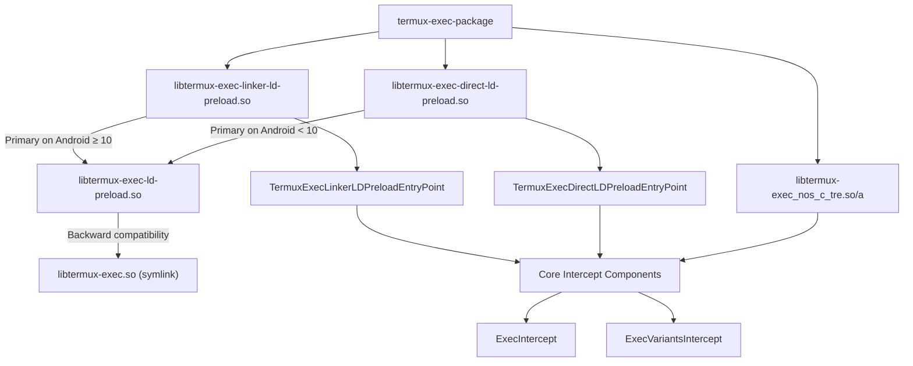

Sources: [Makefile:394-420](), [Makefile:422-438]()

### Component Relationships

The following diagram shows the relationship between source files and functional components:

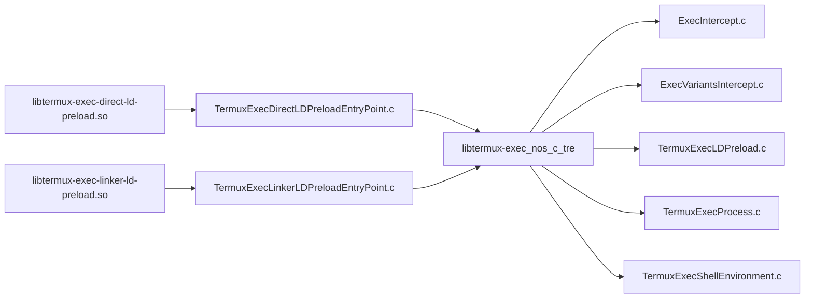

Sources: [Makefile:194-200](), [Makefile:386-402](), [Makefile:422-438]()

## Execution Interception Process

The core functionality of the package is the interception and processing of execution requests. This is implemented as an LD_PRELOAD library that hooks into the exec() family of functions.

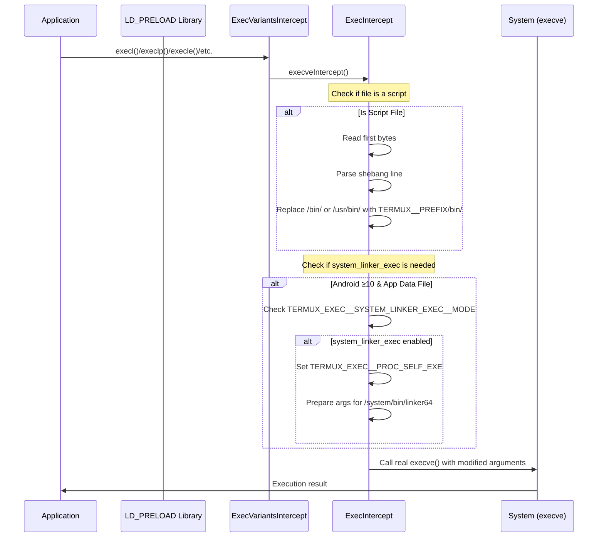

Sources: [lib/termux-exec_nos_c/tre/src/termux/api/termux_exec/service/ld_preload/direct/exec/ExecIntercept.c](), [lib/termux-exec_nos_c/tre/src/termux/api/termux_exec/service/ld_preload/direct/exec/ExecVariantsIntercept.c]()

## System Linker Execution Mechanism

On Android 10+ with targetSdkVersion ≥ 29, direct execution of files in app data directories is restricted (W^X policy). The termux-exec package implements a bypass using the system linker:

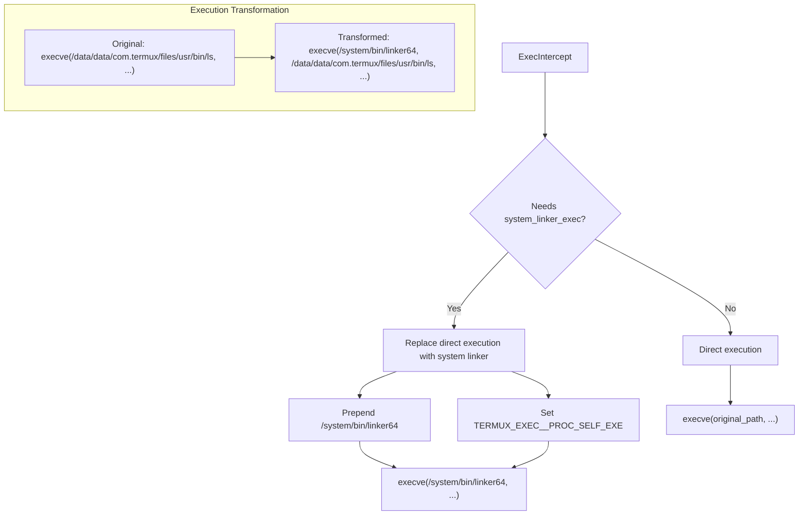

Sources: [lib/termux-exec_nos_c/tre/src/termux/api/termux_exec/service/ld_preload/TermuxExecLDPreload.c:2137-2247](), [lib/termux-exec_nos_c/tre/src/termux/api/termux_exec/service/ld_preload/direct/exec/ExecIntercept.c:216-259]()

## Build System Architecture

The build system is orchestrated by the Makefile, which creates different library variants and installs them appropriately:

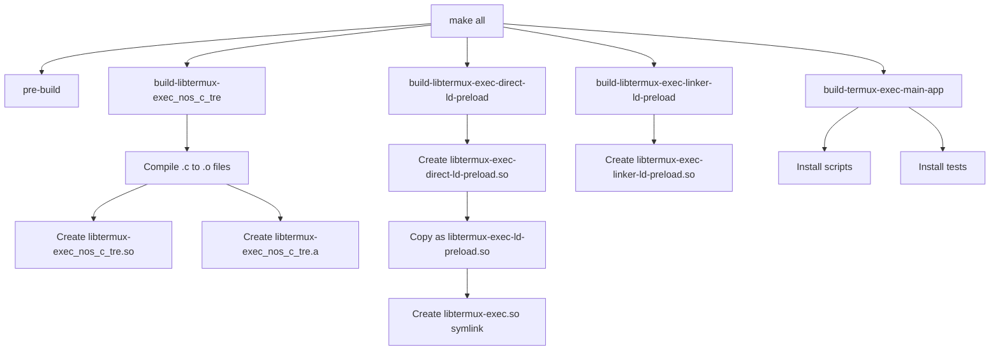

Sources: [Makefile:251-264](), [Makefile:289-316](), [Makefile:386-420](), [Makefile:422-438](), [Makefile:271-287]()

## Environment Variables and Configuration

The system's behavior is controlled by several environment variables:

| Environment Variable | Purpose | Default | Options |
|---------------------|---------|---------|---------|
| TERMUX_EXEC__SYSTEM_LINKER_EXEC__MODE | Controls system linker execution | enable | disable, enable, force |
| TERMUX_EXEC__EXECVE_CALL__INTERCEPT | Controls whether execve() is intercepted | enable | disable, enable |
| TERMUX__PREFIX | Path to Termux installation | /data/data/com.termux/files/usr | Any valid path |
| TERMUX_EXEC__LOG_LEVEL | Controls logging verbosity | 1 | 0 (OFF) to 5 (VVVERBOSE) |
| TERMUX_EXEC__PROC_SELF_EXE | Set by system when using system_linker_exec | - | Path to actual executable |

Sources: [site/pages/en/projects/docs/usage/index.md:158-241]()

## Testing Architecture

The package includes a comprehensive testing framework to verify functionality across different execution scenarios:

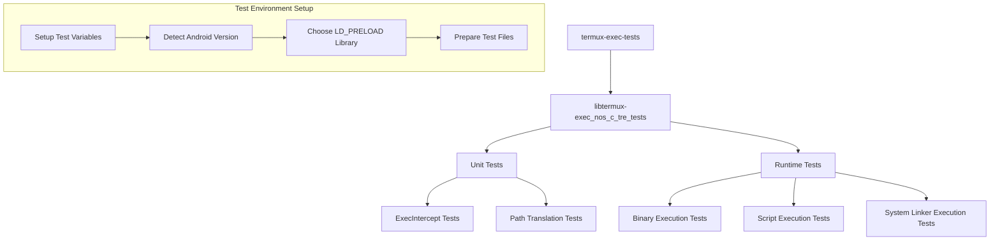

Sources: [app/main/tests/termux-exec-tests.in:220-261](), [app/main/tests/termux-exec-tests.in:140-215]()

## Installation Flow

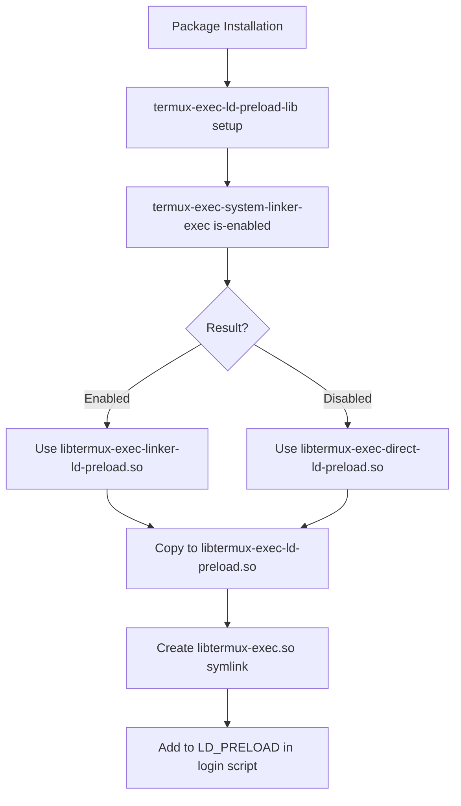

Sources: [site/pages/en/projects/docs/technical/index.md:15-16]()

## System Structures

The core library `libtermux-exec_nos_c_tre` consists of several key components:

| Component | Purpose | Source Files |
|-----------|---------|--------------|
| ExecIntercept | Main execution interception logic | lib/termux-exec_nos_c/tre/src/termux/api/termux_exec/service/ld_preload/direct/exec/ExecIntercept.c |
| ExecVariantsIntercept | Handles different exec variants (execl, execlp, etc.) | lib/termux-exec_nos_c/tre/src/termux/api/termux_exec/service/ld_preload/direct/exec/ExecVariantsIntercept.c |
| TermuxExecLDPreload | Provides core LD_PRELOAD functionality | lib/termux-exec_nos_c/tre/src/termux/api/termux_exec/service/ld_preload/TermuxExecLDPreload.c |
| TermuxExecProcess | Process-related utilities | lib/termux-exec_nos_c/tre/src/termux/os/process/termux_exec/TermuxExecProcess.c |
| TermuxExecShellEnvironment | Shell environment handling | lib/termux-exec_nos_c/tre/src/termux/shell/command/environment/termux_exec/TermuxExecShellEnvironment.c |

Sources: [Makefile:194-200]()

## Decision Tree for Execution Method

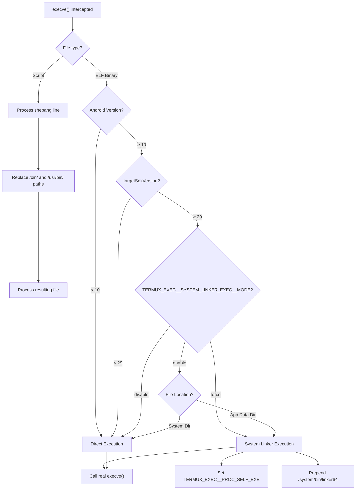

Sources: [lib/termux-exec_nos_c/tre/src/termux/api/termux_exec/service/ld_preload/TermuxExecLDPreload.c:2137-2247](), [lib/termux-exec_nos_c/tre/src/termux/api/termux_exec/service/ld_preload/direct/exec/ExecIntercept.c:216-259](), [site/pages/en/projects/docs/usage/index.md:222-256]()

## System Files and Their Roles

The following table provides an overview of the key files in the system and their roles:

| File Path | Role |
|-----------|------|
| libtermux-exec-ld-preload.so | Primary LD_PRELOAD library (copy of one of the variants) |
| libtermux-exec-direct-ld-preload.so | Direct execution variant (for Android < 10) |
| libtermux-exec-linker-ld-preload.so | System linker execution variant (for Android ≥ 10) |
| libtermux-exec.so | Backward compatibility symlink |
| libtermux-exec_nos_c_tre.so | Core library implementing execution logic |
| termux-exec-ld-preload-lib | Script to configure the primary LD_PRELOAD library |
| termux-exec-system-linker-exec | Script to check if system_linker_exec is needed |

Sources: [Makefile:386-420](), [Makefile:422-438](), [Makefile:289-316](), [site/pages/en/projects/docs/technical/index.md:11-20]()

## Integration with Termux Environment

The termux-exec package integrates with the broader Termux environment through several mechanisms:

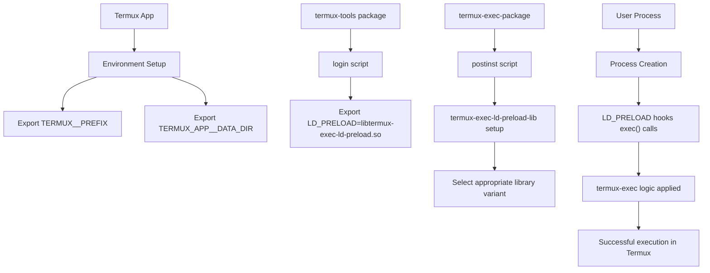

Sources: [site/pages/en/projects/docs/technical/index.md:15-16](), [site/pages/en/projects/docs/usage/index.md:47-116]()

---

# Page: Core Components

# Core Components

<details>
<summary>Relevant source files</summary>

The following files were used as context for generating this wiki page:

- [app/termux-exec-direct-ld-preload/src/termux/api/termux_exec/service/ld_preload/direct/TermuxExecDirectLDPreloadEntryPoint.c](app/termux-exec-direct-ld-preload/src/termux/api/termux_exec/service/ld_preload/direct/TermuxExecDirectLDPreloadEntryPoint.c)
- [app/termux-exec-linker-ld-preload/src/termux/api/termux_exec/service/ld_preload/linker/TermuxExecLinkerLDPreloadEntryPoint.c](app/termux-exec-linker-ld-preload/src/termux/api/termux_exec/service/ld_preload/linker/TermuxExecLinkerLDPreloadEntryPoint.c)
- [lib/termux-exec_nos_c/tre/src/termux/api/termux_exec/service/ld_preload/TermuxExecLDPreload.c](lib/termux-exec_nos_c/tre/src/termux/api/termux_exec/service/ld_preload/TermuxExecLDPreload.c)
- [site/pages/en/projects/docs/technical/index.md](site/pages/en/projects/docs/technical/index.md)
- [site/pages/en/projects/docs/usage/index.md](site/pages/en/projects/docs/usage/index.md)

</details>


This page documents the core components of the termux-exec package, which are essential for enabling proper program execution within the Termux environment on Android. The components described here form the foundation of the execution interception system that handles Android's restrictions on executing files in app data directories and resolves path differences between standard Linux and Termux environments.

For information about how to interact with these components as a user, see [Installation and Setup](#2). For details on how execution interception works, see [Execution Interception Mechanism](#3.2).

## Component Overview

The termux-exec package consists of several interconnected core components that work together to provide execution capabilities in the Termux environment.

```mermaid
graph TD
    subgraph "Core Components Structure"
        LDPreload["LD_PRELOAD Library Variants"]
        CoreLib["libtermux-exec_nos_c_tre"]
        ExecInt["ExecIntercept Module"]
        ExecVarInt["ExecVariantsIntercept Module"]
        TermuxExecLDPreload["TermuxExecLDPreload Service"]
        
        LDPreload -->|"implements through"| CoreLib
        CoreLib --> ExecInt
        CoreLib --> ExecVarInt
        CoreLib --> TermuxExecLDPreload
        
        ExecInt -->|"uses"| TermuxExecLDPreload
        ExecVarInt -->|"uses"| ExecInt
    end
```

Sources:
- [lib/termux-exec_nos_c/tre/src/termux/api/termux_exec/service/ld_preload/TermuxExecLDPreload.c]()
- [app/termux-exec-direct-ld-preload/src/termux/api/termux_exec/service/ld_preload/direct/TermuxExecDirectLDPreloadEntryPoint.c]()
- [app/termux-exec-linker-ld-preload/src/termux/api/termux_exec/service/ld_preload/linker/TermuxExecLinkerLDPreloadEntryPoint.c]()

## LD_PRELOAD Library Variants

The termux-exec package provides two variants of the LD_PRELOAD library to intercept execution requests:

```mermaid
graph TD
    subgraph "LD_PRELOAD Library Variants"
        MainLib["libtermux-exec-ld-preload.so"]
        
        DirectLib["libtermux-exec-direct-ld-preload.so\n(Direct Execution)"]
        LinkerLib["libtermux-exec-linker-ld-preload.so\n(System Linker Execution)"]
        
        MainLib -->|"symlink for\ncompatibility"| LegacyLib["libtermux-exec.so"]
        MainLib -.->|"copy of either"| DirectLib
        MainLib -.->|"copy of either"| LinkerLib
        
        DirectLib -->|"uses"| CoreLib["libtermux-exec_nos_c_tre"]
        LinkerLib -->|"uses"| CoreLib
        
        DirectEntryPoint["TermuxExecDirectLDPreloadEntryPoint.c"]
        LinkerEntryPoint["TermuxExecLinkerLDPreloadEntryPoint.c"]
        
        DirectLib -->|"entry point"| DirectEntryPoint
        LinkerLib -->|"entry point"| LinkerEntryPoint
    end
```

### Direct Execution Variant

The direct execution variant (`libtermux-exec-direct-ld-preload.so`) is used when:
- Running on Android versions below 10
- Running with targetSdkVersion < 28
- W^X restrictions don't apply or are exempted

This variant directly intercepts the exec() family of functions and handles path translations, shebang processing, and direct execution.

Sources:
- [app/termux-exec-direct-ld-preload/src/termux/api/termux_exec/service/ld_preload/direct/TermuxExecDirectLDPreloadEntryPoint.c:1-100]()

### System Linker Execution Variant

The system linker execution variant (`libtermux-exec-linker-ld-preload.so`) is used when:
- Running on Android 10 or above
- Running with targetSdkVersion ≥ 28
- W^X restrictions apply and require bypassing

This variant uses the `/system/bin/linker64` (or `/system/bin/linker` on 32-bit systems) to execute files in app data directories, bypassing Android's W^X restrictions.

Sources:
- [app/termux-exec-linker-ld-preload/src/termux/api/termux_exec/service/ld_preload/linker/TermuxExecLinkerLDPreloadEntryPoint.c:1-100]()

## Core Library: libtermux-exec_nos_c_tre

The core functionality of both LD_PRELOAD variants is implemented in a shared library called `libtermux-exec_nos_c_tre`. This library contains the implementation for:

```mermaid
graph TD
    subgraph "Core Library Components"
        CoreLib["libtermux-exec_nos_c_tre"]
        
        ExecInt["ExecIntercept\n(handles execution interception)"]
        ExecVarInt["ExecVariantsIntercept\n(intercepts exec variants)"]
        LDPreload["TermuxExecLDPreload\n(determines execution mode)"]
        
        CoreLib --> ExecInt
        CoreLib --> ExecVarInt
        CoreLib --> LDPreload
        
        ExecInt -->|"calls"| execveIntercept["execveIntercept()"]
        ExecVarInt -->|"calls"| execlIntercept["execlIntercept()"]
        ExecVarInt -->|"calls"| execvpIntercept["execvpIntercept()"]
        ExecVarInt -->|"calls"| execvpeIntercept["execvpeIntercept()"]
        ExecVarInt -->|"calls"| fexecveIntercept["fexecveIntercept()"]
        
        LDPreload -->|"provides"| isSystemLinkerExecEnabled["isSystemLinkerExecEnabled()"]
        LDPreload -->|"provides"| shouldEnableSystemLinkerExecForFile["shouldEnableSystemLinkerExecForFile()"]
    end
```

### ExecIntercept Module

The ExecIntercept module is responsible for intercepting execution requests and processing them according to Termux requirements. It:

1. Reads the file header to determine if it's a script or ELF binary
2. Processes shebang lines in scripts to replace `/bin` or `/usr/bin` paths with Termux paths
3. Determines whether system linker execution is needed
4. Modifies arguments and environment variables as needed
5. Calls the appropriate execution function

Sources:
- [lib/termux-exec_nos_c/tre/src/termux/api/termux_exec/service/ld_preload/TermuxExecLDPreload.c:31-140]()

### ExecVariantsIntercept Module

The ExecVariantsIntercept module implements interception for all variants of the exec() family of functions:
- `execl()`, `execlp()`, `execle()`
- `execv()`, `execvp()`, `execvpe()`
- `fexecve()`
- `execve()`

These functions are intercepted by the LD_PRELOAD library and redirected to their corresponding intercept functions.

Sources:
- [app/termux-exec-direct-ld-preload/src/termux/api/termux_exec/service/ld_preload/direct/TermuxExecDirectLDPreloadEntryPoint.c:33-99]()
- [app/termux-exec-linker-ld-preload/src/termux/api/termux_exec/service/ld_preload/linker/TermuxExecLinkerLDPreloadEntryPoint.c:33-99]()

### TermuxExecLDPreload Service

The TermuxExecLDPreload service provides functionality to determine whether system linker execution should be enabled. Key functions include:

- `isSystemLinkerExecEnabled()`: Determines whether system linker execution should be used based on:
  - Android version
  - The value of `TERMUX_EXEC__SYSTEM_LINKER_EXEC__MODE`
  - SELinux process context
  - Effective user ID

- `shouldEnableSystemLinkerExecForFile()`: Determines whether system linker execution should be used for a specific file based on:
  - Whether system linker execution is generally enabled
  - Whether the file is under a Termux app data directory

Sources:
- [lib/termux-exec_nos_c/tre/src/termux/api/termux_exec/service/ld_preload/TermuxExecLDPreload.c:31-170]()

## Execution Flow

The following diagram illustrates the execution flow when a program is executed through termux-exec:

```mermaid
sequenceDiagram
    participant App as "Application"
    participant LDPreload as "LD_PRELOAD Library"
    participant ExecInt as "ExecIntercept"
    participant LDPreloadSvc as "TermuxExecLDPreload"
    participant Kernel as "Kernel/execve()"
    
    App->>LDPreload: Call to exec() family function
    LDPreload->>LDPreload: Initialize process
    LDPreload->>ExecInt: Call corresponding intercept function
    
    ExecInt->>ExecInt: Read file header
    ExecInt->>ExecInt: Check if script or ELF binary
    
    alt Is Script with Shebang
        ExecInt->>ExecInt: Parse shebang line
        ExecInt->>ExecInt: Replace /bin or /usr/bin paths
        ExecInt->>ExecInt: Prepare for interpreter execution
    end
    
    ExecInt->>LDPreloadSvc: shouldEnableSystemLinkerExecForFile()
    LDPreloadSvc->>LDPreloadSvc: isSystemLinkerExecEnabled()
    LDPreloadSvc->>LDPreloadSvc: Check Android version
    LDPreloadSvc->>LDPreloadSvc: Check SELinux context
    LDPreloadSvc->>LDPreloadSvc: Check if file is in app data dir
    LDPreloadSvc-->>ExecInt: Return decision
    
    alt System Linker Execution Needed
        ExecInt->>ExecInt: Set TERMUX_EXEC__PROC_SELF_EXE
        ExecInt->>ExecInt: Prepare execution via /system/bin/linker64
    end
    
    ExecInt->>Kernel: Call execve() with processed parameters
    Kernel-->>App: Execution result
```

Sources:
- [lib/termux-exec_nos_c/tre/src/termux/api/termux_exec/service/ld_preload/TermuxExecLDPreload.c:31-170]()
- [app/termux-exec-direct-ld-preload/src/termux/api/termux_exec/service/ld_preload/direct/TermuxExecDirectLDPreloadEntryPoint.c:33-99]()
- [app/termux-exec-linker-ld-preload/src/termux/api/termux_exec/service/ld_preload/linker/TermuxExecLinkerLDPreloadEntryPoint.c:33-99]()

## Key Environment Variables

The behavior of the core components is controlled by several environment variables:

| Environment Variable | Purpose | Possible Values |
|---------------------|---------|----------------|
| `TERMUX_EXEC__EXECVE_CALL__INTERCEPT` | Controls whether execve() calls are intercepted | `enable` (default), `disable` |
| `TERMUX_EXEC__SYSTEM_LINKER_EXEC__MODE` | Determines system linker execution usage | `enable` (default), `disable`, `force` |
| `TERMUX__PREFIX` | Path to Termux installation | typically `/data/data/com.termux/files/usr` |
| `TERMUX_EXEC__LOG_LEVEL` | Controls logging verbosity | 0 (OFF) to 5 (VVVERBOSE) |
| `TERMUX_EXEC__PROC_SELF_EXE` | Set to the actual executable path when using system linker execution | Path to executable |
| `TERMUX_APP__DATA_DIR` | Non-legacy Termux app data directory path | Path to data directory |
| `TERMUX_APP__LEGACY_DATA_DIR` | Legacy Termux app data directory path | Path to legacy data directory |
| `TERMUX__SE_PROCESS_CONTEXT` | SELinux process context | SELinux context string |

Sources:
- [site/pages/en/projects/docs/usage/index.md:27-286]()
- [site/pages/en/projects/docs/technical/index.md:220-227]()

## System Linker Execution Mechanism

The system linker execution mechanism is a key component that allows Termux to bypass Android's W^X restrictions on executing files in app data directories.

```mermaid
graph TD
    subgraph "System Linker Execution Mechanism"
        ExecRequest["Execution Request\n(e.g., execve('/data/data/com.termux/files/usr/bin/python'))"]
        
        Decision{"Is system_linker_exec\nneeded?"}
        
        DirectExec["Direct Execution\n(Normal execve call)"]
        
        LinkerExec["System Linker Execution\n(via /system/bin/linker64)"]
        
        ExecRequest --> Decision
        
        Decision -->|"No"| DirectExec
        Decision -->|"Yes"| LinkerExec
        
        LinkerExec -->|"Execution command becomes"| FinalExec["/system/bin/linker64 /data/data/com.termux/files/usr/bin/python"]
        
        LinkerExec -->|"Sets"| ProcSelfExe["TERMUX_EXEC__PROC_SELF_EXE=/data/data/com.termux/files/usr/bin/python"]
    end
```

When system linker execution is enabled and needed, instead of directly executing the target file, termux-exec:

1. Sets the `TERMUX_EXEC__PROC_SELF_EXE` environment variable to the path of the file being executed
2. Prepends `/system/bin/linker64` (or `/system/bin/linker` on 32-bit systems) to the command
3. Executes the file through the system linker instead of directly

This works because the system linker has the privilege to execute files in app data directories, even when Android's W^X restrictions would normally prevent it.

Sources:
- [lib/termux-exec_nos_c/tre/src/termux/api/termux_exec/service/ld_preload/TermuxExecLDPreload.c:31-170]()
- [site/pages/en/projects/docs/technical/index.md:79-106]()

---

# Page: Execution Interception Mechanism

# Execution Interception Mechanism

<details>
<summary>Relevant source files</summary>

The following files were used as context for generating this wiki page:

- [lib/termux-exec_nos_c/tre/include/termux/termux_exec__nos__c/v1/termux/api/termux_exec/service/ld_preload/direct/exec/ExecIntercept.h](lib/termux-exec_nos_c/tre/include/termux/termux_exec__nos__c/v1/termux/api/termux_exec/service/ld_preload/direct/exec/ExecIntercept.h)
- [lib/termux-exec_nos_c/tre/src/termux/api/termux_exec/service/ld_preload/direct/exec/ExecIntercept.c](lib/termux-exec_nos_c/tre/src/termux/api/termux_exec/service/ld_preload/direct/exec/ExecIntercept.c)
- [lib/termux-exec_nos_c/tre/src/termux/api/termux_exec/service/ld_preload/direct/exec/ExecVariantsIntercept.c](lib/termux-exec_nos_c/tre/src/termux/api/termux_exec/service/ld_preload/direct/exec/ExecVariantsIntercept.c)

</details>


## Purpose and Scope

This document explains how termux-exec intercepts and processes execution requests in the Termux environment. The execution interception mechanism is the core component that enables proper program execution within Termux by handling path translations, shebang processing, and Android's execution restrictions. For information about the system linker execution specifically, see [System Linker Execution](#3.3).

## Overview

The execution interception mechanism works by hooking into the system's `exec()` family of functions through an `LD_PRELOAD` library. When a program attempts to execute another program, termux-exec intercepts this call, processes it according to Termux's requirements, and then redirects it to the actual system call with the necessary modifications.

```mermaid
flowchart TB
    subgraph "Execution Interception Flow"
        exec["exec() Family Call"] --> intercept["execveIntercept()"]
        intercept --> check_enabled{"Is Intercept\nEnabled?"}
        check_enabled -- "Yes" --> internal["execveInterceptInternal()"]
        check_enabled -- "No" --> syscall["execveSyscall()"]
        
        internal --> process_path["Process Path\n(normalize, absolutize)"]
        process_path --> check_system{"Under System\nDirectory?"}
        
        check_system -- "No" --> read_header["Read File Header"]
        check_system -- "Yes" --> skip_header["Skip Header Read"]
        
        read_header --> inspect["inspectFileHeader()"]
        skip_header --> check_linker
        
        inspect --> check_type{"File Type?"}
        check_type -- "ELF Binary" --> check_linker["Check System Linker Need"]
        check_type -- "Script with Shebang" --> process_script["Process Shebang\nReplace Paths"]
        
        process_script --> check_linker
        
        check_linker --> modify_env["Modify Environment"]
        modify_env --> modify_args["Modify Arguments"]
        modify_args --> exec_call["execveSyscall()"]
    end
```

Sources: [lib/termux-exec_nos_c/tre/src/termux/api/termux_exec/service/ld_preload/direct/exec/ExecIntercept.c:48-79](), [lib/termux-exec_nos_c/tre/src/termux/api/termux_exec/service/ld_preload/direct/exec/ExecIntercept.c:85-442]()

## Key Components

The execution interception mechanism consists of several key components that work together:

```mermaid
classDiagram
    class execveIntercept {
        +int execveIntercept(bool intercept, const char* path, char* const argv[], char* const envp[])
    }
    
    class execveInterceptInternal {
        -int execveInterceptInternal(const char* path, char* const argv[], char* const envp[])
    }
    
    class execveSyscall {
        -int execveSyscall(const char* path, char* const argv[], char* const envp[])
    }
    
    class readFileHeader {
        +int readFileHeader(const char* label, const char* path, char* buffer, size_t bufferSize)
    }
    
    class inspectFileHeader {
        +int inspectFileHeader(const char* prefix, char* header, size_t length, struct TermuxFileHeaderInfo* info)
    }
    
    class modifyExecEnv {
        +int modifyExecEnv(char* const* envp, char*** newEnvpPointer, char** procSelfExe, bool unsetLdVars, bool unsetLdPreload)
    }
    
    class modifyExecArgs {
        +int modifyExecArgs(char* const* argv, const char*** newArgvPointer, const char* origPath, const char* execPath, bool interpreter, bool systemLinker, struct TermuxFileHeaderInfo* info)
    }
    
    class ExecVariantsIntercept {
        +int execlIntercept()
        +int execvIntercept()
        +int execvpIntercept()
        +int execvpeIntercept()
        +int fexecveIntercept()
    }

    execveIntercept --> execveInterceptInternal
    execveIntercept --> execveSyscall
    ExecVariantsIntercept --> execveIntercept
    execveInterceptInternal --> readFileHeader
    execveInterceptInternal --> inspectFileHeader
    execveInterceptInternal --> modifyExecEnv
    execveInterceptInternal --> modifyExecArgs
    execveInterceptInternal --> execveSyscall
```

Sources: [lib/termux-exec_nos_c/tre/include/termux/termux_exec__nos__c/v1/termux/api/termux_exec/service/ld_preload/direct/exec/ExecIntercept.h](), [lib/termux-exec_nos_c/tre/src/termux/api/termux_exec/service/ld_preload/direct/exec/ExecIntercept.c](), [lib/termux-exec_nos_c/tre/src/termux/api/termux_exec/service/ld_preload/direct/exec/ExecVariantsIntercept.c]()

## Interception Process

### Entry Points

The execution interception begins when any of the `exec()` family functions is called. All variants ultimately route to `execveIntercept()`, which is the main interception function.

```mermaid
flowchart LR
    subgraph "exec() Family Interception"
        execl["execl()"] --> execlIntercept
        execlp["execlp()"] --> execlIntercept
        execle["execle()"] --> execlIntercept
        
        execlIntercept["execlIntercept()"] --> execlp_or_execve
        
        execv["execv()"] --> execvIntercept["execvIntercept()"]
        execvIntercept --> execveIntercept
        
        execvp["execvp()"] --> execvpIntercept["execvpIntercept()"]
        execvpIntercept --> execvpeIntercept["execvpeIntercept()"]
        
        execlp_or_execve{"variant == ExecLP?"}
        execlp_or_execve -- "Yes" --> execvpIntercept
        execlp_or_execve -- "No" --> execveIntercept
        
        execvpe["execvpe()"] --> execvpeIntercept
        execvpeIntercept --> execveIntercept
        
        fexecve["fexecve()"] --> fexecveIntercept["fexecveIntercept()"]
        fexecveIntercept --> execveIntercept
        
        execveIntercept["execveIntercept()"] --> execveInterceptInternal["execveInterceptInternal()"]
    end
```

Sources: [lib/termux-exec_nos_c/tre/src/termux/api/termux_exec/service/ld_preload/direct/exec/ExecVariantsIntercept.c:47-185]()

### Path Processing

Once the execution request is intercepted, the path to the executable undergoes several processing steps:

1. **Normalization**: Removes redundant path components like `.` and `..`
2. **Absolutization**: Converts relative paths to absolute paths
3. **Prefix Translation**: Replaces standard Linux paths with Termux-specific paths

```mermaid
flowchart TB
    subgraph "Path Processing"
        start["Original Path"] --> check_fd{"Is FD Path?"}
        
        check_fd -- "Yes" --> get_real["Get Real Path from FD"]
        check_fd -- "No" --> check_abs{"Is Absolute?"}
        
        check_abs -- "Yes" --> normalize["Normalize Path"]
        normalize --> prefix["Replace with Termux Prefix"]
        
        check_abs -- "No" --> absolutize["Absolutize Path"]
        absolutize --> normalize2["Normalize Path"]
        
        get_real --> access["Check if Executable"]
        prefix --> access
        normalize2 --> access
        
        access -- "Success" --> proceed["Proceed with Execution"]
        access -- "Failure" --> fail["Return Error"]
    end
```

Sources: [lib/termux-exec_nos_c/tre/src/termux/api/termux_exec/service/ld_preload/direct/exec/ExecIntercept.c:124-207]()

### File Header Inspection

For non-system executables, termux-exec reads and inspects the file header to determine how to handle the execution:

```mermaid
flowchart TB
    subgraph "File Header Inspection"
        start["Read File Header"] --> check_system{"Is Under System Dir?"}
        
        check_system -- "Yes" --> skip["Skip Header Inspection"]
        check_system -- "No" --> read["Read File Header"]
        
        read --> check_elf{"Is ELF File?"}
        
        check_elf -- "Yes" --> set_elf["Set isElf = true"]
        check_elf -- "No" --> check_shebang{"Has Shebang?"}
        
        check_shebang -- "Yes" --> parse["Parse Interpreter\nand Arguments"]
        check_shebang -- "No" --> no_exec["Return ENOEXEC"]
        
        parse --> normalize["Normalize Interpreter Path"]
        normalize --> prefix["Apply Termux Prefix"]
    end
```

Sources: [lib/termux-exec_nos_c/tre/src/termux/api/termux_exec/service/ld_preload/direct/exec/ExecIntercept.c:219-286](), [lib/termux-exec_nos_c/tre/src/termux/api/termux_exec/service/ld_preload/direct/exec/ExecIntercept.c:447-647]()

## Script Handling

### Shebang Processing

One of the primary functions of the execution interception is handling script files with shebangs (`#!`). The mechanism:

1. Reads the first line of the script file
2. Parses the interpreter path and arguments
3. Normalizes and prefixes the interpreter path
4. Modifies execution arguments to run the script with the appropriate interpreter

```mermaid
flowchart TB
    subgraph "Shebang Processing"
        header["File Header"] --> parse["Parse Shebang Line"]
        parse --> extract_interpreter["Extract Interpreter Path"]
        parse --> extract_args["Extract Interpreter Args"]
        
        extract_interpreter --> normalize["Normalize Path"]
        normalize --> check_abs{"Is Absolute?"}
        
        check_abs -- "Yes" --> prefix["Replace /bin or /usr/bin\nwith Termux prefix"]
        check_abs -- "No" --> absolutize["Make Path Absolute"]
        
        absolutize --> normalize2["Normalize Path"]
        
        prefix --> set["Set as executablePath"]
        normalize2 --> set
        
        set --> modify_args["Modify Arguments for Execution:\n1. Set argv[0] to Original Interpreter\n2. Add Interpreter Args\n3. Add Script Path\n4. Add Original Arguments"]
    end
```

Sources: [lib/termux-exec_nos_c/tre/src/termux/api/termux_exec/service/ld_preload/direct/exec/ExecIntercept.c:471-643](), [lib/termux-exec_nos_c/tre/src/termux/api/termux_exec/service/ld_preload/direct/exec/ExecIntercept.c:757-807]()

The shebang processing has two important features:

1. **Extended Shebang Length**: Termux-exec increases the maximum allowed shebang line length from the kernel's limit (128 or 256 bytes) to 340 bytes, allowing longer interpreter paths.

2. **Path Translation**: It automatically translates standard Linux paths in shebangs (like `/bin/bash`) to their Termux equivalents (like `/data/data/com.termux/files/usr/bin/bash`).

## Environment and Argument Modification

### Environment Variable Handling

The execution interception mechanism modifies environment variables for execution based on various conditions:

```mermaid
flowchart TB
    subgraph "Environment Modification"
        start["Check Environment"] --> check_unset_ld{"Should Unset LD Vars?"}
        
        check_unset_ld -- "Yes" --> unset_ld["Unset LD_LIBRARY_PATH\nand LD_PRELOAD"]
        check_unset_ld -- "No" --> check_empty_ld{"Empty LD_PRELOAD?"}
        
        check_empty_ld -- "Yes" --> unset_ld_preload["Unset LD_PRELOAD"]
        check_empty_ld -- "No" --> check_linker{"Need System Linker?"}
        
        unset_ld --> check_linker
        unset_ld_preload --> check_linker
        
        check_linker -- "Yes" --> set_proc_self["Set TERMUX_EXEC__PROC_SELF_EXE\nto Processed Path"]
        check_linker -- "No" --> check_proc_self{"PROC_SELF_EXE Set?"}
        
        check_proc_self -- "Yes" --> unset_proc_self["Unset TERMUX_EXEC__PROC_SELF_EXE"]
        check_proc_self -- "No" --> check_modify{"Need Modification?"}
        
        set_proc_self --> check_modify
        unset_proc_self --> check_modify
        
        check_modify -- "Yes" --> modify["Create New Environment"]
        check_modify -- "No" --> use_original["Use Original Environment"]
    end
```

Sources: [lib/termux-exec_nos_c/tre/src/termux/api/termux_exec/service/ld_preload/direct/exec/ExecIntercept.c:314-387](), [lib/termux-exec_nos_c/tre/src/termux/api/termux_exec/service/ld_preload/direct/exec/ExecIntercept.c:676-753]()

### Argument Modification

Arguments are modified based on whether interpreter execution or system linker execution is needed:

```mermaid
flowchart TB
    subgraph "Argument Modification"
        start["Check Arguments"] --> check_interpreter{"Need Interpreter?"}
        
        check_interpreter -- "Yes" --> set_arg0["Set argv[0] to Original\nInterpreter Path"]
        check_interpreter -- "No" --> keep_arg0["Keep Original argv[0]"]
        
        set_arg0 --> check_linker
        keep_arg0 --> check_linker
        
        check_linker{"Need System Linker?"}
        check_linker -- "Yes" --> add_exec_path["Add Executable Path\nas argv[1]"]
        check_linker -- "No" --> check_add_script
        
        add_exec_path --> check_add_script
        
        check_add_script{"Is Script?"}
        check_add_script -- "Yes" --> check_arg{"Has Interpreter Arg?"}
        check_add_script -- "No" --> add_orig_args
        
        check_arg -- "Yes" --> add_arg["Add Interpreter Arg"]
        check_arg -- "No" --> add_script_path
        
        add_arg --> add_script_path["Add Script Path"]
        add_script_path --> add_orig_args["Add Original Arguments"]
        
        add_orig_args --> finalize["Finalize New Arguments"]
    end
```

Sources: [lib/termux-exec_nos_c/tre/src/termux/api/termux_exec/service/ld_preload/direct/exec/ExecIntercept.c:757-807]()

## Special Cases and Considerations

### System Executables Detection

Termux-exec has special handling for system executables (under `/system`, `/vendor`, etc.):

```mermaid
flowchart TB
    subgraph "System Executable Detection"
        start["Check Path"] --> system_check{"Path starts with:"}
        
        system_check -- "/apex/" --> is_system["Is System Executable"]
        system_check -- "/odm/" --> is_system
        system_check -- "/product/" --> is_system
        system_check -- "/sbin/" --> is_system
        system_check -- "/system/" --> is_system
        system_check -- "/system_ext/" --> is_system
        system_check -- "/vendor/" --> is_system
        system_check -- "Other" --> not_system["Not System Executable"]
        
        is_system --> skip_header["Skip File Header Reading"]
        not_system --> read_header["Read File Header"]
        
        skip_header --> special_ld{"Is special LD path?"}
        special_ld -- "Yes" --> keep_ld["Keep LD Variables"]
        special_ld -- "No" --> unset_ld["Unset LD Variables"]
    end
```

Sources: [lib/termux-exec_nos_c/tre/src/termux/api/termux_exec/service/ld_preload/direct/exec/ExecIntercept.c:651-664](), [lib/termux-exec_nos_c/tre/src/termux/api/termux_exec/service/ld_preload/direct/exec/ExecIntercept.c:668-674]()

### Path Length Considerations

Termux-exec addresses various path length limitations on different Android versions:

| Android Version | Path Length Limit | Description |
|-----------------|------------------|-------------|
| Android < 6     | 128 bytes        | For executable and library paths |
| Android ≥ 6     | PATH_MAX         | Increased limit in newer versions |
| All versions    | 340 bytes        | Termux-exec's extended shebang limit |

The code checks for these limits and handles potential buffer overflows, especially on older Android versions:

```mermaid
flowchart TB
    subgraph "Path Length Checks"
        start["Check Path Length"] --> check_version{"Android Version?"}
        
        check_version -- "< 6" --> check_argv0{"argv[0] Length >= 128?"}
        check_version -- "≥ 6" --> proceed["No Length Check Needed"]
        
        check_argv0 -- "Yes" --> check_elf{"Is ELF or Interpreter?"}
        check_argv0 -- "No" --> proceed
        
        check_elf -- "Yes" --> error["Return ENAMETOOLONG"]
        check_elf -- "No" --> proceed
        
        error --> suggest["Possible Workarounds:\n1. Use 'exec -a' with shorter name\n2. Change directory and use relative path"]
    end
```

Sources: [lib/termux-exec_nos_c/tre/include/termux/termux_exec__nos__c/v1/termux/api/termux_exec/service/ld_preload/direct/exec/ExecIntercept.h:16-117](), [lib/termux-exec_nos_c/tre/src/termux/api/termux_exec/service/ld_preload/direct/exec/ExecIntercept.c:811-856]()

## Complete Execution Flow

The following diagram shows the complete flow of the execution interception process:

```mermaid
sequenceDiagram
    participant App as Application
    participant Exec as exec() Family Functions
    participant Intercept as execveIntercept
    participant Internal as execveInterceptInternal
    participant FileOps as File Header Operations
    participant EnvMod as Environment Modification
    participant ArgMod as Argument Modification
    participant SysCall as execveSyscall

    App->>Exec: Call execl/execv/etc.
    Exec->>Intercept: Redirect to execveIntercept
    
    Intercept->>Intercept: Check if intercept enabled
    
    alt Intercept Enabled
        Intercept->>Internal: Call execveInterceptInternal
        
        Internal->>Internal: Process executable path
        Note over Internal: Normalize, absolutize, prefix
        
        Internal->>Internal: Check if executable exists
        
        alt Not Under System Directory
            Internal->>FileOps: Read file header
            FileOps->>FileOps: inspectFileHeader()
            FileOps-->>Internal: Return header info
        end
        
        Internal->>Internal: Check if system_linker_exec needed
        
        Internal->>EnvMod: Modify environment if needed
        Note over EnvMod: Handle LD_PRELOAD, TERMUX_EXEC__PROC_SELF_EXE
        EnvMod-->>Internal: Return new environment
        
        Internal->>ArgMod: Modify arguments if needed
        Note over ArgMod: Handle interpreter, system linker
        ArgMod-->>Internal: Return new arguments
        
        alt Need System Linker
            Internal->>Internal: Set executablePath to system linker
        end
        
        Internal->>SysCall: Execute with modified parameters
    else Intercept Disabled
        Intercept->>SysCall: Direct syscall
    end
    
    SysCall-->>App: Return execution result
```

Sources: [lib/termux-exec_nos_c/tre/src/termux/api/termux_exec/service/ld_preload/direct/exec/ExecIntercept.c:48-443]()

## Error Handling

The execution interception mechanism provides thorough error handling for various failure scenarios:

| Error Scenario | Error Code | Description |
|----------------|------------|-------------|
| File not found | ENOENT | Executable or interpreter not found |
| Not executable | EACCES | File exists but is not executable |
| Invalid format | ENOEXEC | Not an ELF file or script with valid shebang |
| Path too long | ENAMETOOLONG | Path exceeds system limits |
| Not a regular file | EACCES | Attempted to execute directory or special file |

The mechanism also correctly handles errors from the system call and preserves the original error codes when passing them back to the application.

Sources: [lib/termux-exec_nos_c/tre/src/termux/api/termux_exec/service/ld_preload/direct/exec/ExecIntercept.c:134-140](), [lib/termux-exec_nos_c/tre/src/termux/api/termux_exec/service/ld_preload/direct/exec/ExecIntercept.c:262-267](), [lib/termux-exec_nos_c/tre/src/termux/api/termux_exec/service/ld_preload/direct/exec/ExecIntercept.c:298-308]()

## Conclusion

The execution interception mechanism is the core component that enables Termux to run programs properly in the Android environment. By intercepting execution requests, it handles path translations, shebang processing, and works around Android's execution restrictions. This allows users to run standard Linux commands and scripts within the Termux environment with proper path handling and execution behavior.

---

# Page: System Linker Execution

# System Linker Execution

<details>
<summary>Relevant source files</summary>

The following files were used as context for generating this wiki page:

- [app/termux-exec-linker-ld-preload/src/termux/api/termux_exec/service/ld_preload/linker/TermuxExecLinkerLDPreloadEntryPoint.c](app/termux-exec-linker-ld-preload/src/termux/api/termux_exec/service/ld_preload/linker/TermuxExecLinkerLDPreloadEntryPoint.c)
- [lib/termux-exec_nos_c/tre/src/termux/api/termux_exec/service/ld_preload/TermuxExecLDPreload.c](lib/termux-exec_nos_c/tre/src/termux/api/termux_exec/service/ld_preload/TermuxExecLDPreload.c)
- [site/pages/en/projects/docs/technical/index.md](site/pages/en/projects/docs/technical/index.md)
- [site/pages/en/projects/docs/usage/index.md](site/pages/en/projects/docs/usage/index.md)

</details>


## Purpose and Scope

This document describes the System Linker Execution mechanism in the termux-exec package, which enables execution of files in the Termux environment on Android devices with W^X (Write XOR Execute) restrictions. This mechanism is specifically designed to bypass Android's security restrictions that prevent executing files from app data directories on Android 10 and newer versions with targetSdkVersion ≥ 29.

For information about the general execution interception mechanism, see [Execution Interception Mechanism](#3.2). For details about core components of the termux-exec system, see [Core Components](#3.1).

## Android W^X Restrictions

Starting with Android 10, Google implemented W^X restrictions through SeLinux policies that prevent untrusted apps from executing files stored in their app data directories (like `/data/data/com.termux/`). This creates a significant challenge for Termux, as its entire functionality depends on executing binaries and scripts from its private directories.

```mermaid
flowchart TD
    subgraph "Android Security Restrictions"
        A["App Process"] -->|"execve() attempt"| B["File in /data/data/com.termux/*"]
        B -->|"Android < 10 or\ntargetSdkVersion ≤ 28"| C["Execution Allowed"]
        B -->|"Android ≥ 10 &\ntargetSdkVersion ≥ 29"| D["W^X Restrictions"]
        D -->|"Direct execution"| E["Permission Denied"]
        D -->|"With system_linker_exec"| F["Execution Allowed"]
    end
```

Sources: [site/pages/en/projects/docs/technical/index.md:65-102]()

## System Linker Execution Solution

The system linker execution mechanism works by executing the Android system dynamic linker (`/system/bin/linker64` for 64-bit devices or `/system/bin/linker` for 32-bit) and passing the path to the Termux executable as an argument. This bypasses the W^X restrictions because the kernel/SeLinux only sees the system linker (which has the appropriate permissions) being executed, not the actual Termux executable.

```mermaid
flowchart TD
    subgraph "System Linker Execution"
        A["Original execution:\nexecve('/data/data/com.termux/file', args, env)"] -->|"Intercepted by"| B["termux-exec LD_PRELOAD"]
        B -->|"Determines system_linker_exec needed"| C["Modified execution:\nexecve('/system/bin/linker64', ['/data/data/com.termux/file', ...args], env)"]
        C --> D["System linker loads and runs the executable"]
        D --> E["Executable runs normally"]
    end
```

Sources: [site/pages/en/projects/docs/technical/index.md:80-106]()

## Implementation in termux-exec

The system linker execution is implemented through the LD_PRELOAD library variants provided by termux-exec, specifically:

1. `libtermux-exec-direct-ld-preload.so` - Used for direct execution but supports system linker execution when needed
2. `libtermux-exec-linker-ld-preload.so` - Specifically optimized for system linker execution

The decision to use system linker execution is controlled by the environment variable `TERMUX_EXEC__SYSTEM_LINKER_EXEC__MODE` and is implemented in the `isSystemLinkerExecEnabled()` and `shouldEnableSystemLinkerExecForFile()` functions.

```mermaid
flowchart TD
    A["isSystemLinkerExecEnabled()"] --> B{"TERMUX_EXEC__SYSTEM_LINKER_EXEC__MODE?"}
    B -->|"disable (0)"| C["Disable system_linker_exec"]
    B -->|"force (2)"| D{"Android version ≥ 10?"}
    B -->|"enable (1) or default"| E{"Android version ≥ 10?"}
    
    D -->|"No"| C
    D -->|"Yes"| F["Enable system_linker_exec"]
    
    E -->|"No"| C
    E -->|"Yes"| G{"Check exemption conditions"}
    
    G -->|"Root/shell user or\nExempted SeLinux context"| C
    G -->|"Not exempted"| F
    
    F --> H["shouldEnableSystemLinkerExecForFile()"]
    H -->|"File in app data dir"| I["Use system_linker_exec"]
    H -->|"File outside app data dir"| J["Use direct execution"]
```

Sources: [lib/termux-exec_nos_c/tre/src/termux/api/termux_exec/service/ld_preload/TermuxExecLDPreload.c:31-170]()

## Decision Process

The system determines whether to use system linker execution through a multi-step process:

1. First, it checks the `TERMUX_EXEC__SYSTEM_LINKER_EXEC__MODE` environment variable:
   - `0` (disable): Never use system linker execution
   - `1` (enable): Use when needed (default)
   - `2` (force): Use if available, even if not strictly needed

2. If mode is not disabled, it checks Android version:
   - Only Android 10+ supports this mechanism
   
3. It checks exemption conditions (if mode is "enable"):
   - If running as root or shell user, system linker execution is not needed
   - If running with exempted SeLinux context (untrusted_app_25 or untrusted_app_27), it's not needed

4. For each executable, it checks if the file is under the Termux app data directory:
   - Only files under app data directories need system linker execution

This decision process ensures that system linker execution is only used when necessary, optimizing performance while ensuring compatibility.

Sources: [lib/termux-exec_nos_c/tre/src/termux/api/termux_exec/service/ld_preload/TermuxExecLDPreload.c:31-170](), [site/pages/en/projects/docs/usage/index.md:220-256]()

## Execution Flow

When an exec() family function is called, the system intercepts it and modifies the execution parameters if system linker execution is needed:

```mermaid
sequenceDiagram
    participant App as Application
    participant LD as LD_PRELOAD Library
    participant Exec as ExecIntercept
    participant SysExec as System execve()
    
    App->>LD: execve("/data/data/com.termux/file", args, env)
    LD->>Exec: execveIntercept(true, path, args, env)
    Exec->>Exec: shouldEnableSystemLinkerExecForFile()
    
    alt System Linker Execution Needed
        Exec->>Exec: Set TERMUX_EXEC__PROC_SELF_EXE to original path
        Exec->>Exec: Create new args array with linker as first arg
        Exec->>SysExec: execve("/system/bin/linker64", ["/data/data/com.termux/file", ...args], modified_env)
    else Direct Execution
        Exec->>SysExec: execve("/data/data/com.termux/file", args, env)
    end
```

Sources: [app/termux-exec-linker-ld-preload/src/termux/api/termux_exec/service/ld_preload/linker/TermuxExecLinkerLDPreloadEntryPoint.c:10-99]()

## Configuration Options

The system linker execution behavior can be controlled through environment variables:

| Environment Variable | Purpose | Values |
|---------------------|---------|--------|
| `TERMUX_EXEC__SYSTEM_LINKER_EXEC__MODE` | Controls system linker exec usage | `disable` (0), `enable` (1, default), `force` (2) |
| `TERMUX_EXEC__EXECVE_CALL__INTERCEPT` | Controls whether execve calls are intercepted | `disable`, `enable` (default) |
| `TERMUX_EXEC__LOG_LEVEL` | Controls logging verbosity | 0 (off) to 5 (very verbose) |
| `TERMUX__SE_PROCESS_CONTEXT` | SeLinux process context for determining exemptions | Set by Termux app |

### Output Environment Variables

When system linker execution is used, termux-exec sets:

| Environment Variable | Purpose |
|---------------------|---------|
| `TERMUX_EXEC__PROC_SELF_EXE` | Contains the actual executable path when using system linker execution |

Sources: [site/pages/en/projects/docs/usage/index.md:220-256](), [site/pages/en/projects/docs/usage/index.md:300-339]()

## Library Variants

The termux-exec package includes two library variants that support system linker execution:

```mermaid
flowchart LR
    A["termux-exec package"] --> B["libtermux-exec-direct-ld-preload.so"]
    A --> C["libtermux-exec-linker-ld-preload.so"]
    
    B --> D["Direct execution (primary)"]
    B --> E["System linker execution (supported)"]
    
    C --> F["System linker execution (primary)"]
    C --> G["Direct execution (supported)"]
    
    H["Installation process"] --> I["termux-exec-ld-preload-lib setup"]
    I --> J{"system_linker_exec required?"}
    J -->|"Yes"| K["Set libtermux-exec-linker-ld-preload.so as primary"]
    J -->|"No"| L["Set libtermux-exec-direct-ld-preload.so as primary"]
```

The appropriate library is selected at installation time and configured as the primary LD_PRELOAD library at `$TERMUX__PREFIX/usr/lib/libtermux-exec-ld-preload.so`.

Sources: [site/pages/en/projects/docs/technical/index.md:11-21]()

## Limitations and Considerations

The system linker execution approach has several limitations:

1. **Process identification**: The `/proc/self/exe` will point to `/system/bin/linker64` instead of the actual executable, which can cause issues with programs that check this path. To address this, termux-exec sets the `TERMUX_EXEC__PROC_SELF_EXE` environment variable to the actual executable path.

2. **Statically linked binaries**: The system linker execution approach doesn't work with statically linked binaries, as they don't use the dynamic linker.

3. **Direct system calls**: Programs that bypass the exec() wrappers and directly use the execve() system call won't benefit from this mechanism.

4. **Environment variable management**: When unsetting LD_PRELOAD, the `TERMUX_EXEC__PROC_SELF_EXE` environment variable should also be unset to prevent potential issues.

These limitations require careful consideration when developing applications for Termux, particularly those that need to work across different Android versions.

Sources: [site/pages/en/projects/docs/technical/index.md:108-125](), [site/pages/en/projects/docs/usage/index.md:309-325]()

## Internal Implementation Details

The system linker execution mechanism is primarily implemented in:

1. `TermuxExecLDPreload.c` - Contains the decision logic in `isSystemLinkerExecEnabled()` and `shouldEnableSystemLinkerExecForFile()`
2. `ExecIntercept.c` - Implements the actual execution interception and modification
3. `TermuxExecLinkerLDPreloadEntryPoint.c` - Entry point for the linker-specific library variant

The implementation carefully checks various conditions to determine whether system linker execution is needed, considering factors like Android version, SeLinux context, and file location.

Sources: [lib/termux-exec_nos_c/tre/src/termux/api/termux_exec/service/ld_preload/TermuxExecLDPreload.c:31-170](), [app/termux-exec-linker-ld-preload/src/termux/api/termux_exec/service/ld_preload/linker/TermuxExecLinkerLDPreloadEntryPoint.c:10-99]()

---

# Page: Build System

# Build System

<details>
<summary>Relevant source files</summary>

The following files were used as context for generating this wiki page:

- [.clang-tidy](.clang-tidy)
- [.gitignore](.gitignore)
- [Makefile](Makefile)
- [README.md](README.md)
- [app/main/tests/termux-exec-tests.in](app/main/tests/termux-exec-tests.in)

</details>


This page documents the build system for the termux-exec-package, including its directory structure, configuration options, build targets, and architecture support. For information about the overall system architecture and components, see [System Architecture](#3).

The build system uses GNU Make and is designed to support cross-compilation for multiple architectures, different Android versions, and various execution modes necessary for Termux's environment.

## Directory Structure

The build system organizes output files into a predictable directory structure, separating temporary files, libraries, executables, and packaging artifacts.

```mermaid
flowchart TD
    subgraph "Build Directory Structure"
        BD["build/"] --> OD["output/"]
        BD --> ID["install/"]
        
        OD --> TOD["tmp/"]
        OD --> POD["usr/"]
        OD --> PKG["packaging/"]
        
        TOD --> OTMP["Library Objects (.o files)"]
        
        POD --> BIN["bin/"]
        POD --> LIB["lib/"]
        POD --> LIBEXEC["libexec/"]
        
        BIN --> SCRIPTS["Scripts"]
        LIB --> SHAREDLIBS["Shared Libraries (.so)"]
        LIB --> STATICLIBS["Static Libraries (.a)"]
        LIBEXEC --> TESTS["installed-tests/termux-exec/"]
        
        PKG --> DEBIAN["debian/"]
        
        ID --> INSTPRE["usr/"]
    end
```

Sources: [Makefile:63-76](), [Makefile:80-81]()

## Environment Configuration

The build system defines a comprehensive set of environment variables that control build behavior, paths, and constants. These variables ensure consistent building across different environments.

### Main Configuration Variables

| Variable | Purpose | Default Value |
|----------|---------|---------------|
| `TERMUX_EXEC_PKG__VERSION` | Package version | 2.4.0 |
| `TERMUX_EXEC_PKG__ARCH` | Target architecture | Auto-detected |
| `TERMUX_EXEC_PKG__INSTALL_PREFIX` | Installation prefix | `TERMUX__PREFIX` or `$(DESTDIR)$(PREFIX)` |
| `TERMUX__PREFIX` | Termux installation path | `/data/data/com.termux/files/usr` |
| `TERMUX__PREFIX__BIN_DIR` | Bin directory | `$(TERMUX__PREFIX)/bin` |
| `TERMUX__PREFIX__LIB_DIR` | Library directory | `$(TERMUX__PREFIX)/lib` |

Sources: [Makefile:1-31](), [Makefile:83-90]()

### Architecture Detection

The build system automatically detects the target architecture by examining compiler predefined macros:

```mermaid
flowchart TD
    START["Architecture Detection"] --> CHECK{"Is TERMUX_EXEC_PKG__ARCH set?"}
    CHECK -- No --> MACROS["Get compiler predefined macros"]
    MACROS --> ARM64{"{Check for __aarch64__}"}
    MACROS --> ARM{"{Check for __arm__}"}
    MACROS --> X86{"{Check for __i686__}"}
    MACROS --> X64{"{Check for __x86_64__}"}
    MACROS --> RISCV{"{Check for __riscv}"}
    
    ARM64 -- Found --> SETARM64["Set ARCH=aarch64"]
    ARM -- Found --> SETARM["Set ARCH=arm"]
    X86 -- Found --> SETX86["Set ARCH=i686"]
    X64 -- Found --> SETX64["Set ARCH=x86_64"]
    RISCV -- Found --> SETRISCV["Set ARCH=riscv64"]
    
    MACROS -- None match --> ERROR["Error: Unsupported arch"]
    
    CHECK -- Yes --> DONE["Use provided ARCH"]
    
    SETARM64 --> FINISH["Continue build with detected ARCH"]
    SETARM --> FINISH
    SETX86 --> FINISH
    SETX64 --> FINISH
    SETRISCV --> FINISH
    DONE --> FINISH
```

Sources: [Makefile:34-56]()

### Compiler Flag Configuration

The build system sets appropriate compiler flags based on the target architecture and build requirements:

| Architecture | Special Flags |
|--------------|--------------|
| arm | `-march=armv7-a -mfpu=neon -mfloat-abi=softfp -mthumb` |
| i686 | `-march=i686 -msse3 -mstackrealign -mfpmath=sse -fPIC` |
| All | `-Wall -Wextra -Werror -Wshadow -O2 -D_FORTIFY_SOURCE=2 -fstack-protector-strong` |

For sanitizer builds: `-fsanitize=address -fsanitize-recover=address -fno-omit-frame-pointer`

Sources: [Makefile:130-191]()

## Build Targets

The build system defines several make targets that handle different aspects of building the package:

```mermaid
flowchart TD
    ALL["all"] --> PRE["pre-build (clean)"]
    ALL --> LIBTRE["build-libtermux-exec_nos_c_tre"]
    ALL --> DIRECT["build-libtermux-exec-direct-ld-preload"]
    ALL --> LINKER["build-libtermux-exec-linker-ld-preload"]
    ALL --> MAINAPP["build-termux-exec-main-app"]
    ALL --> DEBPKG["packaging/debian/*"]
    
    INSTALL["install"] --> COPY["Copy libs, headers, scripts, tests to target"]
    
    TEST["test"] --> INSTALL
    TEST --> RUNTESTS["Run termux-exec-tests"]
    
    TESTUNIT["test-unit"] --> INSTALL
    TESTUNIT --> RUNUNIT["Run unit tests"]
    
    TESTRUNTIME["test-runtime"] --> INSTALL
    TESTRUNTIME --> RUNRUNTIME["Run runtime tests"]
    
    DEBIANPKG["packaging-debian-build"] --> ALL
    DEBIANPKG --> CREATEPKG["termux-create-package"]
    
    CLEAN["clean"] --> RMOUT["Remove build/output"]
```

Sources: [Makefile:251-265](), [Makefile:446-532]()

## Core Library Build Process

The build system compiles the base libraries that provide the core termux-exec functionality:

```mermaid
flowchart LR
    subgraph "libtermux-exec_nos_c_tre Build"
        SRCFILES["Source Files"] --> OBJFILES["Object Files (.o)"]
        OBJFILES --> SHAREDLIB["libtermux-exec_nos_c_tre.so"]
        OBJFILES --> STATICLIB["libtermux-exec_nos_c_tre.a"]
    end
    
    subgraph "Source Files"
        direction TB
        SRC1["TermuxExecLibraryConfig.c"]
        SRC2["TermuxExecLDPreload.c"]
        SRC3["ExecIntercept.c"]
        SRC4["ExecVariantsIntercept.c"]
        SRC5["TermuxExecProcess.c"]
        SRC6["TermuxExecShellEnvironment.c"]
    end
    
    SRCFILES --- SRC1
    SRCFILES --- SRC2
    SRCFILES --- SRC3
    SRCFILES --- SRC4
    SRCFILES --- SRC5
    SRCFILES --- SRC6
```

Sources: [Makefile:194-202](), [Makefile:289-316]()

## LD_PRELOAD Variants Build

The build system compiles two variants of the LD_PRELOAD library to support different Android versions and execution modes:

```mermaid
flowchart TD
    DIRECT["Direct Execution Variant
    libtermux-exec-direct-ld-preload.so"] --> LDSO["ld-preload symlink
    libtermux-exec-ld-preload.so"]
    
    LINKER["System Linker Execution Variant
    libtermux-exec-linker-ld-preload.so"] -.-> LDSO
    
    LDSO --> COMPAT["Compatibility Symlink
    libtermux-exec.so"]
    
    CORE["Core Library
    libtermux-exec_nos_c_tre.a"] --> DIRECT
    CORE --> LINKER
```

Sources: [Makefile:386-438]()

## Test Build Process

The build system compiles separate test binaries for unit testing and runtime testing:

```mermaid
flowchart LR
    subgraph "Unit Tests"
        UTESTFSANITIZE["libtermux-exec_nos_c_tre_unit-binary-tests-fsanitize"]
        UTESTNO["libtermux-exec_nos_c_tre_unit-binary-tests-nofsanitize"]
    end
    
    subgraph "Runtime Tests"
        RTESTFSANITIZE["libtermux-exec_nos_c_tre_runtime-binary-tests-fsanitize"]
        RTESTNO["libtermux-exec_nos_c_tre_runtime-binary-tests-nofsanitize"]
    end
    
    TESTSRC["Test Source Files"] --> UTESTFSANITIZE
    TESTSRC --> UTESTNO
    TESTSRC --> RTESTFSANITIZE
    TESTSRC --> RTESTNO
    
    CORE["libtermux-exec_nos_c_tre.a"] --> UTESTFSANITIZE
    CORE --> UTESTNO
    CORE --> RTESTFSANITIZE
    CORE --> RTESTNO
```

Sources: [Makefile:323-355](), [Makefile:372-383]()

## Installation Process

The `install` target places built files into the target installation directory:

| Source | Destination |
|--------|-------------|
| `$(BIN_BUILD_OUTPUT_DIR)/*` | `$(TERMUX_EXEC_PKG__INSTALL_PREFIX)/bin/` |
| `lib/termux-exec_nos_c/tre/include/termux/termux_exec__nos__c` | `$(TERMUX_EXEC_PKG__INSTALL_PREFIX)/include/termux-exec/termux/termux_exec__nos__c` |
| `$(LIB_BUILD_OUTPUT_DIR)/libtermux-exec_nos_c_tre.so` | `$(TERMUX_EXEC_PKG__INSTALL_PREFIX)/lib/` |
| `$(LIB_BUILD_OUTPUT_DIR)/libtermux-exec-*.so` | `$(TERMUX_EXEC_PKG__INSTALL_PREFIX)/lib/` |
| `$(TESTS_BUILD_OUTPUT_DIR)/*` | `$(TERMUX_EXEC_PKG__INSTALL_PREFIX)/libexec/installed-tests/termux-exec/` |

Sources: [Makefile:446-475]()

## Debian Packaging

The build system supports creating Debian packages with properly formatted control files:

```mermaid
flowchart LR
    ALL["all target"] --> DEBFILES["Generate debian/* files"]
    DEBFILES --> SUBSTVAR["Replace variables"]
    SUBSTVAR --> SETPERM["Set permissions"]
    ALL --> PACKDEB["packaging-debian-build target"]
    PACKDEB --> CREATE["termux-create-package"]
```

Sources: [Makefile:251-261](), [Makefile:502-503]()

## Testing Framework Integration

The build system integrates with the testing framework through the `test`, `test-unit`, and `test-runtime` targets. Tests are executed using the `termux-exec-tests` script.

```mermaid
flowchart TD
    TEST["test target"] --> INSTALL["install to build/install"]
    TEST --> EXEC["Execute termux-exec-tests"]
    
    UNIT["test-unit target"] --> INSTALL
    UNIT --> EXECUNIT["Execute unit tests"]
    
    RUNTIME["test-runtime target"] --> INSTALL
    RUNTIME --> EXECRUNTIME["Execute runtime tests"]
    
    EXEC --> SCRIPT["termux-exec-tests script"]
    EXECUNIT --> SCRIPT
    EXECRUNTIME --> SCRIPT
    
    SCRIPT --> ARGS["--tests-path, --ld-preload-dir"]
    SCRIPT --> VERB["Verbosity -vvv"]
    SCRIPT --> TYPE["Test type (all, unit, runtime)"]
```

Sources: [Makefile:507-531](), [app/main/tests/termux-exec-tests.in:90-227]()

## Cross-Compilation Support

The build system automatically detects the architecture and applies appropriate compiler flags, making it suitable for cross-compilation. It also distinguishes between on-device builds and cross-compiled builds.

```mermaid
flowchart TD
    START["Build Start"] --> DETECT["Architecture Detection"]
    DETECT --> FLAGS["Apply Architecture-Specific Flags"]
    FLAGS --> DEVICE{"Is On-Device Build?"}
    
    DEVICE -- Yes --> DIRECT["Direct Build"]
    DEVICE -- No --> CROSS["Cross-Compilation"]
    CROSS --> RPATH["Add -Wl,-rpath flag"]
    
    DIRECT --> BUILD["Compile Libraries and Executables"]
    RPATH --> BUILD
```

Sources: [Makefile:34-56](), [Makefile:59](), [Makefile:150-166]()

## Code Style and Quality Tools

The build system includes targets for code formatting and static analysis:

| Tool | Purpose | Command |
|------|---------|---------|
| clang-format | Code formatting | `make format` |
| clang-format (check) | Code style verification | `make check` |
| clang-tidy | Static analysis | `make check` |

Sources: [Makefile:243-542](), [.clang-tidy:1-3]()

---

# Page: Testing Framework

# Testing Framework

<details>
<summary>Relevant source files</summary>

The following files were used as context for generating this wiki page:

- [Makefile](Makefile)
- [app/main/tests/termux-exec-tests.in](app/main/tests/termux-exec-tests.in)

</details>


This page documents the testing framework for the termux-exec-package, detailing how tests are organized, built, and executed to ensure the reliability of the package across different environments and scenarios. The framework includes both unit tests that verify individual components in isolation and runtime tests that validate behavior in realistic conditions.

For information about the architecture of the execution interception mechanism itself, see [System Architecture](#3) and [Execution Interception Mechanism](#3.2).

## Overview of the Testing Framework

The termux-exec-package includes a comprehensive testing framework designed to verify that the execution interception, shebang processing, and system linker execution functions work correctly. The testing system supports multiple test types, execution environments, and offers various debugging capabilities.

```mermaid
flowchart TD
    A["Testing Framework"] --> B["Unit Tests"]
    A --> C["Runtime Tests"]
    
    B --> D["Core Components Testing"]
    B --> E["LD_PRELOAD Mechanism Testing"]
    
    C --> F["Script Execution Testing"]
    C --> G["Binary Execution Testing"]
    C --> H["Execution Variants Testing"]
    
    D --> I["ExecIntercept Module Tests"]
    D --> J["Path Translation Tests"]
    D --> K["Environment Modification Tests"]
    
    F --> L["Shebang Processing Tests"]
    G --> M["Direct Execution Tests"]
    G --> N["System Linker Execution Tests"]
    H --> O["execl/execlp/execle/etc. Tests"]
```

Sources: [Makefile:500-543](), [app/main/tests/termux-exec-tests.in:1-30]()

## Test Components Architecture

The testing system is structured into several key components that work together to provide comprehensive test coverage:

```mermaid
flowchart TD
    A["termux-exec-tests Script"] --> B["Test Runner"]
    B --> C["Unit Test Runner"]
    B --> D["Runtime Test Runner"]
    
    C --> E["libtermux-exec_nos_c_tre_unit-binary-tests"]
    E --> F["Core Function Tests"]
    
    D --> G["libtermux-exec_nos_c_tre_runtime-binary-tests"]
    D --> H["Script Test Framework"]
    
    G --> I["Execution Variants Tests"]
    G --> J["Environment Variable Tests"]
    
    H --> K["Script Generation"]
    H --> L["Execution & Validation"]
    
    subgraph "Test Binaries"
        M["fsanitize variants"]
        N["non-fsanitize variants"]
    end
    
    E -.-> M
    E -.-> N
    G -.-> M
    G -.-> N
```

Sources: [Makefile:324-356](), [app/main/tests/termux-exec-tests.in:235-261]()

## Test Types

The testing framework provides two primary types of tests:

### Unit Tests

Unit tests focus on validating individual components in isolation, ensuring that each component works correctly on its own. These tests don't require the full execution environment and can be run without setting up LD_PRELOAD.

| Test Type | Purpose | Implementation |
|-----------|---------|----------------|
| Core Function Tests | Validate core functionality of ExecIntercept | C binary tests |
| Path Translation | Verify correct path mapping between standard Linux and Termux paths | C tests with mock file systems |
| Environment Modification | Test that environment variables are correctly modified | Isolated environment tests |

Sources: [Makefile:516-523](), [app/main/tests/termux-exec-tests.in:97-120]()

### Runtime Tests

Runtime tests validate the behavior of the termux-exec system in realistic conditions, including actual execution of binaries and scripts. These tests require setting up the LD_PRELOAD environment and can only be run on an Android device within the Termux environment.

| Test Type | Purpose | Implementation |
|-----------|---------|----------------|
| Script Execution | Verify correct shebang processing and script execution | Shell script generation and execution |
| Binary Execution | Test direct execution and system linker execution | Native binaries |
| Execution Variants | Validate all exec family functions (execl, execlp, etc.) | C test binaries |

Sources: [Makefile:524-531](), [app/main/tests/termux-exec-tests.in:144-215]()

## Test Build System

The test build system compiles and prepares various test binaries and scripts, ensuring they're ready for execution. Test binaries are built with both standard configurations and with Address Sanitizer enabled for detecting memory issues.

```mermaid
flowchart TD
    A["make test"] --> B["Build Tests"]
    A --> C["Execute Tests"]
    
    B --> D["Build Unit Test Binaries"]
    B --> E["Build Runtime Test Binaries"]
    B --> F["Prepare Test Scripts"]
    
    D --> G["libtermux-exec_nos_c_tre_unit-binary-tests-fsanitize"]
    D --> H["libtermux-exec_nos_c_tre_unit-binary-tests-nofsanitize"]
    
    E --> I["libtermux-exec_nos_c_tre_runtime-binary-tests-fsanitize"]
    E --> J["libtermux-exec_nos_c_tre_runtime-binary-tests-nofsanitize"]
    
    C --> K["Install to PREFIX_BUILD_INSTALL_DIR"]
    C --> L["Run Unit Tests"]
    C --> M["Run Runtime Tests"]
    
    L --> N["Test Results"]
    M --> N
```

Sources: [Makefile:324-342](), [Makefile:348-356](), [Makefile:507-531]()

## Test Execution Flow

When executing tests, the following sequence of operations occurs:

1. The main script (`termux-exec-tests`) processes command-line arguments
2. Based on the command type (unit, runtime, or all), appropriate test suites are selected
3. For runtime tests, the environment is prepared:
   - Temporary directories are created
   - The appropriate LD_PRELOAD library is identified
   - Test scripts are generated as needed
4. Tests are executed and results are validated
5. Temporary test files are cleaned up (unless `--no-clean` is specified)

```mermaid
sequenceDiagram
    participant User
    participant TestRunner as "termux-exec-tests Script"
    participant UnitTests as "Unit Tests"
    participant RuntimeTests as "Runtime Tests"
    participant Environment as "Test Environment"
    
    User->>TestRunner: Execute with command & options
    TestRunner->>TestRunner: Process arguments
    
    alt unit or all command
        TestRunner->>UnitTests: Execute unit tests
        UnitTests-->>TestRunner: Report results
    end
    
    alt runtime or all command
        TestRunner->>Environment: Setup test environment
        Environment-->>TestRunner: Environment ready
        TestRunner->>RuntimeTests: Execute runtime tests
        RuntimeTests-->>TestRunner: Report results
    end
    
    TestRunner->>Environment: Clean up (unless --no-clean)
    TestRunner-->>User: Report overall results
```

Sources: [app/main/tests/termux-exec-tests.in:91-229](), [app/main/tests/termux-exec-tests.in:235-261]()

## Script-Based Testing

A key component of the testing framework is the ability to generate and test scripts with various shebang lines and content. This feature, implemented in the `termux_exec__tests__run_script_test` function, allows testing how the termux-exec system handles different script types and execution paths.

```mermaid
flowchart TD
    A["termux_exec__tests__run_script_test"] --> B["Create Test Script"]
    B --> C["Set Permissions"]
    C --> D["Execute Script"]
    D --> E["Capture Output"]
    E --> F["Validate Results"]
    
    B --> G["Script Content"]
    C --> H["Executable Permission"]
    D --> I["Working Directory"]
    D --> J["Execution Path"]
    E --> K["Exit Code"]
    E --> L["Output Text"]
    F --> M["Compare with Expected"]
    
    subgraph "Input Parameters"
        N["Test Name"]
        O["Test File Content"]
        P["Expected Exit Code"]
        Q["Expected Output Regex"]
        R["Script Arguments"]
    end
    
    N --> A
    O --> G
    P --> M
    Q --> M
    R --> D
```

Sources: [app/main/tests/termux-exec-tests.in:267-441]()

## Running Tests

The testing framework can be executed with various options to control test execution behavior, logging level, and test filtering.

### Basic Commands

| Command | Description |
|---------|-------------|
| `termux-exec-tests unit` | Run unit tests only |
| `termux-exec-tests runtime` | Run runtime tests only (requires Android/Termux environment) |
| `termux-exec-tests all` | Run all tests |

### Command-Line Options

| Option | Description |
|--------|-------------|
| `-h, --help` | Display help screen |
| `-q, --quiet` | Set log level to OFF |
| `-v, -vv, -vvv, -vvvv` | Increase verbosity (debug to very verbose) |
| `-f` | Use fsanitize binaries for AddressSanitizer |
| `-l` | Detect memory leaks with LeakSanitizer |
| `--ld-preload-dir=<dir>` | Directory containing LD_PRELOAD libraries |
| `--no-clean` | Do not clean test files on failure |
| `--test-names-filter=<filter>` | Regex to filter tests by name |
| `--tests-path=<path>` | Path to installed-tests directory |

Sources: [app/main/tests/termux-exec-tests.in:587-727](), [Makefile:507-531]()

## Memory Testing Features

The testing framework includes robust memory testing capabilities through integration with Address Sanitizer (ASan) and Leak Sanitizer (LSan).

### Address Sanitizer

Address Sanitizer detects various memory errors including:
- Buffer overflows
- Use-after-free
- Double-free
- Memory leaks (when combined with Leak Sanitizer)

Test binaries are compiled with ASan support when the `-f` option is used.

### Leak Sanitizer

When the `-l` option is specified along with `-f`, the Leak Sanitizer is enabled to detect memory leaks during test execution.

Sources: [Makefile:190](), [Makefile:332-335](), [app/main/tests/termux-exec-tests.in:715-718]()

## Test Structure in the Build System

Tests are built and installed to a specific directory structure in the build system:

```mermaid
flowchart TD
    A["PREFIX_BUILD_INSTALL_DIR/libexec/installed-tests/termux-exec/"] --> B["app/main/"]
    A --> C["lib/termux-exec_nos_c/tre/"]
    
    B --> D["termux-exec-tests Script"]
    
    C --> E["libtermux-exec_nos_c_tre_tests Script"]
    C --> F["bin/"]
    C --> G["scripts/"]
    
    F --> H["Unit Binary Tests"]
    F --> I["Runtime Binary Tests"]
    
    H --> J["fsanitize Variant"]
    H --> K["non-fsanitize Variant"]
    
    I --> L["fsanitize Variant"]
    I --> M["non-fsanitize Variant"]
```

Sources: [Makefile:72-73](), [Makefile:73](), [Makefile:207](), [Makefile:323-342](), [Makefile:346-356](), [Makefile:474]()

## Integration with the Makefile System

The test system is deeply integrated with the Makefile build system, with several dedicated targets for building and running tests.

```mermaid
flowchart TD
    A["make"] --> B["make test"]
    A --> C["make test-unit"]
    A --> D["make test-runtime"]
    
    B --> E["Build All Components"]
    B --> F["Install to BUILD_INSTALL_DIR"]
    B --> G["Run All Tests"]
    
    C --> E
    C --> F
    C --> H["Run Unit Tests Only"]
    
    D --> E
    D --> F
    D --> I["Run Runtime Tests Only"]
    
    G --> J["termux-exec-tests all"]
    H --> K["termux-exec-tests unit"]
    I --> L["termux-exec-tests runtime"]
```

Sources: [Makefile:507-531]()

## Testing Implementation Details

### Unit Test Binary Implementation

Unit tests are implemented as C programs that directly test the internal functions of the termux-exec libraries. These tests validate the core functionality of components like `ExecIntercept` and `ExecVariantsIntercept` without requiring a full execution environment.

The unit test binaries are compiled with:
- Debug flags (`-O0 -g`)
- Optional Address Sanitizer instrumentation
- Direct linkage to the `libtermux-exec_nos_c_tre` library

Sources: [Makefile:332-342]()

### Runtime Test Binary Implementation

Runtime tests focus on the behavior of the system in a realistic environment, including:
- Testing all exec variants (execl, execlp, execle, etc.)
- Validating environment variable handling
- Ensuring proper interception of execution requests

Like unit tests, runtime test binaries are compiled with debug flags and optional sanitizer instrumentation.

Sources: [Makefile:348-356]()

### Script Test Implementation

The script testing framework is particularly powerful for testing shebang handling. It:
1. Creates test scripts with specific content
2. Sets executable permissions
3. Executes the script in a controlled environment
4. Validates that the output and exit code match expectations

This approach allows testing complex scenarios involving shebang line processing, path translation, and interpreter execution.

Sources: [app/main/tests/termux-exec-tests.in:267-441]()

## Android Version-Specific Testing

The testing framework can adapt to different Android versions to ensure proper functionality across the Android ecosystem.

When running on Android, the system:
1. Detects the Android version using `getprop "ro.build.version.sdk"`
2. Identifies the appropriate LD_PRELOAD library variant for the environment
3. Sets up tests to validate functionality specific to that Android version

This ensures that both direct execution (for older Android versions) and system linker execution (for Android 10+) are properly tested.

Sources: [app/main/tests/termux-exec-tests.in:152-157](), [app/main/tests/termux-exec-tests.in:161-185]()

## Conclusion

The termux-exec testing framework provides a comprehensive system for validating all aspects of the package's functionality. By combining unit tests, runtime tests, and script-based testing, it ensures the reliability of the execution interception mechanism across different environments and use cases.

The framework's integration with address sanitizers and leak detection further enhances its ability to catch memory-related issues, while its flexible command-line interface makes it easy to run specific test suites and customize test execution.

---

# Page: Unit Tests

# Unit Tests

<details>
<summary>Relevant source files</summary>

The following files were used as context for generating this wiki page:

- [lib/termux-exec_nos_c/tre/tests/src/termux/api/termux_exec/service/ld_preload/direct/exec/ExecIntercept_UnitBinaryTests.c](lib/termux-exec_nos_c/tre/tests/src/termux/api/termux_exec/service/ld_preload/direct/exec/ExecIntercept_UnitBinaryTests.c)

</details>


This document details the unit testing approach for the core functionality of the termux-exec-package. For information about runtime testing that verifies behavior in realistic environments, see [Runtime Tests](#5.2).

## Unit Testing Structure

The termux-exec unit tests systematically validate the core interceptor functionality, particularly focusing on the `ExecIntercept` module which handles execution interception and environment preparation.

```mermaid
flowchart TD
    A["ExecIntercept_runTests()"] --> B["test__inspectFileHeader()"]
    A --> C["test__modifyExecEnv()"]
    
    B --> D["test__inspectFileHeader__Basic()"]
    C --> E["test__modifyExecEnv__unsetLDVars()"]
    C --> F["test__modifyExecEnv__unsetLDPreload()"]
    C --> G["test__modifyExecEnv__setProcSelfExe()"]
    
    style A stroke-width:2px
    style B stroke-width:2px
    style C stroke-width:2px
```

Sources: [lib/termux-exec_nos_c/tre/tests/src/termux/api/termux_exec/service/ld_preload/direct/exec/ExecIntercept_UnitBinaryTests.c:10-17]()

## ExecIntercept Unit Test Cases

The `ExecIntercept` module contains critical functionality for handling different file types and preparing the execution environment.

### File Header Inspection Tests

The `inspectFileHeader()` function analyzes file headers to determine file type and handle script interpreters. The tests verify:

```mermaid
flowchart TD
    A["inspectFileHeader()"] --> B["Script Detection"]
    A --> C["ELF Binary Detection"]
    
    B --> D["Shebang Path Translation<br>#!/bin/sh → PREFIX/bin/sh"]
    B --> E["Interpreter Argument Extraction<br>-x from #!/bin/sh -x"]
    B --> F["Whitespace Handling<br>#! /bin/sh"]
    
    C --> G["ELF Magic Number Detection<br>\177ELF"]
    C --> H["Native vs Non-native ELF Detection<br>Based on Machine Type"]
    
    style A stroke-width:2px
    style B stroke-width:2px
    style C stroke-width:2px
```

Test cases include:
- Standard shebang lines (`#!/bin/sh`)
- Shebangs with arguments (`#!/bin/sh -x`) 
- Shebangs with extra whitespace (`#! /bin/sh -x`)
- ELF binary detection with magic number `\177ELF`
- Native vs non-native ELF distinction based on machine type

Sources: [lib/termux-exec_nos_c/tre/tests/src/termux/api/termux_exec/service/ld_preload/direct/exec/ExecIntercept_UnitBinaryTests.c:23-103]()

### Environment Modification Tests

The `modifyExecEnv()` function prepares the execution environment by manipulating environment variables. Tests are organized in three categories:

#### 1. Unsetting LD Variables Tests

Tests verify that when `unsetLDVars` is true, all environment variables with prefixes like `LD_PRELOAD` and `LD_LIBRARY_PATH` are properly removed.

Test cases verify:
- Regular environment variables remain intact
- Variables with `LD_` prefixes are removed
- Multiple `LD_` variables are all properly removed

Sources: [lib/termux-exec_nos_c/tre/tests/src/termux/api/termux_exec/service/ld_preload/direct/exec/ExecIntercept_UnitBinaryTests.c:123-157]()

#### 2. Unsetting LD_PRELOAD Tests

Tests ensure that when `unsetLDPreload` is true, specifically the `LD_PRELOAD` environment variable is removed while preserving other variables.

Test cases verify:
- Empty `LD_PRELOAD` variables are properly removed
- Non-empty `LD_PRELOAD` variables are preserved when appropriate
- Other environment variables remain unaffected

Sources: [lib/termux-exec_nos_c/tre/tests/src/termux/api/termux_exec/service/ld_preload/direct/exec/ExecIntercept_UnitBinaryTests.c:159-232]()

#### 3. Setting PROC_SELF_EXE Tests

Tests verify the proper handling of the `TERMUX_EXEC__PROC_SELF_EXE` environment variable.

Test cases verify:
- When a `termuxProcSelfExe` value is provided, `TERMUX_EXEC__PROC_SELF_EXE` is correctly set
- Existing `TERMUX_EXEC__PROC_SELF_EXE` values are properly replaced
- When no `termuxProcSelfExe` is provided, existing `TERMUX_EXEC__PROC_SELF_EXE` is removed

Sources: [lib/termux-exec_nos_c/tre/tests/src/termux/api/termux_exec/service/ld_preload/direct/exec/ExecIntercept_UnitBinaryTests.c:234-284]()

```mermaid
flowchart TD
    A["modifyExecEnv()"] --> B["unsetLDVars Mode"]
    A --> C["unsetLDPreload Mode"]
    A --> D["termuxProcSelfExe Setting"]
    
    B -->|true| E["Remove all LD_* variables<br>LD_PRELOAD, LD_LIBRARY_PATH"]
    C -->|true| F["Remove only LD_PRELOAD<br>Keep other LD_* variables"]
    D -->|provided| G["Set TERMUX_EXEC__PROC_SELF_EXE<br>to provided value"]
    D -->|not provided| H["Remove TERMUX_EXEC__PROC_SELF_EXE<br>if present"]
    
    style A stroke-width:2px
    style B stroke-width:2px
    style C stroke-width:2px
    style D stroke-width:2px
```

## Test Assertion Methods

The unit tests employ custom assertion functions to verify correctness:

| Assertion Method | Purpose | Usage Example |
|-----------------|---------|---------------|
| `state__ATrue()` | Verify a condition is true | `state__ATrue(!info.isElf)` |
| `state__AFalse()` | Verify a condition is false | `state__ATrue(!info.isNonNativeElf)` |
| `string__AEqual()` | Verify two strings match | `string__AEqual(TERMUX__PREFIX__BIN_DIR "/sh", info.interpreterPath)` |
| `int__AEqual()` | Verify two integers match | `int__AEqual(0, errno)` |

Each test function verifies a specific aspect of the code and checks that no errors occurred with `int__AEqual(0, errno)`.

## Unit Test Integration

Unit tests are part of the broader testing framework, with particular focus on:

```mermaid
flowchart LR
    A["make test"] --> B["make test-unit"]
    A --> C["make test-runtime"]
    
    B --> D["termux-exec-tests script<br>(Unit Test Mode)"]
    C --> E["termux-exec-tests script<br>(Runtime Test Mode)"]
    
    D --> F["ExecIntercept Tests"]
    F --> G["inspectFileHeader Tests"]
    F --> H["modifyExecEnv Tests"]
```

The unit tests validate critical functions that underpin the entire execution interception system, ensuring that:

1. Script shebangs are correctly parsed and transformed to use Termux paths
2. ELF binaries are correctly identified (native vs. non-native)
3. Environment variables are properly modified during execution to control LD_PRELOAD behavior
4. The `TERMUX_EXEC__PROC_SELF_EXE` environment variable is correctly managed for system linker execution

These unit tests work alongside the runtime tests (covered in [Runtime Tests](#5.2)) to provide comprehensive verification of the termux-exec-package functionality.

Sources: [lib/termux-exec_nos_c/tre/tests/src/termux/api/termux_exec/service/ld_preload/direct/exec/ExecIntercept_UnitBinaryTests.c:1-285]()

---

# Page: Runtime Tests

# Runtime Tests

<details>
<summary>Relevant source files</summary>

The following files were used as context for generating this wiki page:

- [lib/termux-exec_nos_c/tre/tests/src/termux/api/termux_exec/service/ld_preload/direct/exec/ExecIntercept_RuntimeBinaryTests.c](lib/termux-exec_nos_c/tre/tests/src/termux/api/termux_exec/service/ld_preload/direct/exec/ExecIntercept_RuntimeBinaryTests.c)

</details>


## Purpose and Scope

The Runtime Tests section of the Termux-Exec package focuses on verifying the behavioral correctness of the exec interception mechanism in realistic operating conditions. While [Unit Tests](#5.1) verify individual components in isolation, runtime tests examine how the entire system functions as an integrated whole under various execution scenarios.

These tests ensure that the package correctly handles different types of executable files, properly intercepts all exec family functions, performs path translations correctly, and successfully bypasses Android's W^X restrictions when necessary.

Sources: [lib/termux-exec_nos_c/tre/tests/src/termux/api/termux_exec/service/ld_preload/direct/exec/ExecIntercept_RuntimeBinaryTests.c:11-22]()

## Runtime Test Architecture

The runtime tests are designed to comprehensively validate exec interception across various execution paths and Android versions. Tests are organized into categories that verify different aspects of the system and use a fork-execute-verify model to ensure proper behavior.

### Test Execution Flow

```mermaid
flowchart TD
    A["ExecIntercept_runTests()"] --> B["test__execIntercept()"]
    B --> C["test__execIntercept__Basic()"]
    B --> D["test__execIntercept__AndroidTools()"]
    B --> E["test__execIntercept__Files()"]
    B --> F["test__execIntercept__PackageManager()"]
    
    C --> G["System Path Tests"]
    D --> H["Android Utility Tests"]
    E --> I["File Execution Tests"]
    F --> J["Package Manager Tests"]
    
    subgraph "Test Execution"
        K["Fork Child Process"] --> L["Execute Test Binary/Script"]
        L --> M["Capture Output and Exit Code"]
        M --> N["Verify Against Expected Results"]
    end
    
    G --> K
    H --> K
    I --> K
    J --> K
```

Sources: [lib/termux-exec_nos_c/tre/tests/src/termux/api/termux_exec/service/ld_preload/direct/exec/ExecIntercept_RuntimeBinaryTests.c:282-329]()

### Test Wrapper Mechanism

Runtime tests use a comprehensive wrapper system to test all exec variants with a single test definition:

```mermaid
flowchart TB
    A["runAllExecWrappersTest()"] --> B["Test with execve()"]
    A --> C["Test with execl()"]
    A --> D["Test with execlp()"]
    A --> E["Test with execle()"]
    A --> F["Test with execv()"]
    A --> G["Test with execvp()"]
    A --> H["Test with execvpe()"]
    A --> I["Test with fexecve()"]
    
    subgraph "For each exec variant"
        J["runExecTest()"] --> K["Fork Child Process"]
        K --> L["Run exec() Variant"]
        K --> M["Capture Output/Status"]
        M --> N["Compare with Expected"]
    end
    
    B --> J
    C --> J
    D --> J
    E --> J
    F --> J
    G --> J
    H --> J
    I --> J
```

Sources: [lib/termux-exec_nos_c/tre/tests/src/termux/api/termux_exec/service/ld_preload/direct/exec/ExecIntercept_RuntimeBinaryTests.c:52-262]()

## Test Categories

The runtime tests are divided into four main categories, each focused on testing different aspects of the exec interception mechanism:

| Test Category | Purpose | Test Function |
|---------------|---------|--------------|
| Basic System Tests | Test execution with system directories that should have restricted access | `test__execIntercept__Basic()` |
| Android Tools Tests | Test interception of Android system binaries and scripts | `test__execIntercept__AndroidTools()` |
| File Execution Tests | Test various executable types (binaries, scripts) with different shebangs | `test__execIntercept__Files()` |
| Package Manager Tests | Test execution of Termux package manager | `test__execIntercept__PackageManager()` |

Sources: [lib/termux-exec_nos_c/tre/tests/src/termux/api/termux_exec/service/ld_preload/direct/exec/ExecIntercept_RuntimeBinaryTests.c:277-281]()

### Basic System Tests

Basic system tests verify that the exec interception mechanism properly handles system directories that should have restricted access:

- Tests execution attempts on `/proc` directory
- Tests execution attempts on Termux rootfs directory
- Tests execution attempts on `/system/app` directory

These tests ensure that proper access restrictions are maintained and that access errors are correctly reported.

Sources: [lib/termux-exec_nos_c/tre/tests/src/termux/api/termux_exec/service/ld_preload/direct/exec/ExecIntercept_RuntimeBinaryTests.c:341-361]()

### Android Tools Tests

Android Tools tests verify that the exec interception mechanism correctly handles Android system binaries and scripts:

- Tests execution of Android Activity Manager (`am`)
- Tests execution of Android Package Manager (`pm`)
- Tests execution of Dalvik VM (`dalvikvm`)

These tests are designed to be robust across different Android versions with version-specific adjustments (e.g., handling `/system/bin/pm` differently before Android 9 due to missing shebang).

Sources: [lib/termux-exec_nos_c/tre/tests/src/termux/api/termux_exec/service/ld_preload/direct/exec/ExecIntercept_RuntimeBinaryTests.c:363-481]()

### File Execution Tests

File execution tests verify the handling of various executable types:

```mermaid
flowchart LR
    A["test__execIntercept__Files()"] --> B["Binary Executables"]
    A --> C["Linux-style Scripts"]
    A --> D["Termux-style Scripts"]
    
    B --> B1["print-args-binary"]
    B --> B2["Symbolic Links"]
    
    C --> C1["Scripts with /bin/sh Shebang"]
    C --> C2["Symbolic Links"]
    
    D --> D1["Scripts with Termux Prefix Shebang"]
    D --> D2["Symbolic Links"]
```

This test category validates:
- Binary execution (with special handling for older Android versions)
- Script execution with Linux-style shebangs (path translation)
- Script execution with Termux-style shebangs
- Symbolic link handling for all types

Sources: [lib/termux-exec_nos_c/tre/tests/src/termux/api/termux_exec/service/ld_preload/direct/exec/ExecIntercept_RuntimeBinaryTests.c:484-609]()

### Package Manager Tests

Package manager tests verify the execution of the Termux package manager:

- Tests execution of the package manager specified by `TERMUX_ROOTFS__PACKAGE_MANAGER` environment variable
- Verifies version reporting functionality
- Skips tests when running as root or when package manager is not available

Sources: [lib/termux-exec_nos_c/tre/tests/src/termux/api/termux_exec/service/ld_preload/direct/exec/ExecIntercept_RuntimeBinaryTests.c:611-661]()

## Test Execution Variants

All tests verify the eight different exec variants to ensure comprehensive coverage of the exec family functions:

| Variant | Function | Test Implementation | 
|---------|----------|---------------------|
| ExecVE | execve() | Direct execution with path, argv, envp |
| ExecL | execl() | Variable argument list without envp |
| ExecLP | execlp() | Variable argument list with PATH search |
| ExecLE | execle() | Variable argument list with envp |
| ExecV | execv() | Array argument list without envp |
| ExecVP | execvp() | Array argument list with PATH search |
| ExecVPE | execvpe() | Array argument list with PATH search and envp |
| FExecVE | fexecve() | File descriptor-based execution (Android API ≥ 28) |

The test framework uses macros to simplify testing across all variants, and includes specific handling for variants that require PATH searching (execlp, execvp, execvpe).

Sources: [lib/termux-exec_nos_c/tre/tests/src/termux/api/termux_exec/service/ld_preload/direct/exec/ExecIntercept_RuntimeBinaryTests.c:52-96]()

## Test Environment Setup

The runtime tests require careful environment preparation to ensure consistent results across different Android versions:

```mermaid
flowchart TD
    A["Environment Setup"] --> B["Test Path Configuration"]
    A --> C["PATH Environment Variable"]
    A --> D["Android Version Detection"]
    
    B --> B1["Get Test Files Path"]
    C --> C1["Modify PATH for Exec Variants with PATH Search"]
    D --> D1["Conditional Test Logic Based on Android API Level"]
    
    D1 --> E1["API < 23: Handle ARG0 Buffer Overflow"]
    D1 --> E2["API < 29: Special /system/bin/pm Handling"]
    D1 --> E3["API ≥ 28: Enable fexecve() Tests"]
    D1 --> E4["API ≥ 34: Skip am Command Tests"]
```

Key aspects of test environment setup:
- Tests locate their resource files through the `TERMUX_EXEC__TESTS__TESTS_PATH` environment variable
- PATH environment variable is modified to test PATH-search execution variants
- Tests include conditional logic based on Android version to handle version-specific behaviors

Sources: [lib/termux-exec_nos_c/tre/tests/src/termux/api/termux_exec/service/ld_preload/direct/exec/ExecIntercept_RuntimeBinaryTests.c:286-313]()

## Test Execution Process

The test execution follows a fork-execute-verify pattern:

1. A child process is forked from the test runner
2. Child process executes the target binary/script using specified exec variant
3. Parent process captures stdout/stderr and exit code from the child
4. Results are compared with expected values

Each test verifies:
- Return value of the exec call
- Errno value if exec fails
- Exit code of the process
- Output matching against a regular expression

Sources: [lib/termux-exec_nos_c/tre/tests/src/termux/api/termux_exec/service/ld_preload/direct/exec/ExecIntercept_RuntimeBinaryTests.c:97-189]()

## Version-Specific Test Considerations

Runtime tests include special considerations for different Android versions:

| Android Version | API Level | Special Handling |
|-----------------|-----------|------------------|
| Android < 6 | API < 23 | Tests for ARG0 buffer overflow (length >= 128) |
| Android < 9 | API < 29 | Special handling for `/system/bin/pm` without shebang |
| Android ≥ 9 | API ≥ 28 | Support for fexecve() |
| Android ≥ 13 | API ≥ 33 | Dalvik VM path changes to APEX location |
| Android ≥ 14 | API ≥ 34 | Skip AM tests due to permission changes |

This version-specific handling ensures that tests are robust across the wide range of Android versions supported by Termux.

Sources: [lib/termux-exec_nos_c/tre/tests/src/termux/api/termux_exec/service/ld_preload/direct/exec/ExecIntercept_RuntimeBinaryTests.c:28-46](), [lib/termux-exec_nos_c/tre/tests/src/termux/api/termux_exec/service/ld_preload/direct/exec/ExecIntercept_RuntimeBinaryTests.c:416-444](), [lib/termux-exec_nos_c/tre/tests/src/termux/api/termux_exec/service/ld_preload/direct/exec/ExecIntercept_RuntimeBinaryTests.c:534-566]()

## Summary

The runtime tests provide a comprehensive validation of the Termux-Exec package's ability to correctly intercept and handle all exec family functions across different Android versions, executable types, and execution paths. These tests are crucial for ensuring that the package maintains compatibility with the evolving Android ecosystem while providing consistent and reliable execution behavior for Termux users.

Key strengths of the runtime testing approach:
1. Comprehensive testing of all exec variants
2. Version-specific test logic for Android API level differences
3. Testing of both binary and script execution
4. Verification of path translation for shebangs
5. Environment variable handling and validation

Together with the [Unit Tests](#5.1), these runtime tests ensure that the Termux-Exec package remains robust and reliable across the Android ecosystem.

---

# Page: Configuration and Environment Variables

# Configuration and Environment Variables

<details>
<summary>Relevant source files</summary>

The following files were used as context for generating this wiki page:

- [lib/termux-exec_nos_c/tre/src/termux/api/termux_exec/service/ld_preload/TermuxExecLDPreload.c](lib/termux-exec_nos_c/tre/src/termux/api/termux_exec/service/ld_preload/TermuxExecLDPreload.c)
- [site/pages/en/projects/docs/technical/index.md](site/pages/en/projects/docs/technical/index.md)
- [site/pages/en/projects/docs/usage/index.md](site/pages/en/projects/docs/usage/index.md)

</details>


The termux-exec package relies on a set of environment variables to configure its behavior and adapt to different Android environments. This document details all supported environment variables, their purposes, valid values, and how they affect the execution process in Termux. For information about the technical implementation of system features, see [System Architecture](#3).

## Overview of Configuration System

Termux-exec's configuration system is designed to allow flexible control over execution behavior while maintaining compatibility across different Android versions. The configuration primarily addresses two key challenges:

1. Navigating Android's W^X (Write XOR Execute) restrictions on newer Android versions
2. Handling path differences between standard Linux environments and Termux

```mermaid
flowchart TD
    subgraph "Configuration Categories"
        A["Input Environment Variables"] --> D[Runtime Behavior]
        B["Output Environment Variables"] --> D
        C["Processed Environment Variables"] --> D
    end
    
    subgraph "Main Configuration Areas"
        D --> E["Execution Type Control"]
        D --> F["Path Handling"]
        D --> G["Logging and Debugging"]
    end
    
    E --> H["Direct Execution\n(Default/Legacy)"]
    E --> I["System Linker Execution\n(Android ≥ 10 with W^X)"]
    
    F --> J["Shebang Processing"]
    F --> K["Path Conversion (/bin → TERMUX__PREFIX/bin)"]
    
    G --> L["Variable Log Levels"]
```

Sources: [site/pages/en/projects/docs/usage/index.md:27-340]()

## Input Environment Variables

Input environment variables configure how termux-exec behaves at runtime. They are read when the termux-exec library is loaded and determine its behavior for all subsequent operations.

### Essential Variables

#### TERMUX_EXEC__EXECVE_CALL__INTERCEPT

Controls whether termux-exec should intercept `execve()` wrapper calls.

- **Type**: String
- **Default Value**: `enable`
- **Supported Values**:
  - `disable`: Intercept `execve()` will be disabled
  - `enable`: Intercept `execve()` will be enabled
- **Purpose**: When enabled, termux-exec applies its path conversion and system linker execution logic to solve execution issues in Termux. When disabled, calls go directly to the system execve function.

#### TERMUX_EXEC__SYSTEM_LINKER_EXEC__MODE

Controls the system linker execution mode used to bypass Android's W^X restrictions.

- **Type**: String
- **Default Value**: `enable`
- **Supported Values**:
  - `disable`: System linker execution will never be used
  - `enable`: System linker execution will be used only when required
  - `force`: System linker execution will be used whenever possible
- **Purpose**: Determines how termux-exec handles execution of files in app data directories on Android 10 and newer versions where W^X restrictions apply.

```mermaid
flowchart TD
    subgraph "system_linker_exec Decision Logic"
        A{TERMUX_EXEC__SYSTEM_LINKER_EXEC__MODE?} --> |"disable"| B["Never use system_linker_exec"]
        A --> |"enable"| C{"Android ≥ 10 AND\ntargetSdkVersion ≥ 29?"}
        A --> |"force"| D{"Android ≥ 10?"}
        
        C --> |No| B
        C --> |Yes| E{"Root or shell\nuser (uid=0/2000)?"}
        
        E --> |Yes| B["Process has exemption"]
        E --> |No| F{"Process context is\nuntrusted_app_25/27?"}
        
        F --> |Yes| B["Process has exemption"]
        F --> |No| G["Use system_linker_exec"]
        
        D --> |No| B
        D --> |Yes| G
    end
```

Sources: [lib/termux-exec_nos_c/tre/src/termux/api/termux_exec/service/ld_preload/TermuxExecLDPreload.c:31-139](), [site/pages/en/projects/docs/usage/index.md:220-256]()

#### TERMUX__PREFIX

The path to the Termux prefix directory where all Termux packages are installed.

- **Type**: String
- **Default Value**: `/data/data/com.termux/files/usr`
- **Format**: An absolute path with maximum length of 90 characters
- **Purpose**: Used for path conversion of `/bin` and `/usr/bin` paths to their Termux equivalents

#### TERMUX__SE_PROCESS_CONTEXT

The SELinux process context of the Termux app and its child processes.

- **Type**: String
- **Default Value**: Format like `u:r:untrusted_app_27:s0:cXXX,cXXX,c512,c768` for the Termux process
- **Purpose**: Used to determine if W^X restrictions apply to the current process when deciding whether to enable system linker execution

#### TERMUX_APP__DATA_DIR

The non-legacy Termux app data directory path.

- **Type**: String
- **Default Value**: `/data/user/0/com.termux` (for primary user)
- **Format**: An absolute path with maximum length of 69 characters
- **Purpose**: Used to determine if an executable is under the Termux app data directory for system linker execution decision

#### TERMUX_APP__LEGACY_DATA_DIR

The legacy Termux app data directory path.

- **Type**: String
- **Default Value**: `/data/data/com.termux` (for primary user)
- **Format**: An absolute path with maximum length of 69 characters
- **Purpose**: Alternative data directory path for backward compatibility

### Debugging and Logging Variables

#### TERMUX_EXEC__LOG_LEVEL

Controls the verbosity of termux-exec's logging.

- **Type**: Integer
- **Default Value**: `1`
- **Supported Values**:
  - `0` (`OFF`): Log nothing
  - `1` (`NORMAL`): Log error, warning, and info messages
  - `2` (`DEBUG`): Log debug messages
  - `3` (`VERBOSE`): Log verbose messages
  - `4` (`VVERBOSE`): Log very verbose messages
  - `5` (`VVVERBOSE`): Log very very verbose messages
- **Purpose**: Controls the amount of diagnostic information that termux-exec outputs

#### TERMUX_EXEC__TESTS__LOG_LEVEL

Controls the verbosity of logging for termux-exec tests.

- **Type**: Integer
- **Default Value**: `1`
- **Supported Values**: Same as TERMUX_EXEC__LOG_LEVEL
- **Purpose**: Separate control of logging for test scenarios

Sources: [site/pages/en/projects/docs/usage/index.md:30-290]()

## Output Environment Variables

These variables are set by termux-exec during execution to provide information to child processes.

#### TERMUX_EXEC__PROC_SELF_EXE

Set by termux-exec when system linker execution is used, to provide the correct path to the executable.

- **Type**: String
- **Default Value**: Not set by default
- **Value**: The normalized, absolute path to the executable file being executed
- **Purpose**: Compensates for the fact that `/proc/self/exe` would point to `/system/bin/linker64` rather than the actual executed file when using system linker execution

```mermaid
sequenceDiagram
    participant App as "Application"
    participant TermuxExec as "termux-exec"
    participant Linker as "/system/bin/linker64"
    participant Proc as "/proc/self/exe"
    
    App->>TermuxExec: exec("/data/data/com.termux/files/usr/bin/executable")
    Note over TermuxExec: system_linker_exec needed
    TermuxExec->>TermuxExec: Set TERMUX_EXEC__PROC_SELF_EXE
    TermuxExec->>Linker: exec("/system/bin/linker64", "/data/data/com.termux/files/usr/bin/executable")
    App->>Proc: readlink("/proc/self/exe")
    Proc->>App: Returns "/system/bin/linker64"
    App->>App: getenv("TERMUX_EXEC__PROC_SELF_EXE")
    Note over App: Gets actual executable path
```

Sources: [site/pages/en/projects/docs/usage/index.md:299-339]()

## Processed Environment Variables

These existing environment variables are modified by termux-exec during execution.

#### LD_LIBRARY_PATH

- **Type**: String
- **Processing**: Unset by termux-exec when executing a non-native ELF file (like a 32-bit binary on a 64-bit host) if the executable path starts with `/system/` and is not one of `/system/bin/sh`, `/system/bin/linker`, or `/system/bin/linker64`

#### LD_PRELOAD

- **Type**: String
- **Processing**: Same processing as LD_LIBRARY_PATH

Sources: [site/pages/en/projects/docs/usage/index.md:349-400]()

## Configuration Interaction with Execution Pathways

The following diagram illustrates how configuration variables affect the execution pathway in termux-exec:

```mermaid
flowchart TD
    Start([Execution Request]) --> A{"TERMUX_EXEC__EXECVE_CALL__INTERCEPT?"}
    A --> |"disable"| B["Use Direct System Call"]
    A --> |"enable"| C["Intercept execve()"]
    
    C --> D{"Is File a Script?"}
    D --> |Yes| E["Process Shebang"]
    E --> F["Replace /bin or /usr/bin with TERMUX__PREFIX/bin"]
    
    D --> |No| G{"File is ELF & Under\nTERMUX_APP__DATA_DIR?"}
    G --> |No| H["Direct Execution"]
    
    G --> |Yes| I{"TERMUX_EXEC__SYSTEM_LINKER_EXEC__MODE?"}
    I --> |"disable"| H
    
    I --> |"enable"| J{"Android ≥ 10 &\nProcess Needs\nsystem_linker_exec?"}
    I --> |"force"| K{"Android ≥ 10?"}
    
    J --> |No| H
    J --> |Yes| L["Set TERMUX_EXEC__PROC_SELF_EXE"]
    
    K --> |No| H
    K --> |Yes| L
    
    L --> M["Execute via /system/bin/linker64"]
    
    F --> N["Modified execve()"]
    H --> N
    M --> N
    
    B --> O([End])
    N --> O
```

Sources: [lib/termux-exec_nos_c/tre/src/termux/api/termux_exec/service/ld_preload/TermuxExecLDPreload.c:31-170](), [site/pages/en/projects/docs/technical/index.md:80-108]()

## Component Relationships

The following diagram shows how environment variables relate to the code components that handle them:

```mermaid
flowchart LR
    subgraph "Environment Variables"
        TEXEC_INT["TERMUX_EXEC__EXECVE_CALL__INTERCEPT"]
        TSLE_MODE["TERMUX_EXEC__SYSTEM_LINKER_EXEC__MODE"]
        TPREFIX["TERMUX__PREFIX"]
        TSE_PROC["TERMUX__SE_PROCESS_CONTEXT"]
        TDATA_DIR["TERMUX_APP__DATA_DIR"]
        TPROC_EXE["TERMUX_EXEC__PROC_SELF_EXE"]
        TLOG["TERMUX_EXEC__LOG_LEVEL"]
    end
    
    subgraph "Core Components"
        ExecInt["ExecIntercept.c"]
        ExecVarInt["ExecVariantsIntercept.c"]
        LDPreload["TermuxExecLDPreload.c"]
    end
    
    subgraph "Library Variants"
        DirectLD["libtermux-exec-direct-ld-preload.so"]
        LinkerLD["libtermux-exec-linker-ld-preload.so"]
    end
    
    TEXEC_INT --> ExecInt
    TSLE_MODE --> LDPreload
    TPREFIX --> ExecInt
    TSE_PROC --> LDPreload
    TDATA_DIR --> LDPreload
    TLOG --> ExecInt
    TLOG --> ExecVarInt
    TLOG --> LDPreload
    
    LDPreload -- "isSystemLinkerExecEnabled()" --> ExecInt
    LDPreload -- "shouldEnableSystemLinkerExecForFile()" --> ExecInt
    
    ExecInt --> DirectLD
    ExecInt --> LinkerLD
    ExecVarInt --> DirectLD
    ExecVarInt --> LinkerLD
    
    ExecInt -- "Sets" --> TPROC_EXE
```

Sources: [lib/termux-exec_nos_c/tre/src/termux/api/termux_exec/service/ld_preload/TermuxExecLDPreload.c:31-170](), [site/pages/en/projects/docs/technical/index.md:9-22]()

## Configuration Examples

### Basic Configuration

For most users, the default configuration is sufficient. The termux-exec library is preloaded through the LD_PRELOAD environment variable by the Termux login script:

```
LD_PRELOAD=$TERMUX__PREFIX/usr/lib/libtermux-exec-ld-preload.so
```

### Disabling System Linker Execution

If you want to disable the system linker execution mechanism (useful for debugging or testing):

```
export TERMUX_EXEC__SYSTEM_LINKER_EXEC__MODE=disable
```

### Forcing System Linker Execution

To force system linker execution even when not strictly required:

```
export TERMUX_EXEC__SYSTEM_LINKER_EXEC__MODE=force
```

### Increasing Logging Verbosity

For troubleshooting execution issues:

```
export TERMUX_EXEC__LOG_LEVEL=3  # VERBOSE level
```

### Checking System Linker Execution Status

To determine if system linker execution is enabled at runtime:

```
termux-exec-system-linker-exec is-enabled
```

Sources: [site/pages/en/projects/docs/usage/index.md:257-258](), [site/pages/en/projects/docs/technical/index.md:15-18]()

## Important Considerations

1. **Environment Variable Persistence**: Changes to environment variables only affect new processes. Changes to `LD_PRELOAD` require starting a new shell for the changes to take effect.

2. **TERMUX_EXEC__PROC_SELF_EXE Handling**: If you unset `LD_PRELOAD` in the current process, you should also unset `TERMUX_EXEC__PROC_SELF_EXE` to prevent passing incorrect values to child processes.

3. **Library Selection**: The system automatically selects the appropriate library variant (`libtermux-exec-direct-ld-preload.so` or `libtermux-exec-linker-ld-preload.so`) based on the execution requirements of the host Android device.

4. **Log Levels**: Normal operation uses log level 1, which produces minimal output. For debugging, levels 2-5 provide increasingly detailed information.

Sources: [site/pages/en/projects/docs/usage/index.md:11-12](), [site/pages/en/projects/docs/usage/index.md:308-325]()

---

# Page: Releases and Versioning

# Releases and Versioning

<details>
<summary>Relevant source files</summary>

The following files were used as context for generating this wiki page:

- [site/pages/en/projects/releases/2/v2.0.0.md](site/pages/en/projects/releases/2/v2.0.0.md)
- [site/pages/en/projects/releases/2/v2.1.0.md](site/pages/en/projects/releases/2/v2.1.0.md)
- [site/pages/en/projects/releases/2/v2.2.0.md](site/pages/en/projects/releases/2/v2.2.0.md)
- [site/pages/en/projects/releases/2/v2.3.0.md](site/pages/en/projects/releases/2/v2.3.0.md)
- [site/pages/en/projects/releases/2/v2.4.0.md](site/pages/en/projects/releases/2/v2.4.0.md)
- [site/pages/en/projects/releases/index.md](site/pages/en/projects/releases/index.md)

</details>


This document provides a comprehensive overview of the release history, version information, and changelogs for the termux-exec-package. It explains the versioning scheme used, highlights key features introduced in each major release, and provides information about where to find official releases.

For information about installing and configuring the package, see [Installation and Setup](#2).

## Versioning Scheme

The termux-exec-package follows semantic versioning principles with the format `MAJOR.MINOR.PATCH`:

- **MAJOR** version (e.g., v0, v1, v2) indicates incompatible API changes or significant architectural changes
- **MINOR** version (e.g., v2.1, v2.2) indicates new functionality added in a backward-compatible manner
- **PATCH** version (for future use) would indicate backward-compatible bug fixes

Beginning with v2.0.0, the project adopted a more formal semantic versioning approach, which is reflected in the version numbering scheme.

**Versioning Diagram**

```mermaid
flowchart LR
    subgraph "Semantic Versioning Structure"
        V["Version Number"] --> Major["MAJOR"]
        V --> Minor["MINOR"]
        V --> Patch["PATCH"]
        
        Major --> BC["Breaking Changes"]
        Minor --> NF["New Features"]
        Patch --> BF["Bug Fixes"]
    end
    
    subgraph "Example"
        E["v2.4.0"] --> E1["2"]
        E --> E2["4"]
        E --> E3["0"]
        
        E1 -.-> BC
        E2 -.-> NF
        E3 -.-> BF
    end
```

Sources: [site/pages/en/projects/releases/index.md:34-59]()

## Release Sources

The termux-exec package is officially released through:

- [GitHub Releases](https://github.com/termux/termux-exec-package/releases)

All releases include detailed changelogs documenting new features, changes, and bug fixes following the [Keep a Changelog](https://github.com/olivierlacan/keep-a-changelog) specification.

Sources: [site/pages/en/projects/releases/index.md:19-23]()

## Version History

The project has evolved through three major version series:

**Release Timeline**

```mermaid
timeline
    title Termux-Exec Package Release Timeline
    
    section v0 Series
        v0.1 : Early development version
        v0.9 : Last pre-stable version
        
    section v1 Series
        v1.0 : First stable release
        
    section v2 Series
        v2.0.0 : March 21, 2025 : Major rewrite with new library architecture
        v2.1.0 : March 22, 2025 : Added riscv64 support
        v2.2.0 : March 23, 2025 : Fixed system-linker-exec issues
        v2.3.0 : March 26, 2025 : Changed version string format
        v2.4.0 : May 5, 2025 : Reorganized library structure (Latest)
```

### v0 Series (Early Development)

Initial development versions (v0.1 - v0.9) established the core functionality for termux-exec but had limitations in terms of Android version support and configurability.

### v1 Series (Stable Release)

v1.0 marked the first stable release with reliable functionality for the core use cases of the package.

### v2 Series (Current)

The v2 series represents a significant rewrite of the system with a more modular architecture, comprehensive logging, testing, and support for newer Android versions.

Sources: [site/pages/en/projects/releases/index.md:37-59]()

## Major Architectural Evolution

The v2.0.0 release represented a significant architectural evolution for the package, introducing a more modular approach with separate libraries for different execution modes.

```mermaid
graph TB
    subgraph "v1.0 Architecture"
        A1["termux-exec.so"]
        A1 --> B1["execve() intercept"]
    end
    
    subgraph "v2.0.0+ Architecture"
        A2["libtermux-exec_nos_c_tre"]
        
        A2 --> B2["ExecIntercept Module"]
        A2 --> C2["ExecVariantsIntercept Module"]
        
        D2["libtermux-exec-direct-ld-preload.so"]
        E2["libtermux-exec-linker-ld-preload.so"]
        
        D2 --> A2
        E2 --> A2
        
        F2["libtermux-exec-ld-preload.so"]
        D2 -.-> F2
        E2 -.-> F2
    end
    
    style A1 stroke-width:2px
    style A2 stroke-width:2px
    style F2 stroke-width:2px
```

Sources: [site/pages/en/projects/releases/2/v2.0.0.md:17-21]()

## Key Features by Major Version

### v2.0.0 (March 21, 2025)

The v2.0.0 release was a major rewrite that introduced several key features:

1. **Modular Library Architecture**:
   - Added `libtermux-exec_nos_c_tre` library for core functionality
   - Created separate variants for different execution modes:
     - `libtermux-exec-direct-ld-preload.so`: For direct execution
     - `libtermux-exec-linker-ld-preload.so`: For system linker execution

2. **Full Exec Family Interception**:
   - Intercepts all functions in the exec() family, not just execve()
   - Required for compatibility with Android 14+

3. **System Linker Execution**:
   - Added support to execute ELF files via `/system/bin/linker*`
   - Bypasses Android app data file execution restrictions on Android 10+ with targetSdkVersion ≥ 28

4. **Configurable Behavior**:
   - Added environment variables for fine-grained control:
     - `TERMUX_EXEC__EXECVE_CALL__INTERCEPT`: Controls execve() interception
     - `TERMUX_EXEC__SYSTEM_LINKER_EXEC__MODE`: Controls system linker execution mode
     - `TERMUX_EXEC__LOG_LEVEL`: Controls logging verbosity

5. **Enhanced Logging Framework**:
   - Multiple log levels (OFF=0, NORMAL=1, DEBUG=2, VERBOSE=3, VVERBOSE=4, VVVERBOSE=5)
   - Detailed logging of execution flow and decisions

6. **Comprehensive Testing Framework**:
   - Unit tests for library components
   - Runtime tests for execution behavior
   - Script execution tests

Sources: [site/pages/en/projects/releases/2/v2.0.0.md:15-46]()

### v2.1.0 (March 22, 2025)

1. **Added riscv64 architecture support**
2. **Fixed system-linker-exec issues** for devices without SeLinux support
3. **Improved postinst script** to handle cases where Android SDK version information is not available

Sources: [site/pages/en/projects/releases/2/v2.1.0.md:15-28]()

### v2.2.0 (March 23, 2025)

1. **Fixed system-linker-exec issues** with non-accessible `/proc/self/attr/current`
2. **Fixed exec-intercept issues** with system executables and file headers

Sources: [site/pages/en/projects/releases/2/v2.2.0.md:15-19]()

### v2.3.0 (March 26, 2025)

1. **Standardized version string output format**
2. **Fixed multiple ExecIntercept issues**:
   - Fixed LD_VARS not being unset for system executables with fexecve() or fd path
   - Fixed issues with empty LD_PRELOAD variable on Android ≤ 7
   - Improved error reporting for non-regular files

Sources: [site/pages/en/projects/releases/2/v2.3.0.md:15-33]()

### v2.4.0 (May 5, 2025)

1. **Reorganized library directory structure**:
   - Moved `lib/termux-exec_nos_c_tre` to `lib/termux-exec_nos_c/tre`
   - Moved `api/termux_exec/ld_preload` sources to `api/termux_exec/service/ld_preload`
2. **Fixed logging output synchronization**

Sources: [site/pages/en/projects/releases/2/v2.4.0.md:15-27]()

## Environment Variable Evolution

The termux-exec package relies on several environment variables for configuration. These have evolved across versions to provide more fine-grained control:

| Environment Variable | Version Introduced | Purpose | Values |
|---------------------|-------------------|---------|--------|
| `TERMUX_EXEC_DEBUG` | Pre-v2.0.0 | Basic debugging (removed in v2.0.0) | N/A |
| `TERMUX_EXEC_OPTOUT` | Pre-v2.0.0 | Opt out of all intercepts (removed in v2.0.0) | N/A |
| `TERMUX_EXEC__LOG_LEVEL` | v2.0.0 | Controls logging verbosity | 0 (OFF) to 5 (VVVERBOSE) |
| `TERMUX_EXEC__EXECVE_CALL__INTERCEPT` | v2.0.0 | Controls execve() interception | "enable", "disable" |
| `TERMUX_EXEC__SYSTEM_LINKER_EXEC__MODE` | v2.0.0 | Controls system linker execution | "disable", "enable", "force" |
| `TERMUX_EXEC__PROC_SELF_EXE` | v2.0.0 | Contains actual executable path when using system linker | Path string |
| `TERMUX__PREFIX` | v2.0.0 | Path to Termux installation | Path string |

Sources: [site/pages/en/projects/releases/2/v2.0.0.md:26-38](), [site/pages/en/projects/releases/2/v2.0.0.md:87-88]()

## Component Relationship

```mermaid
graph TD
    subgraph "Environment Variables"
        EV1["TERMUX_EXEC__LOG_LEVEL"]
        EV2["TERMUX_EXEC__EXECVE_CALL__INTERCEPT"]
        EV3["TERMUX_EXEC__SYSTEM_LINKER_EXEC__MODE"]
    end
    
    subgraph "Libraries"
        L1["libtermux-exec_nos_c_tre.so"]
        L2["libtermux-exec-direct-ld-preload.so"]
        L3["libtermux-exec-linker-ld-preload.so"]
        L4["libtermux-exec-ld-preload.so"]
    end
    
    subgraph "Modules"
        M1["ExecIntercept"]
        M2["ExecVariantsIntercept"]
    end
    
    subgraph "Execution Types"
        ET1["Direct Execution"]
        ET2["System Linker Execution"]
    end
    
    L1 --> M1
    L1 --> M2
    
    L2 --> L1
    L3 --> L1
    
    L2 -.-> L4
    L3 -.-> L4
    
    EV1 --> L1
    EV2 --> M1
    EV3 --> ET1
    EV3 --> ET2
    
    M1 --> ET1
    M1 --> ET2
```

Sources: [site/pages/en/projects/releases/2/v2.0.0.md:17-21](), [site/pages/en/projects/releases/2/v2.0.0.md:30-33]()

## Release Changelog Format

Since v2.0.0, the project has adopted a more structured changelog format following the [Keep a Changelog](https://github.com/olivierlacan/keep-a-changelog) specification. Each release changelog is organized into sections:

- **Added**: New features
- **Changed**: Changes to existing functionality
- **Fixed**: Bug fixes
- **Removed**: Removed features or components

Each change references the relevant commit with a link to the full commit details on GitHub.

Sources: [site/pages/en/projects/releases/2/v2.0.0.md:7-9](), [site/pages/en/projects/releases/index.md:35]()

## Accessing Release Documentation

All release information is accessible through:

1. The GitHub repository releases page
2. The project documentation site under the releases section

For detailed release notes and technical information about specific versions, refer to the individual release pages linked from the main releases index.

Sources: [site/pages/en/projects/releases/index.md:7-9](), [site/pages/en/projects/releases/index.md:19-23]()

---

# Page: Licensing

# Licensing

<details>
<summary>Relevant source files</summary>

The following files were used as context for generating this wiki page:

- [LICENSE](LICENSE)
- [licenses/termux__termux-exec-package__Apache-2.0.md](licenses/termux__termux-exec-package__Apache-2.0.md)

</details>


## Purpose and Scope

This document outlines the licensing terms that apply to the termux-exec-package project. It details which licenses cover specific parts of the codebase, summarizes key license provisions, and provides guidance for contributors regarding license compliance. This information is essential for anyone who intends to use, modify, or distribute the termux-exec-package code.

## License Overview

The termux-exec-package is primarily licensed under the Apache License, Version 2.0, with certain specific directories using different licenses. This licensing approach ensures both openness and legal protection for the project and its contributors.

```mermaid
flowchart TD
    A["termux-exec-package Repository"]
    B["Main Codebase (*)"]
    C["site/ Directory"]
    
    A --> B
    A --> C
    
    B --- D["Apache License 2.0"]
    C --- E["MIT License"]
    
    style A stroke-width:2px
    style D stroke-width:2px
    style E stroke-width:2px
```

Sources: [LICENSE:5-10]()

## License Applicability

The licensing structure follows a clear pattern with specific licenses applying to different components of the codebase.

| Component | License | File Path Reference |
|-----------|---------|---------------------|
| Main codebase (all files except as noted) | Apache License 2.0 | [LICENSE:5-10]() |
| Site directory | MIT License | [LICENSE:12-14]() |

The project uses the Debian copyright format to specify its licensing terms, which provides a standardized way to document the copyright and license information.

Sources: [LICENSE:1](), [LICENSE:5-14]()

## Apache-2.0 License Key Points

The Apache License 2.0 is a permissive open-source license that allows users to freely use, modify, and distribute the software. Here are the key provisions:

```mermaid
flowchart TD
    A["Apache License 2.0 Key Provisions"]
    A --> B["Permission to Use"]
    A --> C["Permission to Modify"]
    A --> D["Permission to Distribute"]
    A --> E["Patent License Grant"]
    A --> F["Trademark Limitations"]
    A --> G["Attribution Requirements"]
    
    B --> B1["Royalty-free usage"]
    
    C --> C1["Create derivative works"]
    
    D --> D1["Must include license copy"]
    D --> D2["Must note modified files"]
    D --> D3["Must retain copyright notices"]
    
    E --> E1["Protection from patent litigation"]
    
    F --> F1["No trademark rights granted"]
    
    G --> G1["Must preserve NOTICE file content"]
```

Key requirements when using the termux-exec-package under the Apache 2.0 license:

1. **Distribution Requirements**:
   - Include a copy of the Apache 2.0 license with any distribution
   - Clearly mark any files you modify
   - Retain all copyright, patent, and attribution notices

2. **Patent Provisions**:
   - The license includes a patent grant from contributors
   - The patent license terminates if you initiate patent litigation regarding the covered work

3. **No Warranty**:
   - The software is provided "as is" without warranties or conditions
   - You assume responsibility for determining appropriateness of use or redistribution

Sources: [licenses/termux__termux-exec-package__Apache-2.0.md:66-128](), [licenses/termux__termux-exec-package__Apache-2.0.md:143-173]()

## MIT License for Site Directory

Files in the `site/` directory are covered by the MIT License, which is a permissive license that allows for free use, modification, and distribution with minimal restrictions.

The MIT License is even more permissive than the Apache 2.0 License, requiring only:
- Retention of the copyright and license notices
- No warranty provided (similar to Apache 2.0)

Sources: [LICENSE:12-14]()

## Library Component Licensing

```mermaid
flowchart TD
    A["termux-exec-package Components"]
    A --> B["Core Libraries"]
    A --> C["Build System Files"]
    A --> D["Documentation & Site Files"]
    A --> E["Testing Framework"]
    
    B --> B1["libtermux-exec-ld-preload.so"]
    B --> B2["libtermux-exec-direct-ld-preload.so"]
    B --> B3["libtermux-exec-linker-ld-preload.so"]
    B --> B4["libtermux-exec_nos_c_tre"]
    
    B1 --- F["Apache-2.0 License"]
    B2 --- F
    B3 --- F
    B4 --- F
    C --- F
    E --- F
    
    D --> D1["Documentation"]
    D --> D2["site/ Directory"]
    
    D1 --- F
    D2 --- G["MIT License"]
```

Sources: [LICENSE:5-14]()

## Licensing Considerations for Contributors

When contributing to the termux-exec-package, there are important licensing considerations to keep in mind:

1. **Contribution Agreement**:
   - Any contributions are automatically licensed under the same terms as the files you're modifying (Apache-2.0 for most files, MIT for site files)
   - No additional terms or conditions apply unless explicitly stated

2. **Third-Party Code**:
   - If incorporating third-party code, ensure it has a compatible license
   - Document the source and license of any third-party code

3. **New Files**:
   - Include the appropriate license header in any new files you create
   - For most files, use the Apache 2.0 license header
   - For files in the site/ directory, use the MIT license header

Sources: [licenses/termux__termux-exec-package__Apache-2.0.md:130-136]()

## License Compliance

To ensure compliance when using or distributing termux-exec-package:

1. **Redistribution Requirements**:
   - Include the complete LICENSE file with any distribution
   - Preserve all license and copyright notices in the source code
   - Document any modifications you make to the code

2. **Proper Attribution**:
   - Acknowledge the original copyright holder (termux)
   - Include the Apache 2.0 license text with any distribution
   - For the site/ directory, include the MIT license text

3. **Derivative Works**:
   - You may apply additional or different license terms to your modifications
   - The original code remains under its original license
   - Clearly distinguish between original and modified code

Sources: [licenses/termux__termux-exec-package__Apache-2.0.md:89-128](), [licenses/termux__termux-exec-package__Apache-2.0.md:178-201]()

## Copyright Information

The termux-exec-package is copyrighted by the Termux project:

```
Copyright 2023 termux
```

This copyright notice, along with the license text, should be preserved in all copies or substantial portions of the software.

Sources: [licenses/termux__termux-exec-package__Apache-2.0.md:189]()