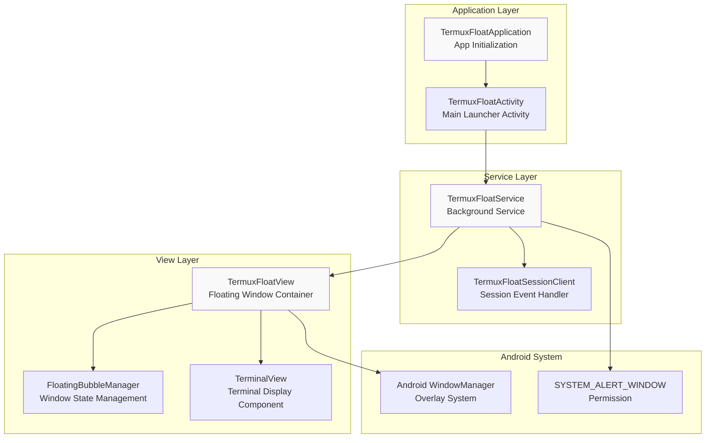
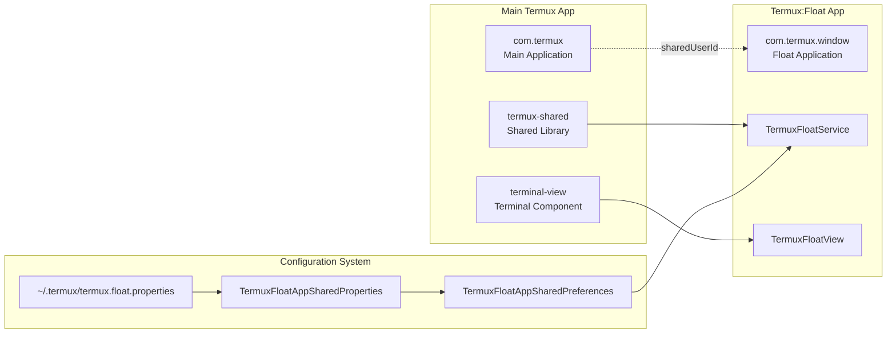

<!-- source: DeepWiki mcp.deepwiki.com · repo termux/termux-float · page 1 Overview · fetched 2026-10-26 -->

# Overview

Relevant source files

The following files were used as context for generating this wiki page:

- [README.md](README.md)

This document provides an introduction to Termux:Float, explaining its purpose as a floating terminal window plugin for the Termux ecosystem, its core architecture, and key capabilities. For installation instructions, see [Installation](#2.1). For detailed configuration options, see [Configuration](#2.2). For in-depth architectural details, see [Architecture](#3).

## Purpose and Scope

Termux:Float is an Android plugin application that extends the [Termux](https://termux.dev) terminal emulator by providing floating window functionality. It allows users to run terminal sessions in resizable, movable overlay windows that can be displayed on top of other applications, enabling multitasking and persistent terminal access across the Android interface.

The application integrates deeply with the main Termux app through shared user ID (`android:sharedUserId="com.termux"`) and shared libraries, while maintaining its own specialized floating window management system.

Sources: [README.md:6]()

## Core Architecture Overview

Termux:Float is built around a service-based architecture that manages floating terminal windows through Android's overlay window system. The application consists of several key components that handle initialization, window management, and terminal session integration.

### Application Component Structure

The architecture follows Android's component-based design with clear separation between the application lifecycle (`TermuxFloatApplication`), user interface entry point (`TermuxFloatActivity`), background processing (`TermuxFloatService`), and floating window presentation (`TermuxFloatView`).

Sources: Based on architectural diagrams provided in context

### Termux Ecosystem Integration

The integration leverages Android's `sharedUserId` mechanism to share data and permissions with the main Termux application, while using shared libraries (`termux-shared`, `terminal-view`) for common terminal functionality.

Sources: [README.md:6](), based on architectural diagrams

## Key Capabilities

### Floating Window Management

| Feature | Description | Implementation |
|---------|-------------|----------------|
| **Overlay Windows** | System-level floating windows | `TermuxFloatView` with `WindowManager.LayoutParams.TYPE_APPLICATION_OVERLAY` |
| **Window States** | Normal, minimized (bubble), hidden | `FloatingBubbleManager` state management |
| **User Interaction** | Touch, drag, resize, long-press actions | Custom touch handling in `TermuxFloatView` |
| **Multi-window** | Multiple concurrent floating terminals | Service-managed window instances |

### Terminal Session Integration

The floating windows provide full terminal functionality through integration with Termux's terminal emulation system:

- **Session Management**: `TermuxFloatSessionClient` handles terminal session lifecycle
- **Input Processing**: Touch and keyboard input forwarded to terminal sessions  
- **Output Rendering**: Real-time terminal output display in floating windows
- **Configuration**: Support for Termux terminal properties via `~/.termux/termux.float.properties`

### System Integration Features

- **Permissions**: Requires `SYSTEM_ALERT_WINDOW` permission for overlay functionality
- **Notifications**: Persistent notification for service management
- **Background Processing**: Service continues running when windows are minimized
- **Multi-tasking**: Floating terminals work alongside other Android applications

Sources: [README.md:55-64]()

## Distribution and Versioning

Termux:Float is distributed through multiple channels with version `v0.15.0` as the latest stable release:

- **F-Droid**: Official open-source distribution channel
- **GitHub Releases**: Direct APK downloads for versions ≥ 0.15.0  
- **GitHub Actions**: Development builds from continuous integration
- **Google Play Store**: Deprecated due to Android 10 compatibility issues

The application uses semantic versioning and maintains compatibility with the main Termux app through shared dependencies and consistent API usage.

Sources: [README.md:24-50]()

## Configuration and Customization

Termux:Float supports terminal customization through the `~/.termux/termux.float.properties` configuration file, enabling users to configure:

| Property | Purpose |
|----------|---------|
| `enforce-char-based-input` | Input method handling |
| `ctrl-space-workaround` | Keyboard combination fixes |
| `bell-character` | Terminal bell behavior |
| `terminal-cursor-style` | Cursor appearance |
| `terminal-transcript-rows` | Scrollback buffer size |
| `back-key` | Hardware back key behavior |
| `default-working-directory` | Initial directory |
| `volume-keys` | Volume key bindings |

Sources: [README.md:55-64]()

For detailed setup instructions, see [Getting Started](#2). For architectural deep-dives, see [Architecture](#3). For development information, see [Development](#6).

---

