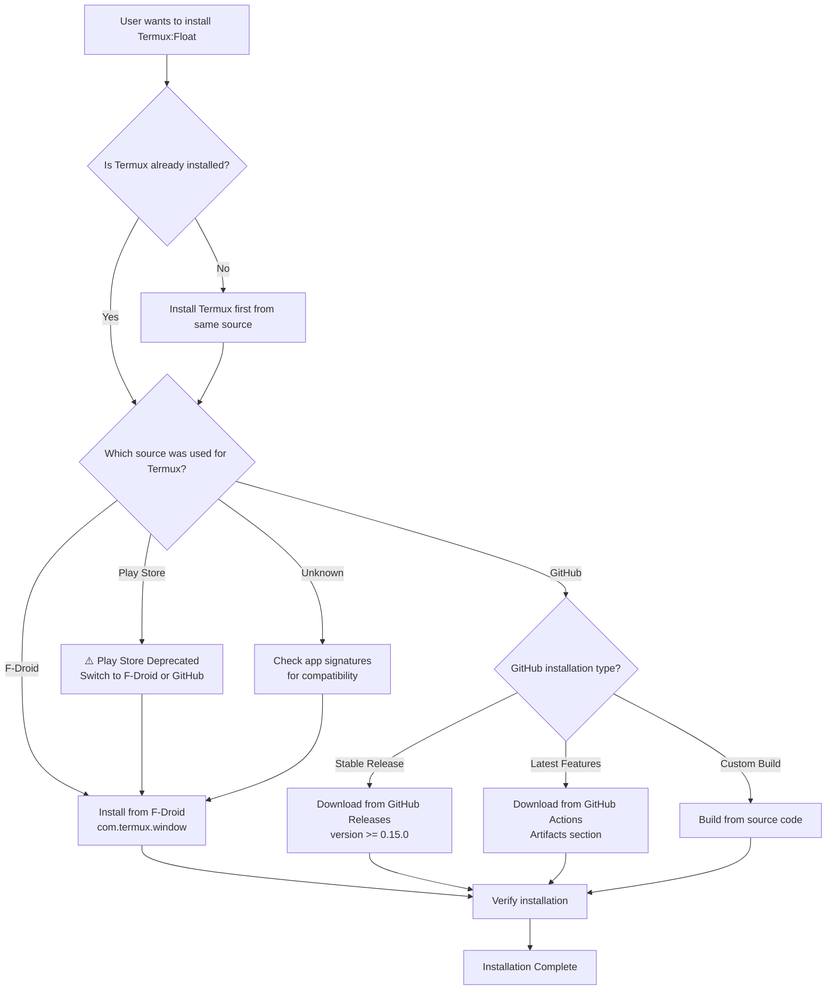
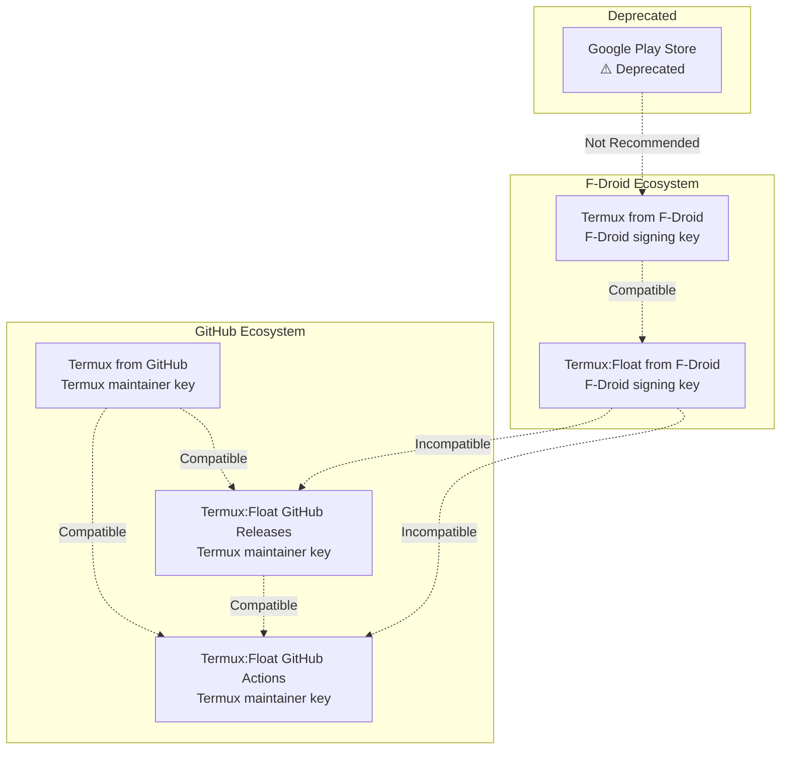

<!-- source: DeepWiki mcp.deepwiki.com · repo termux/termux-float · page 2.1 Installation · fetched 2026-10-26 -->

# Installation

Relevant source files

The following files were used as context for generating this wiki page:

- [README.md](README.md)

This document provides comprehensive instructions for installing Termux:Float from various distribution channels. It covers prerequisites, installation methods, version compatibility, and verification steps.

For information about configuring Termux:Float after installation, see [Configuration](#2.2). For details about the build system and distribution pipeline, see [CI/CD Pipeline](#4.2).

## Prerequisites

Before installing Termux:Float, ensure you have the main Termux application properly installed and configured. Termux:Float is a plugin application that requires the primary Termux app to function.

| Requirement | Details |
|-------------|---------|
| Termux App | Must be installed from the same source as Termux:Float |
| Android Version | Compatible with Android versions supported by Termux |
| System Permissions | `SYSTEM_ALERT_WINDOW` permission required for floating windows |
| Storage Space | Minimal additional space beyond base Termux installation |

**Important**: Termux and Termux:Float must be installed from the same distribution source to ensure compatibility due to Android's `sharedUserId` requirement.

Sources: [README.md:26]()

## Distribution Channels

### Installation Flow Decision Tree

Sources: [README.md:22-51]()

### F-Droid Installation

F-Droid provides the most stable and user-friendly installation method for Termux:Float.

**Installation Steps:**
1. Navigate to the [F-Droid package page](https://f-droid.org/en/packages/com.termux.window)
2. Download the APK directly using the "Download APK" link
3. Install the APK file on your device
4. Grant necessary permissions when prompted

**Key Characteristics:**
- **Package Name**: `com.termux.window`
- **Update Frequency**: Updates typically appear within days to weeks after GitHub releases
- **Signing**: Uses F-Droid's independent signing keys
- **Compatibility**: Only compatible with F-Droid Termux installations

**Update Detection**: F-Droid app may not automatically notify of updates. Manual refresh in the Updates tab may be required, and ensure battery optimizations are disabled for the F-Droid app.

Sources: [README.md:28-36]()

### GitHub Releases

GitHub Releases provide official builds directly from the Termux maintainers for stable versions.

**Installation Steps:**
1. Visit [GitHub Releases page](https://github.com/termux/termux-float/releases)
2. Locate the latest release (version >= 0.15.0)
3. Expand the "Assets" section
4. Download the APK file
5. Install on your device

**Key Characteristics:**
- **Availability**: Versions 0.15.0 and later
- **Build Type**: Debuggable APKs
- **Signing**: Signed with Termux maintainer keys
- **Compatibility**: Compatible with GitHub Actions builds only

### GitHub Actions Artifacts

GitHub Actions provide development builds for testing latest features and pull requests.

**Installation Steps:**
1. Visit [GitHub Actions workflow runs](https://github.com/termux/termux-float/actions/workflows/github_action_build.yml?query=branch%3Amaster+event%3Apush)
2. Select desired workflow run
3. **Login Required**: Ensure you are logged into GitHub
4. Download APK from "Artifacts" section
5. Install on your device

**Key Characteristics:**
- **Build Frequency**: Created for each commit/push
- **Access Requirement**: GitHub account login required
- **Build Type**: Debuggable APKs
- **Use Case**: Testing latest features and pull request changes

**Browser Compatibility**: Use desktop browsers (Chrome, Firefox) with logged-in GitHub accounts rather than mobile app browsers.

Sources: [README.md:38-46]()

### Building from Source

For advanced users who want to build custom versions or contribute to development.

**Prerequisites:**
- Android SDK and build tools
- Gradle build system
- Git for source code management

**Build Process:**
1. Clone the repository: `git clone https://github.com/termux/termux-float.git`
2. Navigate to project directory
3. Build using Gradle wrapper: `./gradlew assembleDebug`
4. Install generated APK from `app/build/outputs/apk/debug/`

For detailed build setup instructions, see [Development Setup](#6.1).

Sources: [README.md:1]()

## Version Compatibility Matrix

Different distribution channels use different signing keys, making them incompatible with each other.

| Source Combination | Compatibility | Notes |
|-------------------|---------------|--------|
| F-Droid Termux + F-Droid Termux:Float | ✅ Compatible | Recommended for most users |
| GitHub Termux + GitHub Termux:Float | ✅ Compatible | Latest features, debuggable builds |
| F-Droid Termux + GitHub Termux:Float | ❌ Incompatible | Different signing keys |
| Play Store Termux + Any Termux:Float | ⚠️ Deprecated | Migrate to F-Droid or GitHub |

Sources: [README.md:34-46]()

## Installation Verification

After installing Termux:Float, verify the installation was successful:

1. **Launch Application**: Find "Termux:Float" in your app drawer
2. **Permission Grant**: Grant `SYSTEM_ALERT_WINDOW` permission when prompted
3. **Floating Window**: Confirm the floating terminal window appears
4. **Terminal Functionality**: Test basic terminal commands
5. **Version Check**: Verify the installed version matches your expected version

**Troubleshooting Common Issues:**
- **Permission Denied**: Ensure `SYSTEM_ALERT_WINDOW` permission is granted in Android settings
- **App Won't Start**: Verify Termux main app is installed from the same source
- **Compatibility Issues**: Check that both apps use the same signing key source

## Latest Version Information

The current latest version is **v0.15.0**. This version introduced support for the `~/.termux/termux.float.properties` configuration file and various terminal settings.

For configuration options available in the latest version, see [Configuration](#2.2).

Sources: [README.md:24](), [README.md:57]()

---

