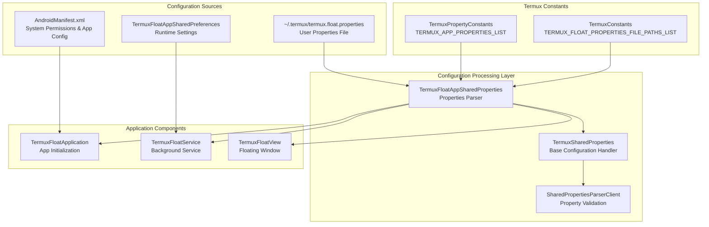
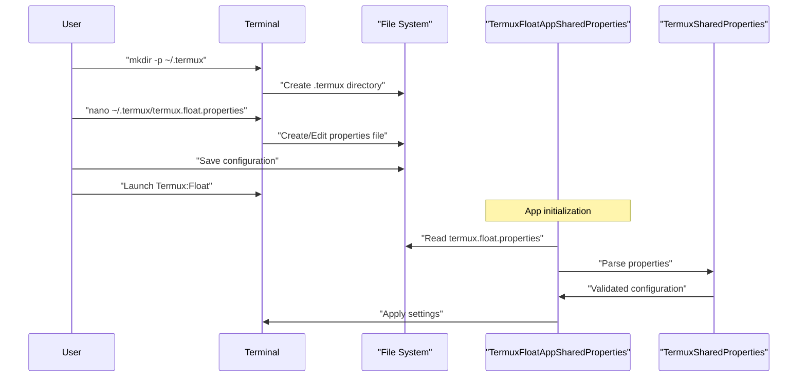
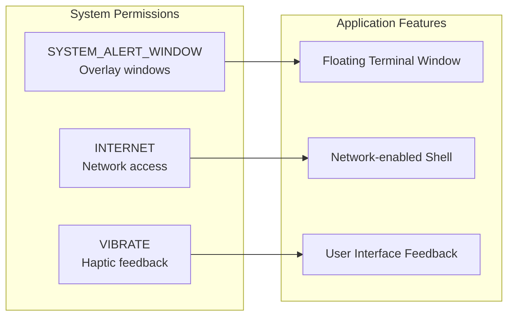
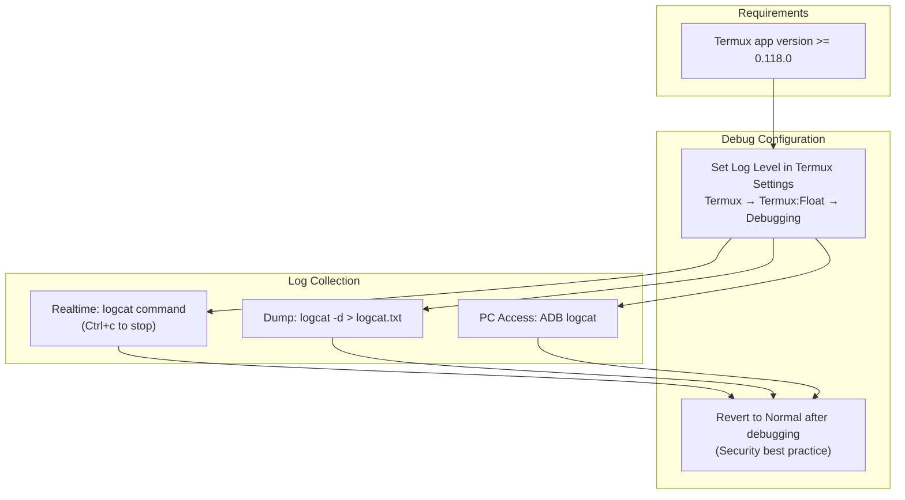
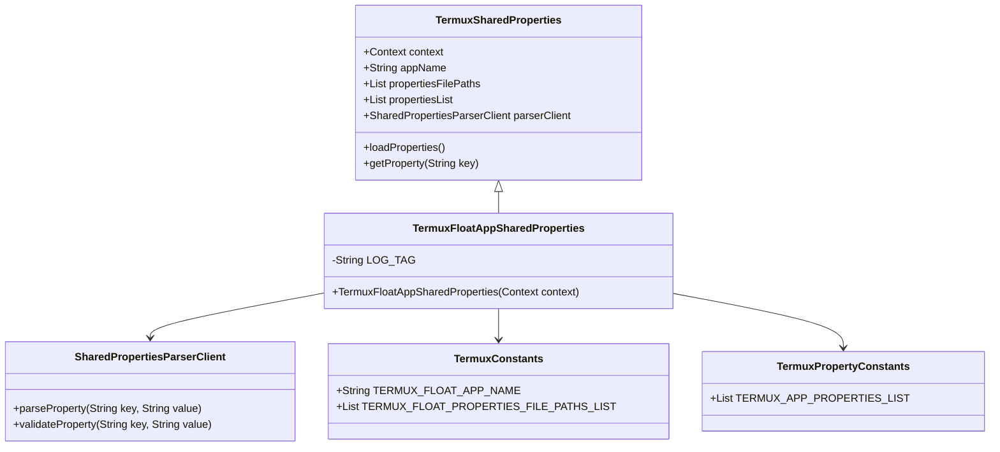

<!-- source: DeepWiki mcp.deepwiki.com · repo termux/termux-float · page 2.2 Configuration · fetched 2026-10-26 -->

# Configuration

<details>
<summary>Relevant source files</summary>

The following files were used as context for generating this wiki page:

- [README.md](README.md)
- [app/src/main/AndroidManifest.xml](app/src/main/AndroidManifest.xml)
- [app/src/main/java/com/termux/window/settings/properties/TermuxFloatAppSharedProperties.java](app/src/main/java/com/termux/window/settings/properties/TermuxFloatAppSharedProperties.java)

</details>


This document covers the configuration mechanisms available in Termux:Float, including properties file configuration, Android system permissions, and debugging settings. Configuration in Termux:Float follows similar patterns to the main Termux application while adding floating window-specific settings.

For information about build configuration and Gradle settings, see [Gradle Configuration](#4.1). For UI-related configuration such as layouts and themes, see [Views and Layouts](#5.1).

## Configuration System Overview

Termux:Float uses multiple configuration sources that work together to provide a flexible configuration system. The configuration is handled through shared properties inherited from the main Termux ecosystem.

### Configuration Architecture



**Sources:** [app/src/main/java/com/termux/window/settings/properties/TermuxFloatAppSharedProperties.java:1-22](), [app/src/main/AndroidManifest.xml:1-39](), [README.md:55-64]()

### Configuration Hierarchy

The configuration system operates with the following precedence order:

| Priority | Source | Purpose | Example |
|----------|--------|---------|---------|
| 1 | Runtime Settings | Dynamic app behavior | Log levels, window state |
| 2 | Properties File | User customization | Terminal settings, key bindings |
| 3 | Android Manifest | System-level configuration | Permissions, shared user ID |
| 4 | Default Values | Fallback configuration | Built-in defaults |

**Sources:** [app/src/main/java/com/termux/window/settings/properties/TermuxFloatAppSharedProperties.java:15-20]()

## Properties File Configuration

Termux:Float supports user configuration through the `~/.termux/termux.float.properties` file, similar to the main Termux application's configuration system.

### Supported Properties

The following properties are supported in the configuration file:

| Property | Purpose | Default | Example Values |
|----------|---------|---------|----------------|
| `enforce-char-based-input` | Input method behavior | `false` | `true`, `false` |
| `ctrl-space-workaround` | Ctrl+Space key handling | `false` | `true`, `false` |
| `bell-character` | Terminal bell behavior | `beep` | `beep`, `vibrate`, `ignore` |
| `terminal-cursor-style` | Cursor appearance | `block` | `block`, `underline`, `bar` |
| `terminal-transcript-rows` | Scrollback buffer size | `2000` | `1000`, `5000`, `10000` |
| `back-key` | Back key behavior | `escape` | `escape`, `back` |
| `default-working-directory` | Initial directory | `$HOME` | `/sdcard`, `$HOME/projects` |
| `volume-keys` | Volume key function | `volume` | `volume`, `cursor` |

### Configuration File Management



**Sources:** [README.md:57-64](), [app/src/main/java/com/termux/window/settings/properties/TermuxFloatAppSharedProperties.java:15-20]()

### Creating Configuration Files

Users can create and edit the properties file using the following commands:

```bash
mkdir -p ~/.termux
nano ~/.termux/termux.float.properties
```

The file can also be edited using a SAF (Storage Access Framework) file browser after creation.

**Sources:** [README.md:61-64]()

## Android Manifest Configuration

The Android manifest defines system-level configuration including permissions and application structure.

### Required Permissions



The manifest defines three critical permissions:

- `android.permission.INTERNET` - Required for network operations in terminal sessions
- `android.permission.SYSTEM_ALERT_WINDOW` - Essential for floating window overlay functionality
- `android.permission.VIBRATE` - Enables haptic feedback for user interactions

**Sources:** [app/src/main/AndroidManifest.xml:8-10]()

### Shared User ID Configuration

Termux:Float uses a shared user ID with the main Termux application:

```xml
android:sharedUserId="${TERMUX_PACKAGE_NAME}"
```

This configuration enables:
- Shared data access between Termux and Termux:Float
- Common security context
- Integrated permission model

**Sources:** [app/src/main/AndroidManifest.xml:4]()

### Application Components

The manifest defines the following key components:

| Component | Type | Purpose | Theme |
|-----------|------|---------|-------|
| `TermuxFloatActivity` | Activity | Main launcher activity | `Theme.NoDisplay` |
| `TermuxFloatPermissionActivity` | Activity | Permission request handling | `Theme.Material` |
| `TermuxFloatService` | Service | Background floating window service | N/A |

**Sources:** [app/src/main/AndroidManifest.xml:20-36]()

## Debugging Configuration

Termux:Float provides configurable logging levels for debugging purposes, managed through the main Termux application settings.

### Log Level Configuration

Debug settings are accessed through: `Termux app settings → Termux:Float → Debugging → Log Level`

Available log levels:

| Level | Purpose | Information Logged |
|-------|---------|-------------------|
| `Off` | No logging | Nothing |
| `Normal` | Standard logging | Errors, warnings, info messages, stack traces |
| `Debug` | Development logging | Debug messages + Normal level |
| `Verbose` | Detailed logging | Verbose messages + Debug level |

### Debugging Workflow



**Sources:** [README.md:70-80]()

### Security Considerations

The verbose logging level may expose private data in log output during normal operation. It's recommended to:

1. Use verbose logging only during active debugging
2. Revert to normal log level after debugging completion
3. Be aware that verbose logging increases execution time

**Sources:** [README.md:72-73]()

## Configuration Implementation Details

The configuration system is implemented through the `TermuxFloatAppSharedProperties` class, which extends the shared Termux configuration infrastructure.

### Properties Class Hierarchy



The `TermuxFloatAppSharedProperties` constructor initializes the configuration system with:

- App name from `TermuxConstants.TERMUX_FLOAT_APP_NAME`
- Properties file paths from `TermuxConstants.TERMUX_FLOAT_PROPERTIES_FILE_PATHS_LIST`
- Supported properties from `TermuxPropertyConstants.TERMUX_APP_PROPERTIES_LIST`
- Property parser client for validation

**Sources:** [app/src/main/java/com/termux/window/settings/properties/TermuxFloatAppSharedProperties.java:15-20]()

---

