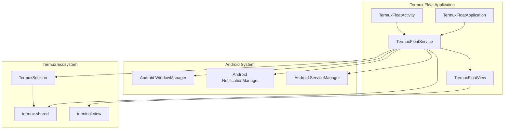
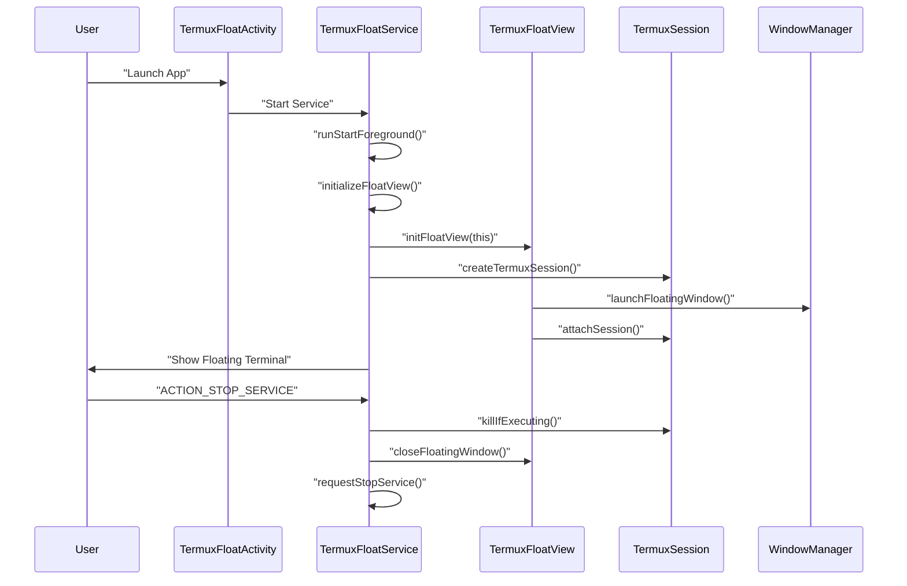
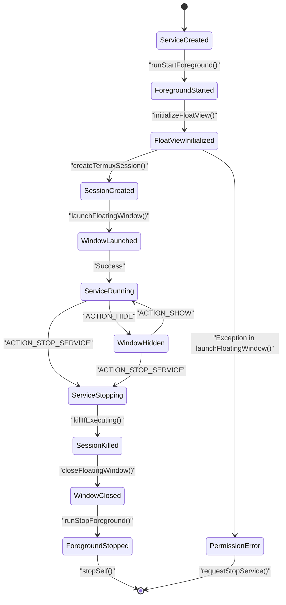

<!-- source: DeepWiki mcp.deepwiki.com · repo termux/termux-float · page 3 Architecture · fetched 2026-10-26 -->

# Architecture

Relevant source files

The following files were used as context for generating this wiki page:

- [app/src/main/java/com/termux/window/TermuxFloatApplication.java](app/src/main/java/com/termux/window/TermuxFloatApplication.java)
- [app/src/main/java/com/termux/window/TermuxFloatService.java](app/src/main/java/com/termux/window/TermuxFloatService.java)

This document provides an overview of the Termux:Float system architecture, explaining how the core components interact to provide floating terminal window functionality. It covers the high-level design patterns, service-based architecture, and integration points with the Android system and Termux ecosystem.

For detailed information about specific components, see [Core Components](#3.1). For floating window implementation details, see [Floating Window System](#3.2). For terminal session integration specifics, see [Terminal Integration](#3.3).

## System Overview

Termux:Float implements a service-based architecture that leverages Android's overlay window system to provide floating terminal functionality. The application integrates with the broader Termux ecosystem through shared libraries while maintaining its own specialized floating window management system.

Sources: [app/src/main/java/com/termux/window/TermuxFloatService.java:1-252](), [app/src/main/java/com/termux/window/TermuxFloatApplication.java:1-39]()

## Service-Based Architecture

The core architecture centers around `TermuxFloatService`, which runs as a foreground Android service to maintain the floating window and terminal session lifecycle. This service manages all floating window operations and coordinates between the UI layer and terminal emulation layer.

Sources: [app/src/main/java/com/termux/window/TermuxFloatService.java:50-88](), [app/src/main/java/com/termux/window/TermuxFloatService.java:172-203]()

## Component Relationships

The application follows a layered architecture with clear separation of concerns:

| Layer | Components | Responsibilities |
|-------|------------|-----------------|
| **Application Layer** | `TermuxFloatApplication` | Application initialization, logging configuration, crash handling |
| **Service Layer** | `TermuxFloatService` | Service lifecycle, floating window management, terminal session coordination |
| **UI Layer** | `TermuxFloatView`, `TermuxFloatActivity` | Floating window display, user interaction, overlay window management |
| **Terminal Layer** | `TermuxSession`, `TerminalSession` | Terminal emulation, shell process management, session state |
| **Integration Layer** | `TermuxFloatSessionClient`, shared libraries | Event handling, Termux ecosystem integration |

## Service Lifecycle Management

The `TermuxFloatService` implements a comprehensive lifecycle management system that handles foreground service operations, notification management, and resource cleanup.

Sources: [app/src/main/java/com/termux/window/TermuxFloatService.java:44-48](), [app/src/main/java/com/termux/window/TermuxFloatService.java:90-112](), [app/src/main/java/com/termux/window/TermuxFloatService.java:114-123]()

## Integration Points

Termux:Float integrates with multiple external systems:

### Termux Ecosystem Integration
- Uses `termux-shared` library for shared utilities, logging, and shell environment management
- Integrates with `terminal-view` for terminal display components
- Leverages `TermuxSession` for session management and execution command handling
- Shares user ID (`sharedUserId`) with main Termux application for seamless integration

### Android System Integration
- **WindowManager**: Manages overlay windows through `SYSTEM_ALERT_WINDOW` permission
- **NotificationManager**: Maintains foreground service notification with show/hide/exit actions
- **ServiceManager**: Handles service lifecycle and background execution

### Configuration System
- `TermuxFloatAppSharedPreferences` for user settings persistence
- `TermuxFloatAppSharedProperties` for application property management
- Integration with `~/.termux/termux.float.properties` configuration file

Sources: [app/src/main/java/com/termux/window/TermuxFloatService.java:18-27](), [app/src/main/java/com/termux/window/TermuxFloatApplication.java:30-37]()

## Error Handling and Permissions

The architecture includes robust error handling, particularly around Android overlay permissions:

- **Permission Detection**: Catches exceptions when launching floating windows instead of relying on `Settings.canDrawOverlays()` due to `sharedUserId` complications
- **Graceful Degradation**: Launches `TermuxFloatPermissionActivity` when permissions are insufficient
- **Service Recovery**: Implements `START_NOT_STICKY` policy to prevent automatic restart on failure

The notification system provides user control over window visibility and service termination through persistent notification actions.

Sources: [app/src/main/java/com/termux/window/TermuxFloatService.java:188-197](), [app/src/main/java/com/termux/window/TermuxFloatService.java:134-167]()

---

