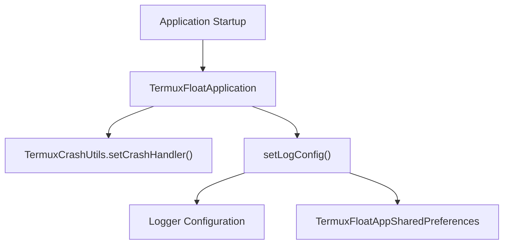
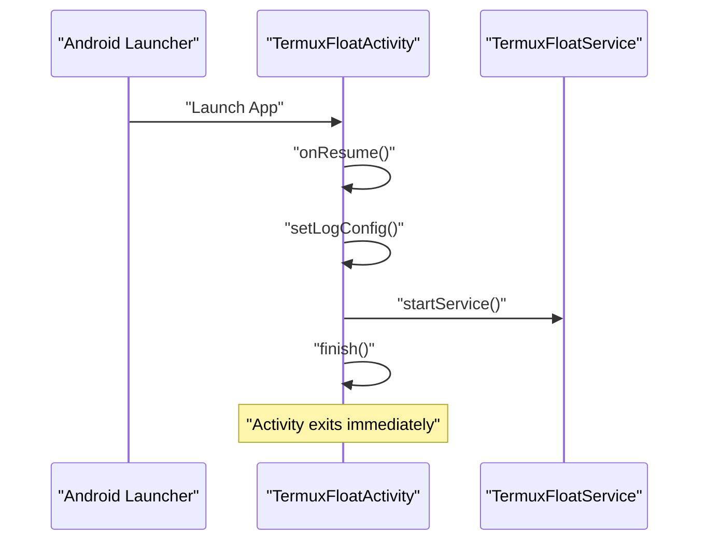
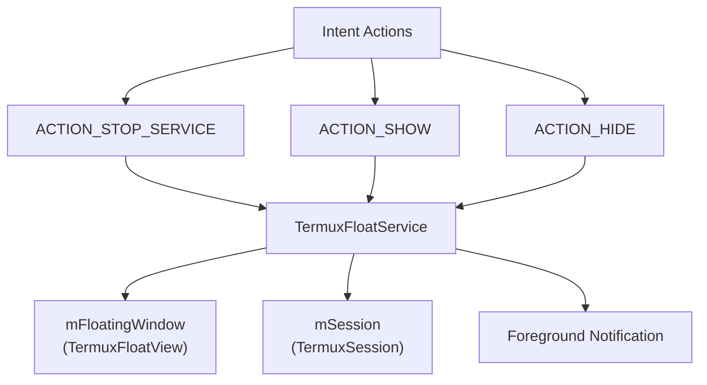
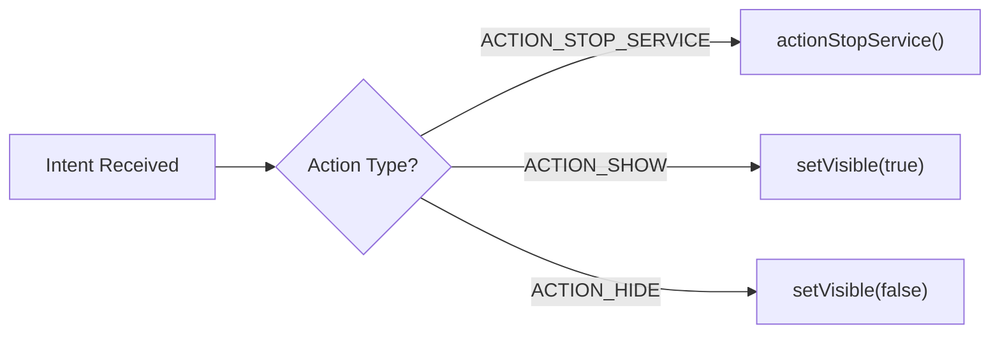
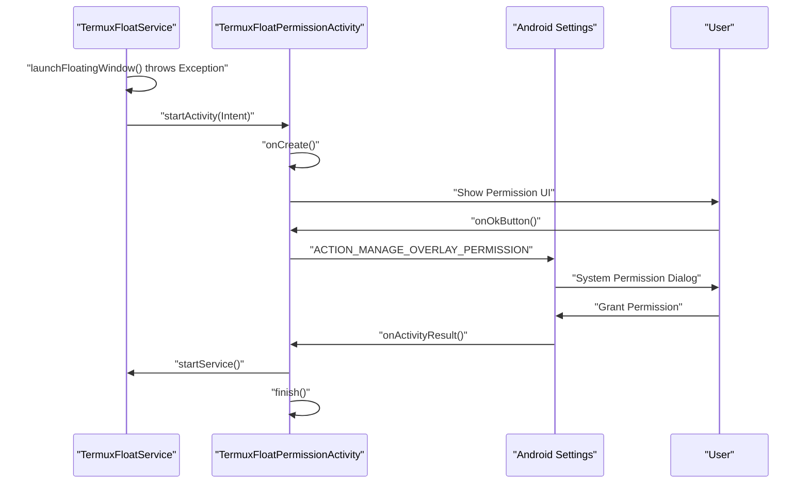
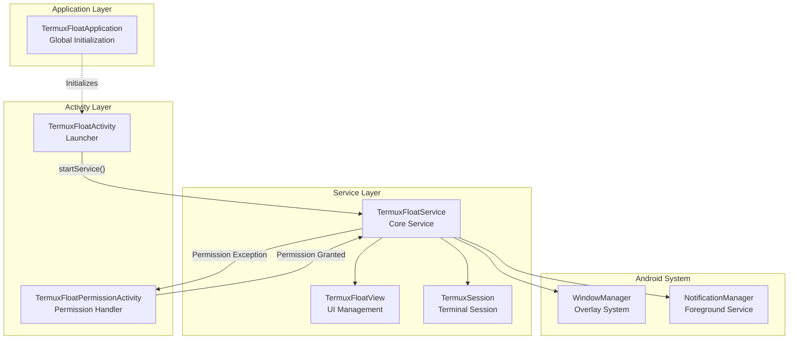

<!-- source: DeepWiki mcp.deepwiki.com · repo termux/termux-float · page 3.1 Core Components · fetched 2026-10-26 -->

# Core Components

Relevant source files

The following files were used as context for generating this wiki page:

- [app/src/main/java/com/termux/window/TermuxFloatActivity.java](app/src/main/java/com/termux/window/TermuxFloatActivity.java)
- [app/src/main/java/com/termux/window/TermuxFloatApplication.java](app/src/main/java/com/termux/window/TermuxFloatApplication.java)
- [app/src/main/java/com/termux/window/TermuxFloatPermissionActivity.java](app/src/main/java/com/termux/window/TermuxFloatPermissionActivity.java)
- [app/src/main/java/com/termux/window/TermuxFloatService.java](app/src/main/java/com/termux/window/TermuxFloatService.java)

This page covers the fundamental application components that form the backbone of Termux:Float. These components handle application lifecycle, service management, and user interface coordination. For information about the floating window implementation details, see [Floating Window System](#3.2). For terminal session management specifics, see [Terminal Integration](#3.3).

## Application Component

The `TermuxFloatApplication` class serves as the main application entry point and handles global initialization tasks. It extends Android's `Application` class and is responsible for setting up system-wide configurations that persist throughout the application lifecycle.

**Application Initialization Flow**

The application performs these key initialization steps during `onCreate()`:

| Step | Function | Purpose |
|------|----------|---------|
| 1 | `TermuxCrashUtils.setCrashHandler()` | Sets up crash reporting and handling |
| 2 | `setLogConfig()` | Configures logging system with preferences |
| 3 | `Logger.setDefaultLogTag()` | Sets default log tag for the application |
| 4 | `TermuxFloatAppSharedPreferences.build()` | Loads user preferences and log levels |

Sources: [app/src/main/java/com/termux/window/TermuxFloatApplication.java:16-37]()

## Activity Component

The `TermuxFloatActivity` functions as a lightweight launcher that immediately delegates to the service layer. This design pattern allows the application to appear in the launcher while keeping the main functionality in a background service.

**Activity Lifecycle**

The activity implements a minimal lifecycle:

- **onResume()**: Configures logging, starts `TermuxFloatService`, and terminates itself
- No other lifecycle methods are overridden
- Activity exists only to provide a launcher entry point

Sources: [app/src/main/java/com/termux/window/TermuxFloatActivity.java:12-20]()

## Service Component

The `TermuxFloatService` is the core component that manages the floating terminal window. It extends Android's `Service` class and handles all terminal session management, window operations, and user interactions.

**Service State Management**

| State Variable | Type | Purpose |
|---------------|------|---------|
| `mFloatingWindow` | `TermuxFloatView` | Main floating window instance |
| `mSession` | `TermuxSession` | Current terminal session |
| `mVisibleWindow` | `boolean` | Window visibility state |

**Service Operations**

The service handles these primary operations:

1. **Foreground Management**: Runs as foreground service with persistent notification
2. **Window Management**: Creates and manages the floating window through `initializeFloatView()`
3. **Session Management**: Creates terminal sessions via `createTermuxSession()`
4. **Action Processing**: Responds to intent actions for show/hide/stop operations

**Intent Action Handling**

Sources: [app/src/main/java/com/termux/window/TermuxFloatService.java:28-252]()

## Permission Component

The `TermuxFloatPermissionActivity` handles the critical `SYSTEM_ALERT_WINDOW` permission required for displaying overlay windows. This component only activates when permission is not granted and the service cannot initialize the floating window.

**Permission Flow**

1. **Trigger**: Service detects permission exception during window creation
2. **Request**: Activity launches system settings for overlay permission
3. **Grant**: User grants permission in system settings
4. **Restart**: Activity restarts the service and terminates

Sources: [app/src/main/java/com/termux/window/TermuxFloatPermissionActivity.java:17-33]()

## Component Interactions

The core components interact through a well-defined flow that ensures proper initialization and service management:

**Initialization Sequence**

1. **Application Start**: `TermuxFloatApplication.onCreate()` sets up global configuration
2. **Activity Launch**: `TermuxFloatActivity.onResume()` starts service and exits
3. **Service Creation**: `TermuxFloatService.onCreate()` runs foreground setup
4. **Service Start**: `TermuxFloatService.onStartCommand()` initializes floating window
5. **Permission Check**: If permission missing, launches `TermuxFloatPermissionActivity`
6. **Window Creation**: Service creates `TermuxFloatView` and `TermuxSession`

**Error Handling**

The components implement robust error handling:

- **Permission Errors**: Caught during window creation, redirects to permission activity
- **Service Errors**: Logged and service stops gracefully
- **Crash Handling**: Global crash handler captures and reports exceptions

Sources: [app/src/main/java/com/termux/window/TermuxFloatService.java:188-197](), [app/src/main/java/com/termux/window/TermuxFloatApplication.java:23-24]()

---

