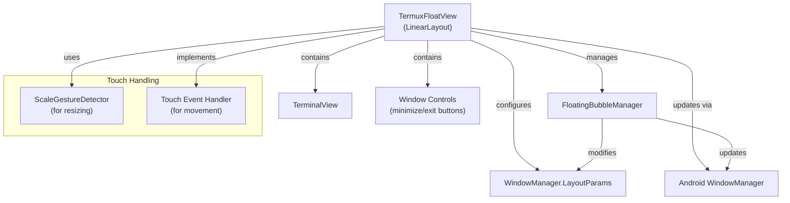
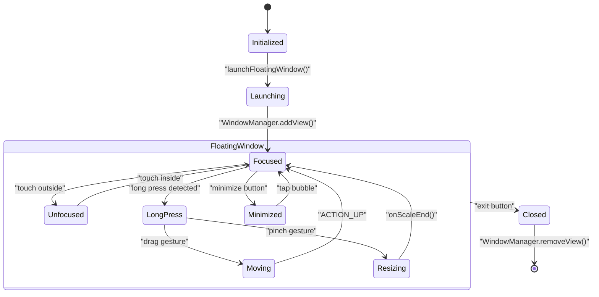
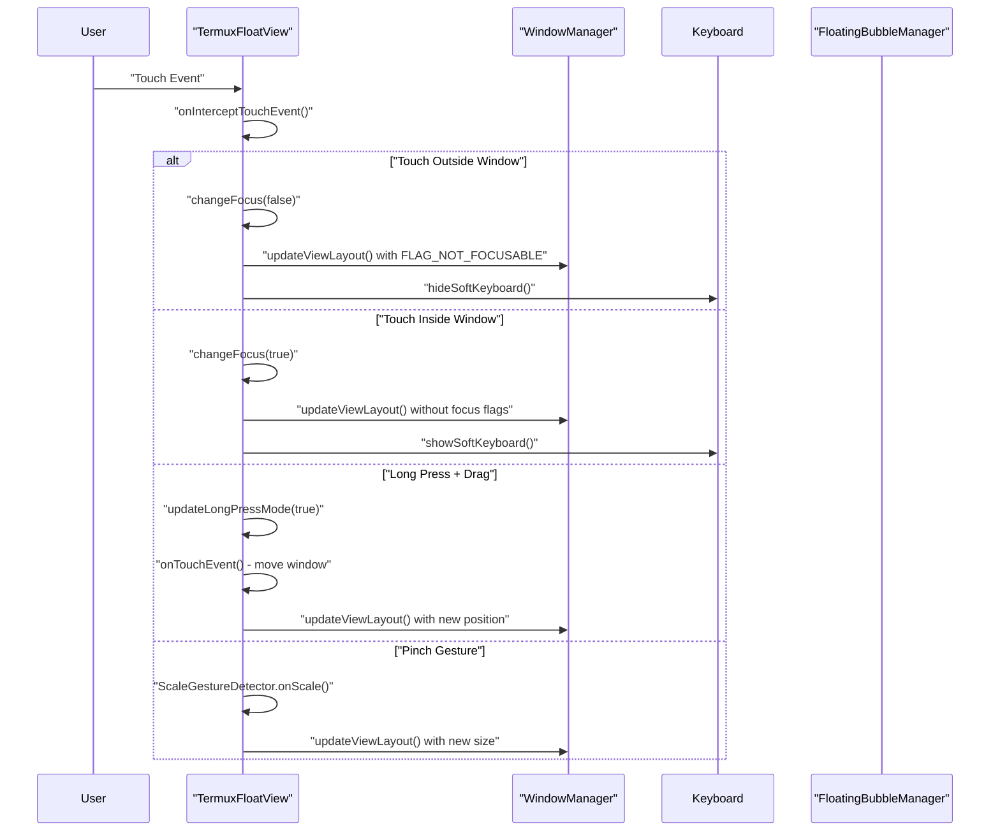
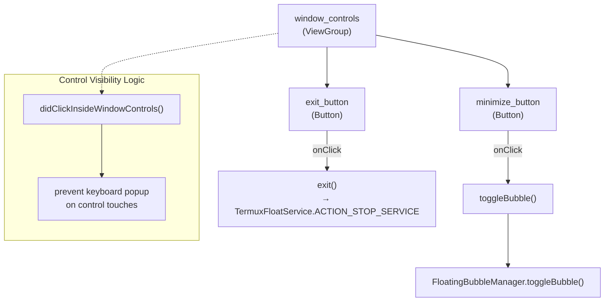
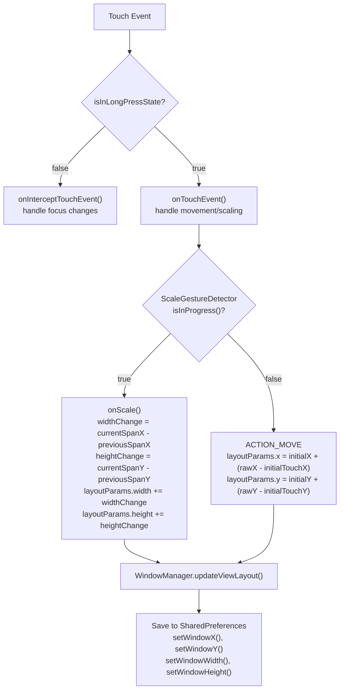

<!-- source: DeepWiki mcp.deepwiki.com · repo termux/termux-float · page 3.2 Floating Window System · fetched 2026-10-26 -->

# Floating Window System

Relevant source files

The following files were used as context for generating this wiki page:

- [app/src/main/java/com/termux/window/FloatingBubbleManager.java](app/src/main/java/com/termux/window/FloatingBubbleManager.java)
- [app/src/main/java/com/termux/window/TermuxFloatView.java](app/src/main/java/com/termux/window/TermuxFloatView.java)

This document covers the implementation of the floating window system in Termux:Float, which provides the core functionality for displaying a terminal interface as an overlay window that can be moved, resized, and minimized to a bubble. The system manages window positioning, focus states, touch interactions, and the bubble minimization feature.

For information about terminal session integration within the floating window, see [Terminal Integration](#3.3). For details about the core application components that initialize the floating window, see [Core Components](#3.1).

## Overview

The floating window system consists of two primary components: `TermuxFloatView` which manages the floating window display and interaction, and `FloatingBubbleManager` which handles the bubble minimization functionality. The system integrates with Android's `WindowManager` to create an overlay window that can be positioned anywhere on the screen.

**Core Components Architecture**

Sources: [app/src/main/java/com/termux/window/TermuxFloatView.java:1-363](), [app/src/main/java/com/termux/window/FloatingBubbleManager.java:1-149]()

## Window Initialization and Management

The floating window is initialized through `launchFloatingWindow()` which configures the `WindowManager.LayoutParams` for overlay display. The window type is set to `TYPE_APPLICATION_OVERLAY` on Android O+ or `TYPE_PHONE` on older versions.

| Configuration | Value | Purpose |
|---------------|--------|---------|
| Window Type | `TYPE_APPLICATION_OVERLAY` / `TYPE_PHONE` | Overlay permission |
| Format | `PixelFormat.RGBA_8888` | Transparency support |
| Gravity | `Gravity.TOP \| Gravity.LEFT` | Positioning anchor |
| Initial Size | `WRAP_CONTENT` | Auto-sizing |

**Window Lifecycle and State Management**

Sources: [app/src/main/java/com/termux/window/TermuxFloatView.java:181-206](), [app/src/main/java/com/termux/window/TermuxFloatView.java:318-324]()

## Focus and Touch Event Handling

The floating window implements sophisticated touch handling through `onInterceptTouchEvent()` and `onTouchEvent()`. Focus management controls window behavior and keyboard visibility.

**Touch Event Flow**

The system uses three alpha transparency levels to indicate different states:
- `ALPHA_FOCUS = 0.9f` - Window has focus
- `ALPHA_NOT_FOCUS = 0.7f` - Window unfocused  
- `ALPHA_MOVING = 0.5f` - Window being moved/resized

Sources: [app/src/main/java/com/termux/window/TermuxFloatView.java:211-241](), [app/src/main/java/com/termux/window/TermuxFloatView.java:276-298](), [app/src/main/java/com/termux/window/TermuxFloatView.java:302-316]()

## Bubble Minimization System

The `FloatingBubbleManager` provides bubble minimization functionality, allowing the terminal to be collapsed to a small circular bubble that can be expanded back to full window mode.

**Bubble State Transitions**

```mermaid
graph LR
    FW["Floating Window<br/>(full terminal view)"]
    FB["Floating Bubble<br/>(56dp circular)"]
    
    FW -->|"minimize button<br/>displayAsFloatingBubble()"| FB
    FB -->|"tap bubble<br/>displayAsFloatingWindow()"| FW
    
    subgraph "Bubble Transformations"
        CaptureValues["captureOriginalLayoutValues()<br/>preserve width/height/backgrounds"]
        SetBubbleSize["layoutParams.width = BUBBLE_SIZE_PX<br/>layoutParams.height = BUBBLE_SIZE_PX"]
        SetOutline["terminalView.setOutlineProvider()<br/>outline.setOval()"]
        HideControls["windowControls.setVisibility(GONE)"]
    end
    
    subgraph "Window Restoration"
        RestoreSize["layoutParams.width = mOriginalLayoutWidth<br/>layoutParams.height = mOriginalLayoutHeight"]
        RestoreBackground["terminalView.setBackground(mOriginalBackground)"]
        ShowControls["windowControls.setVisibility(VISIBLE)"]
        ClearOutline["terminalView.setOutlineProvider(null)"]
    end
    
    FW --> CaptureValues
    CaptureValues --> SetBubbleSize
    SetBubbleSize --> SetOutline
    SetOutline --> HideControls
    HideControls --> FB
    
    FB --> RestoreSize
    RestoreSize --> RestoreBackground
    RestoreBackground --> ShowControls
    ShowControls --> ClearOutline
    ClearOutline --> FW
```

Key bubble implementation details:
- Default bubble size: `DEFAULT_BUBBLE_SIZE_DP = 56` converted to pixels
- Circular outline using `ViewOutlineProvider` with `setOval()`
- Background resource: `R.drawable.round_button_with_outline`
- Window controls hidden during bubble mode
- Original layout parameters preserved for restoration

Sources: [app/src/main/java/com/termux/window/FloatingBubbleManager.java:38-44](), [app/src/main/java/com/termux/window/FloatingBubbleManager.java:53-84](), [app/src/main/java/com/termux/window/FloatingBubbleManager.java:86-110]()

## Window Controls and User Interface

The floating window includes control buttons for minimize and exit operations, positioned at the top of the window through the `window_controls` ViewGroup.

**Window Controls Integration**

The controls are managed through:
- Click detection to prevent unintended focus changes: `didClickInsideWindowControls()`
- Visibility toggling during bubble mode (hidden when minimized)
- Focus management integration to avoid keyboard popup on control touches

Sources: [app/src/main/java/com/termux/window/TermuxFloatView.java:148-157](), [app/src/main/java/com/termux/window/TermuxFloatView.java:243-253](), [app/src/main/java/com/termux/window/TermuxFloatView.java:326-329]()

## Scaling and Movement Implementation

The window supports both movement through drag gestures and resizing through pinch gestures, implemented via `ScaleGestureDetector` and custom touch handling.

**Gesture Processing Flow**

Movement constraints:
- Minimum size: `MIN_SIZE = 50` pixels for both width and height
- Boundary checking: window cannot be moved outside screen bounds
- Position clamping: `Math.max(0, Math.min(DISPLAY_WIDTH - width, x))`

Sources: [app/src/main/java/com/termux/window/TermuxFloatView.java:81-109](), [app/src/main/java/com/termux/window/TermuxFloatView.java:276-298](), [app/src/main/java/com/termux/window/TermuxFloatView.java:264-270]()

---

