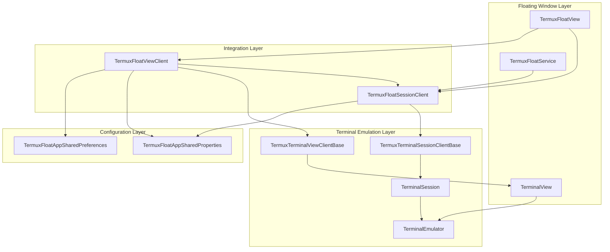
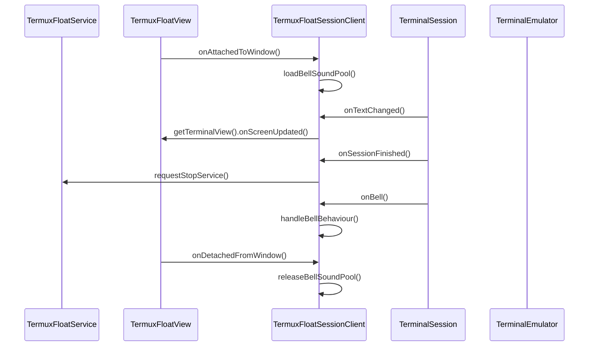
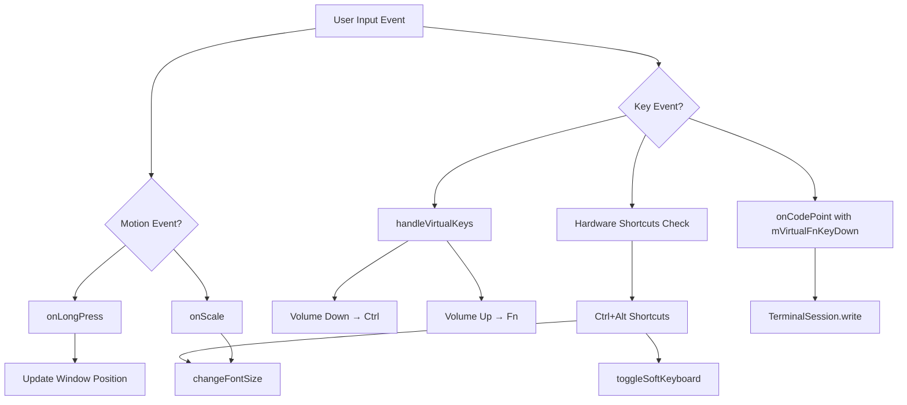
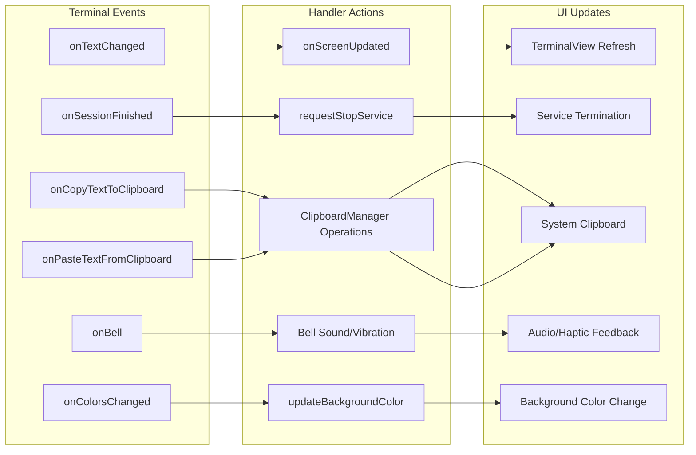
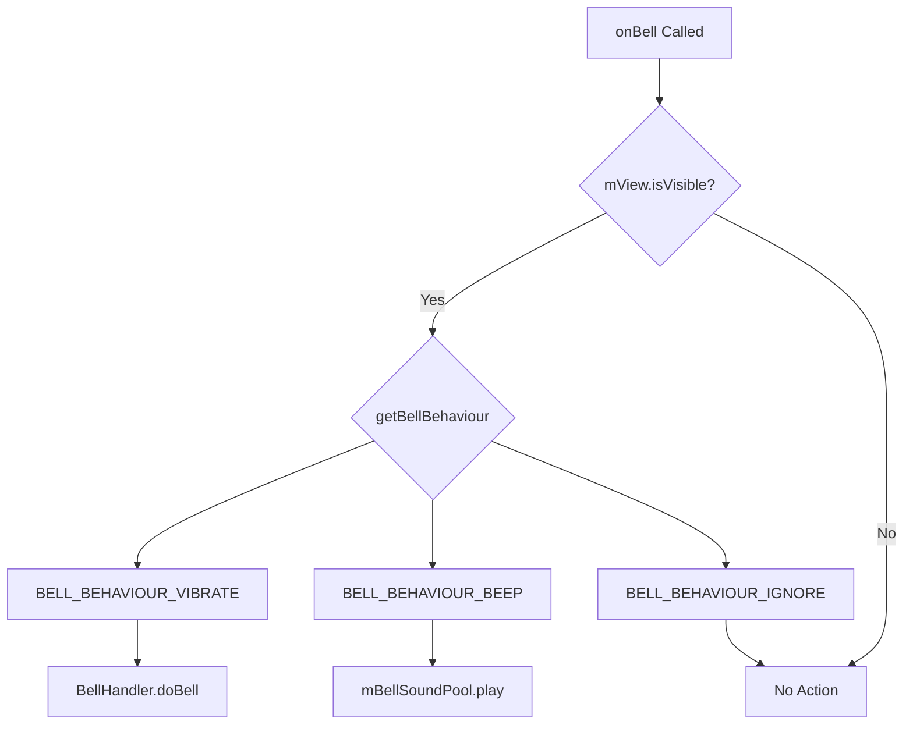
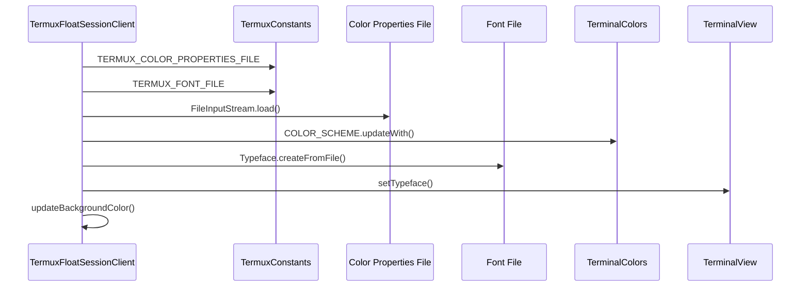

<!-- source: DeepWiki mcp.deepwiki.com · repo termux/termux-float · page 3.3 Terminal Integration · fetched 2026-10-26 -->

# Terminal Integration

Relevant source files

The following files were used as context for generating this wiki page:

- [app/src/main/java/com/termux/window/TermuxFloatSessionClient.java](app/src/main/java/com/termux/window/TermuxFloatSessionClient.java)
- [app/src/main/java/com/termux/window/TermuxFloatViewClient.java](app/src/main/java/com/termux/window/TermuxFloatViewClient.java)

This document explains how Termux:Float integrates with terminal sessions to provide a functional floating terminal experience. It covers the session management architecture, user input handling, and the event flow between the floating window system and the underlying terminal emulation layer.

For information about the floating window implementation itself, see [Floating Window System](#3.2). For details about the core application components, see [Core Components](#3.1).

## Session Management Architecture

The terminal integration in Termux:Float is built around two primary client classes that bridge the floating window system with the terminal emulation layer: `TermuxFloatSessionClient` for session-level events and `TermuxFloatViewClient` for input handling.

### Terminal Session Integration Components

Sources: [app/src/main/java/com/termux/window/TermuxFloatSessionClient.java:25-39](), [app/src/main/java/com/termux/window/TermuxFloatViewClient.java:15-28]()

The `TermuxFloatSessionClient` extends `TermuxTerminalSessionClientBase` and serves as the primary handler for terminal session events. It maintains references to both the `TermuxFloatService` and `TermuxFloatView` to coordinate between the background service and the user interface.

### Session Lifecycle Management

The session client manages the complete lifecycle of terminal sessions within the floating window context:

Sources: [app/src/main/java/com/termux/window/TermuxFloatSessionClient.java:44-60](), [app/src/main/java/com/termux/window/TermuxFloatSessionClient.java:72-81]()

Key lifecycle methods include:

- `onAttachedToWindow()` - Initializes resources when the view is attached [app/src/main/java/com/termux/window/TermuxFloatSessionClient.java:44-49]()
- `onDetachedFromWindow()` - Releases resources to prevent memory leaks [app/src/main/java/com/termux/window/TermuxFloatSessionClient.java:54-60]()
- `onSessionFinished()` - Triggers service shutdown when the terminal session ends [app/src/main/java/com/termux/window/TermuxFloatSessionClient.java:79-81]()

## Input Handling System

The `TermuxFloatViewClient` manages all user input interactions with the floating terminal, including keyboard events, gestures, and hardware key mappings.

### Input Event Processing Flow

Sources: [app/src/main/java/com/termux/window/TermuxFloatViewClient.java:94-119](), [app/src/main/java/com/termux/window/TermuxFloatViewClient.java:240-255]()

### Virtual Key Mapping

The view client implements a sophisticated virtual key system that allows volume buttons to function as modifier keys:

| Physical Key | Virtual Function | State Variable |
|--------------|------------------|----------------|
| Volume Down | Ctrl Key | `mVirtualControlKeyDown` |
| Volume Up | Fn Key | `mVirtualFnKeyDown` |

Sources: [app/src/main/java/com/termux/window/TermuxFloatViewClient.java:23](), [app/src/main/java/com/termux/window/TermuxFloatViewClient.java:247-252]()

### Function Key Mappings

When the virtual Fn key is active, the view client translates character input into terminal control sequences:

| Character | Function | Key Code/Code Point |
|-----------|----------|---------------------|
| w, a, s, d | Arrow Keys | `KEYCODE_DPAD_*` |
| p, n | Page Up/Down | `KEYCODE_PAGE_*` |
| t | Tab | `KEYCODE_TAB` |
| 1-9, 0 | Function Keys | `KEYCODE_F1`-`KEYCODE_F10` |
| e | Escape | Code Point 27 |
| u, l | Special Characters | `_`, `|` |

Sources: [app/src/main/java/com/termux/window/TermuxFloatViewClient.java:138-235]()

## Event Flow and Integration

The terminal integration handles multiple types of events that flow between the terminal emulation layer and the floating window interface.

### Session Event Handling

Sources: [app/src/main/java/com/termux/window/TermuxFloatSessionClient.java:72-121]()

### Bell Handling System

The terminal integration includes comprehensive bell handling with multiple behavior modes:

Sources: [app/src/main/java/com/termux/window/TermuxFloatSessionClient.java:102-115]()

## Configuration Integration

The terminal integration system retrieves configuration from multiple sources to customize terminal behavior and appearance.

### Font and Color Management

The session client handles dynamic font and color updates through the `checkForFontAndColors()` method:

Sources: [app/src/main/java/com/termux/window/TermuxFloatSessionClient.java:155-180]()

### Property-Based Configuration

The view client integrates with the properties system to control input behavior:

| Property Method | Configuration Area | Default Behavior |
|-----------------|-------------------|------------------|
| `isBackKeyTheEscapeKey()` | Back button mapping | Maps to Escape key |
| `isEnforcingCharBasedInput()` | Input method | Character-based input |
| `isUsingCtrlSpaceWorkaround()` | Key handling | Ctrl+Space workaround |
| `areHardwareKeyboardShortcutsDisabled()` | Shortcuts | Hardware shortcuts enabled |
| `areVirtualVolumeKeysDisabled()` | Virtual keys | Volume key mapping enabled |

Sources: [app/src/main/java/com/termux/window/TermuxFloatViewClient.java:74-86](), [app/src/main/java/com/termux/window/TermuxFloatViewClient.java:97](), [app/src/main/java/com/termux/window/TermuxFloatViewClient.java:242]()

The integration ensures that configuration changes are applied immediately through the `onReload()` callback, which triggers font and color updates when properties are modified.

Sources: [app/src/main/java/com/termux/window/TermuxFloatSessionClient.java:65-67]()

---

