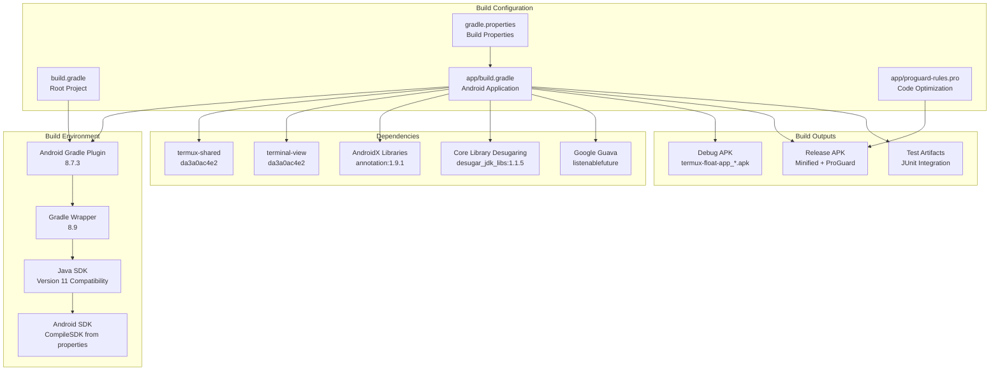
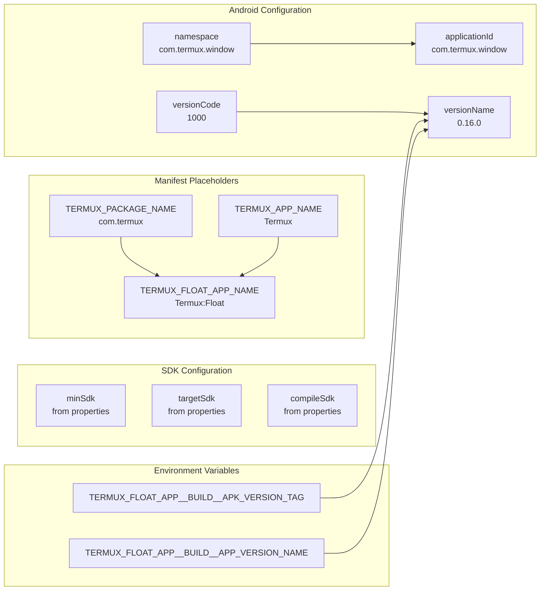
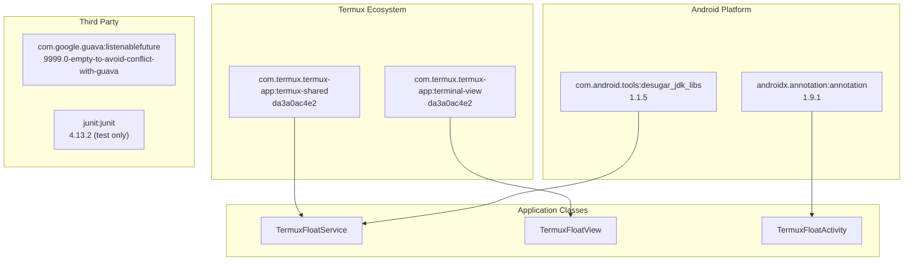
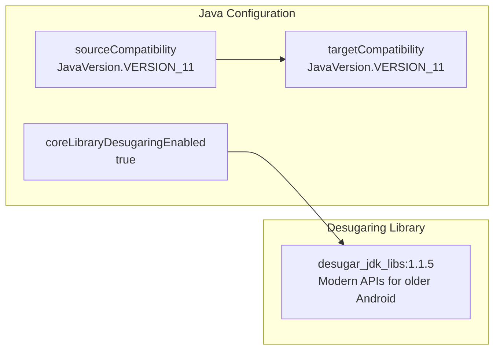

<!-- source: DeepWiki mcp.deepwiki.com · repo termux/termux-float · page 4 Build System · fetched 2026-10-26 -->

# Build System

<details>
<summary>Relevant source files</summary>

The following files were used as context for generating this wiki page:

- [app/build.gradle](app/build.gradle)
- [build.gradle](build.gradle)

</details>


This document provides an overview of the build system architecture for Termux:Float, including Gradle configuration, dependency management, and build output artifacts. The build system is designed to integrate with the broader Termux ecosystem while maintaining compatibility across multiple distribution channels.

For detailed Gradle build configuration and properties, see [Gradle Configuration](#4.1). For information about automated building and distribution workflows, see [CI/CD Pipeline](#4.2).

## System Architecture

The Termux:Float build system is built on Gradle with the Android Application Plugin, providing a comprehensive build pipeline from source code to distributable APK files.

### Build System Components



Sources: [build.gradle:1-24](), [app/build.gradle:1-99]()

### Application Configuration Structure

The Android application configuration defines the core build parameters and integration points with the Termux ecosystem.



Sources: [app/build.gradle:4-23]()

## Build Types and Configuration

The build system supports two primary build types with distinct characteristics for development and production use.

### Build Type Configuration

| Build Type | Minification | ProGuard | Signing | Resource Shrinking |
|------------|-------------|----------|---------|-------------------|
| `release` | Enabled | Enabled | Default | Disabled |
| `debug` | Disabled | Disabled | Custom Keystore | Disabled |

The release build type enables code minification while maintaining reproducible builds by disabling resource shrinking [app/build.gradle:35-39](). The debug build type uses a custom signing configuration with a test keystore for development purposes [app/build.gradle:25-44]().

### Custom Output Naming

Build outputs use a standardized naming convention that incorporates version information and build metadata:

```
termux-float-app_{apkVersionTag|versionName+buildType}.apk
```

This naming scheme supports both environment-driven version tags for CI/CD builds and standard version names for local development [app/build.gradle:55-60]().

Sources: [app/build.gradle:34-60]()

## Dependency Management

The project relies on core Termux libraries and standard Android dependencies to provide terminal functionality within the floating window interface.

### Core Dependencies



The dependency configuration includes special handling for JNI libraries, excluding `liblocal-socket.so` from the terminal-shared dependency to prevent conflicts [app/build.gradle:62-66]().

Sources: [app/build.gradle:68-85]()

## Java Compatibility and Modern Language Features

The build system is configured for Java 11 compatibility with core library desugaring to support modern language features on older Android versions.

### Language Configuration



This configuration enables the use of modern Java language features and APIs while maintaining compatibility with the minimum supported Android SDK version.

Sources: [app/build.gradle:47-53](), [app/build.gradle:69]()

## Repository Configuration

The build system is configured to resolve dependencies from multiple Maven repositories to ensure reliable access to all required libraries.

### Repository Priority

1. **Maven Central** - Primary repository for standard dependencies
2. **Google Maven** - Android-specific libraries and tools
3. **JitPack** - Custom builds of Termux libraries
4. **Maven Local** - Optional local repository for development

The repository configuration supports both production builds using JitPack for Termux libraries and development builds using locally published versions [build.gradle:12-19]().

Sources: [build.gradle:1-19]()

## Build Validation and Quality

The build system includes validation mechanisms to ensure consistent versioning and code quality across builds.

### Version Validation

The `validateVersionName` function enforces semantic versioning compliance using regex pattern matching against the SemVer 2.0.0 specification [app/build.gradle:93-98](). This ensures all builds use properly formatted version strings in the format `major.minor.patch(-prerelease)(+buildmetadata)`.

### Custom Tasks

| Task | Purpose | Output |
|------|---------|---------|
| `versionName` | Extract current version | Version string |
| `clean` | Clean build artifacts | Removes build directory |

Sources: [app/build.gradle:87-98](), [build.gradle:21-23]()

---

