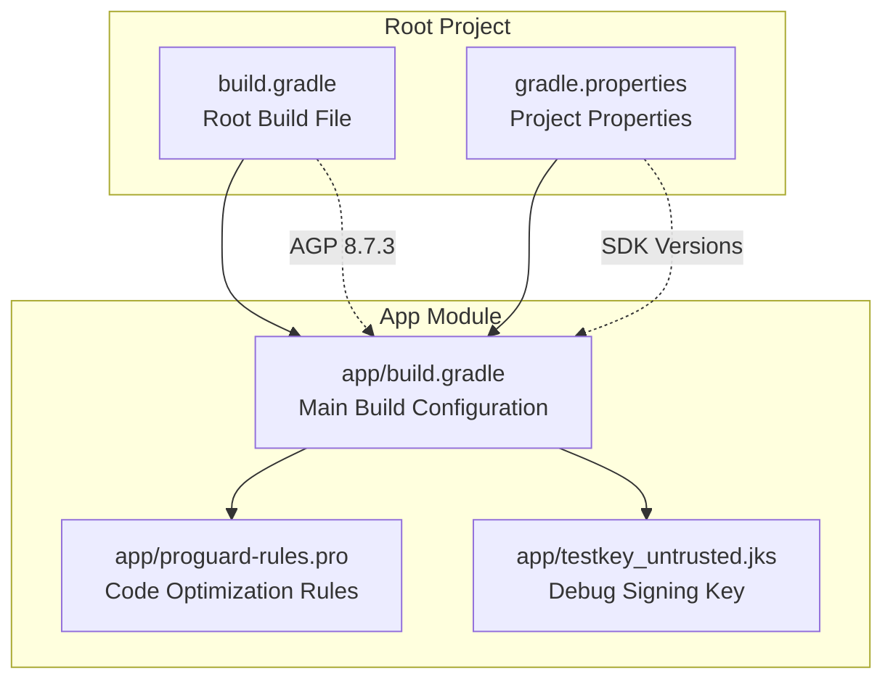
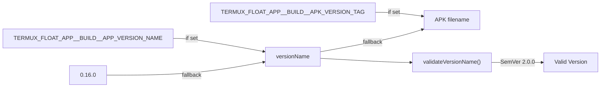
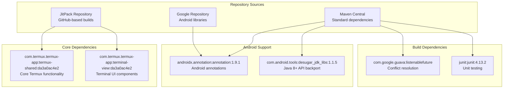
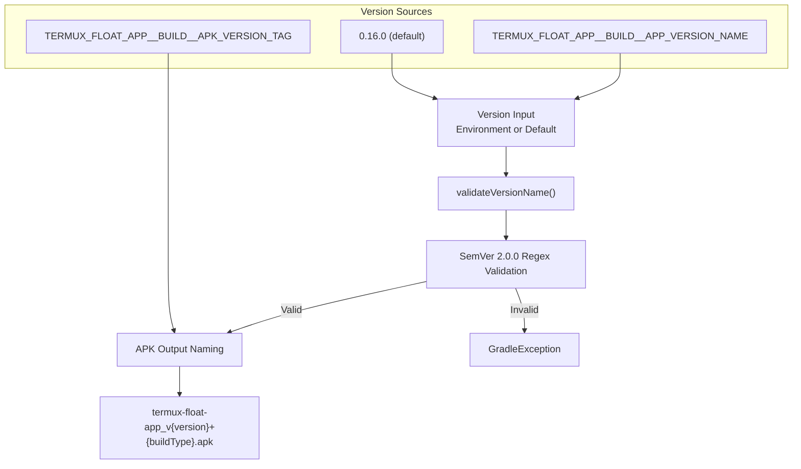

<!-- source: DeepWiki mcp.deepwiki.com · repo termux/termux-float · page 4.1 Gradle Configuration · fetched 2026-10-26 -->

# Gradle Configuration

<details>
<summary>Relevant source files</summary>

The following files were used as context for generating this wiki page:

- [app/build.gradle](app/build.gradle)
- [build.gradle](build.gradle)
- [gradle.properties](gradle.properties)

</details>


This document covers the Gradle build configuration for Termux:Float, including Android application settings, dependency management, build types, and version control. For information about the CI/CD pipeline that uses these configurations, see [CI/CD Pipeline](#4.2). For development environment setup, see [Development Setup](#6.1).

## Project Structure

The Termux:Float project uses a standard Android Gradle project structure with configuration split across multiple files:



**Sources:** [build.gradle:1-24](), [gradle.properties:1-21](), [app/build.gradle:1-99]()

## Android Application Configuration

The main Android configuration is defined in the `android` block, establishing the application identity and SDK requirements:

| Configuration | Value | Purpose |
|---------------|-------|---------|
| `namespace` | `"com.termux.window"` | Application package namespace |
| `applicationId` | `"com.termux.window"` | Unique application identifier |
| `compileSdk` | `35` | Target compilation SDK version |
| `minSdk` | `24` | Minimum supported Android version (API 24) |
| `targetSdk` | `28` | Target Android SDK version |
| `versionCode` | `1000` | Numeric version for Play Store |
| `versionName` | `"0.16.0"` | User-visible version string |

The configuration uses dynamic version name resolution through environment variables for CI/CD builds:



**Sources:** [app/build.gradle:3-23](), [gradle.properties:18-21](), [app/build.gradle:93-98]()

## Dependencies Management

Termux:Float uses a curated set of dependencies focused on terminal functionality and Android compatibility:



The project includes commented configuration for local Maven dependencies, enabling development against locally built Termux libraries:

**Sources:** [app/build.gradle:68-85](), [build.gradle:12-19](), [app/build.gradle:78-82]()

## Build Types and Signing Configuration

Termux:Float defines two build types with distinct optimization and signing strategies:

| Build Type | Configuration | Purpose |
|------------|---------------|---------|
| **Release** | `minifyEnabled: true`<br/>`shrinkResources: false`<br/>ProGuard enabled | Production builds with optimization |
| **Debug** | Custom signing config<br/>`zipAlignEnabled: true` | Development builds with test signing |

```mermaid
stateDiagram-v2
    [*] --> BuildType
    
    state BuildType {
        [*] --> Release
        [*] --> Debug
        
        state Release {
            MinifyEnabled --> ProGuardRules
            ProGuardRules --> OptimizedAPK
            note right of OptimizedAPK : Reproducible builds\n(shrinkResources: false)
        }
        
        state Debug {
            TestKeystore --> SignedAPK
            ZipAlign --> SignedAPK
            note right of SignedAPK : testkey_untrusted.jks\nDevelopment signing only
        }
    }
    
    BuildType --> [*]
```

The debug signing configuration uses an untrusted keystore specifically for development purposes:

**Sources:** [app/build.gradle:25-45](), [app/build.gradle:34-39](), [app/build.gradle:41-44]()

## Version Management and Validation

The build system implements semantic version validation and dynamic APK naming:



The `validateVersionName` function enforces strict semantic versioning compliance using regex pattern matching:

**Sources:** [app/build.gradle:55-60](), [app/build.gradle:93-98](), [app/build.gradle:7-8](), [app/build.gradle:17-18]()

## Java Compatibility and Modern Language Features

The project is configured for Java 11 compatibility with desugaring support for modern language features:

| Configuration | Value | Purpose |
|---------------|-------|---------|
| `sourceCompatibility` | `JavaVersion.VERSION_11` | Java source language level |
| `targetCompatibility` | `JavaVersion.VERSION_11` | Compiled bytecode target |
| `coreLibraryDesugaringEnabled` | `true` | Backport Java 8+ APIs to older Android |

**Sources:** [app/build.gradle:47-53](), [app/build.gradle:69]()

## Packaging Configuration

The build includes specific packaging rules to handle library conflicts and optimize the final APK:

```mermaid
graph LR
    subgraph "Packaging Rules"
        ExcludeJNI["Exclude JNI Libraries<br/>lib/*/liblocal-socket.so"]
        ManifestPlaceholders["Manifest Placeholders<br/>TERMUX_PACKAGE_NAME<br/>TERMUX_APP_NAME<br/>TERMUX_FLOAT_APP_NAME"]
    end
    
    subgraph "Build Output"
        APKFile["termux-float-app_*.apk<br/>Dynamic naming"]
    end
    
    ExcludeJNI --> APKFile
    ManifestPlaceholders --> APKFile
    
    note right of ExcludeJNI : Removes conflicting JNI libs\nfrom termux-shared dependency
```

**Sources:** [app/build.gradle:62-65](), [app/build.gradle:20-22]()

---

