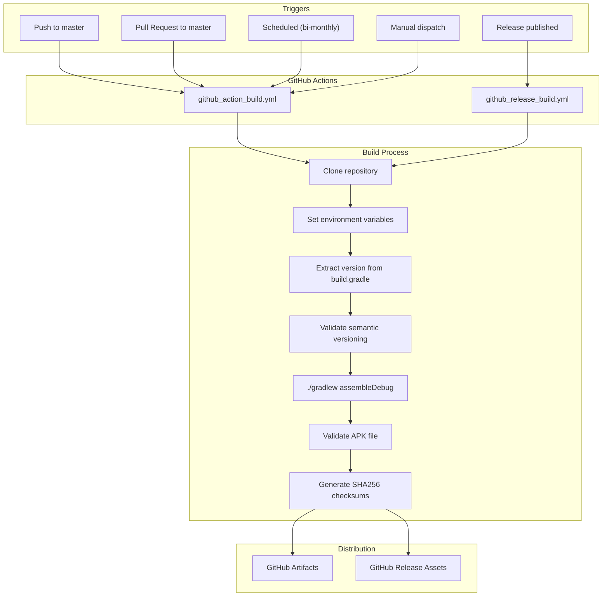
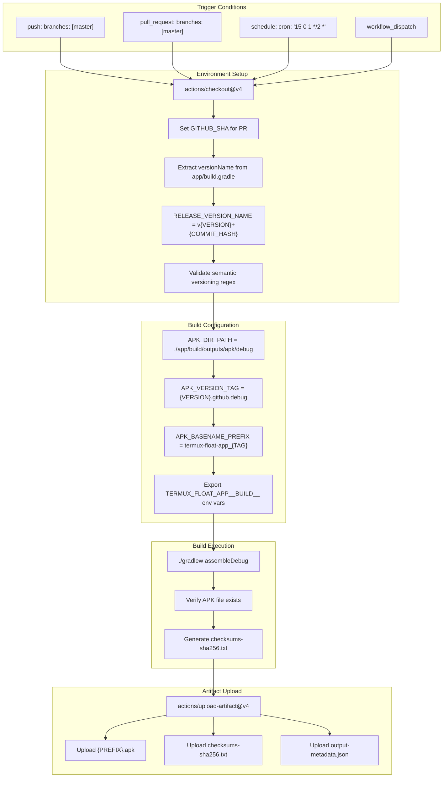
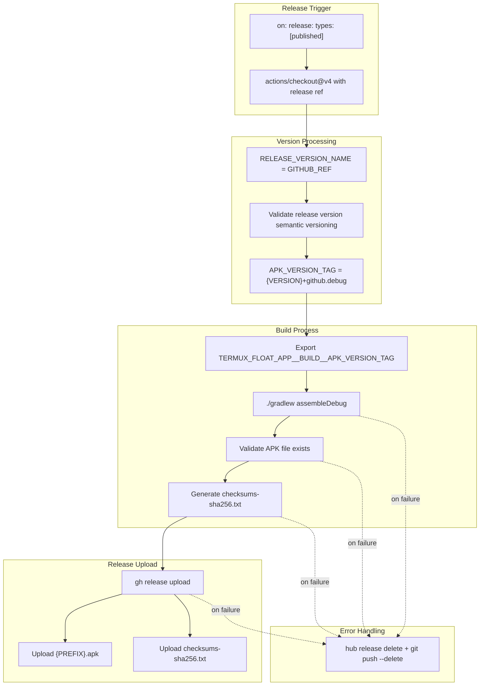
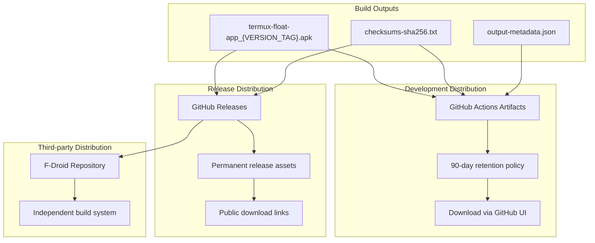

<!-- source: DeepWiki mcp.deepwiki.com · repo termux/termux-float · page 4.2 CI/CD Pipeline · fetched 2026-10-26 -->

# CI/CD Pipeline

<details>
<summary>Relevant source files</summary>

The following files were used as context for generating this wiki page:

- [.github/workflows/github_action_build.yml](.github/workflows/github_action_build.yml)
- [.github/workflows/github_release_build.yml](.github/workflows/github_release_build.yml)

</details>


This document covers the automated Continuous Integration and Continuous Deployment (CI/CD) system for Termux:Float, implemented using GitHub Actions workflows. The pipeline handles automated building, testing, version management, and distribution of APK files for both development and release scenarios.

For information about the underlying Gradle build configuration that these workflows execute, see [4.1](#4.1).

## Overview

The Termux:Float CI/CD pipeline consists of two primary GitHub Actions workflows that automate the build and distribution process:

| Workflow | Purpose | Triggers | Output |
|----------|---------|----------|--------|
| `github_action_build.yml` | Development builds | Push, PR, schedule, manual | GitHub Artifacts |
| `github_release_build.yml` | Release builds | Published releases | GitHub Release assets |

Both workflows generate debug APK files with comprehensive validation and checksums, ensuring consistent and reliable distribution across multiple channels.

## Build Workflow Architecture

The following diagram shows the overall CI/CD pipeline structure:

**CI/CD Pipeline Overview**



Sources: [.github/workflows/github_action_build.yml:1-76](), [.github/workflows/github_release_build.yml:1-65]()

## Development Build Workflow

The `github_action_build.yml` workflow handles continuous integration for development builds with multiple trigger conditions and comprehensive version management.

**Development Build Process**



Sources: [.github/workflows/github_action_build.yml:3-12](), [.github/workflows/github_action_build.yml:28-51](), [.github/workflows/github_action_build.yml:68-76]()

## Release Build Workflow

The `github_release_build.yml` workflow is specifically triggered when a GitHub release is published and handles uploading build artifacts directly to the release.

**Release Build Process**



Sources: [.github/workflows/github_release_build.yml:3-7](), [.github/workflows/github_release_build.yml:30-42](), [.github/workflows/github_release_build.yml:58-64]()

## Version Management Strategy

The CI/CD pipeline implements a sophisticated version management system that ensures consistent versioning across development and release builds while maintaining semantic versioning compliance.

### Version Extraction and Validation

Both workflows extract the base version from the `versionName` field in `app/build.gradle` and apply different tagging strategies:

| Build Type | Version Format | Example |
|------------|----------------|---------|
| Development | `v{VERSION}+{COMMIT_HASH}.github.debug` | `v0.15.0+a1b2c3d.github.debug` |
| Release | `v{VERSION}+github.debug` | `v0.15.0+github.debug` |

The version validation uses semantic versioning regex pattern to ensure compliance with [Semantic Versioning 2.0.0](https://semver.org/spec/v2.0.0.html) specification.

**Version Processing Flow**

```mermaid
flowchart TD
    subgraph "Version Extraction"
        GradleVersionRegex["CURRENT_VERSION_NAME_REGEX = '\\s+versionName \"([^\"]+)\"$'"]
        ExtractFromGradle["grep -m 1 -E app/build.gradle"]
        ParseVersion["sed -r to extract version string"]
    end
    
    subgraph "Version Construction"
        DevVersionFormat["Development: v{VERSION}+{GITHUB_SHA:0:7}"]
        ReleaseVersionFormat["Release: GITHUB_REF without refs/tags/"]
        TagConstruction["APK_VERSION_TAG construction"]
    end
    
    subgraph "Validation"
        SemVerRegex["Semantic versioning regex validation"]
        FormatCheck["Format: major.minor.patch(-prerelease)(+buildmetadata)"]
        ExitOnInvalid["exit_on_error if validation fails"]
    end
    
    subgraph "Environment Export"
        ExportVersionName["TERMUX_FLOAT_APP__BUILD__APP_VERSION_NAME"]
        ExportVersionTag["TERMUX_FLOAT_APP__BUILD__APK_VERSION_TAG"]
        GradleConsumption["Consumed by app/build.gradle"]
    end
    
    GradleVersionRegex --> ExtractFromGradle
    ExtractFromGradle --> ParseVersion
    
    ParseVersion --> DevVersionFormat
    ParseVersion --> ReleaseVersionFormat
    
    DevVersionFormat --> TagConstruction
    ReleaseVersionFormat --> TagConstruction
    
    TagConstruction --> SemVerRegex
    SemVerRegex --> FormatCheck
    FormatCheck --> ExitOnInvalid
    
    FormatCheck --> ExportVersionName
    FormatCheck --> ExportVersionTag
    ExportVersionName --> GradleConsumption
    ExportVersionTag --> GradleConsumption
```

Sources: [.github/workflows/github_action_build.yml:33-38](), [.github/workflows/github_action_build.yml:50-51](), [.github/workflows/github_release_build.yml:31-34]()

## Build Artifacts and Distribution

The pipeline generates consistent APK artifacts with comprehensive metadata and validation for different distribution channels.

### Artifact Structure

Each build produces the following artifacts:

| File | Purpose | Generation |
|------|---------|------------|
| `{APK_BASENAME_PREFIX}.apk` | Main application binary | `./gradlew assembleDebug` |
| `checksums-sha256.txt` | SHA256 hash verification | `sha256sum` command |
| `output-metadata.json` | Build metadata | Android Gradle Plugin |

### Distribution Channels

The CI/CD pipeline supports multiple distribution channels with different access patterns:

**Distribution Flow**



Sources: [.github/workflows/github_action_build.yml:40-43](), [.github/workflows/github_action_build.yml:68-76](), [.github/workflows/github_release_build.yml:36-38]()

## Error Handling and Validation

Both workflows implement comprehensive error handling with specific validation steps and cleanup procedures.

### Build Validation Process

The pipeline includes multiple validation checkpoints:

1. **Semantic Version Validation**: Ensures version strings comply with semver 2.0.0 specification
2. **APK File Existence**: Verifies the expected APK file was generated at the correct path
3. **Checksum Generation**: Validates that SHA256 checksums can be generated successfully
4. **Upload Verification**: Confirms successful artifact or release asset upload

### Release Cleanup Strategy

The release workflow includes automatic cleanup on failure using the `exit_on_error` function that:

- Deletes the published release using `hub release delete`
- Removes the associated Git tag using `git push --delete origin`
- Prevents partial or corrupted releases from remaining published

Sources: [.github/workflows/github_action_build.yml:24](), [.github/workflows/github_action_build.yml:36-38](), [.github/workflows/github_release_build.yml:22-28]()

## Integration with Build System

The CI/CD pipeline integrates closely with the Gradle build system through environment variable communication and artifact path management.

### Environment Variable Interface

The workflows communicate with the Gradle build through specific environment variables:

| Variable | Purpose | Usage |
|----------|---------|-------|
| `TERMUX_FLOAT_APP__BUILD__APP_VERSION_NAME` | Override version name | Development builds only |
| `TERMUX_FLOAT_APP__BUILD__APK_VERSION_TAG` | Set APK filename tag | Both workflows |

### Build Path Management

The pipeline uses consistent path management for build outputs:

- **APK Directory**: `./app/build/outputs/apk/debug`
- **APK Naming**: `termux-float-app_{APK_VERSION_TAG}.apk`
- **Checksum Location**: Same directory as APK files

This integration ensures that the CI/CD pipeline can reliably locate and process build artifacts while maintaining consistent naming conventions across different build scenarios.

Sources: [.github/workflows/github_action_build.yml:40-47](), [.github/workflows/github_action_build.yml:50-51](), [.github/workflows/github_release_build.yml:36-41]()

---

