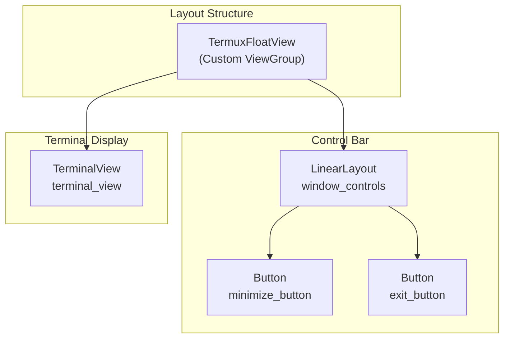
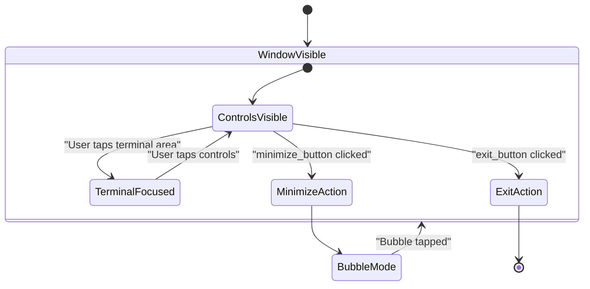
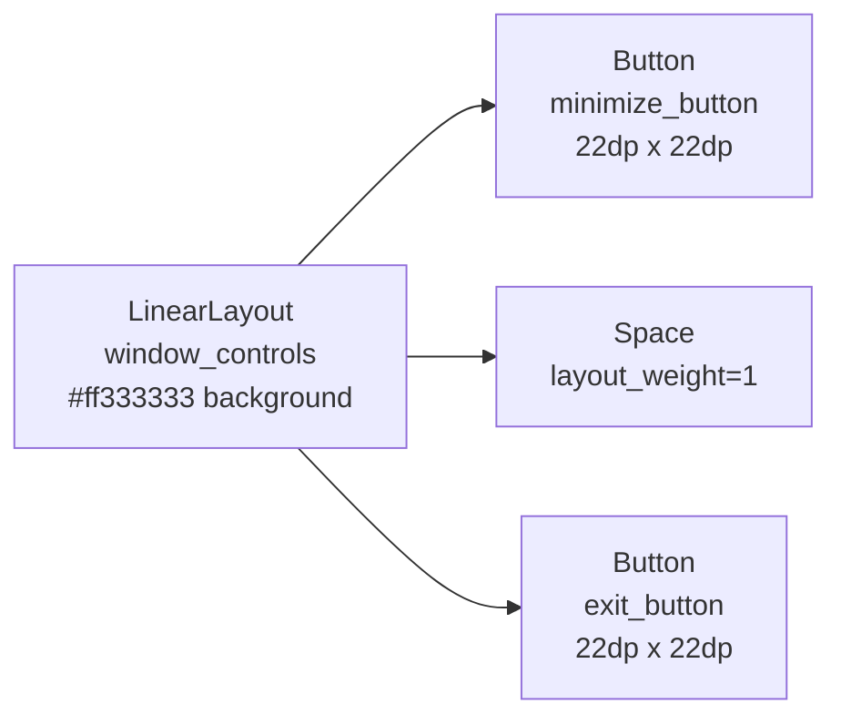

<!-- source: DeepWiki mcp.deepwiki.com · repo termux/termux-float · page 5 User Interface · fetched 2026-10-26 -->

# User Interface

<details>
<summary>Relevant source files</summary>

The following files were used as context for generating this wiki page:

- [app/src/main/res/drawable/ic_exit_icon.xml](app/src/main/res/drawable/ic_exit_icon.xml)
- [app/src/main/res/drawable/ic_minimize_icon.xml](app/src/main/res/drawable/ic_minimize_icon.xml)
- [app/src/main/res/layout/activity_main.xml](app/src/main/res/layout/activity_main.xml)
- [app/src/main/res/values/strings.xml](app/src/main/res/values/strings.xml)

</details>


This document covers the user interface components, layouts, and visual resources of Termux:Float. It focuses on the Android UI implementation including the main activity layout, window controls, and integration with the terminal view component.

For information about the underlying floating window system mechanics, see [Floating Window System](#3.2). For details about terminal session integration, see [Terminal Integration](#3.3).

## UI Architecture Overview

The Termux:Float user interface is built around a floating window system with minimal UI elements to maximize terminal space while providing essential window management controls.

### UI Component Hierarchy



**Sources:** [app/src/main/res/layout/activity_main.xml:1-48]()

### UI State Flow



**Sources:** [app/src/main/res/layout/activity_main.xml:15-36](), [app/src/main/res/values/strings.xml:17-19]()

## Main Activity Layout

The main UI is defined in `activity_main.xml` using a custom `TermuxFloatView` as the root container. This layout provides the structure for the floating terminal window.

### Layout Structure

| Component | ID | Purpose |
|-----------|----|---------| 
| `TermuxFloatView` | `window_layout` | Root container for floating window |
| `LinearLayout` | `window_controls` | Top control bar with minimize/exit buttons |
| `Button` | `minimize_button` | Minimizes window to bubble mode |
| `Button` | `exit_button` | Closes the floating window |
| `TerminalView` | `terminal_view` | Main terminal display area |

The layout uses a vertical orientation with the control bar at the top and the terminal view taking up the remaining space with `layout_weight="1"`.

**Sources:** [app/src/main/res/layout/activity_main.xml:2-8](), [app/src/main/res/layout/activity_main.xml:10-47]()

### Root Container Configuration

```xml
<com.termux.window.TermuxFloatView
    android:id="@+id/window_layout"
    android:layout_width="fill_parent"
    android:layout_height="fill_parent"
    android:background="@drawable/floating_window_background"
    android:orientation="vertical"
    android:padding="1px">
```

- **Background**: Uses custom drawable `floating_window_background`
- **Padding**: 1px border around entire window
- **Orientation**: Vertical layout for stacked components

**Sources:** [app/src/main/res/layout/activity_main.xml:2-8]()

## Window Controls

The window controls provide essential window management functionality through a compact control bar.

### Control Bar Layout



**Sources:** [app/src/main/res/layout/activity_main.xml:10-37]()

### Button Specifications

Both control buttons share consistent styling:
- **Dimensions**: 22dp × 22dp
- **Margins**: 8dp horizontal, 4dp vertical
- **Background**: Vector drawable icons
- **Color**: White icons on dark background

#### Minimize Button
- **Drawable**: `ic_minimize_icon`
- **Function**: Transforms window to bubble mode
- **Toast Message**: "Touch to show window." when minimized

#### Exit Button  
- **Drawable**: `ic_exit_icon`
- **Function**: Closes floating window and stops service
- **Notification Action**: "Exit" button in persistent notification

**Sources:** [app/src/main/res/layout/activity_main.xml:15-36](), [app/src/main/res/values/strings.xml:17-19]()

## Terminal View Integration

The terminal display area integrates the standard Termux `TerminalView` component within the floating window layout.

### Terminal View Configuration

```xml
<com.termux.view.TerminalView
    android:id="@+id/terminal_view"
    android:layout_width="match_parent"
    android:layout_height="wrap_content"
    android:layout_weight="1"
    android:focusable="true"
    android:focusableInTouchMode="true"
    android:scrollbars="vertical" />
```

Key configuration attributes:
- **Focus Management**: Both `focusable` and `focusableInTouchMode` enabled
- **Layout Weight**: Takes remaining space after controls
- **Scrollbars**: Vertical scrolling for terminal output
- **Touch Interaction**: Full touch mode support for terminal input

**Sources:** [app/src/main/res/layout/activity_main.xml:39-46]()

## String Resources and Localization

The UI strings are centralized in `strings.xml` for localization support and consistent messaging.

### User Interaction Messages

| Resource ID | Purpose | Content |
|-------------|---------|---------|
| `initial_instruction_toast` | First-time user guidance | Long press instructions and font size control |
| `after_long_press` | Contextual help | Move and resize instructions |
| `draw_overlay_permission_explanation` | Permission request | Overlay permission explanation |
| `grant_permission` | Permission button | Permission grant action |

### Notification Messages

| Resource ID | Purpose | Content |
|-------------|---------|---------|
| `notification_action_exit` | Notification action | "Exit" button text |
| `notification_message_visible` | Window visible state | "Touch to hide window." |
| `notification_message_hidden` | Window hidden state | "Touch to show window." |

**Sources:** [app/src/main/res/values/strings.xml:10-20]()

### Application Branding

The application uses XML entity references for consistent branding:
- `&TERMUX_PACKAGE_NAME;` → "com.termux"
- `&TERMUX_APP_NAME;` → "Termux"  
- `&TERMUX_FLOAT_APP_NAME;` → "Termux:Float"

**Sources:** [app/src/main/res/values/strings.xml:3-7]()

## Drawable Resources

The UI uses vector drawable resources for scalable icons that maintain quality across different screen densities.

### Vector Icon Specifications

Both control icons are implemented as vector drawables with consistent styling:

#### Exit Icon (`ic_exit_icon.xml`)
- **Dimensions**: 32dp × 32dp viewport
- **Design**: Circular border with X symbol
- **Color**: White (`#FFFFFF`)
- **Paths**: Two-path design (circle + X)

#### Minimize Icon (`ic_minimize_icon.xml`)  
- **Dimensions**: 32dp × 32dp viewport
- **Design**: Window with minimize symbol and circle
- **Color**: White (`#FFFFFF`)
- **Paths**: Three-path design (window + circle + arrow)

**Sources:** [app/src/main/res/drawable/ic_exit_icon.xml:1-12](), [app/src/main/res/drawable/ic_minimize_icon.xml:1-15]()

### Icon Design Patterns

Both icons follow consistent design principles:
- White color scheme for visibility on dark backgrounds
- Circular elements for visual consistency
- Clear symbolic representation of function
- Optimized path data for performance

**Sources:** [app/src/main/res/drawable/ic_exit_icon.xml:7-11](), [app/src/main/res/drawable/ic_minimize_icon.xml:7-14]()

---

