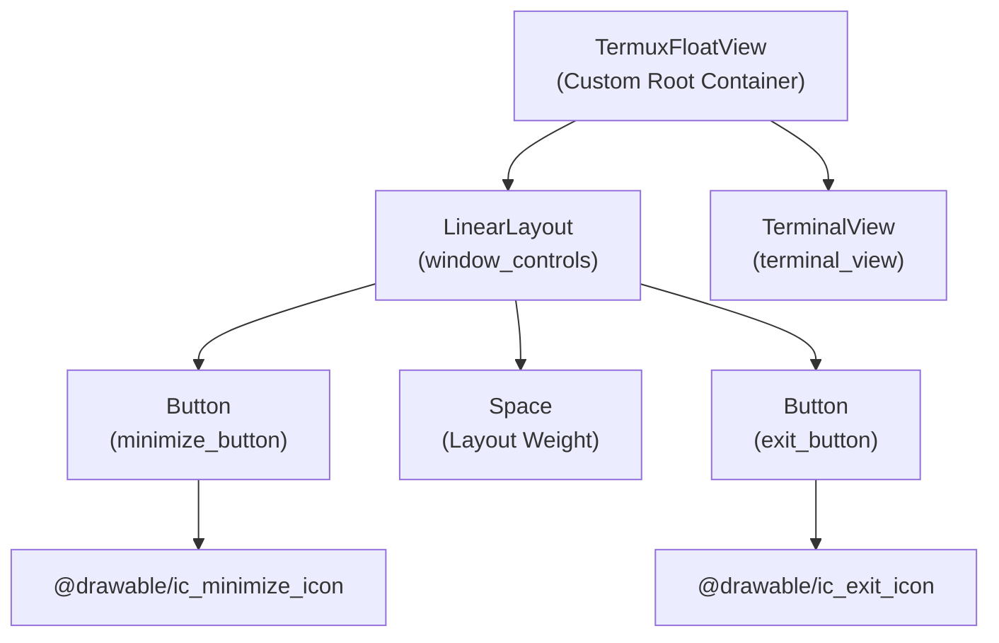
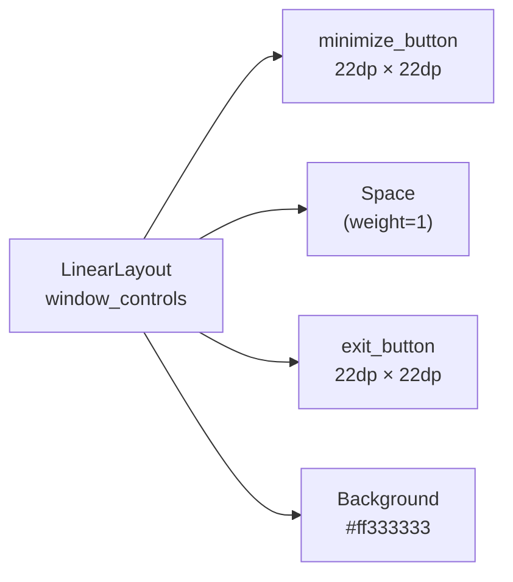
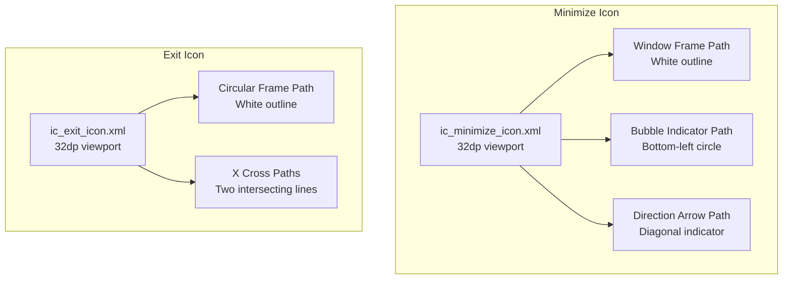
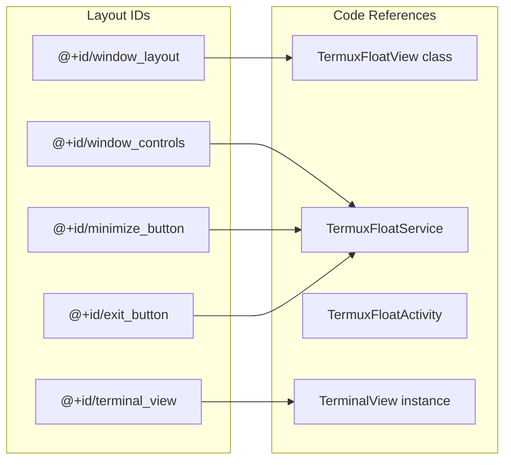

<!-- source: DeepWiki mcp.deepwiki.com · repo termux/termux-float · page 5.1 Views and Layouts · fetched 2026-10-26 -->

# Views and Layouts

Relevant source files

The following files were used as context for generating this wiki page:

- [app/src/main/res/drawable/ic_exit_icon.xml](app/src/main/res/drawable/ic_exit_icon.xml)
- [app/src/main/res/drawable/ic_minimize_icon.xml](app/src/main/res/drawable/ic_minimize_icon.xml)
- [app/src/main/res/layout/activity_main.xml](app/src/main/res/layout/activity_main.xml)

This document covers the user interface layout structure and view components that compose the floating terminal window in Termux:Float. It details the XML layout definitions, custom view components, and visual resources that create the floating window's appearance and controls.

For information about the underlying floating window implementation and behavior, see [Floating Window System](#3.2). For details on terminal session integration, see [Terminal Integration](#3.3). For broader coverage of visual resources and assets, see [Resources and Assets](#5.2).

## Layout Structure Overview

The Termux:Float application uses a single main layout that defines the structure of the floating terminal window. The layout is designed to provide a compact, functional interface with window controls and a terminal display area.

**Main Layout Structure**

Sources: [app/src/main/res/layout/activity_main.xml:1-48]()

## Root Container - TermuxFloatView

The layout uses `com.termux.window.TermuxFloatView` as its root container, which is a custom view class that extends Android's ViewGroup to provide floating window functionality.

| Property | Value | Purpose |
|----------|-------|---------|
| `android:id` | `@+id/window_layout` | Root container identifier |
| `android:layout_width` | `fill_parent` | Full width of available space |
| `android:layout_height` | `fill_parent` | Full height of available space |
| `android:background` | `@drawable/floating_window_background` | Window background styling |
| `android:orientation` | `vertical` | Vertical stacking of child elements |
| `android:padding` | `1px` | Minimal border padding |

The `TermuxFloatView` serves as both a layout container and the primary interface for floating window operations such as dragging, resizing, and state management.

Sources: [app/src/main/res/layout/activity_main.xml:2-8]()

## Window Controls Bar

The control bar provides essential window management functions through a horizontal layout containing minimize and exit buttons.

**Control Bar Layout**

### Control Bar Properties

| Property | Value | Description |
|----------|-------|-------------|
| `android:id` | `@+id/window_controls` | Control bar container ID |
| `android:layout_width` | `match_parent` | Full width spanning |
| `android:layout_height` | `wrap_content` | Height based on content |
| `android:background` | `#ff333333` | Dark gray background |

### Button Specifications

Both control buttons share consistent sizing and margin properties:

| Property | Value | Applied To |
|----------|-------|------------|
| `android:layout_width` | `22dp` | Both buttons |
| `android:layout_height` | `22dp` | Both buttons |
| `android:layout_marginTop` | `4dp` | Both buttons |
| `android:layout_marginBottom` | `4dp` | Both buttons |
| `android:layout_marginStart` | `8dp` | Both buttons |
| `android:layout_marginEnd` | `8dp` | Both buttons |

The buttons use vector drawable backgrounds for their visual representation and functionality indicators.

Sources: [app/src/main/res/layout/activity_main.xml:10-37]()

## Terminal Display Area

The terminal content is rendered using the `com.termux.view.TerminalView` component, which provides the actual terminal emulation display and input handling.

### TerminalView Configuration

| Property | Value | Purpose |
|----------|-------|---------|
| `android:id` | `@+id/terminal_view` | Terminal view identifier |
| `android:layout_width` | `match_parent` | Full width utilization |
| `android:layout_height` | `wrap_content` | Height based on content |
| `android:layout_weight` | `1` | Expand to fill remaining space |
| `android:focusable` | `true` | Accept focus for input |
| `android:focusableInTouchMode` | `true` | Touch-based focus handling |
| `android:scrollbars` | `vertical` | Vertical scrolling support |

The `layout_weight="1"` property ensures the terminal view expands to fill all available space below the control bar, providing maximum terminal display area within the floating window.

Sources: [app/src/main/res/layout/activity_main.xml:39-46]()

## Vector Drawable Resources

The window control buttons use vector drawable resources that provide scalable, crisp icons for the minimize and exit functions.

**Icon Resource Structure**

### Minimize Icon Details

The minimize icon (`ic_minimize_icon.xml`) uses a 32dp viewport and contains three distinct path elements:
- Window frame outline representing the original window
- Small circle indicating bubble/minimized state
- Diagonal arrow showing the minimize direction

### Exit Icon Details

The exit icon (`ic_exit_icon.xml`) uses a 32dp viewport with two path elements:
- Circular border frame
- X-shaped cross formed by two intersecting diagonal lines

Both icons use white fills (`#FFFFFF`) for visibility against the dark control bar background.

Sources: [app/src/main/res/drawable/ic_minimize_icon.xml:1-16](), [app/src/main/res/drawable/ic_exit_icon.xml:1-13]()

## Layout-to-Code Integration

The layout components integrate with the application code through ID references and view binding mechanisms.

**View Integration Mapping**

The layout serves as the foundation for the floating window's visual presentation, with each component playing a specific role in the overall user interface architecture. The `TermuxFloatView` root container provides the floating capabilities, while the control buttons enable user interaction with window state management, and the `TerminalView` delivers the core terminal functionality.

Sources: [app/src/main/res/layout/activity_main.xml:1-48]()

---

