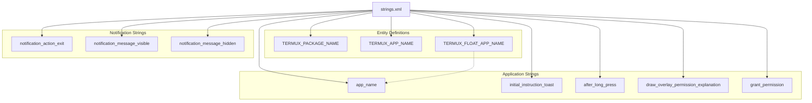
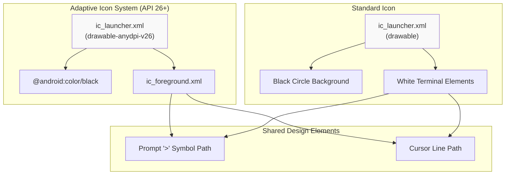
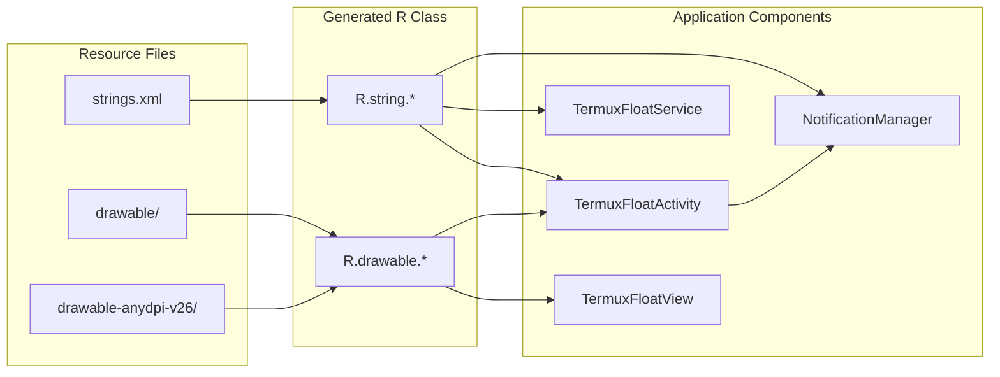

<!-- source: DeepWiki mcp.deepwiki.com · repo termux/termux-float · page 5.2 Resources and Assets · fetched 2026-10-26 -->

# Resources and Assets

Relevant source files

The following files were used as context for generating this wiki page:

- [app/src/main/res/drawable-anydpi-v26/ic_launcher.xml](app/src/main/res/drawable-anydpi-v26/ic_launcher.xml)
- [app/src/main/res/drawable/ic_foreground.xml](app/src/main/res/drawable/ic_foreground.xml)
- [app/src/main/res/drawable/ic_launcher.xml](app/src/main/res/drawable/ic_launcher.xml)
- [app/src/main/res/drawable/round_button_with_outline.xml](app/src/main/res/drawable/round_button_with_outline.xml)
- [app/src/main/res/values/strings.xml](app/src/main/res/values/strings.xml)

This document covers the Android resources and assets used by the Termux:Float application, including string resources for user interface text, drawable resources for visual elements, and application icons. These resources define the visual appearance and user-facing text throughout the application.

For information about the user interface components that consume these resources, see [Views and Layouts](#5.1).

## String Resources

The application defines all user-facing text through Android string resources located in [app/src/main/res/values/strings.xml:1-21](). The string resources use XML entity declarations to maintain consistency with the broader Termux ecosystem.

### Entity Declarations

The strings file defines reusable entities for consistent naming:

| Entity | Value | Usage |
|--------|-------|-------|
| `TERMUX_PACKAGE_NAME` | `com.termux` | Package identifier reference |
| `TERMUX_APP_NAME` | `Termux` | Main application name |
| `TERMUX_FLOAT_APP_NAME` | `Termux:Float` | Float application name |

### Application Text Resources

| Resource Name | Purpose | Text Content |
|---------------|---------|--------------|
| `app_name` | Application display name | Uses `&TERMUX_FLOAT_APP_NAME;` entity |
| `initial_instruction_toast` | First-use guidance | Window interaction instructions |
| `after_long_press` | Context-sensitive help | Drag and resize instructions |
| `draw_overlay_permission_explanation` | Permission request context | Overlay permission explanation |
| `grant_permission` | Permission button text | Grant permission action |
| `notification_action_exit` | Notification action | Exit button text |
| `notification_message_visible` | Notification status | Window visible state message |
| `notification_message_hidden` | Notification status | Window hidden state message |

**String Resource Organization**

Sources: [app/src/main/res/values/strings.xml:1-21]()

## Drawable Resources

The application includes drawable resources for UI elements and visual components. These resources are defined as XML vector drawables and selectors.

### Button and UI Elements

The `round_button_with_outline` drawable defines the visual style for circular button elements used in the floating bubble interface:

| Property | Value | Purpose |
|----------|-------|---------|
| Shape | `oval` | Creates circular button appearance |  
| Fill Color | `@android:color/black` | Button background |
| Stroke Color | `@android:color/white` | Button border |
| Stroke Width | `@dimen/bubble_outline_stroke_width` | Border thickness reference |

The drawable uses a `<selector>` element to allow for potential state-dependent styling, though currently only defines a single default state [app/src/main/res/drawable/round_button_with_outline.xml:2-9]().

Sources: [app/src/main/res/drawable/round_button_with_outline.xml:1-10]()

## Application Icons

The Termux:Float application uses a consistent icon design across different Android icon formats, featuring a terminal prompt symbol and cursor line.

### Icon Design Elements

Both adaptive and standard launcher icons share the same foreground design:

| Element | Path Data | Visual Representation |
|---------|-----------|----------------------|
| Prompt Symbol | `M34,38 h6 l12,16 l-12,16 h-6 l12,-16` | Terminal ">" prompt character |
| Cursor Line | `M56,66 h18 v4 h-18` | Terminal cursor/underscore |

### Icon Implementations

**Standard Launcher Icon** ([app/src/main/res/drawable/ic_launcher.xml:1-35]())
- Black circular background with 36dp radius
- White foreground elements
- Single vector drawable with all elements

**Adaptive Icon System** ([app/src/main/res/drawable-anydpi-v26/ic_launcher.xml:1-6]())
- Black background layer using `@android:color/black`
- Separate foreground drawable `@drawable/ic_foreground`
- Supports Android 8.0+ adaptive icon system

**Foreground Component** ([app/src/main/res/drawable/ic_foreground.xml:1-28]())
- White terminal elements on transparent background
- 108dp viewbox for adaptive icon compatibility
- Synchronized with standard icon design

**Icon Resource Hierarchy**

Sources: [app/src/main/res/drawable/ic_launcher.xml:1-35](), [app/src/main/res/drawable-anydpi-v26/ic_launcher.xml:1-6](), [app/src/main/res/drawable/ic_foreground.xml:1-28]()

## Resource Organization and Usage

The Android resource system organizes assets by type and provides runtime access through the `R` class. The following diagram shows how resources flow from definition to application usage:

**Resource Access Flow**

### Resource Usage Patterns

| Resource Type | Primary Consumers | Access Pattern |
|---------------|-------------------|----------------|
| String resources | Activities, Services, Notifications | `getString(R.string.resource_name)` |
| Drawable resources | Views, Buttons, Icons | `getDrawable(R.drawable.resource_name)` |
| Application icons | Android System, Launcher | Manifest reference via `@drawable/ic_launcher` |

Sources: [app/src/main/res/values/strings.xml:1-21](), [app/src/main/res/drawable/round_button_with_outline.xml:1-10](), [app/src/main/res/drawable/ic_launcher.xml:1-35]()

---

