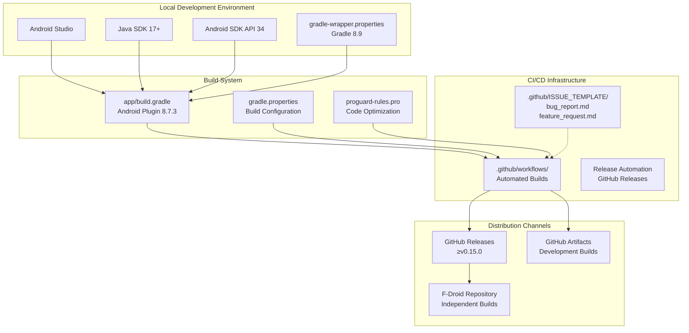
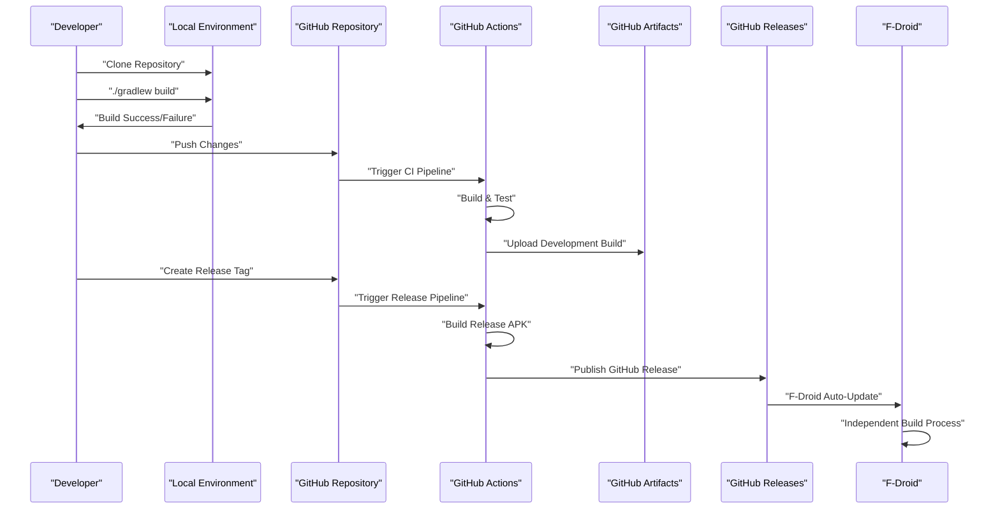

<!-- source: DeepWiki mcp.deepwiki.com · repo termux/termux-float · page 6 Development · fetched 2026-10-26 -->

# Development

Relevant source files

The following files were used as context for generating this wiki page:

- [.github/ISSUE_TEMPLATE/bug_report.md](.github/ISSUE_TEMPLATE/bug_report.md)
- [.github/ISSUE_TEMPLATE/feature_request.md](.github/ISSUE_TEMPLATE/feature_request.md)
- [gradle/wrapper/gradle-wrapper.properties](gradle/wrapper/gradle-wrapper.properties)

This page provides essential information for developers working on or contributing to the Termux:Float project. It covers development environment setup, project structure, development workflows, and contribution guidelines.

For detailed development environment configuration, see [Development Setup](#6.1). For specific contribution guidelines and processes, see [Contributing](#6.2). For licensing and legal information, see [Licensing](#6.3).

## Development Environment Overview

Termux:Float uses a modern Android development stack with Gradle as the primary build system and GitHub Actions for continuous integration and delivery.

### Development Toolchain

**Sources:** [gradle/wrapper/gradle-wrapper.properties:1-6](), [.github/ISSUE_TEMPLATE/bug_report.md:1-36](), [.github/ISSUE_TEMPLATE/feature_request.md:1-18]()

## Project Structure and Development Workflow

The project follows standard Android application structure with specialized components for floating window management and terminal integration.

### Core Development Components

```mermaid
flowchart TB
    subgraph "Source Code Organization"
        MainSrc["app/src/main/java/com/termux/float/"]
        AppClass["TermuxFloatApplication.java<br/>Application Entry Point"]
        ServiceClass["TermuxFloatService.java<br/>Background Service"]
        ActivityClass["TermuxFloatActivity.java<br/>Launcher Activity"]
        ViewClass["TermuxFloatView.java<br/>Floating Window UI"]
        SessionClient["TermuxFloatSessionClient.java<br/>Terminal Session Handler"]
    end
    
    subgraph "Configuration and Resources"
        AndroidManifest["AndroidManifest.xml<br/>Permissions & Components"]
        AppSharedPrefs["TermuxFloatAppSharedPreferences.java<br/>User Settings"]
        AppSharedProps["TermuxFloatAppSharedProperties.java<br/>App Properties"]
        StringResources["res/values/strings.xml<br/>Localized Text"]
        LayoutResources["res/layout/<br/>UI Layouts"]
    end
    
    subgraph "Build Configuration"
        BuildGradle["app/build.gradle<br/>Dependencies & Build Config"]
        GradleProps["gradle.properties<br/>Project Properties"]
        ProguardConfig["proguard-rules.pro<br/>Code Shrinking Rules"]
    end
    
    subgraph "External Dependencies"
        TermuxShared["termux-shared<br/>Common Termux Components"]
        TerminalView["terminal-view<br/>Terminal Display Component"]
        AndroidXLibs["AndroidX Libraries<br/>Core, AppCompat, etc."]
    end
    
    MainSrc --> AppClass
    MainSrc --> ServiceClass
    MainSrc --> ActivityClass
    MainSrc --> ViewClass
    MainSrc --> SessionClient
    
    AppClass --> AppSharedPrefs
    ServiceClass --> AppSharedProps
    ViewClass --> LayoutResources
    ActivityClass --> StringResources
    
    BuildGradle --> TermuxShared
    BuildGradle --> TerminalView
    BuildGradle --> AndroidXLibs
    
    AndroidManifest -.-> AppClass
    AndroidManifest -.-> ServiceClass
    AndroidManifest -.-> ActivityClass
```

**Sources:** [gradle/wrapper/gradle-wrapper.properties:3]()

## Development Workflow Process

The development workflow emphasizes automated testing, continuous integration, and multiple distribution channels to ensure code quality and broad accessibility.

### Development Lifecycle

**Sources:** [gradle/wrapper/gradle-wrapper.properties:3]()

## Contributing Guidelines

Contributions to Termux:Float follow established issue templates and development practices to maintain code quality and project consistency.

### Issue Reporting Process

The project uses structured issue templates for bug reports and feature requests:

| Template Type | File | Required Information |
|---------------|------|---------------------|
| Bug Report | [.github/ISSUE_TEMPLATE/bug_report.md:1-36]() | Problem description, reproduction steps, expected behavior, system information |
| Feature Request | [.github/ISSUE_TEMPLATE/feature_request.md:1-18]() | Feature description and justification |

**Key Requirements:**
- Android 5.x - 6.x support is no longer provided
- All templates must be filled completely after reading comments
- Bug reports require specific system information: Termux version, Android OS version, device model

### Development Standards

Development follows these key principles:

1. **Build System Compatibility**: Uses Gradle 8.9 as specified in [gradle/wrapper/gradle-wrapper.properties:3]()
2. **Code Quality**: ProGuard rules applied with `-dontobfuscate` for debugging
3. **Integration Testing**: Automated builds for all pull requests
4. **Distribution**: Multi-channel release process supporting GitHub Releases and F-Droid

**Sources:** [.github/ISSUE_TEMPLATE/bug_report.md:10-11](), [.github/ISSUE_TEMPLATE/feature_request.md:10-11](), [gradle/wrapper/gradle-wrapper.properties:1-6]()

## Project Dependencies and Integration

Termux:Float integrates closely with the broader Termux ecosystem through shared libraries and common architectural patterns:

- **termux-shared**: Provides common utilities and shared preferences management
- **terminal-view**: Handles terminal display and input processing
- **AndroidX Libraries**: Modern Android development components

The build system maintains compatibility with the main Termux application through `sharedUserId` configuration and consistent dependency versions.

For specific setup instructions and environment configuration, see [Development Setup](#6.1). For detailed contribution workflows and code review processes, see [Contributing](#6.2).

---

