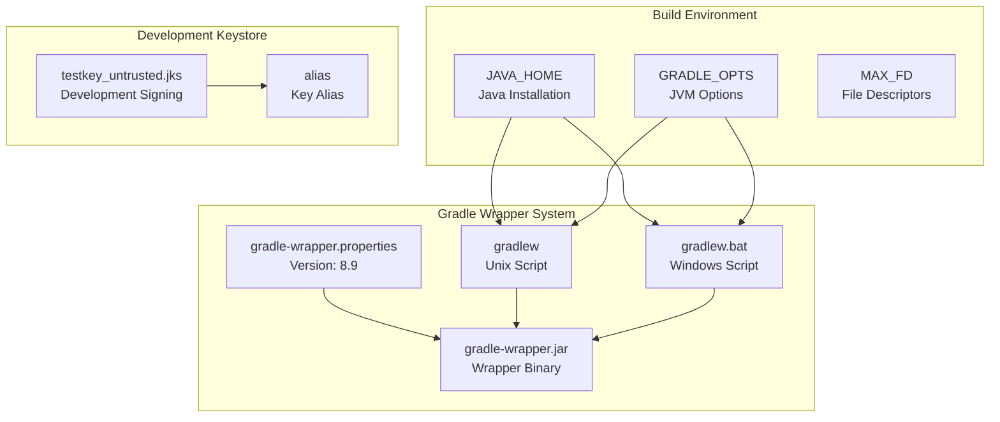
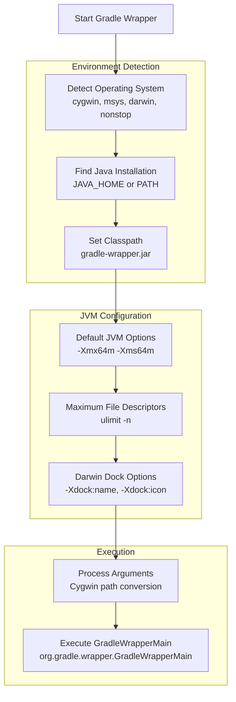
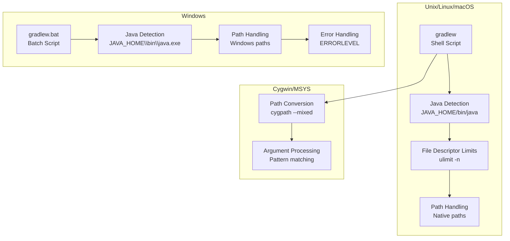
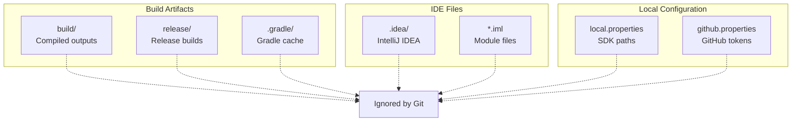

<!-- source: DeepWiki mcp.deepwiki.com · repo termux/termux-float · page 6.1 Development Setup · fetched 2026-10-26 -->

# Development Setup

<details>
<summary>Relevant source files</summary>

The following files were used as context for generating this wiki page:

- [.gitignore](.gitignore)
- [app/testkey_untrusted.jks](app/testkey_untrusted.jks)
- [gradle/wrapper/gradle-wrapper.jar](gradle/wrapper/gradle-wrapper.jar)
- [gradle/wrapper/gradle-wrapper.properties](gradle/wrapper/gradle-wrapper.properties)
- [gradlew](gradlew)
- [gradlew.bat](gradlew.bat)

</details>


This document covers the development environment setup for Termux:Float, including Gradle configuration, build tools, and development keystores. This includes the Gradle wrapper, build scripts, and signing configuration necessary for development builds.

For information about the overall build system configuration and CI/CD pipeline, see [Build System](#4). For contributing guidelines and development workflows, see [Contributing](#6.2).

## Gradle Wrapper Configuration

The project uses Gradle Wrapper to ensure consistent builds across different development environments. The wrapper is configured to use Gradle 8.9 and includes both Unix and Windows scripts.



**Sources:** [gradle/wrapper/gradle-wrapper.properties:1-6](), [gradlew:1-186](), [gradlew.bat:1-105]()

### Gradle Version and Distribution

The project is configured to use Gradle 8.9 with the complete distribution including documentation and sources:

| Property | Value |
|----------|-------|
| Distribution Base | `GRADLE_USER_HOME` |
| Distribution Path | `wrapper/dists` |
| Distribution URL | `https://services.gradle.org/distributions/gradle-8.9-all.zip` |
| Zip Store Base | `GRADLE_USER_HOME` |
| Zip Store Path | `wrapper/dists` |

**Sources:** [gradle/wrapper/gradle-wrapper.properties:1-6]()

### Gradle Wrapper Scripts

The project includes platform-specific wrapper scripts that handle Java detection, classpath setup, and JVM options:



**Sources:** [gradlew:25-185](), [gradlew.bat:25-89]()

## Development Keystore

The project includes a development keystore for signing debug builds during development. This keystore should never be used for production releases.

### Keystore Configuration

| Property | Value |
|----------|-------|
| Keystore File | `app/testkey_untrusted.jks` |
| Keystore Type | JKS (Java KeyStore) |
| Key Alias | `alias` |
| Certificate | X.509 with Earth organization |
| Validity Period | 2019-09-03 to 2049-10-25 |

**Sources:** [app/testkey_untrusted.jks:1-23]()

### Certificate Information

The development certificate contains the following information:

- **Subject:** `CN=APK Signer, O=Earth, C=Earth`
- **Issuer:** Self-signed
- **Serial Number:** Generated during keystore creation
- **Public Key Algorithm:** RSA
- **Signature Algorithm:** SHA256withRSA

**Sources:** [app/testkey_untrusted.jks:9-22]()

## Build Environment Setup

### Prerequisites

The development environment requires the following components:

1. **Java Development Kit (JDK)**
   - Minimum version: Java 8
   - Recommended: Java 11 or higher
   - Environment variable: `JAVA_HOME`

2. **Android SDK**
   - Required for Android development
   - Should be properly configured with SDK path

3. **Git**
   - For version control operations
   - Required for cloning the repository

### Environment Variables

The Gradle wrapper scripts recognize several environment variables for customization:

| Variable | Purpose | Default |
|----------|---------|---------|
| `JAVA_HOME` | Java installation directory | Auto-detected |
| `GRADLE_OPTS` | JVM options for Gradle | Empty |
| `GRADLE_CYGPATTERN` | Cygwin path pattern | Empty |
| `MAX_FD` | Maximum file descriptors | `maximum` |

**Sources:** [gradlew:47-122](), [gradlew.bat:35-89]()

### Platform-Specific Configuration



**Sources:** [gradlew:63-185](), [gradlew.bat:38-89]()

## Development Workflow

### Initial Setup

1. **Clone the repository:**
   ```bash
   git clone https://github.com/termux/termux-float.git
   cd termux-float
   ```

2. **Verify Gradle wrapper:**
   ```bash
   ./gradlew --version
   ```

3. **Build the project:**
   ```bash
   ./gradlew build
   ```

### Development Build Commands

| Command | Purpose |
|---------|---------|
| `./gradlew assembleDebug` | Build debug APK |
| `./gradlew installDebug` | Install debug APK to device |
| `./gradlew clean` | Clean build artifacts |
| `./gradlew build` | Full build with tests |

### Ignored Files

The development environment excludes certain files and directories from version control:



**Sources:** [.gitignore:1-9]()

### Troubleshooting

Common development setup issues and solutions:

1. **Java not found:** Ensure `JAVA_HOME` is set correctly
2. **Permission denied on gradlew:** Run `chmod +x gradlew`
3. **Gradle daemon issues:** Run `./gradlew --stop` and retry
4. **Build cache problems:** Run `./gradlew clean` or delete `.gradle` directory

**Sources:** [gradlew:86-106](), [gradlew.bat:39-65]()

---

