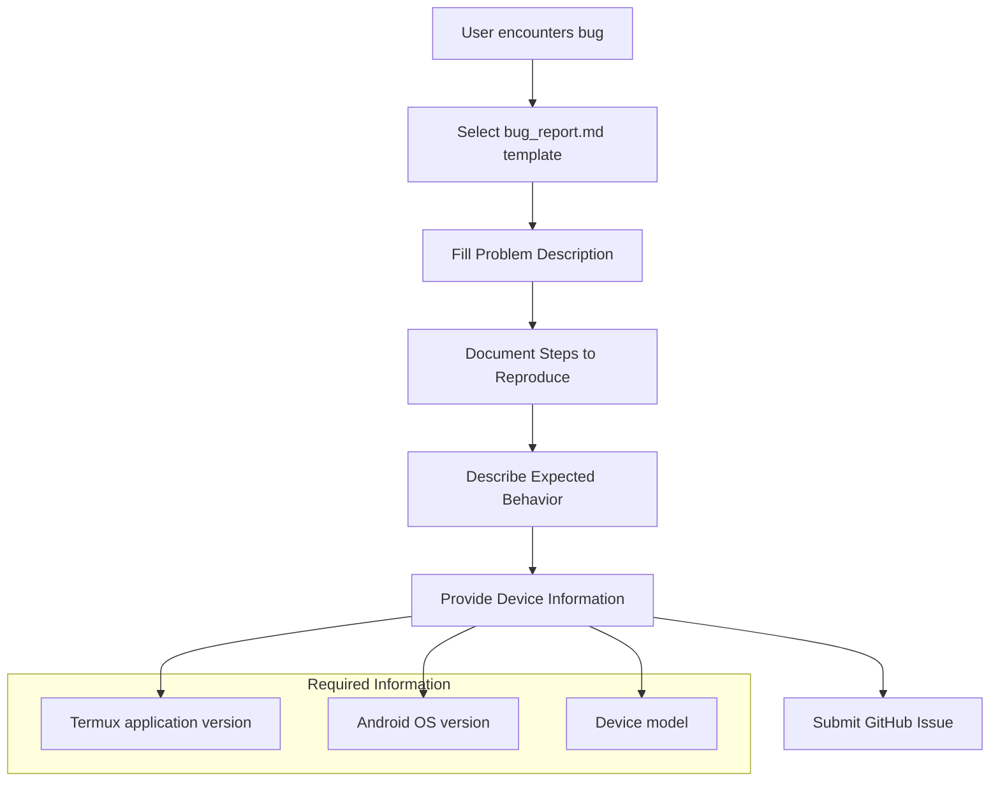
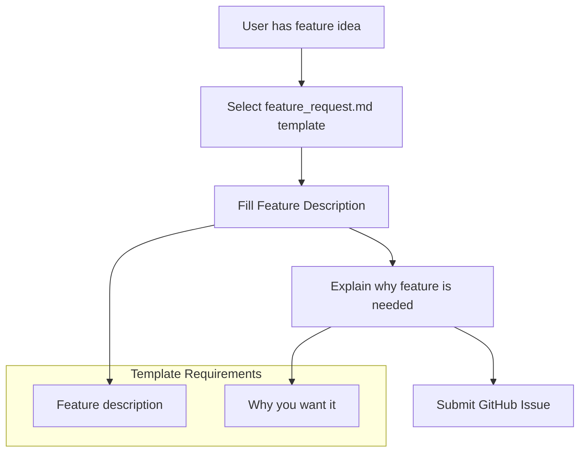
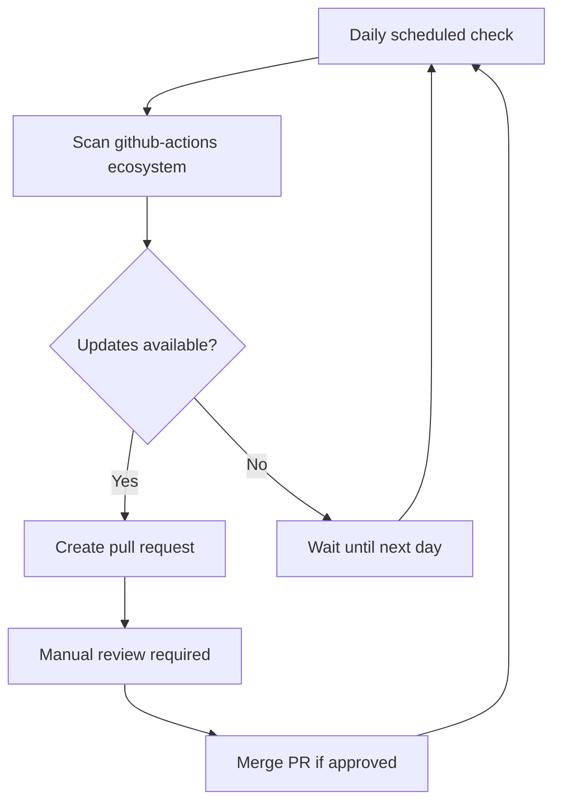

<!-- source: DeepWiki mcp.deepwiki.com · repo termux/termux-float · page 6.2 Contributing · fetched 2026-10-26 -->

# Contributing

<details>
<summary>Relevant source files</summary>

The following files were used as context for generating this wiki page:

- [.github/ISSUE_TEMPLATE/bug_report.md](.github/ISSUE_TEMPLATE/bug_report.md)
- [.github/ISSUE_TEMPLATE/feature_request.md](.github/ISSUE_TEMPLATE/feature_request.md)
- [.github/dependabot.yml](.github/dependabot.yml)

</details>


This document provides guidelines for contributing to the Termux:Float project, including issue reporting procedures, dependency management, and the contribution workflow. It covers the structured processes for reporting bugs and requesting features, as well as how automated dependency management is handled through GitHub Actions.

For information about setting up the development environment, see [Development Setup](#6.1). For licensing and legal aspects, see [Licensing](#6.3).

## Issue Reporting Process

The project uses structured GitHub issue templates to ensure consistent and actionable bug reports and feature requests. These templates guide contributors through providing essential information needed for effective issue resolution.

### Bug Report Workflow

**Bug Report Template Structure**


The bug report template requires specific technical information to facilitate debugging:

| Field | Description | Required |
|-------|-------------|----------|
| Problem description | Clear description with optional screenshots | Yes |
| Steps to reproduce | Exact commands and actions needed | Yes |
| Expected behavior | What should have happened | Yes |
| Termux application version | Version of main Termux app | Yes |
| Android OS version | Android version number | Yes |
| Device model | Specific device model | Yes |

Sources: [.github/ISSUE_TEMPLATE/bug_report.md:1-36]()

### Feature Request Process

**Feature Request Workflow**


The feature request template focuses on understanding the need and purpose behind proposed enhancements rather than implementation details.

Sources: [.github/ISSUE_TEMPLATE/feature_request.md:1-18]()

## Automated Dependency Management

The project uses Dependabot to automatically manage GitHub Actions dependencies, ensuring the CI/CD pipeline stays current with security updates and new features.

### Dependabot Configuration

**Dependency Update Process**


The Dependabot configuration targets the GitHub Actions ecosystem with daily update checks:

```yaml
version: 2
updates:
- package-ecosystem: github-actions
  directory: /
  schedule:
    interval: daily
```

This ensures that workflow dependencies in [.github/workflows/]() remain current and secure without manual intervention.

Sources: [.github/dependabot.yml:1-7]()

## Platform Compatibility

Both issue templates include important compatibility information that contributors should be aware of:

### Supported Android Versions

The project has discontinued support for older Android versions:

| Android Version | Support Status |
|-----------------|----------------|
| Android 5.x | Discontinued |
| Android 6.x | Discontinued |
| Android 7.0+ | Supported |

This compatibility matrix affects both bug reproduction and feature development, as issues on unsupported Android versions will not be addressed.

Sources: [.github/ISSUE_TEMPLATE/bug_report.md:10](), [.github/ISSUE_TEMPLATE/feature_request.md:10]()

## Contribution Guidelines

### Issue Template Compliance

All bug reports and feature requests must use the provided templates. The templates include HTML comments with important instructions that must be followed:

- Fill template sections AFTER the HTML comments
- Provide all required information for bug reports
- Support for Android 5.x-6.x is finished and will not be addressed

### Code Contribution Process

While specific code contribution guidelines are not defined in the available template files, contributors should:

1. Follow the existing code structure and patterns
2. Ensure compatibility with supported Android versions
3. Test changes against the CI/CD pipeline requirements
4. Document any new dependencies or build requirements

### Dependency Management

When contributing code that introduces new dependencies:

- Gradle dependencies are managed in [app/build.gradle]()
- GitHub Actions dependencies are automatically managed by Dependabot
- Any new package ecosystems may require updates to [.github/dependabot.yml]()

The automated dependency management helps maintain security and compatibility but requires manual review of generated pull requests to ensure compatibility with the project's requirements.

Sources: [.github/dependabot.yml:1-7](), [.github/ISSUE_TEMPLATE/bug_report.md:7-12](), [.github/ISSUE_TEMPLATE/feature_request.md:7-12]()

---

