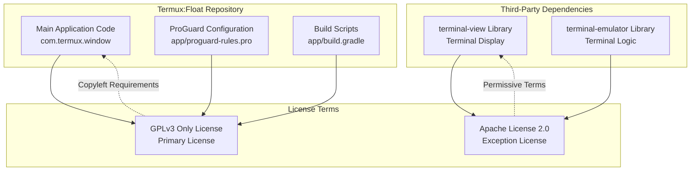
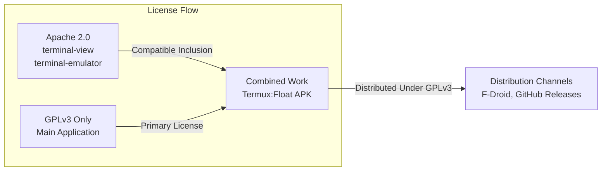
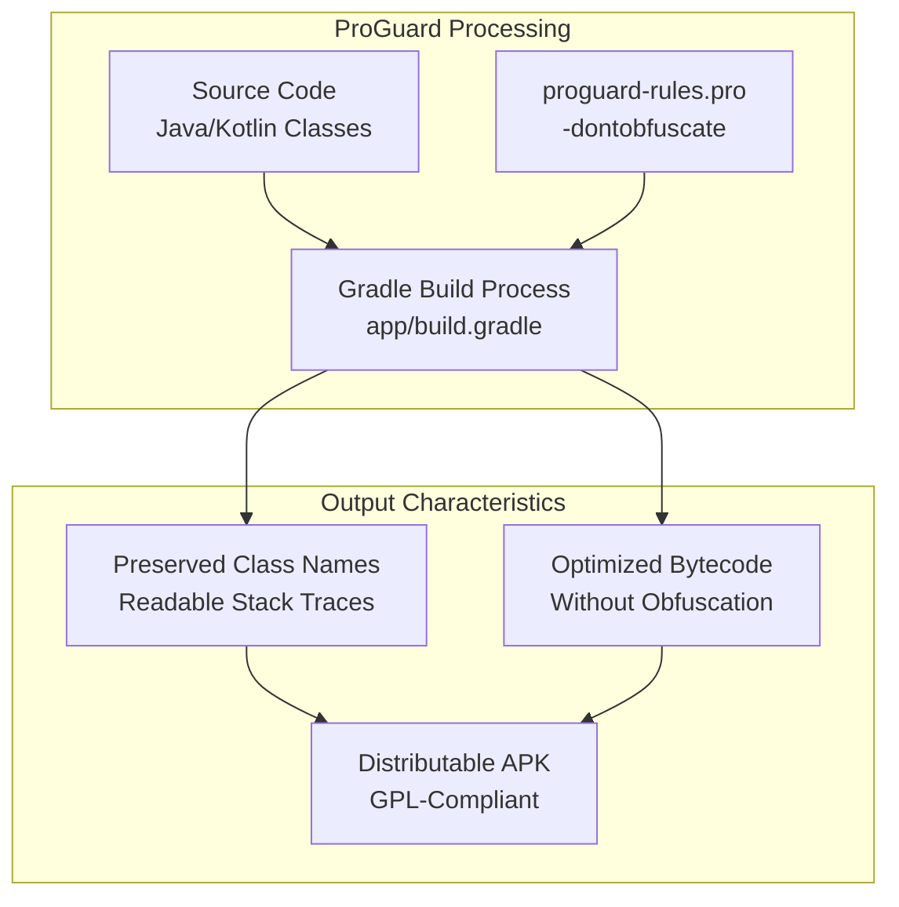

<!-- source: DeepWiki mcp.deepwiki.com · repo termux/termux-float · page 6.3 Licensing · fetched 2026-10-26 -->

# Licensing

<details>
<summary>Relevant source files</summary>

The following files were used as context for generating this wiki page:

- [LICENSE.md](LICENSE.md)
- [app/proguard-rules.pro](app/proguard-rules.pro)

</details>


This document covers the licensing terms, legal framework, and code distribution policies for Termux:Float. It details the primary GPLv3 license, exceptions for third-party components, and ProGuard configuration that affects code distribution. For information about distribution channels and release processes, see [CI/CD Pipeline](#4.2).

## License Overview

Termux:Float follows a clear licensing structure with the main codebase under GPLv3 and specific exceptions for third-party components. The licensing model affects both development practices and distribution policies.

### License Structure



**License Distribution Across Components**

Sources: [LICENSE.md:1-6]()

## Primary License: GPLv3 Only

The main Termux:Float repository operates under the GNU General Public License version 3 (GPLv3) only. This license choice enforces strong copyleft requirements for the core application code.

### GPLv3 Scope

The GPLv3 license applies to:
- All application source code in `com.termux.window` package
- Build configuration files
- ProGuard rules and optimization settings
- Custom UI components and floating window implementation
- Integration code with the Termux ecosystem

The "GPLv3 only" designation means the code cannot be redistributed under later GPL versions, providing license stability for the project.

Sources: [LICENSE.md:1]()

## License Exceptions

### Terminal Emulator Components

Termux:Float includes components from the Terminal Emulator for Android project, which are licensed under Apache License 2.0. This creates a mixed licensing environment where different components operate under different terms.

| Component | License | Source Project |
|-----------|---------|----------------|
| `terminal-view` library | Apache License 2.0 | Android Terminal Emulator |
| `terminal-emulator` library | Apache License 2.0 | Android Terminal Emulator |
| Main application code | GPLv3 only | Termux:Float |

### License Compatibility

The combination of GPLv3 and Apache 2.0 licenses is legally compatible for distribution. The Apache-licensed components can be included in GPLv3 projects, but the resulting combined work must be distributed under GPLv3 terms.



Sources: [LICENSE.md:3-6]()

## ProGuard Configuration and Code Distribution

### Code Obfuscation Policy

The ProGuard configuration includes a specific directive that affects how the code is distributed and relates to licensing compliance:

```
-dontobfuscate
```

This configuration choice has several licensing implications:

#### Transparency Requirements
The `-dontobfuscate` flag ensures that:
- Class names remain readable in distributed APKs
- Method signatures are preserved
- Stack traces maintain meaningful names
- GPL compliance is easier to verify

#### GPL Compliance Benefits
By not obfuscating code, Termux:Float maintains transparency that aligns with GPL principles:
- Source code correspondence is clearer
- Debugging and development are more accessible
- License compliance auditing is simplified

### ProGuard Rules Structure



Sources: [app/proguard-rules.pro:10]()

## Distribution and Legal Framework

### Open Source Distribution Model

Termux:Float follows an open source distribution model that respects both license requirements:

1. **Source Code Availability**: Full source code is available on GitHub
2. **Binary Distribution**: Pre-built APKs through F-Droid and GitHub Releases
3. **License Documentation**: Clear license information in repository root
4. **Dependency Attribution**: Proper attribution for Apache-licensed components

### Compliance Mechanisms

The project maintains license compliance through:
- Explicit license documentation in [LICENSE.md:1-6]()
- ProGuard configuration that preserves code transparency
- Clear separation of differently-licensed components
- Automated build processes that maintain license integrity

This licensing framework ensures that Termux:Float can be freely distributed while respecting the terms of both GPLv3 and Apache License 2.0 for their respective components.

Sources: [LICENSE.md:1-6](), [app/proguard-rules.pro:1-11]()