# Page: Overview

# Overview

<details>
<summary>Relevant source files</summary>

The following files were used as context for generating this wiki page:

- [README.md](README.md)

</details>


This document provides an introduction to Termux:Float, explaining its purpose as a floating terminal window plugin for the Termux ecosystem, its core architecture, and key capabilities. For installation instructions, see [Installation](#2.1). For detailed configuration options, see [Configuration](#2.2). For in-depth architectural details, see [Architecture](#3).

## Purpose and Scope

Termux:Float is an Android plugin application that extends the [Termux](https://termux.dev) terminal emulator by providing floating window functionality. It allows users to run terminal sessions in resizable, movable overlay windows that can be displayed on top of other applications, enabling multitasking and persistent terminal access across the Android interface.

The application integrates deeply with the main Termux app through shared user ID (`android:sharedUserId="com.termux"`) and shared libraries, while maintaining its own specialized floating window management system.

Sources: [README.md:6]()

## Core Architecture Overview

Termux:Float is built around a service-based architecture that manages floating terminal windows through Android's overlay window system. The application consists of several key components that handle initialization, window management, and terminal session integration.

### Application Component Structure

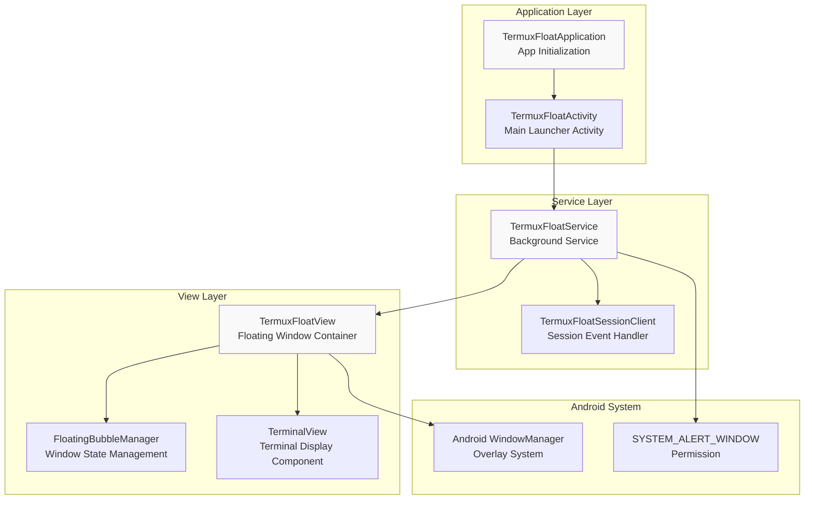

The architecture follows Android's component-based design with clear separation between the application lifecycle (`TermuxFloatApplication`), user interface entry point (`TermuxFloatActivity`), background processing (`TermuxFloatService`), and floating window presentation (`TermuxFloatView`).

Sources: Based on architectural diagrams provided in context

### Termux Ecosystem Integration

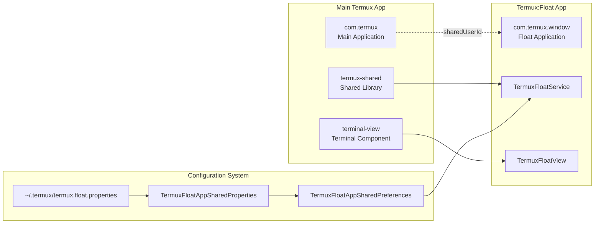

The integration leverages Android's `sharedUserId` mechanism to share data and permissions with the main Termux application, while using shared libraries (`termux-shared`, `terminal-view`) for common terminal functionality.

Sources: [README.md:6](), based on architectural diagrams

## Key Capabilities

### Floating Window Management

| Feature | Description | Implementation |
|---------|-------------|----------------|
| **Overlay Windows** | System-level floating windows | `TermuxFloatView` with `WindowManager.LayoutParams.TYPE_APPLICATION_OVERLAY` |
| **Window States** | Normal, minimized (bubble), hidden | `FloatingBubbleManager` state management |
| **User Interaction** | Touch, drag, resize, long-press actions | Custom touch handling in `TermuxFloatView` |
| **Multi-window** | Multiple concurrent floating terminals | Service-managed window instances |

### Terminal Session Integration

The floating windows provide full terminal functionality through integration with Termux's terminal emulation system:

- **Session Management**: `TermuxFloatSessionClient` handles terminal session lifecycle
- **Input Processing**: Touch and keyboard input forwarded to terminal sessions  
- **Output Rendering**: Real-time terminal output display in floating windows
- **Configuration**: Support for Termux terminal properties via `~/.termux/termux.float.properties`

### System Integration Features

- **Permissions**: Requires `SYSTEM_ALERT_WINDOW` permission for overlay functionality
- **Notifications**: Persistent notification for service management
- **Background Processing**: Service continues running when windows are minimized
- **Multi-tasking**: Floating terminals work alongside other Android applications

Sources: [README.md:55-64]()

## Distribution and Versioning

Termux:Float is distributed through multiple channels with version `v0.15.0` as the latest stable release:

- **F-Droid**: Official open-source distribution channel
- **GitHub Releases**: Direct APK downloads for versions ≥ 0.15.0  
- **GitHub Actions**: Development builds from continuous integration
- **Google Play Store**: Deprecated due to Android 10 compatibility issues

The application uses semantic versioning and maintains compatibility with the main Termux app through shared dependencies and consistent API usage.

Sources: [README.md:24-50]()

## Configuration and Customization

Termux:Float supports terminal customization through the `~/.termux/termux.float.properties` configuration file, enabling users to configure:

| Property | Purpose |
|----------|---------|
| `enforce-char-based-input` | Input method handling |
| `ctrl-space-workaround` | Keyboard combination fixes |
| `bell-character` | Terminal bell behavior |
| `terminal-cursor-style` | Cursor appearance |
| `terminal-transcript-rows` | Scrollback buffer size |
| `back-key` | Hardware back key behavior |
| `default-working-directory` | Initial directory |
| `volume-keys` | Volume key bindings |

Sources: [README.md:55-64]()

For detailed setup instructions, see [Getting Started](#2). For architectural deep-dives, see [Architecture](#3). For development information, see [Development](#6).

---

# Page: Getting Started

# Getting Started

<details>
<summary>Relevant source files</summary>

The following files were used as context for generating this wiki page:

- [README.md](README.md)

</details>


This document provides an overview of how to install, configure, and start using Termux:Float. It covers the essential steps needed to get the floating terminal window running on your Android device, from initial installation through basic configuration and first use.

For detailed installation instructions from specific sources, see [Installation](#2.1). For comprehensive configuration options and property settings, see [Configuration](#2.2).

## Prerequisites

Before installing Termux:Float, you must have the main Termux application installed and properly configured. Termux:Float is a plugin application that extends Termux functionality and cannot operate independently.

**Required Components:**
- Main Termux app (installed and functional)
- Android system permissions for overlay windows (`SYSTEM_ALERT_WINDOW`)
- Compatible Android version (API level support varies by distribution channel)

## Installation Overview

Termux:Float can be installed from three primary sources, each with different characteristics:

| Source | Compatibility | Update Frequency | Signing Key |
|--------|--------------|------------------|-------------|
| F-Droid | F-Droid builds only | Weekly (delayed) | F-Droid key |
| GitHub Releases | GitHub builds only | On release | Debug key |
| GitHub Actions | GitHub builds only | Per commit | Debug key |

**Important:** APKs from different sources use different signing keys and are not interchangeable. Choose one source and stick with it for updates.

Sources: [README.md:22-50]()

## Application Startup Flow

The following diagram shows the initialization sequence when Termux:Float starts, including the key classes and Android system interactions involved:

### Termux:Float Initialization Sequence

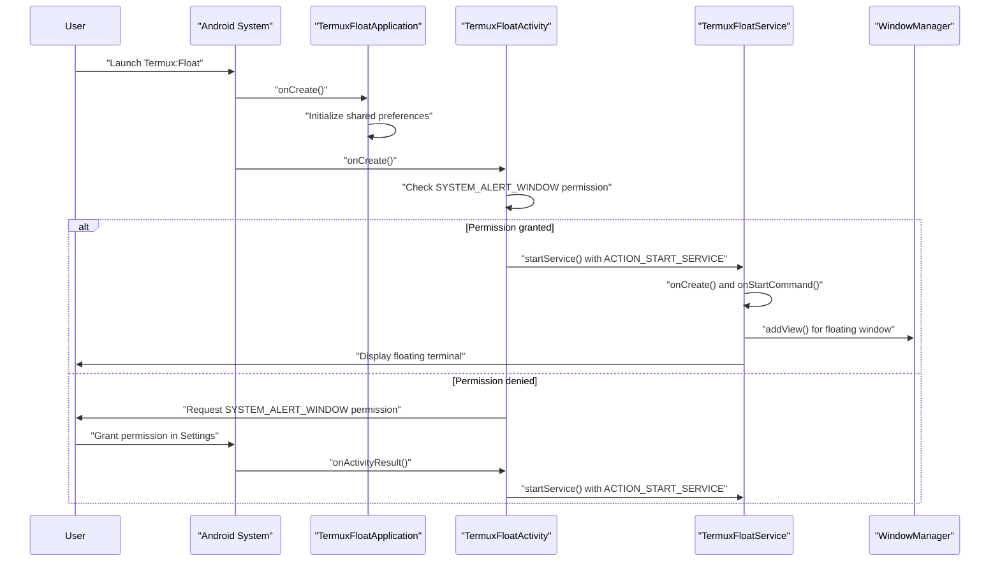

Sources: [README.md:6](), System architecture diagrams provided

## Basic Configuration Setup

Termux:Float uses a properties file system similar to the main Termux app. Configuration is managed through the `~/.termux/termux.float.properties` file and Android shared preferences.

### Configuration File Location and Creation

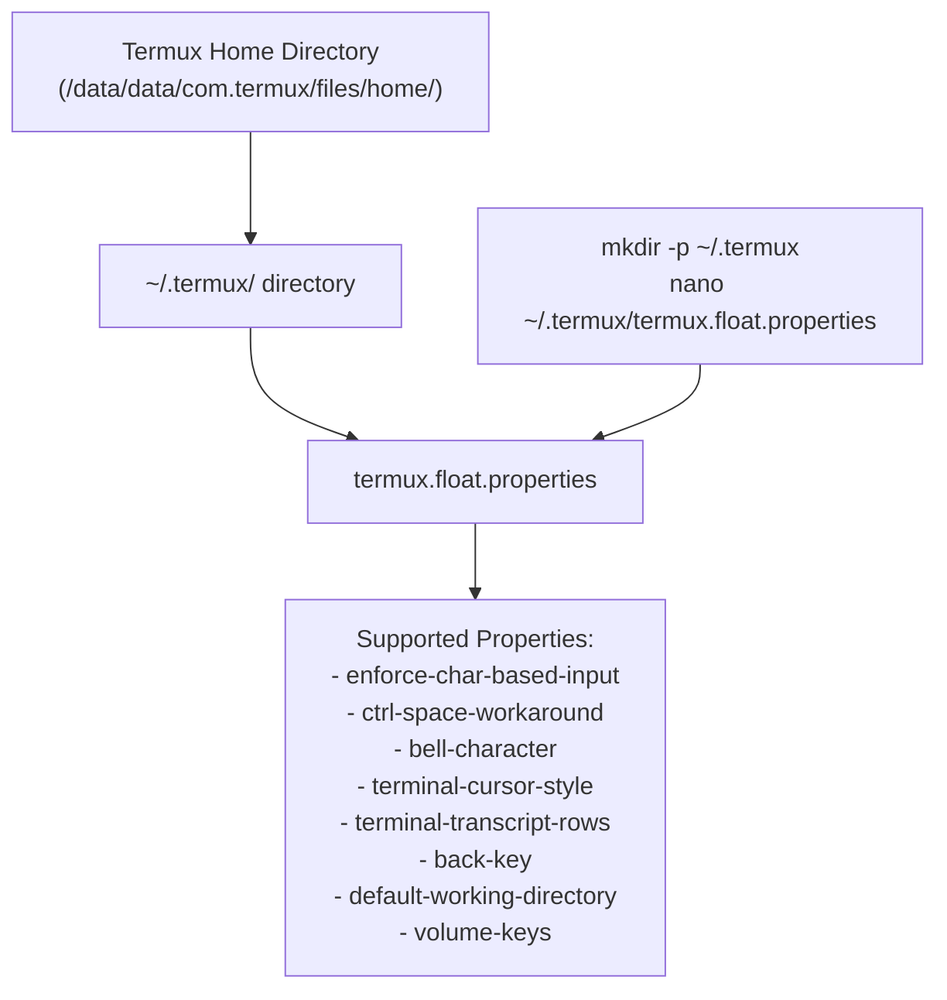

The configuration file must be created manually as it doesn't exist by default. Use the following commands in a Termux terminal:

```bash
mkdir -p ~/.termux
nano ~/.termux/termux.float.properties
```

Sources: [README.md:55-64]()

## First Launch Process

After installation, the first launch involves several system interactions and user decisions:

### Initial Launch Flow with Permission Handling

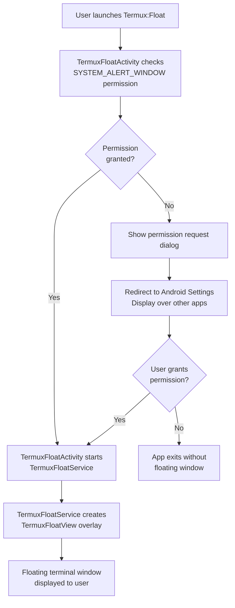

Sources: [README.md:6](), System architecture diagrams provided

## Basic Usage Patterns

Once running, Termux:Float operates as a floating overlay window with several interaction modes:

**Window States:**
- **Full Window**: Complete terminal interface with keyboard input
- **Bubble Mode**: Minimized floating button for quick access
- **Hidden**: Service continues running but window not visible

**Common Actions:**
- Touch inside window: Focus terminal for input
- Touch outside window: Unfocus terminal
- Long press: Enable window movement/resizing
- Minimize gesture: Convert to bubble mode
- Exit action: Stop service and remove overlay

## Debugging and Troubleshooting

Termux:Float supports configurable logging levels for troubleshooting issues. Log levels are set through the main Termux app settings under `Termux:Float` → `Debugging` → `Log Level`.

**Available Log Levels:**
- `Off`: No logging output
- `Normal`: Error, warning, and info messages (default)
- `Debug`: Additional debug information
- `Verbose`: Comprehensive logging (may include sensitive data)

View logs using `logcat` command in terminal or ADB connection from a PC.

Sources: [README.md:70-81]()

## Next Steps

After completing basic setup:

1. **Detailed Installation**: For comprehensive installation instructions including source-specific considerations, see [Installation](#2.1)

2. **Advanced Configuration**: For complete property file configuration options and Android manifest permissions, see [Configuration](#2.2)

3. **Architecture Understanding**: To understand the underlying system components and their relationships, see [Architecture](#3)

The floating terminal window should now be operational and ready for regular terminal usage with the added convenience of overlay functionality.

---

# Page: Installation

# Installation

<details>
<summary>Relevant source files</summary>

The following files were used as context for generating this wiki page:

- [README.md](README.md)

</details>


This document provides comprehensive instructions for installing Termux:Float from various distribution channels. It covers prerequisites, installation methods, version compatibility, and verification steps.

For information about configuring Termux:Float after installation, see [Configuration](#2.2). For details about the build system and distribution pipeline, see [CI/CD Pipeline](#4.2).

## Prerequisites

Before installing Termux:Float, ensure you have the main Termux application properly installed and configured. Termux:Float is a plugin application that requires the primary Termux app to function.

| Requirement | Details |
|-------------|---------|
| Termux App | Must be installed from the same source as Termux:Float |
| Android Version | Compatible with Android versions supported by Termux |
| System Permissions | `SYSTEM_ALERT_WINDOW` permission required for floating windows |
| Storage Space | Minimal additional space beyond base Termux installation |

**Important**: Termux and Termux:Float must be installed from the same distribution source to ensure compatibility due to Android's `sharedUserId` requirement.

Sources: [README.md:26]()

## Distribution Channels

### Installation Flow Decision Tree

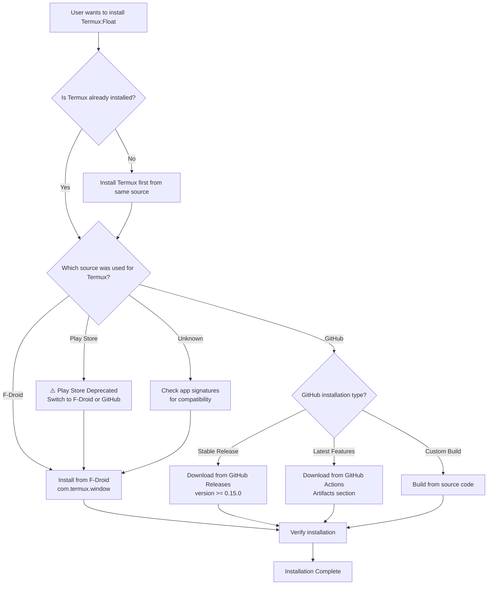

Sources: [README.md:22-51]()

### F-Droid Installation

F-Droid provides the most stable and user-friendly installation method for Termux:Float.

**Installation Steps:**
1. Navigate to the [F-Droid package page](https://f-droid.org/en/packages/com.termux.window)
2. Download the APK directly using the "Download APK" link
3. Install the APK file on your device
4. Grant necessary permissions when prompted

**Key Characteristics:**
- **Package Name**: `com.termux.window`
- **Update Frequency**: Updates typically appear within days to weeks after GitHub releases
- **Signing**: Uses F-Droid's independent signing keys
- **Compatibility**: Only compatible with F-Droid Termux installations

**Update Detection**: F-Droid app may not automatically notify of updates. Manual refresh in the Updates tab may be required, and ensure battery optimizations are disabled for the F-Droid app.

Sources: [README.md:28-36]()

### GitHub Releases

GitHub Releases provide official builds directly from the Termux maintainers for stable versions.

**Installation Steps:**
1. Visit [GitHub Releases page](https://github.com/termux/termux-float/releases)
2. Locate the latest release (version >= 0.15.0)
3. Expand the "Assets" section
4. Download the APK file
5. Install on your device

**Key Characteristics:**
- **Availability**: Versions 0.15.0 and later
- **Build Type**: Debuggable APKs
- **Signing**: Signed with Termux maintainer keys
- **Compatibility**: Compatible with GitHub Actions builds only

### GitHub Actions Artifacts

GitHub Actions provide development builds for testing latest features and pull requests.

**Installation Steps:**
1. Visit [GitHub Actions workflow runs](https://github.com/termux/termux-float/actions/workflows/github_action_build.yml?query=branch%3Amaster+event%3Apush)
2. Select desired workflow run
3. **Login Required**: Ensure you are logged into GitHub
4. Download APK from "Artifacts" section
5. Install on your device

**Key Characteristics:**
- **Build Frequency**: Created for each commit/push
- **Access Requirement**: GitHub account login required
- **Build Type**: Debuggable APKs
- **Use Case**: Testing latest features and pull request changes

**Browser Compatibility**: Use desktop browsers (Chrome, Firefox) with logged-in GitHub accounts rather than mobile app browsers.

Sources: [README.md:38-46]()

### Building from Source

For advanced users who want to build custom versions or contribute to development.

**Prerequisites:**
- Android SDK and build tools
- Gradle build system
- Git for source code management

**Build Process:**
1. Clone the repository: `git clone https://github.com/termux/termux-float.git`
2. Navigate to project directory
3. Build using Gradle wrapper: `./gradlew assembleDebug`
4. Install generated APK from `app/build/outputs/apk/debug/`

For detailed build setup instructions, see [Development Setup](#6.1).

Sources: [README.md:1]()

## Version Compatibility Matrix

Different distribution channels use different signing keys, making them incompatible with each other.

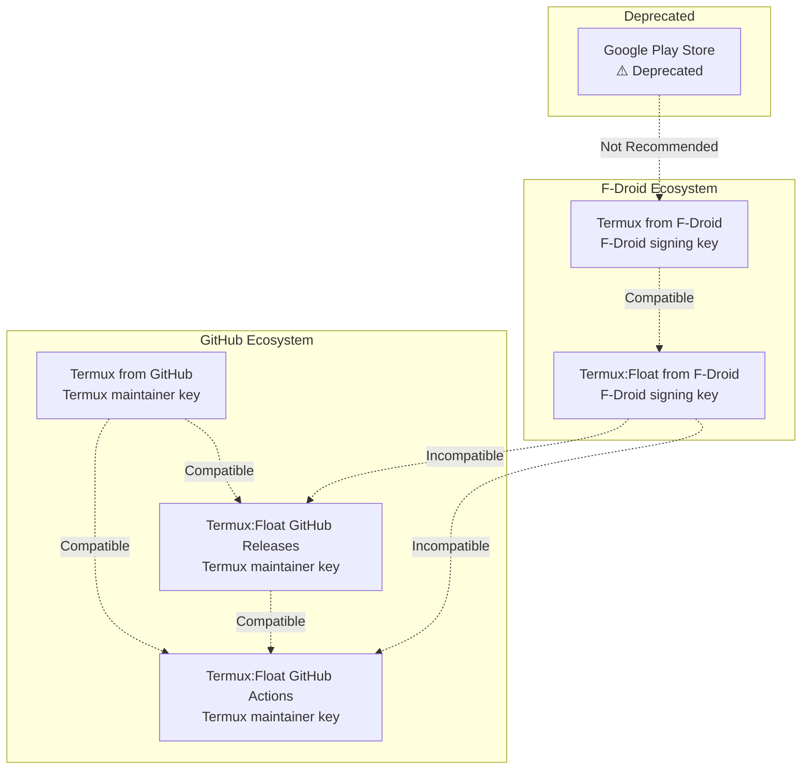

| Source Combination | Compatibility | Notes |
|-------------------|---------------|--------|
| F-Droid Termux + F-Droid Termux:Float | ✅ Compatible | Recommended for most users |
| GitHub Termux + GitHub Termux:Float | ✅ Compatible | Latest features, debuggable builds |
| F-Droid Termux + GitHub Termux:Float | ❌ Incompatible | Different signing keys |
| Play Store Termux + Any Termux:Float | ⚠️ Deprecated | Migrate to F-Droid or GitHub |

Sources: [README.md:34-46]()

## Installation Verification

After installing Termux:Float, verify the installation was successful:

1. **Launch Application**: Find "Termux:Float" in your app drawer
2. **Permission Grant**: Grant `SYSTEM_ALERT_WINDOW` permission when prompted
3. **Floating Window**: Confirm the floating terminal window appears
4. **Terminal Functionality**: Test basic terminal commands
5. **Version Check**: Verify the installed version matches your expected version

**Troubleshooting Common Issues:**
- **Permission Denied**: Ensure `SYSTEM_ALERT_WINDOW` permission is granted in Android settings
- **App Won't Start**: Verify Termux main app is installed from the same source
- **Compatibility Issues**: Check that both apps use the same signing key source

## Latest Version Information

The current latest version is **v0.15.0**. This version introduced support for the `~/.termux/termux.float.properties` configuration file and various terminal settings.

For configuration options available in the latest version, see [Configuration](#2.2).

Sources: [README.md:24](), [README.md:57]()

---

# Page: Configuration

# Configuration

<details>
<summary>Relevant source files</summary>

The following files were used as context for generating this wiki page:

- [README.md](README.md)
- [app/src/main/AndroidManifest.xml](app/src/main/AndroidManifest.xml)
- [app/src/main/java/com/termux/window/settings/properties/TermuxFloatAppSharedProperties.java](app/src/main/java/com/termux/window/settings/properties/TermuxFloatAppSharedProperties.java)

</details>


This document covers the configuration mechanisms available in Termux:Float, including properties file configuration, Android system permissions, and debugging settings. Configuration in Termux:Float follows similar patterns to the main Termux application while adding floating window-specific settings.

For information about build configuration and Gradle settings, see [Gradle Configuration](#4.1). For UI-related configuration such as layouts and themes, see [Views and Layouts](#5.1).

## Configuration System Overview

Termux:Float uses multiple configuration sources that work together to provide a flexible configuration system. The configuration is handled through shared properties inherited from the main Termux ecosystem.

### Configuration Architecture

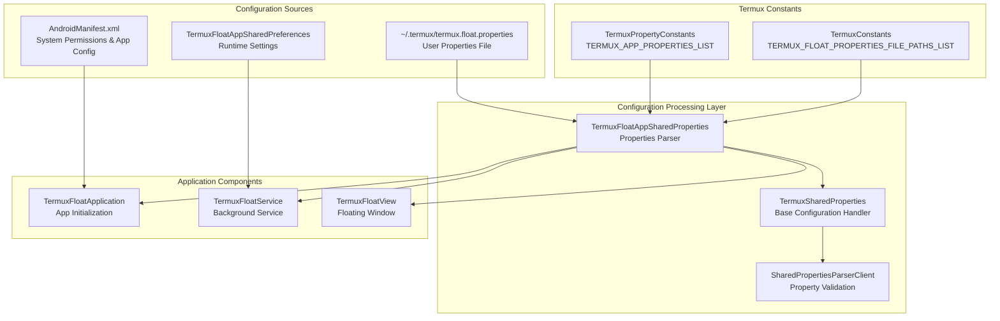

**Sources:** [app/src/main/java/com/termux/window/settings/properties/TermuxFloatAppSharedProperties.java:1-22](), [app/src/main/AndroidManifest.xml:1-39](), [README.md:55-64]()

### Configuration Hierarchy

The configuration system operates with the following precedence order:

| Priority | Source | Purpose | Example |
|----------|--------|---------|---------|
| 1 | Runtime Settings | Dynamic app behavior | Log levels, window state |
| 2 | Properties File | User customization | Terminal settings, key bindings |
| 3 | Android Manifest | System-level configuration | Permissions, shared user ID |
| 4 | Default Values | Fallback configuration | Built-in defaults |

**Sources:** [app/src/main/java/com/termux/window/settings/properties/TermuxFloatAppSharedProperties.java:15-20]()

## Properties File Configuration

Termux:Float supports user configuration through the `~/.termux/termux.float.properties` file, similar to the main Termux application's configuration system.

### Supported Properties

The following properties are supported in the configuration file:

| Property | Purpose | Default | Example Values |
|----------|---------|---------|----------------|
| `enforce-char-based-input` | Input method behavior | `false` | `true`, `false` |
| `ctrl-space-workaround` | Ctrl+Space key handling | `false` | `true`, `false` |
| `bell-character` | Terminal bell behavior | `beep` | `beep`, `vibrate`, `ignore` |
| `terminal-cursor-style` | Cursor appearance | `block` | `block`, `underline`, `bar` |
| `terminal-transcript-rows` | Scrollback buffer size | `2000` | `1000`, `5000`, `10000` |
| `back-key` | Back key behavior | `escape` | `escape`, `back` |
| `default-working-directory` | Initial directory | `$HOME` | `/sdcard`, `$HOME/projects` |
| `volume-keys` | Volume key function | `volume` | `volume`, `cursor` |

### Configuration File Management

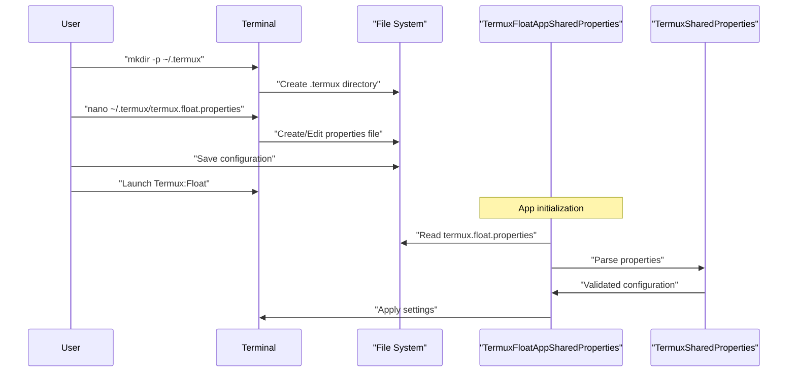

**Sources:** [README.md:57-64](), [app/src/main/java/com/termux/window/settings/properties/TermuxFloatAppSharedProperties.java:15-20]()

### Creating Configuration Files

Users can create and edit the properties file using the following commands:

```bash
mkdir -p ~/.termux
nano ~/.termux/termux.float.properties
```

The file can also be edited using a SAF (Storage Access Framework) file browser after creation.

**Sources:** [README.md:61-64]()

## Android Manifest Configuration

The Android manifest defines system-level configuration including permissions and application structure.

### Required Permissions

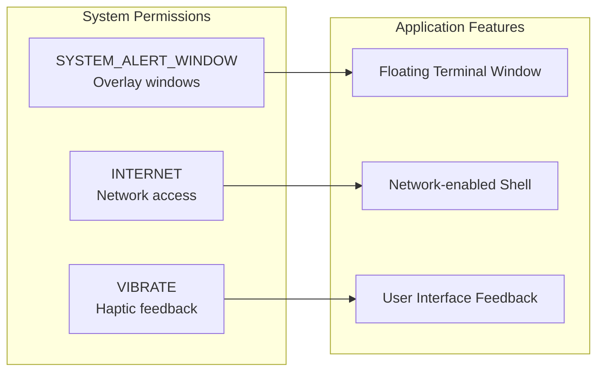

The manifest defines three critical permissions:

- `android.permission.INTERNET` - Required for network operations in terminal sessions
- `android.permission.SYSTEM_ALERT_WINDOW` - Essential for floating window overlay functionality
- `android.permission.VIBRATE` - Enables haptic feedback for user interactions

**Sources:** [app/src/main/AndroidManifest.xml:8-10]()

### Shared User ID Configuration

Termux:Float uses a shared user ID with the main Termux application:

```xml
android:sharedUserId="${TERMUX_PACKAGE_NAME}"
```

This configuration enables:
- Shared data access between Termux and Termux:Float
- Common security context
- Integrated permission model

**Sources:** [app/src/main/AndroidManifest.xml:4]()

### Application Components

The manifest defines the following key components:

| Component | Type | Purpose | Theme |
|-----------|------|---------|-------|
| `TermuxFloatActivity` | Activity | Main launcher activity | `Theme.NoDisplay` |
| `TermuxFloatPermissionActivity` | Activity | Permission request handling | `Theme.Material` |
| `TermuxFloatService` | Service | Background floating window service | N/A |

**Sources:** [app/src/main/AndroidManifest.xml:20-36]()

## Debugging Configuration

Termux:Float provides configurable logging levels for debugging purposes, managed through the main Termux application settings.

### Log Level Configuration

Debug settings are accessed through: `Termux app settings → Termux:Float → Debugging → Log Level`

Available log levels:

| Level | Purpose | Information Logged |
|-------|---------|-------------------|
| `Off` | No logging | Nothing |
| `Normal` | Standard logging | Errors, warnings, info messages, stack traces |
| `Debug` | Development logging | Debug messages + Normal level |
| `Verbose` | Detailed logging | Verbose messages + Debug level |

### Debugging Workflow

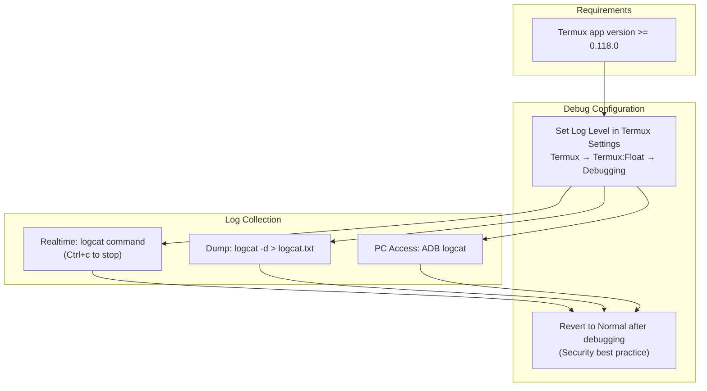

**Sources:** [README.md:70-80]()

### Security Considerations

The verbose logging level may expose private data in log output during normal operation. It's recommended to:

1. Use verbose logging only during active debugging
2. Revert to normal log level after debugging completion
3. Be aware that verbose logging increases execution time

**Sources:** [README.md:72-73]()

## Configuration Implementation Details

The configuration system is implemented through the `TermuxFloatAppSharedProperties` class, which extends the shared Termux configuration infrastructure.

### Properties Class Hierarchy

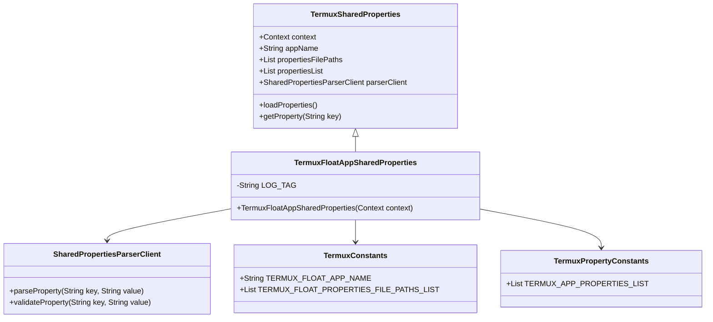

The `TermuxFloatAppSharedProperties` constructor initializes the configuration system with:

- App name from `TermuxConstants.TERMUX_FLOAT_APP_NAME`
- Properties file paths from `TermuxConstants.TERMUX_FLOAT_PROPERTIES_FILE_PATHS_LIST`
- Supported properties from `TermuxPropertyConstants.TERMUX_APP_PROPERTIES_LIST`
- Property parser client for validation

**Sources:** [app/src/main/java/com/termux/window/settings/properties/TermuxFloatAppSharedProperties.java:15-20]()

---

# Page: Architecture

# Architecture

<details>
<summary>Relevant source files</summary>

The following files were used as context for generating this wiki page:

- [app/src/main/java/com/termux/window/TermuxFloatApplication.java](app/src/main/java/com/termux/window/TermuxFloatApplication.java)
- [app/src/main/java/com/termux/window/TermuxFloatService.java](app/src/main/java/com/termux/window/TermuxFloatService.java)

</details>


This document provides an overview of the Termux:Float system architecture, explaining how the core components interact to provide floating terminal window functionality. It covers the high-level design patterns, service-based architecture, and integration points with the Android system and Termux ecosystem.

For detailed information about specific components, see [Core Components](#3.1). For floating window implementation details, see [Floating Window System](#3.2). For terminal session integration specifics, see [Terminal Integration](#3.3).

## System Overview

Termux:Float implements a service-based architecture that leverages Android's overlay window system to provide floating terminal functionality. The application integrates with the broader Termux ecosystem through shared libraries while maintaining its own specialized floating window management system.

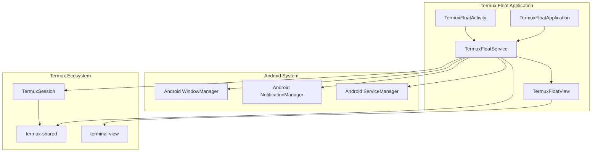

Sources: [app/src/main/java/com/termux/window/TermuxFloatService.java:1-252](), [app/src/main/java/com/termux/window/TermuxFloatApplication.java:1-39]()

## Service-Based Architecture

The core architecture centers around `TermuxFloatService`, which runs as a foreground Android service to maintain the floating window and terminal session lifecycle. This service manages all floating window operations and coordinates between the UI layer and terminal emulation layer.

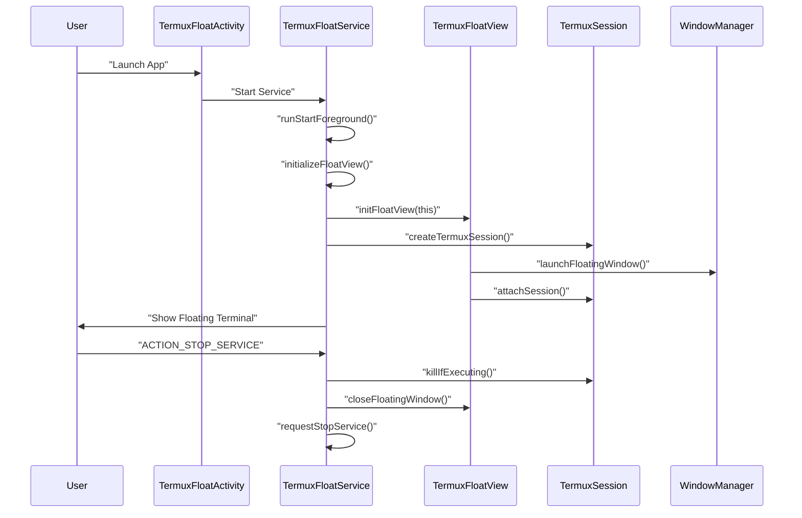

Sources: [app/src/main/java/com/termux/window/TermuxFloatService.java:50-88](), [app/src/main/java/com/termux/window/TermuxFloatService.java:172-203]()

## Component Relationships

The application follows a layered architecture with clear separation of concerns:

| Layer | Components | Responsibilities |
|-------|------------|-----------------|
| **Application Layer** | `TermuxFloatApplication` | Application initialization, logging configuration, crash handling |
| **Service Layer** | `TermuxFloatService` | Service lifecycle, floating window management, terminal session coordination |
| **UI Layer** | `TermuxFloatView`, `TermuxFloatActivity` | Floating window display, user interaction, overlay window management |
| **Terminal Layer** | `TermuxSession`, `TerminalSession` | Terminal emulation, shell process management, session state |
| **Integration Layer** | `TermuxFloatSessionClient`, shared libraries | Event handling, Termux ecosystem integration |

## Service Lifecycle Management

The `TermuxFloatService` implements a comprehensive lifecycle management system that handles foreground service operations, notification management, and resource cleanup.

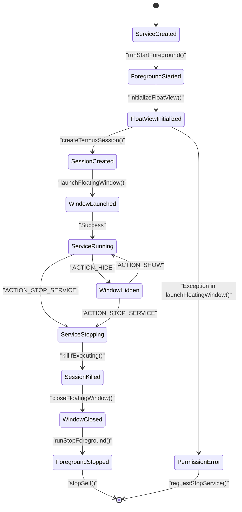

Sources: [app/src/main/java/com/termux/window/TermuxFloatService.java:44-48](), [app/src/main/java/com/termux/window/TermuxFloatService.java:90-112](), [app/src/main/java/com/termux/window/TermuxFloatService.java:114-123]()

## Integration Points

Termux:Float integrates with multiple external systems:

### Termux Ecosystem Integration
- Uses `termux-shared` library for shared utilities, logging, and shell environment management
- Integrates with `terminal-view` for terminal display components
- Leverages `TermuxSession` for session management and execution command handling
- Shares user ID (`sharedUserId`) with main Termux application for seamless integration

### Android System Integration
- **WindowManager**: Manages overlay windows through `SYSTEM_ALERT_WINDOW` permission
- **NotificationManager**: Maintains foreground service notification with show/hide/exit actions
- **ServiceManager**: Handles service lifecycle and background execution

### Configuration System
- `TermuxFloatAppSharedPreferences` for user settings persistence
- `TermuxFloatAppSharedProperties` for application property management
- Integration with `~/.termux/termux.float.properties` configuration file

Sources: [app/src/main/java/com/termux/window/TermuxFloatService.java:18-27](), [app/src/main/java/com/termux/window/TermuxFloatApplication.java:30-37]()

## Error Handling and Permissions

The architecture includes robust error handling, particularly around Android overlay permissions:

- **Permission Detection**: Catches exceptions when launching floating windows instead of relying on `Settings.canDrawOverlays()` due to `sharedUserId` complications
- **Graceful Degradation**: Launches `TermuxFloatPermissionActivity` when permissions are insufficient
- **Service Recovery**: Implements `START_NOT_STICKY` policy to prevent automatic restart on failure

The notification system provides user control over window visibility and service termination through persistent notification actions.

Sources: [app/src/main/java/com/termux/window/TermuxFloatService.java:188-197](), [app/src/main/java/com/termux/window/TermuxFloatService.java:134-167]()

---

# Page: Core Components

# Core Components

<details>
<summary>Relevant source files</summary>

The following files were used as context for generating this wiki page:

- [app/src/main/java/com/termux/window/TermuxFloatActivity.java](app/src/main/java/com/termux/window/TermuxFloatActivity.java)
- [app/src/main/java/com/termux/window/TermuxFloatApplication.java](app/src/main/java/com/termux/window/TermuxFloatApplication.java)
- [app/src/main/java/com/termux/window/TermuxFloatPermissionActivity.java](app/src/main/java/com/termux/window/TermuxFloatPermissionActivity.java)
- [app/src/main/java/com/termux/window/TermuxFloatService.java](app/src/main/java/com/termux/window/TermuxFloatService.java)

</details>


This page covers the fundamental application components that form the backbone of Termux:Float. These components handle application lifecycle, service management, and user interface coordination. For information about the floating window implementation details, see [Floating Window System](#3.2). For terminal session management specifics, see [Terminal Integration](#3.3).

## Application Component

The `TermuxFloatApplication` class serves as the main application entry point and handles global initialization tasks. It extends Android's `Application` class and is responsible for setting up system-wide configurations that persist throughout the application lifecycle.

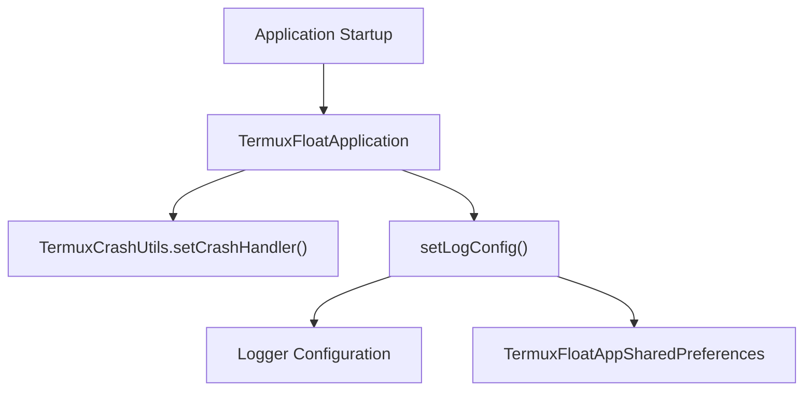

**Application Initialization Flow**

The application performs these key initialization steps during `onCreate()`:

| Step | Function | Purpose |
|------|----------|---------|
| 1 | `TermuxCrashUtils.setCrashHandler()` | Sets up crash reporting and handling |
| 2 | `setLogConfig()` | Configures logging system with preferences |
| 3 | `Logger.setDefaultLogTag()` | Sets default log tag for the application |
| 4 | `TermuxFloatAppSharedPreferences.build()` | Loads user preferences and log levels |

Sources: [app/src/main/java/com/termux/window/TermuxFloatApplication.java:16-37]()

## Activity Component

The `TermuxFloatActivity` functions as a lightweight launcher that immediately delegates to the service layer. This design pattern allows the application to appear in the launcher while keeping the main functionality in a background service.

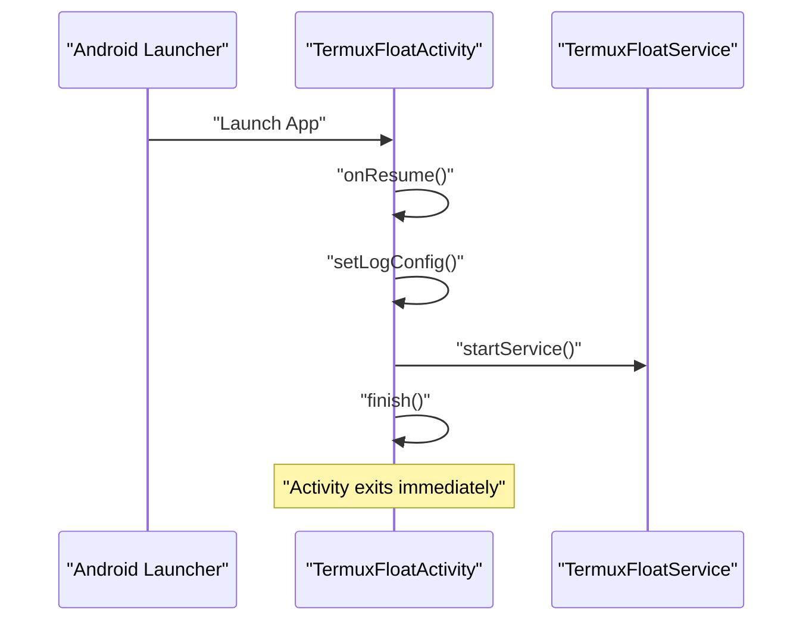

**Activity Lifecycle**

The activity implements a minimal lifecycle:

- **onResume()**: Configures logging, starts `TermuxFloatService`, and terminates itself
- No other lifecycle methods are overridden
- Activity exists only to provide a launcher entry point

Sources: [app/src/main/java/com/termux/window/TermuxFloatActivity.java:12-20]()

## Service Component

The `TermuxFloatService` is the core component that manages the floating terminal window. It extends Android's `Service` class and handles all terminal session management, window operations, and user interactions.

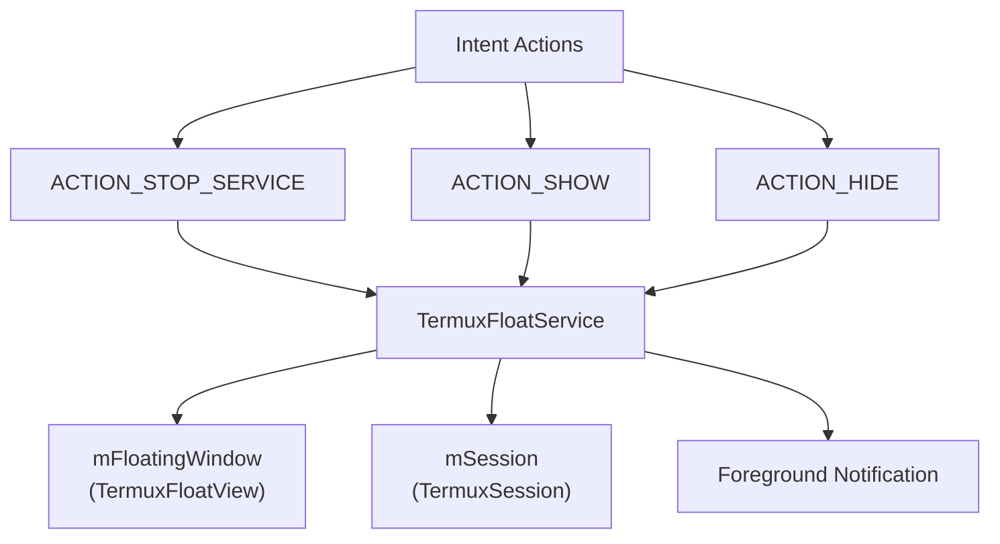

**Service State Management**

| State Variable | Type | Purpose |
|---------------|------|---------|
| `mFloatingWindow` | `TermuxFloatView` | Main floating window instance |
| `mSession` | `TermuxSession` | Current terminal session |
| `mVisibleWindow` | `boolean` | Window visibility state |

**Service Operations**

The service handles these primary operations:

1. **Foreground Management**: Runs as foreground service with persistent notification
2. **Window Management**: Creates and manages the floating window through `initializeFloatView()`
3. **Session Management**: Creates terminal sessions via `createTermuxSession()`
4. **Action Processing**: Responds to intent actions for show/hide/stop operations

**Intent Action Handling**

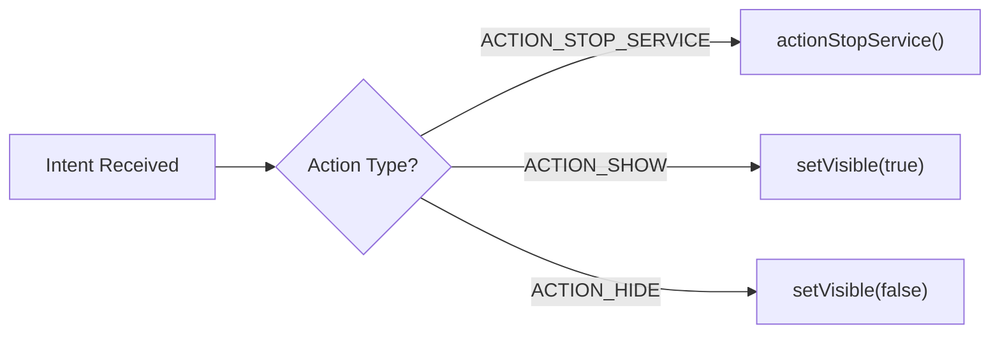

Sources: [app/src/main/java/com/termux/window/TermuxFloatService.java:28-252]()

## Permission Component

The `TermuxFloatPermissionActivity` handles the critical `SYSTEM_ALERT_WINDOW` permission required for displaying overlay windows. This component only activates when permission is not granted and the service cannot initialize the floating window.

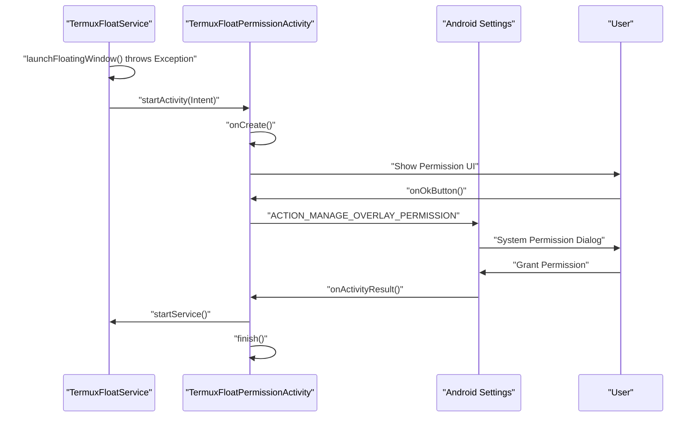

**Permission Flow**

1. **Trigger**: Service detects permission exception during window creation
2. **Request**: Activity launches system settings for overlay permission
3. **Grant**: User grants permission in system settings
4. **Restart**: Activity restarts the service and terminates

Sources: [app/src/main/java/com/termux/window/TermuxFloatPermissionActivity.java:17-33]()

## Component Interactions

The core components interact through a well-defined flow that ensures proper initialization and service management:

```mermaid
graph TB
    subgraph "Application Layer"
        TFA["TermuxFloatApplication<br/>Global Initialization"]
    end
    
    subgraph "Activity Layer"
        TFAct["TermuxFloatActivity<br/>Launcher"]
        TFPA["TermuxFloatPermissionActivity<br/>Permission Handler"]
    end
    
    subgraph "Service Layer"
        TFS["TermuxFloatService<br/>Core Service"]
        FloatView["TermuxFloatView<br/>UI Management"]
        Session["TermuxSession<br/>Terminal Session"]
    end
    
    subgraph "Android System"
        WindowManager["WindowManager<br/>Overlay System"]
        NotificationManager["NotificationManager<br/>Foreground Service"]
    end
    
    TFA -.->|"Initializes"| TFAct
    TFAct -->|"startService()"| TFS
    TFS -->|"Permission Exception"| TFPA
    TFPA -->|"Permission Granted"| TFS
    TFS --> FloatView
    TFS --> Session
    TFS --> WindowManager
    TFS --> NotificationManager
```

**Initialization Sequence**

1. **Application Start**: `TermuxFloatApplication.onCreate()` sets up global configuration
2. **Activity Launch**: `TermuxFloatActivity.onResume()` starts service and exits
3. **Service Creation**: `TermuxFloatService.onCreate()` runs foreground setup
4. **Service Start**: `TermuxFloatService.onStartCommand()` initializes floating window
5. **Permission Check**: If permission missing, launches `TermuxFloatPermissionActivity`
6. **Window Creation**: Service creates `TermuxFloatView` and `TermuxSession`

**Error Handling**

The components implement robust error handling:

- **Permission Errors**: Caught during window creation, redirects to permission activity
- **Service Errors**: Logged and service stops gracefully
- **Crash Handling**: Global crash handler captures and reports exceptions

Sources: [app/src/main/java/com/termux/window/TermuxFloatService.java:188-197](), [app/src/main/java/com/termux/window/TermuxFloatApplication.java:23-24]()

---

# Page: Floating Window System

# Floating Window System

<details>
<summary>Relevant source files</summary>

The following files were used as context for generating this wiki page:

- [app/src/main/java/com/termux/window/FloatingBubbleManager.java](app/src/main/java/com/termux/window/FloatingBubbleManager.java)
- [app/src/main/java/com/termux/window/TermuxFloatView.java](app/src/main/java/com/termux/window/TermuxFloatView.java)

</details>


This document covers the implementation of the floating window system in Termux:Float, which provides the core functionality for displaying a terminal interface as an overlay window that can be moved, resized, and minimized to a bubble. The system manages window positioning, focus states, touch interactions, and the bubble minimization feature.

For information about terminal session integration within the floating window, see [Terminal Integration](#3.3). For details about the core application components that initialize the floating window, see [Core Components](#3.1).

## Overview

The floating window system consists of two primary components: `TermuxFloatView` which manages the floating window display and interaction, and `FloatingBubbleManager` which handles the bubble minimization functionality. The system integrates with Android's `WindowManager` to create an overlay window that can be positioned anywhere on the screen.

**Core Components Architecture**

```mermaid
graph TB
    TFV["TermuxFloatView<br/>(LinearLayout)"]
    FBM["FloatingBubbleManager"]
    WM["Android WindowManager"]
    TV["TerminalView"]
    WC["Window Controls<br/>(minimize/exit buttons)"]
    LP["WindowManager.LayoutParams"]
    
    TFV -->|contains| TV
    TFV -->|contains| WC
    TFV -->|manages| FBM
    TFV -->|updates via| WM
    TFV -->|configures| LP
    FBM -->|modifies| LP
    FBM -->|updates| WM
    
    subgraph "Touch Handling"
        SGD["ScaleGestureDetector<br/>(for resizing)"]
        TH["Touch Event Handler<br/>(for movement)"]
    end
    
    TFV -->|uses| SGD
    TFV -->|implements| TH
```

Sources: [app/src/main/java/com/termux/window/TermuxFloatView.java:1-363](), [app/src/main/java/com/termux/window/FloatingBubbleManager.java:1-149]()

## Window Initialization and Management

The floating window is initialized through `launchFloatingWindow()` which configures the `WindowManager.LayoutParams` for overlay display. The window type is set to `TYPE_APPLICATION_OVERLAY` on Android O+ or `TYPE_PHONE` on older versions.

| Configuration | Value | Purpose |
|---------------|--------|---------|
| Window Type | `TYPE_APPLICATION_OVERLAY` / `TYPE_PHONE` | Overlay permission |
| Format | `PixelFormat.RGBA_8888` | Transparency support |
| Gravity | `Gravity.TOP \| Gravity.LEFT` | Positioning anchor |
| Initial Size | `WRAP_CONTENT` | Auto-sizing |

**Window Lifecycle and State Management**

```mermaid
stateDiagram-v2
    [*] --> Initialized
    Initialized --> Launching : "launchFloatingWindow()"
    Launching --> Focused : "WindowManager.addView()"
    
    state FloatingWindow {
        Focused --> Unfocused : "touch outside"
        Unfocused --> Focused : "touch inside"
        
        Focused --> LongPress : "long press detected"
        LongPress --> Moving : "drag gesture"
        LongPress --> Resizing : "pinch gesture"
        Moving --> Focused : "ACTION_UP"
        Resizing --> Focused : "onScaleEnd()"
        
        Focused --> Minimized : "minimize button"
        Minimized --> Focused : "tap bubble"
    }
    
    FloatingWindow --> Closed : "exit button"
    Closed --> [*] : "WindowManager.removeView()"
```

Sources: [app/src/main/java/com/termux/window/TermuxFloatView.java:181-206](), [app/src/main/java/com/termux/window/TermuxFloatView.java:318-324]()

## Focus and Touch Event Handling

The floating window implements sophisticated touch handling through `onInterceptTouchEvent()` and `onTouchEvent()`. Focus management controls window behavior and keyboard visibility.

**Touch Event Flow**

```mermaid
sequenceDiagram
    participant User
    participant TFV as "TermuxFloatView"
    participant WM as "WindowManager"
    participant Keyboard
    participant FBM as "FloatingBubbleManager"
    
    User->>TFV: "Touch Event"
    TFV->>TFV: "onInterceptTouchEvent()"
    
    alt "Touch Outside Window"
        TFV->>TFV: "changeFocus(false)"
        TFV->>WM: "updateViewLayout() with FLAG_NOT_FOCUSABLE"
        TFV->>Keyboard: "hideSoftKeyboard()"
    else "Touch Inside Window"
        TFV->>TFV: "changeFocus(true)"
        TFV->>WM: "updateViewLayout() without focus flags"
        TFV->>Keyboard: "showSoftKeyboard()"
    else "Long Press + Drag"
        TFV->>TFV: "updateLongPressMode(true)"
        TFV->>TFV: "onTouchEvent() - move window"
        TFV->>WM: "updateViewLayout() with new position"
    else "Pinch Gesture"
        TFV->>TFV: "ScaleGestureDetector.onScale()"
        TFV->>WM: "updateViewLayout() with new size"
    end
```

The system uses three alpha transparency levels to indicate different states:
- `ALPHA_FOCUS = 0.9f` - Window has focus
- `ALPHA_NOT_FOCUS = 0.7f` - Window unfocused  
- `ALPHA_MOVING = 0.5f` - Window being moved/resized

Sources: [app/src/main/java/com/termux/window/TermuxFloatView.java:211-241](), [app/src/main/java/com/termux/window/TermuxFloatView.java:276-298](), [app/src/main/java/com/termux/window/TermuxFloatView.java:302-316]()

## Bubble Minimization System

The `FloatingBubbleManager` provides bubble minimization functionality, allowing the terminal to be collapsed to a small circular bubble that can be expanded back to full window mode.

**Bubble State Transitions**

```mermaid
graph LR
    FW["Floating Window<br/>(full terminal view)"]
    FB["Floating Bubble<br/>(56dp circular)"]
    
    FW -->|"minimize button<br/>displayAsFloatingBubble()"| FB
    FB -->|"tap bubble<br/>displayAsFloatingWindow()"| FW
    
    subgraph "Bubble Transformations"
        CaptureValues["captureOriginalLayoutValues()<br/>preserve width/height/backgrounds"]
        SetBubbleSize["layoutParams.width = BUBBLE_SIZE_PX<br/>layoutParams.height = BUBBLE_SIZE_PX"]
        SetOutline["terminalView.setOutlineProvider()<br/>outline.setOval()"]
        HideControls["windowControls.setVisibility(GONE)"]
    end
    
    subgraph "Window Restoration"
        RestoreSize["layoutParams.width = mOriginalLayoutWidth<br/>layoutParams.height = mOriginalLayoutHeight"]
        RestoreBackground["terminalView.setBackground(mOriginalBackground)"]
        ShowControls["windowControls.setVisibility(VISIBLE)"]
        ClearOutline["terminalView.setOutlineProvider(null)"]
    end
    
    FW --> CaptureValues
    CaptureValues --> SetBubbleSize
    SetBubbleSize --> SetOutline
    SetOutline --> HideControls
    HideControls --> FB
    
    FB --> RestoreSize
    RestoreSize --> RestoreBackground
    RestoreBackground --> ShowControls
    ShowControls --> ClearOutline
    ClearOutline --> FW
```

Key bubble implementation details:
- Default bubble size: `DEFAULT_BUBBLE_SIZE_DP = 56` converted to pixels
- Circular outline using `ViewOutlineProvider` with `setOval()`
- Background resource: `R.drawable.round_button_with_outline`
- Window controls hidden during bubble mode
- Original layout parameters preserved for restoration

Sources: [app/src/main/java/com/termux/window/FloatingBubbleManager.java:38-44](), [app/src/main/java/com/termux/window/FloatingBubbleManager.java:53-84](), [app/src/main/java/com/termux/window/FloatingBubbleManager.java:86-110]()

## Window Controls and User Interface

The floating window includes control buttons for minimize and exit operations, positioned at the top of the window through the `window_controls` ViewGroup.

**Window Controls Integration**

```mermaid
graph TB
    WC["window_controls<br/>(ViewGroup)"]
    MB["minimize_button<br/>(Button)"]
    EB["exit_button<br/>(Button)"]
    
    WC --> MB
    WC --> EB
    
    MB -->|"onClick"| TBF["toggleBubble()"]
    EB -->|"onClick"| EXIT["exit()<br/>→ TermuxFloatService.ACTION_STOP_SERVICE"]
    
    TBF --> FBM["FloatingBubbleManager.toggleBubble()"]
    
    subgraph "Control Visibility Logic"
        CVL["didClickInsideWindowControls()"]
        CVL --> KPH["prevent keyboard popup<br/>on control touches"]
    end
    
    WC -.-> CVL
```

The controls are managed through:
- Click detection to prevent unintended focus changes: `didClickInsideWindowControls()`
- Visibility toggling during bubble mode (hidden when minimized)
- Focus management integration to avoid keyboard popup on control touches

Sources: [app/src/main/java/com/termux/window/TermuxFloatView.java:148-157](), [app/src/main/java/com/termux/window/TermuxFloatView.java:243-253](), [app/src/main/java/com/termux/window/TermuxFloatView.java:326-329]()

## Scaling and Movement Implementation

The window supports both movement through drag gestures and resizing through pinch gestures, implemented via `ScaleGestureDetector` and custom touch handling.

**Gesture Processing Flow**

```mermaid
flowchart TD
    TE["Touch Event"]
    
    TE --> ILP{"isInLongPressState?"}
    
    ILP -->|false| ITI["onInterceptTouchEvent()<br/>handle focus changes"]
    ILP -->|true| OTE["onTouchEvent()<br/>handle movement/scaling"]
    
    OTE --> SGD{"ScaleGestureDetector<br/>isInProgress()?"}
    
    SGD -->|true| SCALE["onScale()<br/>widthChange = currentSpanX - previousSpanX<br/>heightChange = currentSpanY - previousSpanY<br/>layoutParams.width += widthChange<br/>layoutParams.height += heightChange"]
    
    SGD -->|false| MOVE["ACTION_MOVE<br/>layoutParams.x = initialX + (rawX - initialTouchX)<br/>layoutParams.y = initialY + (rawY - initialTouchY)"]
    
    SCALE --> UVL["WindowManager.updateViewLayout()"]
    MOVE --> UVL
    
    UVL --> SP["Save to SharedPreferences<br/>setWindowX(), setWindowY()<br/>setWindowWidth(), setWindowHeight()"]
```

Movement constraints:
- Minimum size: `MIN_SIZE = 50` pixels for both width and height
- Boundary checking: window cannot be moved outside screen bounds
- Position clamping: `Math.max(0, Math.min(DISPLAY_WIDTH - width, x))`

Sources: [app/src/main/java/com/termux/window/TermuxFloatView.java:81-109](), [app/src/main/java/com/termux/window/TermuxFloatView.java:276-298](), [app/src/main/java/com/termux/window/TermuxFloatView.java:264-270]()

---

# Page: Terminal Integration

# Terminal Integration

<details>
<summary>Relevant source files</summary>

The following files were used as context for generating this wiki page:

- [app/src/main/java/com/termux/window/TermuxFloatSessionClient.java](app/src/main/java/com/termux/window/TermuxFloatSessionClient.java)
- [app/src/main/java/com/termux/window/TermuxFloatViewClient.java](app/src/main/java/com/termux/window/TermuxFloatViewClient.java)

</details>


This document explains how Termux:Float integrates with terminal sessions to provide a functional floating terminal experience. It covers the session management architecture, user input handling, and the event flow between the floating window system and the underlying terminal emulation layer.

For information about the floating window implementation itself, see [Floating Window System](#3.2). For details about the core application components, see [Core Components](#3.1).

## Session Management Architecture

The terminal integration in Termux:Float is built around two primary client classes that bridge the floating window system with the terminal emulation layer: `TermuxFloatSessionClient` for session-level events and `TermuxFloatViewClient` for input handling.

### Terminal Session Integration Components

```mermaid
graph TB
    subgraph "Floating Window Layer"
        TFService[TermuxFloatService]
        TFView[TermuxFloatView]
        TerminalView[TerminalView]
    end
    
    subgraph "Integration Layer"
        TFSessionClient[TermuxFloatSessionClient]
        TFViewClient[TermuxFloatViewClient]
    end
    
    subgraph "Terminal Emulation Layer"
        TerminalSession[TerminalSession]
        TerminalEmulator[TerminalEmulator]
        BaseSessionClient[TermuxTerminalSessionClientBase]
        BaseViewClient[TermuxTerminalViewClientBase]
    end
    
    subgraph "Configuration Layer"
        Properties[TermuxFloatAppSharedProperties]
        Preferences[TermuxFloatAppSharedPreferences]
    end
    
    TFService --> TFSessionClient
    TFView --> TFSessionClient
    TFView --> TFViewClient
    TFViewClient --> TFSessionClient
    
    TFSessionClient --> BaseSessionClient
    TFViewClient --> BaseViewClient
    BaseSessionClient --> TerminalSession
    BaseViewClient --> TerminalView
    
    TerminalSession --> TerminalEmulator
    TerminalView --> TerminalEmulator
    
    TFSessionClient --> Properties
    TFViewClient --> Properties
    TFViewClient --> Preferences
```

Sources: [app/src/main/java/com/termux/window/TermuxFloatSessionClient.java:25-39](), [app/src/main/java/com/termux/window/TermuxFloatViewClient.java:15-28]()

The `TermuxFloatSessionClient` extends `TermuxTerminalSessionClientBase` and serves as the primary handler for terminal session events. It maintains references to both the `TermuxFloatService` and `TermuxFloatView` to coordinate between the background service and the user interface.

### Session Lifecycle Management

The session client manages the complete lifecycle of terminal sessions within the floating window context:

```mermaid
sequenceDiagram
    participant TFService as TermuxFloatService
    participant TFView as TermuxFloatView
    participant TFSessionClient as TermuxFloatSessionClient
    participant TerminalSession as TerminalSession
    participant TerminalEmulator as TerminalEmulator
    
    TFView->>TFSessionClient: onAttachedToWindow()
    TFSessionClient->>TFSessionClient: loadBellSoundPool()
    
    TerminalSession->>TFSessionClient: onTextChanged()
    TFSessionClient->>TFView: getTerminalView().onScreenUpdated()
    
    TerminalSession->>TFSessionClient: onSessionFinished()
    TFSessionClient->>TFService: requestStopService()
    
    TerminalSession->>TFSessionClient: onBell()
    TFSessionClient->>TFSessionClient: handleBellBehaviour()
    
    TFView->>TFSessionClient: onDetachedFromWindow()
    TFSessionClient->>TFSessionClient: releaseBellSoundPool()
```

Sources: [app/src/main/java/com/termux/window/TermuxFloatSessionClient.java:44-60](), [app/src/main/java/com/termux/window/TermuxFloatSessionClient.java:72-81]()

Key lifecycle methods include:

- `onAttachedToWindow()` - Initializes resources when the view is attached [app/src/main/java/com/termux/window/TermuxFloatSessionClient.java:44-49]()
- `onDetachedFromWindow()` - Releases resources to prevent memory leaks [app/src/main/java/com/termux/window/TermuxFloatSessionClient.java:54-60]()
- `onSessionFinished()` - Triggers service shutdown when the terminal session ends [app/src/main/java/com/termux/window/TermuxFloatSessionClient.java:79-81]()

## Input Handling System

The `TermuxFloatViewClient` manages all user input interactions with the floating terminal, including keyboard events, gestures, and hardware key mappings.

### Input Event Processing Flow

```mermaid
flowchart TD
    UserInput[User Input Event]
    KeyEvent{Key Event?}
    MotionEvent{Motion Event?}
    
    VirtualKeys[handleVirtualKeys]
    HardwareShortcuts[Hardware Shortcuts Check]
    FnKeyProcessing[onCodePoint with mVirtualFnKeyDown]
    LongPressHandler[onLongPress]
    ScaleHandler[onScale]
    
    VolumeDown[Volume Down → Ctrl]
    VolumeUp[Volume Up → Fn]
    
    CtrlAltShortcuts[Ctrl+Alt Shortcuts]
    FontSize[changeFontSize]
    ToggleKeyboard[toggleSoftKeyboard]
    
    TerminalSession[TerminalSession.write]
    WindowMovement[Update Window Position]
    
    UserInput --> KeyEvent
    UserInput --> MotionEvent
    
    KeyEvent --> VirtualKeys
    KeyEvent --> HardwareShortcuts
    KeyEvent --> FnKeyProcessing
    
    VirtualKeys --> VolumeDown
    VirtualKeys --> VolumeUp
    
    HardwareShortcuts --> CtrlAltShortcuts
    CtrlAltShortcuts --> FontSize
    CtrlAltShortcuts --> ToggleKeyboard
    
    FnKeyProcessing --> TerminalSession
    
    MotionEvent --> LongPressHandler
    MotionEvent --> ScaleHandler
    
    LongPressHandler --> WindowMovement
    ScaleHandler --> FontSize
```

Sources: [app/src/main/java/com/termux/window/TermuxFloatViewClient.java:94-119](), [app/src/main/java/com/termux/window/TermuxFloatViewClient.java:240-255]()

### Virtual Key Mapping

The view client implements a sophisticated virtual key system that allows volume buttons to function as modifier keys:

| Physical Key | Virtual Function | State Variable |
|--------------|------------------|----------------|
| Volume Down | Ctrl Key | `mVirtualControlKeyDown` |
| Volume Up | Fn Key | `mVirtualFnKeyDown` |

Sources: [app/src/main/java/com/termux/window/TermuxFloatViewClient.java:23](), [app/src/main/java/com/termux/window/TermuxFloatViewClient.java:247-252]()

### Function Key Mappings

When the virtual Fn key is active, the view client translates character input into terminal control sequences:

| Character | Function | Key Code/Code Point |
|-----------|----------|---------------------|
| w, a, s, d | Arrow Keys | `KEYCODE_DPAD_*` |
| p, n | Page Up/Down | `KEYCODE_PAGE_*` |
| t | Tab | `KEYCODE_TAB` |
| 1-9, 0 | Function Keys | `KEYCODE_F1`-`KEYCODE_F10` |
| e | Escape | Code Point 27 |
| u, l | Special Characters | `_`, `|` |

Sources: [app/src/main/java/com/termux/window/TermuxFloatViewClient.java:138-235]()

## Event Flow and Integration

The terminal integration handles multiple types of events that flow between the terminal emulation layer and the floating window interface.

### Session Event Handling

```mermaid
graph LR
    subgraph "Terminal Events"
        TextChanged[onTextChanged]
        SessionFinished[onSessionFinished] 
        CopyText[onCopyTextToClipboard]
        PasteText[onPasteTextFromClipboard]
        Bell[onBell]
        ColorsChanged[onColorsChanged]
    end
    
    subgraph "Handler Actions"
        ScreenUpdate[onScreenUpdated]
        StopService[requestStopService]
        ClipboardOps[ClipboardManager Operations]
        BellHandler[Bell Sound/Vibration]
        BackgroundUpdate[updateBackgroundColor]
    end
    
    subgraph "UI Updates"
        TerminalViewUpdate[TerminalView Refresh]
        ServiceShutdown[Service Termination]
        SystemClipboard[System Clipboard]
        AudioFeedback[Audio/Haptic Feedback]
        ColorUpdate[Background Color Change]
    end
    
    TextChanged --> ScreenUpdate --> TerminalViewUpdate
    SessionFinished --> StopService --> ServiceShutdown
    CopyText --> ClipboardOps --> SystemClipboard
    PasteText --> ClipboardOps --> SystemClipboard
    Bell --> BellHandler --> AudioFeedback
    ColorsChanged --> BackgroundUpdate --> ColorUpdate
```

Sources: [app/src/main/java/com/termux/window/TermuxFloatSessionClient.java:72-121]()

### Bell Handling System

The terminal integration includes comprehensive bell handling with multiple behavior modes:

```mermaid
flowchart TD
    BellEvent[onBell Called]
    VisibilityCheck{mView.isVisible?}
    BellBehaviour{getBellBehaviour}
    
    Vibrate[BELL_BEHAVIOUR_VIBRATE]
    Beep[BELL_BEHAVIOUR_BEEP]
    Ignore[BELL_BEHAVIOUR_IGNORE]
    
    BellHandlerVibration[BellHandler.doBell]
    SoundPoolPlay[mBellSoundPool.play]
    NoAction[No Action]
    
    BellEvent --> VisibilityCheck
    VisibilityCheck -->|Yes| BellBehaviour
    VisibilityCheck -->|No| NoAction
    
    BellBehaviour --> Vibrate
    BellBehaviour --> Beep  
    BellBehaviour --> Ignore
    
    Vibrate --> BellHandlerVibration
    Beep --> SoundPoolPlay
    Ignore --> NoAction
```

Sources: [app/src/main/java/com/termux/window/TermuxFloatSessionClient.java:102-115]()

## Configuration Integration

The terminal integration system retrieves configuration from multiple sources to customize terminal behavior and appearance.

### Font and Color Management

The session client handles dynamic font and color updates through the `checkForFontAndColors()` method:

```mermaid
sequenceDiagram
    participant TFSessionClient as TermuxFloatSessionClient
    participant TermuxConstants as TermuxConstants
    participant PropertiesFile as Color Properties File
    participant FontFile as Font File
    participant TerminalColors as TerminalColors
    participant TerminalView as TerminalView
    
    TFSessionClient->>TermuxConstants: TERMUX_COLOR_PROPERTIES_FILE
    TFSessionClient->>TermuxConstants: TERMUX_FONT_FILE
    
    TFSessionClient->>PropertiesFile: FileInputStream.load()
    TFSessionClient->>TerminalColors: COLOR_SCHEME.updateWith()
    
    TFSessionClient->>FontFile: Typeface.createFromFile()
    TFSessionClient->>TerminalView: setTypeface()
    
    TFSessionClient->>TFSessionClient: updateBackgroundColor()
```

Sources: [app/src/main/java/com/termux/window/TermuxFloatSessionClient.java:155-180]()

### Property-Based Configuration

The view client integrates with the properties system to control input behavior:

| Property Method | Configuration Area | Default Behavior |
|-----------------|-------------------|------------------|
| `isBackKeyTheEscapeKey()` | Back button mapping | Maps to Escape key |
| `isEnforcingCharBasedInput()` | Input method | Character-based input |
| `isUsingCtrlSpaceWorkaround()` | Key handling | Ctrl+Space workaround |
| `areHardwareKeyboardShortcutsDisabled()` | Shortcuts | Hardware shortcuts enabled |
| `areVirtualVolumeKeysDisabled()` | Virtual keys | Volume key mapping enabled |

Sources: [app/src/main/java/com/termux/window/TermuxFloatViewClient.java:74-86](), [app/src/main/java/com/termux/window/TermuxFloatViewClient.java:97](), [app/src/main/java/com/termux/window/TermuxFloatViewClient.java:242]()

The integration ensures that configuration changes are applied immediately through the `onReload()` callback, which triggers font and color updates when properties are modified.

Sources: [app/src/main/java/com/termux/window/TermuxFloatSessionClient.java:65-67]()

---

# Page: Build System

# Build System

<details>
<summary>Relevant source files</summary>

The following files were used as context for generating this wiki page:

- [app/build.gradle](app/build.gradle)
- [build.gradle](build.gradle)

</details>


This document provides an overview of the build system architecture for Termux:Float, including Gradle configuration, dependency management, and build output artifacts. The build system is designed to integrate with the broader Termux ecosystem while maintaining compatibility across multiple distribution channels.

For detailed Gradle build configuration and properties, see [Gradle Configuration](#4.1). For information about automated building and distribution workflows, see [CI/CD Pipeline](#4.2).

## System Architecture

The Termux:Float build system is built on Gradle with the Android Application Plugin, providing a comprehensive build pipeline from source code to distributable APK files.

### Build System Components

```mermaid
graph TB
    subgraph "Build Configuration"
        RootGradle["build.gradle<br/>Root Project"]
        AppGradle["app/build.gradle<br/>Android Application"]
        GradleProps["gradle.properties<br/>Build Properties"]
        ProGuardRules["app/proguard-rules.pro<br/>Code Optimization"]
    end
    
    subgraph "Build Environment"
        AGP["Android Gradle Plugin<br/>8.7.3"]
        GradleWrapper["Gradle Wrapper<br/>8.9"]
        JavaSDK["Java SDK<br/>Version 11 Compatibility"]
        AndroidSDK["Android SDK<br/>CompileSDK from properties"]
    end
    
    subgraph "Dependencies"
        TermuxShared["termux-shared<br/>da3a0ac4e2"]
        TerminalView["terminal-view<br/>da3a0ac4e2"]
        AndroidX["AndroidX Libraries<br/>annotation:1.9.1"]
        Desugar["Core Library Desugaring<br/>desugar_jdk_libs:1.1.5"]
        Guava["Google Guava<br/>listenablefuture"]
    end
    
    subgraph "Build Outputs"
        DebugAPK["Debug APK<br/>termux-float-app_*.apk"]
        ReleaseAPK["Release APK<br/>Minified + ProGuard"]
        TestArtifacts["Test Artifacts<br/>JUnit Integration"]
    end
    
    RootGradle --> AGP
    AppGradle --> AGP
    GradleProps --> AppGradle
    ProGuardRules --> ReleaseAPK
    
    AGP --> GradleWrapper
    GradleWrapper --> JavaSDK
    JavaSDK --> AndroidSDK
    
    AppGradle --> TermuxShared
    AppGradle --> TerminalView
    AppGradle --> AndroidX
    AppGradle --> Desugar
    AppGradle --> Guava
    
    AppGradle --> DebugAPK
    AppGradle --> ReleaseAPK
    AppGradle --> TestArtifacts
```

Sources: [build.gradle:1-24](), [app/build.gradle:1-99]()

### Application Configuration Structure

The Android application configuration defines the core build parameters and integration points with the Termux ecosystem.

```mermaid
graph LR
    subgraph "Android Configuration"
        Namespace["namespace<br/>com.termux.window"]
        AppId["applicationId<br/>com.termux.window"]
        VersionCode["versionCode<br/>1000"]
        VersionName["versionName<br/>0.16.0"]
    end
    
    subgraph "SDK Configuration"
        MinSDK["minSdk<br/>from properties"]
        TargetSDK["targetSdk<br/>from properties"]
        CompileSDK["compileSdk<br/>from properties"]
    end
    
    subgraph "Manifest Placeholders"
        TermuxPkg["TERMUX_PACKAGE_NAME<br/>com.termux"]
        TermuxApp["TERMUX_APP_NAME<br/>Termux"]
        FloatApp["TERMUX_FLOAT_APP_NAME<br/>Termux:Float"]
    end
    
    subgraph "Environment Variables"
        AppVersionEnv["TERMUX_FLOAT_APP__BUILD__APP_VERSION_NAME"]
        ApkVersionEnv["TERMUX_FLOAT_APP__BUILD__APK_VERSION_TAG"]
    end
    
    AppVersionEnv --> VersionName
    ApkVersionEnv --> VersionName
    
    Namespace --> AppId
    VersionCode --> VersionName
    
    TermuxPkg --> FloatApp
    TermuxApp --> FloatApp
```

Sources: [app/build.gradle:4-23]()

## Build Types and Configuration

The build system supports two primary build types with distinct characteristics for development and production use.

### Build Type Configuration

| Build Type | Minification | ProGuard | Signing | Resource Shrinking |
|------------|-------------|----------|---------|-------------------|
| `release` | Enabled | Enabled | Default | Disabled |
| `debug` | Disabled | Disabled | Custom Keystore | Disabled |

The release build type enables code minification while maintaining reproducible builds by disabling resource shrinking [app/build.gradle:35-39](). The debug build type uses a custom signing configuration with a test keystore for development purposes [app/build.gradle:25-44]().

### Custom Output Naming

Build outputs use a standardized naming convention that incorporates version information and build metadata:

```
termux-float-app_{apkVersionTag|versionName+buildType}.apk
```

This naming scheme supports both environment-driven version tags for CI/CD builds and standard version names for local development [app/build.gradle:55-60]().

Sources: [app/build.gradle:34-60]()

## Dependency Management

The project relies on core Termux libraries and standard Android dependencies to provide terminal functionality within the floating window interface.

### Core Dependencies

```mermaid
graph TB
    subgraph "Termux Ecosystem"
        TermuxSharedDep["com.termux.termux-app:termux-shared<br/>da3a0ac4e2"]
        TerminalViewDep["com.termux.termux-app:terminal-view<br/>da3a0ac4e2"]
    end
    
    subgraph "Android Platform"
        AndroidXAnnotation["androidx.annotation:annotation<br/>1.9.1"]
        CoreLibDesugaring["com.android.tools:desugar_jdk_libs<br/>1.1.5"]
    end
    
    subgraph "Third Party"
        GuavaFuture["com.google.guava:listenablefuture<br/>9999.0-empty-to-avoid-conflict-with-guava"]
        JUnit["junit:junit<br/>4.13.2 (test only)"]
    end
    
    subgraph "Application Classes"
        TermuxFloatService["TermuxFloatService"]
        TermuxFloatView["TermuxFloatView"]
        TermuxFloatActivity["TermuxFloatActivity"]
    end
    
    TermuxSharedDep --> TermuxFloatService
    TerminalViewDep --> TermuxFloatView
    AndroidXAnnotation --> TermuxFloatActivity
    CoreLibDesugaring --> TermuxFloatService
```

The dependency configuration includes special handling for JNI libraries, excluding `liblocal-socket.so` from the terminal-shared dependency to prevent conflicts [app/build.gradle:62-66]().

Sources: [app/build.gradle:68-85]()

## Java Compatibility and Modern Language Features

The build system is configured for Java 11 compatibility with core library desugaring to support modern language features on older Android versions.

### Language Configuration

```mermaid
graph LR
    subgraph "Java Configuration"
        SourceCompat["sourceCompatibility<br/>JavaVersion.VERSION_11"]
        TargetCompat["targetCompatibility<br/>JavaVersion.VERSION_11"]
        CoreLibDesug["coreLibraryDesugaringEnabled<br/>true"]
    end
    
    subgraph "Desugaring Library"
        DesugarLib["desugar_jdk_libs:1.1.5<br/>Modern APIs for older Android"]
    end
    
    CoreLibDesug --> DesugarLib
    SourceCompat --> TargetCompat
```

This configuration enables the use of modern Java language features and APIs while maintaining compatibility with the minimum supported Android SDK version.

Sources: [app/build.gradle:47-53](), [app/build.gradle:69]()

## Repository Configuration

The build system is configured to resolve dependencies from multiple Maven repositories to ensure reliable access to all required libraries.

### Repository Priority

1. **Maven Central** - Primary repository for standard dependencies
2. **Google Maven** - Android-specific libraries and tools
3. **JitPack** - Custom builds of Termux libraries
4. **Maven Local** - Optional local repository for development

The repository configuration supports both production builds using JitPack for Termux libraries and development builds using locally published versions [build.gradle:12-19]().

Sources: [build.gradle:1-19]()

## Build Validation and Quality

The build system includes validation mechanisms to ensure consistent versioning and code quality across builds.

### Version Validation

The `validateVersionName` function enforces semantic versioning compliance using regex pattern matching against the SemVer 2.0.0 specification [app/build.gradle:93-98](). This ensures all builds use properly formatted version strings in the format `major.minor.patch(-prerelease)(+buildmetadata)`.

### Custom Tasks

| Task | Purpose | Output |
|------|---------|---------|
| `versionName` | Extract current version | Version string |
| `clean` | Clean build artifacts | Removes build directory |

Sources: [app/build.gradle:87-98](), [build.gradle:21-23]()

---

# Page: Gradle Configuration

# Gradle Configuration

<details>
<summary>Relevant source files</summary>

The following files were used as context for generating this wiki page:

- [app/build.gradle](app/build.gradle)
- [build.gradle](build.gradle)
- [gradle.properties](gradle.properties)

</details>


This document covers the Gradle build configuration for Termux:Float, including Android application settings, dependency management, build types, and version control. For information about the CI/CD pipeline that uses these configurations, see [CI/CD Pipeline](#4.2). For development environment setup, see [Development Setup](#6.1).

## Project Structure

The Termux:Float project uses a standard Android Gradle project structure with configuration split across multiple files:

```mermaid
graph TB
    subgraph "Root Project"
        RootBuild["build.gradle<br/>Root Build File"]
        GradleProps["gradle.properties<br/>Project Properties"]
    end
    
    subgraph "App Module"
        AppBuild["app/build.gradle<br/>Main Build Configuration"]
        ProGuardRules["app/proguard-rules.pro<br/>Code Optimization Rules"]
        TestKeystore["app/testkey_untrusted.jks<br/>Debug Signing Key"]
    end
    
    RootBuild --> AppBuild
    GradleProps --> AppBuild
    AppBuild --> ProGuardRules
    AppBuild --> TestKeystore
    
    RootBuild -.->|"AGP 8.7.3"| AppBuild
    GradleProps -.->|"SDK Versions"| AppBuild
```

**Sources:** [build.gradle:1-24](), [gradle.properties:1-21](), [app/build.gradle:1-99]()

## Android Application Configuration

The main Android configuration is defined in the `android` block, establishing the application identity and SDK requirements:

| Configuration | Value | Purpose |
|---------------|-------|---------|
| `namespace` | `"com.termux.window"` | Application package namespace |
| `applicationId` | `"com.termux.window"` | Unique application identifier |
| `compileSdk` | `35` | Target compilation SDK version |
| `minSdk` | `24` | Minimum supported Android version (API 24) |
| `targetSdk` | `28` | Target Android SDK version |
| `versionCode` | `1000` | Numeric version for Play Store |
| `versionName` | `"0.16.0"` | User-visible version string |

The configuration uses dynamic version name resolution through environment variables for CI/CD builds:

```mermaid
flowchart LR
    EnvVar1["TERMUX_FLOAT_APP__BUILD__APP_VERSION_NAME"]
    EnvVar2["TERMUX_FLOAT_APP__BUILD__APK_VERSION_TAG"]
    DefaultVersion["0.16.0"]
    
    EnvVar1 -->|"if set"| VersionName["versionName"]
    DefaultVersion -->|"fallback"| VersionName
    
    EnvVar2 -->|"if set"| OutputFile["APK filename"]
    VersionName -->|"fallback"| OutputFile
    
    VersionName --> Validation["validateVersionName()"]
    Validation -->|"SemVer 2.0.0"| Valid["Valid Version"]
```

**Sources:** [app/build.gradle:3-23](), [gradle.properties:18-21](), [app/build.gradle:93-98]()

## Dependencies Management

Termux:Float uses a curated set of dependencies focused on terminal functionality and Android compatibility:

```mermaid
graph TB
    subgraph "Core Dependencies"
        TermuxShared["com.termux.termux-app:termux-shared:da3a0ac4e2<br/>Core Termux functionality"]
        TerminalView["com.termux.termux-app:terminal-view:da3a0ac4e2<br/>Terminal UI components"]
    end
    
    subgraph "Android Support"
        AndroidX["androidx.annotation:annotation:1.9.1<br/>Android annotations"]
        Desugaring["com.android.tools:desugar_jdk_libs:1.1.5<br/>Java 8+ API backport"]
    end
    
    subgraph "Build Dependencies"
        GuavaFuture["com.google.guava:listenablefuture<br/>Conflict resolution"]
        JUnit["junit:junit:4.13.2<br/>Unit testing"]
    end
    
    subgraph "Repository Sources"
        JitPack["JitPack Repository<br/>GitHub-based builds"]
        MavenCentral["Maven Central<br/>Standard dependencies"]
        Google["Google Repository<br/>Android libraries"]
    end
    
    JitPack --> TermuxShared
    JitPack --> TerminalView
    MavenCentral --> AndroidX
    MavenCentral --> Desugaring
    MavenCentral --> GuavaFuture
    MavenCentral --> JUnit
    Google --> AndroidX
```

The project includes commented configuration for local Maven dependencies, enabling development against locally built Termux libraries:

**Sources:** [app/build.gradle:68-85](), [build.gradle:12-19](), [app/build.gradle:78-82]()

## Build Types and Signing Configuration

Termux:Float defines two build types with distinct optimization and signing strategies:

| Build Type | Configuration | Purpose |
|------------|---------------|---------|
| **Release** | `minifyEnabled: true`<br/>`shrinkResources: false`<br/>ProGuard enabled | Production builds with optimization |
| **Debug** | Custom signing config<br/>`zipAlignEnabled: true` | Development builds with test signing |

```mermaid
stateDiagram-v2
    [*] --> BuildType
    
    state BuildType {
        [*] --> Release
        [*] --> Debug
        
        state Release {
            MinifyEnabled --> ProGuardRules
            ProGuardRules --> OptimizedAPK
            note right of OptimizedAPK : Reproducible builds\n(shrinkResources: false)
        }
        
        state Debug {
            TestKeystore --> SignedAPK
            ZipAlign --> SignedAPK
            note right of SignedAPK : testkey_untrusted.jks\nDevelopment signing only
        }
    }
    
    BuildType --> [*]
```

The debug signing configuration uses an untrusted keystore specifically for development purposes:

**Sources:** [app/build.gradle:25-45](), [app/build.gradle:34-39](), [app/build.gradle:41-44]()

## Version Management and Validation

The build system implements semantic version validation and dynamic APK naming:

```mermaid
flowchart TD
    VersionInput["Version Input<br/>Environment or Default"]
    
    VersionInput --> Validation["validateVersionName()"]
    Validation --> RegexCheck["SemVer 2.0.0 Regex Validation"]
    
    RegexCheck -->|Valid| APKNaming["APK Output Naming"]
    RegexCheck -->|Invalid| BuildError["GradleException"]
    
    APKNaming --> OutputFormat["termux-float-app_v{version}+{buildType}.apk"]
    
    subgraph "Version Sources"
        EnvVersion["TERMUX_FLOAT_APP__BUILD__APP_VERSION_NAME"]
        DefaultVer["0.16.0 (default)"]
        TagVersion["TERMUX_FLOAT_APP__BUILD__APK_VERSION_TAG"]
    end
    
    EnvVersion --> VersionInput
    DefaultVer --> VersionInput
    TagVersion --> APKNaming
```

The `validateVersionName` function enforces strict semantic versioning compliance using regex pattern matching:

**Sources:** [app/build.gradle:55-60](), [app/build.gradle:93-98](), [app/build.gradle:7-8](), [app/build.gradle:17-18]()

## Java Compatibility and Modern Language Features

The project is configured for Java 11 compatibility with desugaring support for modern language features:

| Configuration | Value | Purpose |
|---------------|-------|---------|
| `sourceCompatibility` | `JavaVersion.VERSION_11` | Java source language level |
| `targetCompatibility` | `JavaVersion.VERSION_11` | Compiled bytecode target |
| `coreLibraryDesugaringEnabled` | `true` | Backport Java 8+ APIs to older Android |

**Sources:** [app/build.gradle:47-53](), [app/build.gradle:69]()

## Packaging Configuration

The build includes specific packaging rules to handle library conflicts and optimize the final APK:

```mermaid
graph LR
    subgraph "Packaging Rules"
        ExcludeJNI["Exclude JNI Libraries<br/>lib/*/liblocal-socket.so"]
        ManifestPlaceholders["Manifest Placeholders<br/>TERMUX_PACKAGE_NAME<br/>TERMUX_APP_NAME<br/>TERMUX_FLOAT_APP_NAME"]
    end
    
    subgraph "Build Output"
        APKFile["termux-float-app_*.apk<br/>Dynamic naming"]
    end
    
    ExcludeJNI --> APKFile
    ManifestPlaceholders --> APKFile
    
    note right of ExcludeJNI : Removes conflicting JNI libs\nfrom termux-shared dependency
```

**Sources:** [app/build.gradle:62-65](), [app/build.gradle:20-22]()

---

# Page: CI/CD Pipeline

# CI/CD Pipeline

<details>
<summary>Relevant source files</summary>

The following files were used as context for generating this wiki page:

- [.github/workflows/github_action_build.yml](.github/workflows/github_action_build.yml)
- [.github/workflows/github_release_build.yml](.github/workflows/github_release_build.yml)

</details>


This document covers the automated Continuous Integration and Continuous Deployment (CI/CD) system for Termux:Float, implemented using GitHub Actions workflows. The pipeline handles automated building, testing, version management, and distribution of APK files for both development and release scenarios.

For information about the underlying Gradle build configuration that these workflows execute, see [4.1](#4.1).

## Overview

The Termux:Float CI/CD pipeline consists of two primary GitHub Actions workflows that automate the build and distribution process:

| Workflow | Purpose | Triggers | Output |
|----------|---------|----------|--------|
| `github_action_build.yml` | Development builds | Push, PR, schedule, manual | GitHub Artifacts |
| `github_release_build.yml` | Release builds | Published releases | GitHub Release assets |

Both workflows generate debug APK files with comprehensive validation and checksums, ensuring consistent and reliable distribution across multiple channels.

## Build Workflow Architecture

The following diagram shows the overall CI/CD pipeline structure:

**CI/CD Pipeline Overview**

```mermaid
flowchart TD
    subgraph "Triggers"
        PushMaster["Push to master"]
        PullRequest["Pull Request to master"]
        Schedule["Scheduled (bi-monthly)"]
        Manual["Manual dispatch"]
        ReleasePublished["Release published"]
    end
    
    subgraph "GitHub Actions"
        BuildWorkflow["github_action_build.yml"]
        ReleaseWorkflow["github_release_build.yml"]
    end
    
    subgraph "Build Process"
        CloneRepo["Clone repository"]
        SetVars["Set environment variables"]
        ExtractVersion["Extract version from build.gradle"]
        ValidateVersion["Validate semantic versioning"]
        GradleBuild["./gradlew assembleDebug"]
        ValidateAPK["Validate APK file"]
        GenerateChecksums["Generate SHA256 checksums"]
    end
    
    subgraph "Distribution"
        GitHubArtifacts["GitHub Artifacts"]
        GitHubRelease["GitHub Release Assets"]
    end
    
    PushMaster --> BuildWorkflow
    PullRequest --> BuildWorkflow
    Schedule --> BuildWorkflow
    Manual --> BuildWorkflow
    ReleasePublished --> ReleaseWorkflow
    
    BuildWorkflow --> CloneRepo
    ReleaseWorkflow --> CloneRepo
    
    CloneRepo --> SetVars
    SetVars --> ExtractVersion
    ExtractVersion --> ValidateVersion
    ValidateVersion --> GradleBuild
    GradleBuild --> ValidateAPK
    ValidateAPK --> GenerateChecksums
    
    GenerateChecksums --> GitHubArtifacts
    GenerateChecksums --> GitHubRelease
```

Sources: [.github/workflows/github_action_build.yml:1-76](), [.github/workflows/github_release_build.yml:1-65]()

## Development Build Workflow

The `github_action_build.yml` workflow handles continuous integration for development builds with multiple trigger conditions and comprehensive version management.

**Development Build Process**

```mermaid
flowchart TD
    subgraph "Trigger Conditions"
        PushTrigger["push: branches: [master]"]
        PRTrigger["pull_request: branches: [master]"]
        CronTrigger["schedule: cron: '15 0 1 */2 *'"]
        ManualTrigger["workflow_dispatch"]
    end
    
    subgraph "Environment Setup"
        CheckoutAction["actions/checkout@v4"]
        SetGitHubSHA["Set GITHUB_SHA for PR"]
        ExtractCurrentVersion["Extract versionName from app/build.gradle"]
        BuildReleaseVersion["RELEASE_VERSION_NAME = v{VERSION}+{COMMIT_HASH}"]
        ValidateSemVer["Validate semantic versioning regex"]
    end
    
    subgraph "Build Configuration"
        SetAPKPath["APK_DIR_PATH = ./app/build/outputs/apk/debug"]
        SetVersionTag["APK_VERSION_TAG = {VERSION}.github.debug"]
        SetBasename["APK_BASENAME_PREFIX = termux-float-app_{TAG}"]
        ExportBuildVars["Export TERMUX_FLOAT_APP__BUILD__ env vars"]
    end
    
    subgraph "Build Execution"
        GradleAssemble["./gradlew assembleDebug"]
        ValidateAPKExists["Verify APK file exists"]
        GenerateSHA256["Generate checksums-sha256.txt"]
    end
    
    subgraph "Artifact Upload"
        UploadArtifact["actions/upload-artifact@v4"]
        IncludeAPK["Upload {PREFIX}.apk"]
        IncludeChecksums["Upload checksums-sha256.txt"]
        IncludeMetadata["Upload output-metadata.json"]
    end
    
    PushTrigger --> CheckoutAction
    PRTrigger --> CheckoutAction
    CronTrigger --> CheckoutAction
    ManualTrigger --> CheckoutAction
    
    CheckoutAction --> SetGitHubSHA
    SetGitHubSHA --> ExtractCurrentVersion
    ExtractCurrentVersion --> BuildReleaseVersion
    BuildReleaseVersion --> ValidateSemVer
    
    ValidateSemVer --> SetAPKPath
    SetAPKPath --> SetVersionTag
    SetVersionTag --> SetBasename
    SetBasename --> ExportBuildVars
    
    ExportBuildVars --> GradleAssemble
    GradleAssemble --> ValidateAPKExists
    ValidateAPKExists --> GenerateSHA256
    
    GenerateSHA256 --> UploadArtifact
    UploadArtifact --> IncludeAPK
    UploadArtifact --> IncludeChecksums
    UploadArtifact --> IncludeMetadata
```

Sources: [.github/workflows/github_action_build.yml:3-12](), [.github/workflows/github_action_build.yml:28-51](), [.github/workflows/github_action_build.yml:68-76]()

## Release Build Workflow

The `github_release_build.yml` workflow is specifically triggered when a GitHub release is published and handles uploading build artifacts directly to the release.

**Release Build Process**

```mermaid
flowchart TD
    subgraph "Release Trigger"
        ReleaseTrigger["on: release: types: [published]"]
        CheckoutWithRef["actions/checkout@v4 with release ref"]
    end
    
    subgraph "Version Processing"
        ExtractTagName["RELEASE_VERSION_NAME = GITHUB_REF"]
        ValidateReleaseSemVer["Validate release version semantic versioning"]
        SetReleaseTag["APK_VERSION_TAG = {VERSION}+github.debug"]
    end
    
    subgraph "Build Process"
        ExportReleaseVars["Export TERMUX_FLOAT_APP__BUILD__APK_VERSION_TAG"]
        GradleAssembleRelease["./gradlew assembleDebug"]
        ValidateReleaseAPK["Validate APK file exists"]
        GenerateReleaseChecksums["Generate checksums-sha256.txt"]
    end
    
    subgraph "Release Upload"
        GitHubCLI["gh release upload"]
        UploadAPKFile["Upload {PREFIX}.apk"]
        UploadChecksumsFile["Upload checksums-sha256.txt"]
    end
    
    subgraph "Error Handling"
        DeleteReleaseOnError["hub release delete + git push --delete"]
    end
    
    ReleaseTrigger --> CheckoutWithRef
    CheckoutWithRef --> ExtractTagName
    ExtractTagName --> ValidateReleaseSemVer
    ValidateReleaseSemVer --> SetReleaseTag
    
    SetReleaseTag --> ExportReleaseVars
    ExportReleaseVars --> GradleAssembleRelease
    GradleAssembleRelease --> ValidateReleaseAPK
    ValidateReleaseAPK --> GenerateReleaseChecksums
    
    GenerateReleaseChecksums --> GitHubCLI
    GitHubCLI --> UploadAPKFile
    GitHubCLI --> UploadChecksumsFile
    
    GradleAssembleRelease -.->|"on failure"| DeleteReleaseOnError
    ValidateReleaseAPK -.->|"on failure"| DeleteReleaseOnError
    GenerateReleaseChecksums -.->|"on failure"| DeleteReleaseOnError
    GitHubCLI -.->|"on failure"| DeleteReleaseOnError
```

Sources: [.github/workflows/github_release_build.yml:3-7](), [.github/workflows/github_release_build.yml:30-42](), [.github/workflows/github_release_build.yml:58-64]()

## Version Management Strategy

The CI/CD pipeline implements a sophisticated version management system that ensures consistent versioning across development and release builds while maintaining semantic versioning compliance.

### Version Extraction and Validation

Both workflows extract the base version from the `versionName` field in `app/build.gradle` and apply different tagging strategies:

| Build Type | Version Format | Example |
|------------|----------------|---------|
| Development | `v{VERSION}+{COMMIT_HASH}.github.debug` | `v0.15.0+a1b2c3d.github.debug` |
| Release | `v{VERSION}+github.debug` | `v0.15.0+github.debug` |

The version validation uses semantic versioning regex pattern to ensure compliance with [Semantic Versioning 2.0.0](https://semver.org/spec/v2.0.0.html) specification.

**Version Processing Flow**

```mermaid
flowchart TD
    subgraph "Version Extraction"
        GradleVersionRegex["CURRENT_VERSION_NAME_REGEX = '\\s+versionName \"([^\"]+)\"$'"]
        ExtractFromGradle["grep -m 1 -E app/build.gradle"]
        ParseVersion["sed -r to extract version string"]
    end
    
    subgraph "Version Construction"
        DevVersionFormat["Development: v{VERSION}+{GITHUB_SHA:0:7}"]
        ReleaseVersionFormat["Release: GITHUB_REF without refs/tags/"]
        TagConstruction["APK_VERSION_TAG construction"]
    end
    
    subgraph "Validation"
        SemVerRegex["Semantic versioning regex validation"]
        FormatCheck["Format: major.minor.patch(-prerelease)(+buildmetadata)"]
        ExitOnInvalid["exit_on_error if validation fails"]
    end
    
    subgraph "Environment Export"
        ExportVersionName["TERMUX_FLOAT_APP__BUILD__APP_VERSION_NAME"]
        ExportVersionTag["TERMUX_FLOAT_APP__BUILD__APK_VERSION_TAG"]
        GradleConsumption["Consumed by app/build.gradle"]
    end
    
    GradleVersionRegex --> ExtractFromGradle
    ExtractFromGradle --> ParseVersion
    
    ParseVersion --> DevVersionFormat
    ParseVersion --> ReleaseVersionFormat
    
    DevVersionFormat --> TagConstruction
    ReleaseVersionFormat --> TagConstruction
    
    TagConstruction --> SemVerRegex
    SemVerRegex --> FormatCheck
    FormatCheck --> ExitOnInvalid
    
    FormatCheck --> ExportVersionName
    FormatCheck --> ExportVersionTag
    ExportVersionName --> GradleConsumption
    ExportVersionTag --> GradleConsumption
```

Sources: [.github/workflows/github_action_build.yml:33-38](), [.github/workflows/github_action_build.yml:50-51](), [.github/workflows/github_release_build.yml:31-34]()

## Build Artifacts and Distribution

The pipeline generates consistent APK artifacts with comprehensive metadata and validation for different distribution channels.

### Artifact Structure

Each build produces the following artifacts:

| File | Purpose | Generation |
|------|---------|------------|
| `{APK_BASENAME_PREFIX}.apk` | Main application binary | `./gradlew assembleDebug` |
| `checksums-sha256.txt` | SHA256 hash verification | `sha256sum` command |
| `output-metadata.json` | Build metadata | Android Gradle Plugin |

### Distribution Channels

The CI/CD pipeline supports multiple distribution channels with different access patterns:

**Distribution Flow**

```mermaid
flowchart TD
    subgraph "Build Outputs"
        APKFile["termux-float-app_{VERSION_TAG}.apk"]
        ChecksumFile["checksums-sha256.txt"]
        MetadataFile["output-metadata.json"]
    end
    
    subgraph "Development Distribution"
        GitHubArtifacts["GitHub Actions Artifacts"]
        ArtifactRetention["90-day retention policy"]
        DevDownload["Download via GitHub UI"]
    end
    
    subgraph "Release Distribution"
        GitHubReleases["GitHub Releases"]
        ReleaseAssets["Permanent release assets"]
        PublicDownload["Public download links"]
    end
    
    subgraph "Third-party Distribution"
        FDroidRepo["F-Droid Repository"]
        IndependentBuilds["Independent build system"]
    end
    
    APKFile --> GitHubArtifacts
    ChecksumFile --> GitHubArtifacts
    MetadataFile --> GitHubArtifacts
    
    APKFile --> GitHubReleases
    ChecksumFile --> GitHubReleases
    
    GitHubReleases --> FDroidRepo
    
    GitHubArtifacts --> ArtifactRetention
    ArtifactRetention --> DevDownload
    
    GitHubReleases --> ReleaseAssets
    ReleaseAssets --> PublicDownload
    
    FDroidRepo --> IndependentBuilds
```

Sources: [.github/workflows/github_action_build.yml:40-43](), [.github/workflows/github_action_build.yml:68-76](), [.github/workflows/github_release_build.yml:36-38]()

## Error Handling and Validation

Both workflows implement comprehensive error handling with specific validation steps and cleanup procedures.

### Build Validation Process

The pipeline includes multiple validation checkpoints:

1. **Semantic Version Validation**: Ensures version strings comply with semver 2.0.0 specification
2. **APK File Existence**: Verifies the expected APK file was generated at the correct path
3. **Checksum Generation**: Validates that SHA256 checksums can be generated successfully
4. **Upload Verification**: Confirms successful artifact or release asset upload

### Release Cleanup Strategy

The release workflow includes automatic cleanup on failure using the `exit_on_error` function that:

- Deletes the published release using `hub release delete`
- Removes the associated Git tag using `git push --delete origin`
- Prevents partial or corrupted releases from remaining published

Sources: [.github/workflows/github_action_build.yml:24](), [.github/workflows/github_action_build.yml:36-38](), [.github/workflows/github_release_build.yml:22-28]()

## Integration with Build System

The CI/CD pipeline integrates closely with the Gradle build system through environment variable communication and artifact path management.

### Environment Variable Interface

The workflows communicate with the Gradle build through specific environment variables:

| Variable | Purpose | Usage |
|----------|---------|-------|
| `TERMUX_FLOAT_APP__BUILD__APP_VERSION_NAME` | Override version name | Development builds only |
| `TERMUX_FLOAT_APP__BUILD__APK_VERSION_TAG` | Set APK filename tag | Both workflows |

### Build Path Management

The pipeline uses consistent path management for build outputs:

- **APK Directory**: `./app/build/outputs/apk/debug`
- **APK Naming**: `termux-float-app_{APK_VERSION_TAG}.apk`
- **Checksum Location**: Same directory as APK files

This integration ensures that the CI/CD pipeline can reliably locate and process build artifacts while maintaining consistent naming conventions across different build scenarios.

Sources: [.github/workflows/github_action_build.yml:40-47](), [.github/workflows/github_action_build.yml:50-51](), [.github/workflows/github_release_build.yml:36-41]()

---

# Page: User Interface

# User Interface

<details>
<summary>Relevant source files</summary>

The following files were used as context for generating this wiki page:

- [app/src/main/res/drawable/ic_exit_icon.xml](app/src/main/res/drawable/ic_exit_icon.xml)
- [app/src/main/res/drawable/ic_minimize_icon.xml](app/src/main/res/drawable/ic_minimize_icon.xml)
- [app/src/main/res/layout/activity_main.xml](app/src/main/res/layout/activity_main.xml)
- [app/src/main/res/values/strings.xml](app/src/main/res/values/strings.xml)

</details>


This document covers the user interface components, layouts, and visual resources of Termux:Float. It focuses on the Android UI implementation including the main activity layout, window controls, and integration with the terminal view component.

For information about the underlying floating window system mechanics, see [Floating Window System](#3.2). For details about terminal session integration, see [Terminal Integration](#3.3).

## UI Architecture Overview

The Termux:Float user interface is built around a floating window system with minimal UI elements to maximize terminal space while providing essential window management controls.

### UI Component Hierarchy

```mermaid
graph TB
    TFView["TermuxFloatView<br/>(Custom ViewGroup)"]
    WindowControls["LinearLayout<br/>window_controls"]
    MinimizeBtn["Button<br/>minimize_button"]
    ExitBtn["Button<br/>exit_button"]
    TerminalView["TerminalView<br/>terminal_view"]
    
    TFView --> WindowControls
    TFView --> TerminalView
    WindowControls --> MinimizeBtn
    WindowControls --> ExitBtn
    
    subgraph "Layout Structure"
        TFView
    end
    
    subgraph "Control Bar"
        WindowControls
        MinimizeBtn
        ExitBtn
    end
    
    subgraph "Terminal Display"
        TerminalView
    end
```

**Sources:** [app/src/main/res/layout/activity_main.xml:1-48]()

### UI State Flow

```mermaid
stateDiagram-v2
    [*] --> WindowVisible
    
    state WindowVisible {
        [*] --> ControlsVisible
        ControlsVisible --> TerminalFocused : "User taps terminal area"
        TerminalFocused --> ControlsVisible : "User taps controls"
        
        ControlsVisible --> MinimizeAction : "minimize_button clicked"
        ControlsVisible --> ExitAction : "exit_button clicked"
    }
    
    MinimizeAction --> BubbleMode
    BubbleMode --> WindowVisible : "Bubble tapped"
    
    ExitAction --> [*]
```

**Sources:** [app/src/main/res/layout/activity_main.xml:15-36](), [app/src/main/res/values/strings.xml:17-19]()

## Main Activity Layout

The main UI is defined in `activity_main.xml` using a custom `TermuxFloatView` as the root container. This layout provides the structure for the floating terminal window.

### Layout Structure

| Component | ID | Purpose |
|-----------|----|---------| 
| `TermuxFloatView` | `window_layout` | Root container for floating window |
| `LinearLayout` | `window_controls` | Top control bar with minimize/exit buttons |
| `Button` | `minimize_button` | Minimizes window to bubble mode |
| `Button` | `exit_button` | Closes the floating window |
| `TerminalView` | `terminal_view` | Main terminal display area |

The layout uses a vertical orientation with the control bar at the top and the terminal view taking up the remaining space with `layout_weight="1"`.

**Sources:** [app/src/main/res/layout/activity_main.xml:2-8](), [app/src/main/res/layout/activity_main.xml:10-47]()

### Root Container Configuration

```xml
<com.termux.window.TermuxFloatView
    android:id="@+id/window_layout"
    android:layout_width="fill_parent"
    android:layout_height="fill_parent"
    android:background="@drawable/floating_window_background"
    android:orientation="vertical"
    android:padding="1px">
```

- **Background**: Uses custom drawable `floating_window_background`
- **Padding**: 1px border around entire window
- **Orientation**: Vertical layout for stacked components

**Sources:** [app/src/main/res/layout/activity_main.xml:2-8]()

## Window Controls

The window controls provide essential window management functionality through a compact control bar.

### Control Bar Layout

```mermaid
graph LR
    ControlBar["LinearLayout<br/>window_controls<br/>#ff333333 background"]
    MinBtn["Button<br/>minimize_button<br/>22dp x 22dp"]
    Spacer["Space<br/>layout_weight=1"]
    ExitBtn["Button<br/>exit_button<br/>22dp x 22dp"]
    
    ControlBar --> MinBtn
    ControlBar --> Spacer
    ControlBar --> ExitBtn
```

**Sources:** [app/src/main/res/layout/activity_main.xml:10-37]()

### Button Specifications

Both control buttons share consistent styling:
- **Dimensions**: 22dp × 22dp
- **Margins**: 8dp horizontal, 4dp vertical
- **Background**: Vector drawable icons
- **Color**: White icons on dark background

#### Minimize Button
- **Drawable**: `ic_minimize_icon`
- **Function**: Transforms window to bubble mode
- **Toast Message**: "Touch to show window." when minimized

#### Exit Button  
- **Drawable**: `ic_exit_icon`
- **Function**: Closes floating window and stops service
- **Notification Action**: "Exit" button in persistent notification

**Sources:** [app/src/main/res/layout/activity_main.xml:15-36](), [app/src/main/res/values/strings.xml:17-19]()

## Terminal View Integration

The terminal display area integrates the standard Termux `TerminalView` component within the floating window layout.

### Terminal View Configuration

```xml
<com.termux.view.TerminalView
    android:id="@+id/terminal_view"
    android:layout_width="match_parent"
    android:layout_height="wrap_content"
    android:layout_weight="1"
    android:focusable="true"
    android:focusableInTouchMode="true"
    android:scrollbars="vertical" />
```

Key configuration attributes:
- **Focus Management**: Both `focusable` and `focusableInTouchMode` enabled
- **Layout Weight**: Takes remaining space after controls
- **Scrollbars**: Vertical scrolling for terminal output
- **Touch Interaction**: Full touch mode support for terminal input

**Sources:** [app/src/main/res/layout/activity_main.xml:39-46]()

## String Resources and Localization

The UI strings are centralized in `strings.xml` for localization support and consistent messaging.

### User Interaction Messages

| Resource ID | Purpose | Content |
|-------------|---------|---------|
| `initial_instruction_toast` | First-time user guidance | Long press instructions and font size control |
| `after_long_press` | Contextual help | Move and resize instructions |
| `draw_overlay_permission_explanation` | Permission request | Overlay permission explanation |
| `grant_permission` | Permission button | Permission grant action |

### Notification Messages

| Resource ID | Purpose | Content |
|-------------|---------|---------|
| `notification_action_exit` | Notification action | "Exit" button text |
| `notification_message_visible` | Window visible state | "Touch to hide window." |
| `notification_message_hidden` | Window hidden state | "Touch to show window." |

**Sources:** [app/src/main/res/values/strings.xml:10-20]()

### Application Branding

The application uses XML entity references for consistent branding:
- `&TERMUX_PACKAGE_NAME;` → "com.termux"
- `&TERMUX_APP_NAME;` → "Termux"  
- `&TERMUX_FLOAT_APP_NAME;` → "Termux:Float"

**Sources:** [app/src/main/res/values/strings.xml:3-7]()

## Drawable Resources

The UI uses vector drawable resources for scalable icons that maintain quality across different screen densities.

### Vector Icon Specifications

Both control icons are implemented as vector drawables with consistent styling:

#### Exit Icon (`ic_exit_icon.xml`)
- **Dimensions**: 32dp × 32dp viewport
- **Design**: Circular border with X symbol
- **Color**: White (`#FFFFFF`)
- **Paths**: Two-path design (circle + X)

#### Minimize Icon (`ic_minimize_icon.xml`)  
- **Dimensions**: 32dp × 32dp viewport
- **Design**: Window with minimize symbol and circle
- **Color**: White (`#FFFFFF`)
- **Paths**: Three-path design (window + circle + arrow)

**Sources:** [app/src/main/res/drawable/ic_exit_icon.xml:1-12](), [app/src/main/res/drawable/ic_minimize_icon.xml:1-15]()

### Icon Design Patterns

Both icons follow consistent design principles:
- White color scheme for visibility on dark backgrounds
- Circular elements for visual consistency
- Clear symbolic representation of function
- Optimized path data for performance

**Sources:** [app/src/main/res/drawable/ic_exit_icon.xml:7-11](), [app/src/main/res/drawable/ic_minimize_icon.xml:7-14]()

---

# Page: Views and Layouts

# Views and Layouts

<details>
<summary>Relevant source files</summary>

The following files were used as context for generating this wiki page:

- [app/src/main/res/drawable/ic_exit_icon.xml](app/src/main/res/drawable/ic_exit_icon.xml)
- [app/src/main/res/drawable/ic_minimize_icon.xml](app/src/main/res/drawable/ic_minimize_icon.xml)
- [app/src/main/res/layout/activity_main.xml](app/src/main/res/layout/activity_main.xml)

</details>


This document covers the user interface layout structure and view components that compose the floating terminal window in Termux:Float. It details the XML layout definitions, custom view components, and visual resources that create the floating window's appearance and controls.

For information about the underlying floating window implementation and behavior, see [Floating Window System](#3.2). For details on terminal session integration, see [Terminal Integration](#3.3). For broader coverage of visual resources and assets, see [Resources and Assets](#5.2).

## Layout Structure Overview

The Termux:Float application uses a single main layout that defines the structure of the floating terminal window. The layout is designed to provide a compact, functional interface with window controls and a terminal display area.

**Main Layout Structure**
```mermaid
graph TD
    Root["TermuxFloatView<br/>(Custom Root Container)"] --> Controls["LinearLayout<br/>(window_controls)"]
    Root --> Terminal["TerminalView<br/>(terminal_view)"]
    
    Controls --> MinButton["Button<br/>(minimize_button)"]
    Controls --> Spacer["Space<br/>(Layout Weight)"]
    Controls --> ExitButton["Button<br/>(exit_button)"]
    
    MinButton --> MinIcon["@drawable/ic_minimize_icon"]
    ExitButton --> ExitIcon["@drawable/ic_exit_icon"]
```

Sources: [app/src/main/res/layout/activity_main.xml:1-48]()

## Root Container - TermuxFloatView

The layout uses `com.termux.window.TermuxFloatView` as its root container, which is a custom view class that extends Android's ViewGroup to provide floating window functionality.

| Property | Value | Purpose |
|----------|-------|---------|
| `android:id` | `@+id/window_layout` | Root container identifier |
| `android:layout_width` | `fill_parent` | Full width of available space |
| `android:layout_height` | `fill_parent` | Full height of available space |
| `android:background` | `@drawable/floating_window_background` | Window background styling |
| `android:orientation` | `vertical` | Vertical stacking of child elements |
| `android:padding` | `1px` | Minimal border padding |

The `TermuxFloatView` serves as both a layout container and the primary interface for floating window operations such as dragging, resizing, and state management.

Sources: [app/src/main/res/layout/activity_main.xml:2-8]()

## Window Controls Bar

The control bar provides essential window management functions through a horizontal layout containing minimize and exit buttons.

**Control Bar Layout**
```mermaid
graph LR
    ControlBar["LinearLayout<br/>window_controls"] --> MinButton["minimize_button<br/>22dp × 22dp"]
    ControlBar --> FlexSpace["Space<br/>(weight=1)"]
    ControlBar --> ExitButton["exit_button<br/>22dp × 22dp"]
    
    ControlBar --> Background["Background<br/>#ff333333"]
```

### Control Bar Properties

| Property | Value | Description |
|----------|-------|-------------|
| `android:id` | `@+id/window_controls` | Control bar container ID |
| `android:layout_width` | `match_parent` | Full width spanning |
| `android:layout_height` | `wrap_content` | Height based on content |
| `android:background` | `#ff333333` | Dark gray background |

### Button Specifications

Both control buttons share consistent sizing and margin properties:

| Property | Value | Applied To |
|----------|-------|------------|
| `android:layout_width` | `22dp` | Both buttons |
| `android:layout_height` | `22dp` | Both buttons |
| `android:layout_marginTop` | `4dp` | Both buttons |
| `android:layout_marginBottom` | `4dp` | Both buttons |
| `android:layout_marginStart` | `8dp` | Both buttons |
| `android:layout_marginEnd` | `8dp` | Both buttons |

The buttons use vector drawable backgrounds for their visual representation and functionality indicators.

Sources: [app/src/main/res/layout/activity_main.xml:10-37]()

## Terminal Display Area

The terminal content is rendered using the `com.termux.view.TerminalView` component, which provides the actual terminal emulation display and input handling.

### TerminalView Configuration

| Property | Value | Purpose |
|----------|-------|---------|
| `android:id` | `@+id/terminal_view` | Terminal view identifier |
| `android:layout_width` | `match_parent` | Full width utilization |
| `android:layout_height` | `wrap_content` | Height based on content |
| `android:layout_weight` | `1` | Expand to fill remaining space |
| `android:focusable` | `true` | Accept focus for input |
| `android:focusableInTouchMode` | `true` | Touch-based focus handling |
| `android:scrollbars` | `vertical` | Vertical scrolling support |

The `layout_weight="1"` property ensures the terminal view expands to fill all available space below the control bar, providing maximum terminal display area within the floating window.

Sources: [app/src/main/res/layout/activity_main.xml:39-46]()

## Vector Drawable Resources

The window control buttons use vector drawable resources that provide scalable, crisp icons for the minimize and exit functions.

**Icon Resource Structure**
```mermaid
graph TD
    subgraph "Minimize Icon"
        MinVec["ic_minimize_icon.xml<br/>32dp viewport"] --> MinCircle["Window Frame Path<br/>White outline"]
        MinVec --> MinBubble["Bubble Indicator Path<br/>Bottom-left circle"]
        MinVec --> MinArrow["Direction Arrow Path<br/>Diagonal indicator"]
    end
    
    subgraph "Exit Icon"
        ExitVec["ic_exit_icon.xml<br/>32dp viewport"] --> ExitCircle["Circular Frame Path<br/>White outline"]
        ExitVec --> ExitX["X Cross Paths<br/>Two intersecting lines"]
    end
```

### Minimize Icon Details

The minimize icon (`ic_minimize_icon.xml`) uses a 32dp viewport and contains three distinct path elements:
- Window frame outline representing the original window
- Small circle indicating bubble/minimized state
- Diagonal arrow showing the minimize direction

### Exit Icon Details

The exit icon (`ic_exit_icon.xml`) uses a 32dp viewport with two path elements:
- Circular border frame
- X-shaped cross formed by two intersecting diagonal lines

Both icons use white fills (`#FFFFFF`) for visibility against the dark control bar background.

Sources: [app/src/main/res/drawable/ic_minimize_icon.xml:1-16](), [app/src/main/res/drawable/ic_exit_icon.xml:1-13]()

## Layout-to-Code Integration

The layout components integrate with the application code through ID references and view binding mechanisms.

**View Integration Mapping**
```mermaid
graph LR
    subgraph "Layout IDs"
        WindowLayout["@+id/window_layout"]
        WindowControls["@+id/window_controls"]
        MinimizeBtn["@+id/minimize_button"]
        ExitBtn["@+id/exit_button"]
        TerminalView["@+id/terminal_view"]
    end
    
    subgraph "Code References"
        TFView["TermuxFloatView class"]
        TFService["TermuxFloatService"]
        TFActivity["TermuxFloatActivity"]
        TermView["TerminalView instance"]
    end
    
    WindowLayout --> TFView
    WindowControls --> TFService
    MinimizeBtn --> TFService
    ExitBtn --> TFService
    TerminalView --> TermView
```

The layout serves as the foundation for the floating window's visual presentation, with each component playing a specific role in the overall user interface architecture. The `TermuxFloatView` root container provides the floating capabilities, while the control buttons enable user interaction with window state management, and the `TerminalView` delivers the core terminal functionality.

Sources: [app/src/main/res/layout/activity_main.xml:1-48]()

---

# Page: Resources and Assets

# Resources and Assets

<details>
<summary>Relevant source files</summary>

The following files were used as context for generating this wiki page:

- [app/src/main/res/drawable-anydpi-v26/ic_launcher.xml](app/src/main/res/drawable-anydpi-v26/ic_launcher.xml)
- [app/src/main/res/drawable/ic_foreground.xml](app/src/main/res/drawable/ic_foreground.xml)
- [app/src/main/res/drawable/ic_launcher.xml](app/src/main/res/drawable/ic_launcher.xml)
- [app/src/main/res/drawable/round_button_with_outline.xml](app/src/main/res/drawable/round_button_with_outline.xml)
- [app/src/main/res/values/strings.xml](app/src/main/res/values/strings.xml)

</details>


This document covers the Android resources and assets used by the Termux:Float application, including string resources for user interface text, drawable resources for visual elements, and application icons. These resources define the visual appearance and user-facing text throughout the application.

For information about the user interface components that consume these resources, see [Views and Layouts](#5.1).

## String Resources

The application defines all user-facing text through Android string resources located in [app/src/main/res/values/strings.xml:1-21](). The string resources use XML entity declarations to maintain consistency with the broader Termux ecosystem.

### Entity Declarations

The strings file defines reusable entities for consistent naming:

| Entity | Value | Usage |
|--------|-------|-------|
| `TERMUX_PACKAGE_NAME` | `com.termux` | Package identifier reference |
| `TERMUX_APP_NAME` | `Termux` | Main application name |
| `TERMUX_FLOAT_APP_NAME` | `Termux:Float` | Float application name |

### Application Text Resources

| Resource Name | Purpose | Text Content |
|---------------|---------|--------------|
| `app_name` | Application display name | Uses `&TERMUX_FLOAT_APP_NAME;` entity |
| `initial_instruction_toast` | First-use guidance | Window interaction instructions |
| `after_long_press` | Context-sensitive help | Drag and resize instructions |
| `draw_overlay_permission_explanation` | Permission request context | Overlay permission explanation |
| `grant_permission` | Permission button text | Grant permission action |
| `notification_action_exit` | Notification action | Exit button text |
| `notification_message_visible` | Notification status | Window visible state message |
| `notification_message_hidden` | Notification status | Window hidden state message |

**String Resource Organization**
```mermaid
graph TB
    StringsXML["strings.xml"]
    
    subgraph "Entity Definitions"
        PackageName["TERMUX_PACKAGE_NAME"]
        AppName["TERMUX_APP_NAME"] 
        FloatAppName["TERMUX_FLOAT_APP_NAME"]
    end
    
    subgraph "Application Strings"
        AppNameRes["app_name"]
        InitialToast["initial_instruction_toast"]
        LongPressHelp["after_long_press"]
        PermissionExpl["draw_overlay_permission_explanation"]
        GrantPerm["grant_permission"]
    end
    
    subgraph "Notification Strings"
        NotifExit["notification_action_exit"]
        NotifVisible["notification_message_visible"]
        NotifHidden["notification_message_hidden"]
    end
    
    StringsXML --> PackageName
    StringsXML --> AppName
    StringsXML --> FloatAppName
    StringsXML --> AppNameRes
    StringsXML --> InitialToast
    StringsXML --> LongPressHelp
    StringsXML --> PermissionExpl
    StringsXML --> GrantPerm
    StringsXML --> NotifExit
    StringsXML --> NotifVisible
    StringsXML --> NotifHidden
    
    FloatAppName -.-> AppNameRes
```

Sources: [app/src/main/res/values/strings.xml:1-21]()

## Drawable Resources

The application includes drawable resources for UI elements and visual components. These resources are defined as XML vector drawables and selectors.

### Button and UI Elements

The `round_button_with_outline` drawable defines the visual style for circular button elements used in the floating bubble interface:

| Property | Value | Purpose |
|----------|-------|---------|
| Shape | `oval` | Creates circular button appearance |  
| Fill Color | `@android:color/black` | Button background |
| Stroke Color | `@android:color/white` | Button border |
| Stroke Width | `@dimen/bubble_outline_stroke_width` | Border thickness reference |

The drawable uses a `<selector>` element to allow for potential state-dependent styling, though currently only defines a single default state [app/src/main/res/drawable/round_button_with_outline.xml:2-9]().

Sources: [app/src/main/res/drawable/round_button_with_outline.xml:1-10]()

## Application Icons

The Termux:Float application uses a consistent icon design across different Android icon formats, featuring a terminal prompt symbol and cursor line.

### Icon Design Elements

Both adaptive and standard launcher icons share the same foreground design:

| Element | Path Data | Visual Representation |
|---------|-----------|----------------------|
| Prompt Symbol | `M34,38 h6 l12,16 l-12,16 h-6 l12,-16` | Terminal ">" prompt character |
| Cursor Line | `M56,66 h18 v4 h-18` | Terminal cursor/underscore |

### Icon Implementations

**Standard Launcher Icon** ([app/src/main/res/drawable/ic_launcher.xml:1-35]())
- Black circular background with 36dp radius
- White foreground elements
- Single vector drawable with all elements

**Adaptive Icon System** ([app/src/main/res/drawable-anydpi-v26/ic_launcher.xml:1-6]())
- Black background layer using `@android:color/black`
- Separate foreground drawable `@drawable/ic_foreground`
- Supports Android 8.0+ adaptive icon system

**Foreground Component** ([app/src/main/res/drawable/ic_foreground.xml:1-28]())
- White terminal elements on transparent background
- 108dp viewbox for adaptive icon compatibility
- Synchronized with standard icon design

**Icon Resource Hierarchy**
```mermaid
graph TB
    subgraph "Adaptive Icon System (API 26+)"
        AdaptiveIcon["ic_launcher.xml<br/>(drawable-anydpi-v26)"]
        Background["@android:color/black"]
        Foreground["ic_foreground.xml"]
    end
    
    subgraph "Standard Icon"
        StandardIcon["ic_launcher.xml<br/>(drawable)"]
        BlackBG["Black Circle Background"]
        WhiteSymbols["White Terminal Elements"]
    end
    
    subgraph "Shared Design Elements"
        PromptPath["Prompt '>' Symbol Path"]
        CursorPath["Cursor Line Path"]
    end
    
    AdaptiveIcon --> Background
    AdaptiveIcon --> Foreground
    Foreground --> PromptPath
    Foreground --> CursorPath
    
    StandardIcon --> BlackBG
    StandardIcon --> WhiteSymbols
    WhiteSymbols --> PromptPath
    WhiteSymbols --> CursorPath
    
    style AdaptiveIcon fill:#f9f9f9
    style StandardIcon fill:#f9f9f9
```

Sources: [app/src/main/res/drawable/ic_launcher.xml:1-35](), [app/src/main/res/drawable-anydpi-v26/ic_launcher.xml:1-6](), [app/src/main/res/drawable/ic_foreground.xml:1-28]()

## Resource Organization and Usage

The Android resource system organizes assets by type and provides runtime access through the `R` class. The following diagram shows how resources flow from definition to application usage:

**Resource Access Flow**
```mermaid
graph LR
    subgraph "Resource Files"
        StringsXML["strings.xml"]
        DrawablesDir["drawable/"]
        AdaptiveDir["drawable-anydpi-v26/"]
    end
    
    subgraph "Generated R Class"
        RString["R.string.*"]
        RDrawable["R.drawable.*"]
    end
    
    subgraph "Application Components"
        Activity["TermuxFloatActivity"]
        Service["TermuxFloatService"] 
        NotificationMgr["NotificationManager"]
        FloatingView["TermuxFloatView"]
    end
    
    StringsXML --> RString
    DrawablesDir --> RDrawable
    AdaptiveDir --> RDrawable
    
    RString --> Activity
    RString --> Service
    RString --> NotificationMgr
    RDrawable --> FloatingView
    RDrawable --> Activity
    
    Activity --> NotificationMgr
```

### Resource Usage Patterns

| Resource Type | Primary Consumers | Access Pattern |
|---------------|-------------------|----------------|
| String resources | Activities, Services, Notifications | `getString(R.string.resource_name)` |
| Drawable resources | Views, Buttons, Icons | `getDrawable(R.drawable.resource_name)` |
| Application icons | Android System, Launcher | Manifest reference via `@drawable/ic_launcher` |

Sources: [app/src/main/res/values/strings.xml:1-21](), [app/src/main/res/drawable/round_button_with_outline.xml:1-10](), [app/src/main/res/drawable/ic_launcher.xml:1-35]()

---

# Page: Development

# Development

<details>
<summary>Relevant source files</summary>

The following files were used as context for generating this wiki page:

- [.github/ISSUE_TEMPLATE/bug_report.md](.github/ISSUE_TEMPLATE/bug_report.md)
- [.github/ISSUE_TEMPLATE/feature_request.md](.github/ISSUE_TEMPLATE/feature_request.md)
- [gradle/wrapper/gradle-wrapper.properties](gradle/wrapper/gradle-wrapper.properties)

</details>


This page provides essential information for developers working on or contributing to the Termux:Float project. It covers development environment setup, project structure, development workflows, and contribution guidelines.

For detailed development environment configuration, see [Development Setup](#6.1). For specific contribution guidelines and processes, see [Contributing](#6.2). For licensing and legal information, see [Licensing](#6.3).

## Development Environment Overview

Termux:Float uses a modern Android development stack with Gradle as the primary build system and GitHub Actions for continuous integration and delivery.

### Development Toolchain

```mermaid
flowchart TD
    subgraph "Local Development Environment"
        AndroidStudio["Android Studio"]
        JavaSDK["Java SDK 17+"]
        AndroidSDK["Android SDK API 34"]
        GradleWrapper["gradle-wrapper.properties<br/>Gradle 8.9"]
    end
    
    subgraph "Build System"
        AppBuildGradle["app/build.gradle<br/>Android Plugin 8.7.3"]
        GradleProperties["gradle.properties<br/>Build Configuration"]
        ProguardRules["proguard-rules.pro<br/>Code Optimization"]
    end
    
    subgraph "CI/CD Infrastructure"
        GitHubActions[".github/workflows/<br/>Automated Builds"]
        IssueTemplates[".github/ISSUE_TEMPLATE/<br/>bug_report.md<br/>feature_request.md"]
        ReleaseProcess["Release Automation<br/>GitHub Releases"]
    end
    
    subgraph "Distribution Channels"
        GitHubReleases["GitHub Releases<br/>≥v0.15.0"]
        FDroidRepo["F-Droid Repository<br/>Independent Builds"]
        DevArtifacts["GitHub Artifacts<br/>Development Builds"]
    end
    
    AndroidStudio --> AppBuildGradle
    JavaSDK --> AppBuildGradle
    AndroidSDK --> AppBuildGradle
    GradleWrapper --> AppBuildGradle
    
    AppBuildGradle --> GitHubActions
    GradleProperties --> GitHubActions
    ProguardRules --> GitHubActions
    
    GitHubActions --> GitHubReleases
    GitHubActions --> DevArtifacts
    GitHubReleases --> FDroidRepo
    
    IssueTemplates -.-> GitHubActions
```

**Sources:** [gradle/wrapper/gradle-wrapper.properties:1-6](), [.github/ISSUE_TEMPLATE/bug_report.md:1-36](), [.github/ISSUE_TEMPLATE/feature_request.md:1-18]()

## Project Structure and Development Workflow

The project follows standard Android application structure with specialized components for floating window management and terminal integration.

### Core Development Components

```mermaid
flowchart TB
    subgraph "Source Code Organization"
        MainSrc["app/src/main/java/com/termux/float/"]
        AppClass["TermuxFloatApplication.java<br/>Application Entry Point"]
        ServiceClass["TermuxFloatService.java<br/>Background Service"]
        ActivityClass["TermuxFloatActivity.java<br/>Launcher Activity"]
        ViewClass["TermuxFloatView.java<br/>Floating Window UI"]
        SessionClient["TermuxFloatSessionClient.java<br/>Terminal Session Handler"]
    end
    
    subgraph "Configuration and Resources"
        AndroidManifest["AndroidManifest.xml<br/>Permissions & Components"]
        AppSharedPrefs["TermuxFloatAppSharedPreferences.java<br/>User Settings"]
        AppSharedProps["TermuxFloatAppSharedProperties.java<br/>App Properties"]
        StringResources["res/values/strings.xml<br/>Localized Text"]
        LayoutResources["res/layout/<br/>UI Layouts"]
    end
    
    subgraph "Build Configuration"
        BuildGradle["app/build.gradle<br/>Dependencies & Build Config"]
        GradleProps["gradle.properties<br/>Project Properties"]
        ProguardConfig["proguard-rules.pro<br/>Code Shrinking Rules"]
    end
    
    subgraph "External Dependencies"
        TermuxShared["termux-shared<br/>Common Termux Components"]
        TerminalView["terminal-view<br/>Terminal Display Component"]
        AndroidXLibs["AndroidX Libraries<br/>Core, AppCompat, etc."]
    end
    
    MainSrc --> AppClass
    MainSrc --> ServiceClass
    MainSrc --> ActivityClass
    MainSrc --> ViewClass
    MainSrc --> SessionClient
    
    AppClass --> AppSharedPrefs
    ServiceClass --> AppSharedProps
    ViewClass --> LayoutResources
    ActivityClass --> StringResources
    
    BuildGradle --> TermuxShared
    BuildGradle --> TerminalView
    BuildGradle --> AndroidXLibs
    
    AndroidManifest -.-> AppClass
    AndroidManifest -.-> ServiceClass
    AndroidManifest -.-> ActivityClass
```

**Sources:** [gradle/wrapper/gradle-wrapper.properties:3]()

## Development Workflow Process

The development workflow emphasizes automated testing, continuous integration, and multiple distribution channels to ensure code quality and broad accessibility.

### Development Lifecycle

```mermaid
sequenceDiagram
    participant Dev as "Developer"
    participant LocalEnv as "Local Environment"
    participant GitHub as "GitHub Repository"
    participant Actions as "GitHub Actions"
    participant Artifacts as "GitHub Artifacts"
    participant Releases as "GitHub Releases"
    participant FDroid as "F-Droid"
    
    Dev->>LocalEnv: "Clone Repository"
    Dev->>LocalEnv: "./gradlew build"
    LocalEnv->>Dev: "Build Success/Failure"
    
    Dev->>GitHub: "Push Changes"
    GitHub->>Actions: "Trigger CI Pipeline"
    Actions->>Actions: "Build & Test"
    Actions->>Artifacts: "Upload Development Build"
    
    Dev->>GitHub: "Create Release Tag"
    GitHub->>Actions: "Trigger Release Pipeline"
    Actions->>Actions: "Build Release APK"
    Actions->>Releases: "Publish GitHub Release"
    
    Releases->>FDroid: "F-Droid Auto-Update"
    FDroid->>FDroid: "Independent Build Process"
```

**Sources:** [gradle/wrapper/gradle-wrapper.properties:3]()

## Contributing Guidelines

Contributions to Termux:Float follow established issue templates and development practices to maintain code quality and project consistency.

### Issue Reporting Process

The project uses structured issue templates for bug reports and feature requests:

| Template Type | File | Required Information |
|---------------|------|---------------------|
| Bug Report | [.github/ISSUE_TEMPLATE/bug_report.md:1-36]() | Problem description, reproduction steps, expected behavior, system information |
| Feature Request | [.github/ISSUE_TEMPLATE/feature_request.md:1-18]() | Feature description and justification |

**Key Requirements:**
- Android 5.x - 6.x support is no longer provided
- All templates must be filled completely after reading comments
- Bug reports require specific system information: Termux version, Android OS version, device model

### Development Standards

Development follows these key principles:

1. **Build System Compatibility**: Uses Gradle 8.9 as specified in [gradle/wrapper/gradle-wrapper.properties:3]()
2. **Code Quality**: ProGuard rules applied with `-dontobfuscate` for debugging
3. **Integration Testing**: Automated builds for all pull requests
4. **Distribution**: Multi-channel release process supporting GitHub Releases and F-Droid

**Sources:** [.github/ISSUE_TEMPLATE/bug_report.md:10-11](), [.github/ISSUE_TEMPLATE/feature_request.md:10-11](), [gradle/wrapper/gradle-wrapper.properties:1-6]()

## Project Dependencies and Integration

Termux:Float integrates closely with the broader Termux ecosystem through shared libraries and common architectural patterns:

- **termux-shared**: Provides common utilities and shared preferences management
- **terminal-view**: Handles terminal display and input processing
- **AndroidX Libraries**: Modern Android development components

The build system maintains compatibility with the main Termux application through `sharedUserId` configuration and consistent dependency versions.

For specific setup instructions and environment configuration, see [Development Setup](#6.1). For detailed contribution workflows and code review processes, see [Contributing](#6.2).

---

# Page: Development Setup

# Development Setup

<details>
<summary>Relevant source files</summary>

The following files were used as context for generating this wiki page:

- [.gitignore](.gitignore)
- [app/testkey_untrusted.jks](app/testkey_untrusted.jks)
- [gradle/wrapper/gradle-wrapper.jar](gradle/wrapper/gradle-wrapper.jar)
- [gradle/wrapper/gradle-wrapper.properties](gradle/wrapper/gradle-wrapper.properties)
- [gradlew](gradlew)
- [gradlew.bat](gradlew.bat)

</details>


This document covers the development environment setup for Termux:Float, including Gradle configuration, build tools, and development keystores. This includes the Gradle wrapper, build scripts, and signing configuration necessary for development builds.

For information about the overall build system configuration and CI/CD pipeline, see [Build System](#4). For contributing guidelines and development workflows, see [Contributing](#6.2).

## Gradle Wrapper Configuration

The project uses Gradle Wrapper to ensure consistent builds across different development environments. The wrapper is configured to use Gradle 8.9 and includes both Unix and Windows scripts.

```mermaid
graph TB
    subgraph "Gradle Wrapper System"
        GradleProps["gradle-wrapper.properties<br/>Version: 8.9"]
        GradleJar["gradle-wrapper.jar<br/>Wrapper Binary"]
        GradlewUnix["gradlew<br/>Unix Script"]
        GradlewWin["gradlew.bat<br/>Windows Script"]
    end
    
    subgraph "Build Environment"
        JavaHome["JAVA_HOME<br/>Java Installation"]
        GradleOpts["GRADLE_OPTS<br/>JVM Options"]
        MaxFD["MAX_FD<br/>File Descriptors"]
    end
    
    subgraph "Development Keystore"
        TestKey["testkey_untrusted.jks<br/>Development Signing"]
        KeyAlias["alias<br/>Key Alias"]
    end
    
    GradleProps --> GradleJar
    GradlewUnix --> GradleJar
    GradlewWin --> GradleJar
    JavaHome --> GradlewUnix
    JavaHome --> GradlewWin
    GradleOpts --> GradlewUnix
    GradleOpts --> GradlewWin
    
    TestKey --> KeyAlias
```

**Sources:** [gradle/wrapper/gradle-wrapper.properties:1-6](), [gradlew:1-186](), [gradlew.bat:1-105]()

### Gradle Version and Distribution

The project is configured to use Gradle 8.9 with the complete distribution including documentation and sources:

| Property | Value |
|----------|-------|
| Distribution Base | `GRADLE_USER_HOME` |
| Distribution Path | `wrapper/dists` |
| Distribution URL | `https://services.gradle.org/distributions/gradle-8.9-all.zip` |
| Zip Store Base | `GRADLE_USER_HOME` |
| Zip Store Path | `wrapper/dists` |

**Sources:** [gradle/wrapper/gradle-wrapper.properties:1-6]()

### Gradle Wrapper Scripts

The project includes platform-specific wrapper scripts that handle Java detection, classpath setup, and JVM options:

```mermaid
flowchart TD
    Start["Start Gradle Wrapper"]
    
    subgraph "Environment Detection"
        DetectOS["Detect Operating System<br/>cygwin, msys, darwin, nonstop"]
        FindJava["Find Java Installation<br/>JAVA_HOME or PATH"]
        SetClasspath["Set Classpath<br/>gradle-wrapper.jar"]
    end
    
    subgraph "JVM Configuration"
        DefaultOpts["Default JVM Options<br/>-Xmx64m -Xms64m"]
        MaxFD["Maximum File Descriptors<br/>ulimit -n"]
        DarwinOpts["Darwin Dock Options<br/>-Xdock:name, -Xdock:icon"]
    end
    
    subgraph "Execution"
        ProcessArgs["Process Arguments<br/>Cygwin path conversion"]
        ExecGradle["Execute GradleWrapperMain<br/>org.gradle.wrapper.GradleWrapperMain"]
    end
    
    Start --> DetectOS
    DetectOS --> FindJava
    FindJava --> SetClasspath
    SetClasspath --> DefaultOpts
    DefaultOpts --> MaxFD
    MaxFD --> DarwinOpts
    DarwinOpts --> ProcessArgs
    ProcessArgs --> ExecGradle
```

**Sources:** [gradlew:25-185](), [gradlew.bat:25-89]()

## Development Keystore

The project includes a development keystore for signing debug builds during development. This keystore should never be used for production releases.

### Keystore Configuration

| Property | Value |
|----------|-------|
| Keystore File | `app/testkey_untrusted.jks` |
| Keystore Type | JKS (Java KeyStore) |
| Key Alias | `alias` |
| Certificate | X.509 with Earth organization |
| Validity Period | 2019-09-03 to 2049-10-25 |

**Sources:** [app/testkey_untrusted.jks:1-23]()

### Certificate Information

The development certificate contains the following information:

- **Subject:** `CN=APK Signer, O=Earth, C=Earth`
- **Issuer:** Self-signed
- **Serial Number:** Generated during keystore creation
- **Public Key Algorithm:** RSA
- **Signature Algorithm:** SHA256withRSA

**Sources:** [app/testkey_untrusted.jks:9-22]()

## Build Environment Setup

### Prerequisites

The development environment requires the following components:

1. **Java Development Kit (JDK)**
   - Minimum version: Java 8
   - Recommended: Java 11 or higher
   - Environment variable: `JAVA_HOME`

2. **Android SDK**
   - Required for Android development
   - Should be properly configured with SDK path

3. **Git**
   - For version control operations
   - Required for cloning the repository

### Environment Variables

The Gradle wrapper scripts recognize several environment variables for customization:

| Variable | Purpose | Default |
|----------|---------|---------|
| `JAVA_HOME` | Java installation directory | Auto-detected |
| `GRADLE_OPTS` | JVM options for Gradle | Empty |
| `GRADLE_CYGPATTERN` | Cygwin path pattern | Empty |
| `MAX_FD` | Maximum file descriptors | `maximum` |

**Sources:** [gradlew:47-122](), [gradlew.bat:35-89]()

### Platform-Specific Configuration

```mermaid
graph TB
    subgraph "Unix/Linux/macOS"
        UnixScript["gradlew<br/>Shell Script"]
        UnixJava["Java Detection<br/>JAVA_HOME/bin/java"]
        UnixFD["File Descriptor Limits<br/>ulimit -n"]
        UnixPaths["Path Handling<br/>Native paths"]
    end
    
    subgraph "Windows"
        WinScript["gradlew.bat<br/>Batch Script"]
        WinJava["Java Detection<br/>JAVA_HOME\\bin\\java.exe"]
        WinPaths["Path Handling<br/>Windows paths"]
        WinErrorLevel["Error Handling<br/>ERRORLEVEL"]
    end
    
    subgraph "Cygwin/MSYS"
        CygwinPaths["Path Conversion<br/>cygpath --mixed"]
        CygwinArgs["Argument Processing<br/>Pattern matching"]
    end
    
    UnixScript --> UnixJava
    UnixJava --> UnixFD
    UnixFD --> UnixPaths
    
    WinScript --> WinJava
    WinJava --> WinPaths
    WinPaths --> WinErrorLevel
    
    UnixScript --> CygwinPaths
    CygwinPaths --> CygwinArgs
```

**Sources:** [gradlew:63-185](), [gradlew.bat:38-89]()

## Development Workflow

### Initial Setup

1. **Clone the repository:**
   ```bash
   git clone https://github.com/termux/termux-float.git
   cd termux-float
   ```

2. **Verify Gradle wrapper:**
   ```bash
   ./gradlew --version
   ```

3. **Build the project:**
   ```bash
   ./gradlew build
   ```

### Development Build Commands

| Command | Purpose |
|---------|---------|
| `./gradlew assembleDebug` | Build debug APK |
| `./gradlew installDebug` | Install debug APK to device |
| `./gradlew clean` | Clean build artifacts |
| `./gradlew build` | Full build with tests |

### Ignored Files

The development environment excludes certain files and directories from version control:

```mermaid
graph TB
    subgraph "Build Artifacts"
        BuildDir["build/<br/>Compiled outputs"]
        ReleaseDir["release/<br/>Release builds"]
        GradleDir[".gradle/<br/>Gradle cache"]
    end
    
    subgraph "IDE Files"
        IdeaDir[".idea/<br/>IntelliJ IDEA"]
        ImlFiles["*.iml<br/>Module files"]
    end
    
    subgraph "Local Configuration"
        LocalProps["local.properties<br/>SDK paths"]
        GitHubProps["github.properties<br/>GitHub tokens"]
    end
    
    BuildDir -.-> Ignored["Ignored by Git"]
    ReleaseDir -.-> Ignored
    GradleDir -.-> Ignored
    IdeaDir -.-> Ignored
    ImlFiles -.-> Ignored
    LocalProps -.-> Ignored
    GitHubProps -.-> Ignored
```

**Sources:** [.gitignore:1-9]()

### Troubleshooting

Common development setup issues and solutions:

1. **Java not found:** Ensure `JAVA_HOME` is set correctly
2. **Permission denied on gradlew:** Run `chmod +x gradlew`
3. **Gradle daemon issues:** Run `./gradlew --stop` and retry
4. **Build cache problems:** Run `./gradlew clean` or delete `.gradle` directory

**Sources:** [gradlew:86-106](), [gradlew.bat:39-65]()

---

# Page: Contributing

# Contributing

<details>
<summary>Relevant source files</summary>

The following files were used as context for generating this wiki page:

- [.github/ISSUE_TEMPLATE/bug_report.md](.github/ISSUE_TEMPLATE/bug_report.md)
- [.github/ISSUE_TEMPLATE/feature_request.md](.github/ISSUE_TEMPLATE/feature_request.md)
- [.github/dependabot.yml](.github/dependabot.yml)

</details>


This document provides guidelines for contributing to the Termux:Float project, including issue reporting procedures, dependency management, and the contribution workflow. It covers the structured processes for reporting bugs and requesting features, as well as how automated dependency management is handled through GitHub Actions.

For information about setting up the development environment, see [Development Setup](#6.1). For licensing and legal aspects, see [Licensing](#6.3).

## Issue Reporting Process

The project uses structured GitHub issue templates to ensure consistent and actionable bug reports and feature requests. These templates guide contributors through providing essential information needed for effective issue resolution.

### Bug Report Workflow

**Bug Report Template Structure**
```mermaid
flowchart TD
    BugStart["User encounters bug"] --> TemplateSelect["Select bug_report.md template"]
    TemplateSelect --> ProblemDesc["Fill Problem Description"]
    ProblemDesc --> StepsToRepro["Document Steps to Reproduce"]
    StepsToRepro --> ExpectedBehavior["Describe Expected Behavior"]
    ExpectedBehavior --> DeviceInfo["Provide Device Information"]
    DeviceInfo --> SubmitIssue["Submit GitHub Issue"]
    
    subgraph "Required Information"
        TermuxVersion["Termux application version"]
        AndroidVersion["Android OS version"]
        DeviceModel["Device model"]
    end
    
    DeviceInfo --> TermuxVersion
    DeviceInfo --> AndroidVersion
    DeviceInfo --> DeviceModel
```

The bug report template requires specific technical information to facilitate debugging:

| Field | Description | Required |
|-------|-------------|----------|
| Problem description | Clear description with optional screenshots | Yes |
| Steps to reproduce | Exact commands and actions needed | Yes |
| Expected behavior | What should have happened | Yes |
| Termux application version | Version of main Termux app | Yes |
| Android OS version | Android version number | Yes |
| Device model | Specific device model | Yes |

Sources: [.github/ISSUE_TEMPLATE/bug_report.md:1-36]()

### Feature Request Process

**Feature Request Workflow**
```mermaid
flowchart TD
    FeatureIdea["User has feature idea"] --> TemplateSelect["Select feature_request.md template"]
    TemplateSelect --> FeatureDesc["Fill Feature Description"]
    FeatureDesc --> Rationale["Explain why feature is needed"]
    Rationale --> SubmitRequest["Submit GitHub Issue"]
    
    subgraph "Template Requirements"
        Description["Feature description"]
        Justification["Why you want it"]
    end
    
    FeatureDesc --> Description
    Rationale --> Justification
```

The feature request template focuses on understanding the need and purpose behind proposed enhancements rather than implementation details.

Sources: [.github/ISSUE_TEMPLATE/feature_request.md:1-18]()

## Automated Dependency Management

The project uses Dependabot to automatically manage GitHub Actions dependencies, ensuring the CI/CD pipeline stays current with security updates and new features.

### Dependabot Configuration

**Dependency Update Process**
```mermaid
flowchart TD
    DailySchedule["Daily scheduled check"] --> ScanActions["Scan github-actions ecosystem"]
    ScanActions --> UpdatesFound{"Updates available?"}
    UpdatesFound -->|Yes| CreatePR["Create pull request"]
    UpdatesFound -->|No| Wait["Wait until next day"]
    CreatePR --> ReviewProcess["Manual review required"]
    ReviewProcess --> MergePR["Merge PR if approved"]
    Wait --> DailySchedule
    MergePR --> DailySchedule
```

The Dependabot configuration targets the GitHub Actions ecosystem with daily update checks:

```yaml
version: 2
updates:
- package-ecosystem: github-actions
  directory: /
  schedule:
    interval: daily
```

This ensures that workflow dependencies in [.github/workflows/]() remain current and secure without manual intervention.

Sources: [.github/dependabot.yml:1-7]()

## Platform Compatibility

Both issue templates include important compatibility information that contributors should be aware of:

### Supported Android Versions

The project has discontinued support for older Android versions:

| Android Version | Support Status |
|-----------------|----------------|
| Android 5.x | Discontinued |
| Android 6.x | Discontinued |
| Android 7.0+ | Supported |

This compatibility matrix affects both bug reproduction and feature development, as issues on unsupported Android versions will not be addressed.

Sources: [.github/ISSUE_TEMPLATE/bug_report.md:10](), [.github/ISSUE_TEMPLATE/feature_request.md:10]()

## Contribution Guidelines

### Issue Template Compliance

All bug reports and feature requests must use the provided templates. The templates include HTML comments with important instructions that must be followed:

- Fill template sections AFTER the HTML comments
- Provide all required information for bug reports
- Support for Android 5.x-6.x is finished and will not be addressed

### Code Contribution Process

While specific code contribution guidelines are not defined in the available template files, contributors should:

1. Follow the existing code structure and patterns
2. Ensure compatibility with supported Android versions
3. Test changes against the CI/CD pipeline requirements
4. Document any new dependencies or build requirements

### Dependency Management

When contributing code that introduces new dependencies:

- Gradle dependencies are managed in [app/build.gradle]()
- GitHub Actions dependencies are automatically managed by Dependabot
- Any new package ecosystems may require updates to [.github/dependabot.yml]()

The automated dependency management helps maintain security and compatibility but requires manual review of generated pull requests to ensure compatibility with the project's requirements.

Sources: [.github/dependabot.yml:1-7](), [.github/ISSUE_TEMPLATE/bug_report.md:7-12](), [.github/ISSUE_TEMPLATE/feature_request.md:7-12]()

---

# Page: Licensing

# Licensing

<details>
<summary>Relevant source files</summary>

The following files were used as context for generating this wiki page:

- [LICENSE.md](LICENSE.md)
- [app/proguard-rules.pro](app/proguard-rules.pro)

</details>


This document covers the licensing terms, legal framework, and code distribution policies for Termux:Float. It details the primary GPLv3 license, exceptions for third-party components, and ProGuard configuration that affects code distribution. For information about distribution channels and release processes, see [CI/CD Pipeline](#4.2).

## License Overview

Termux:Float follows a clear licensing structure with the main codebase under GPLv3 and specific exceptions for third-party components. The licensing model affects both development practices and distribution policies.

### License Structure

```mermaid
graph TD
    subgraph "Termux:Float Repository"
        MainCode["Main Application Code<br/>com.termux.window"]
        ProGuardRules["ProGuard Configuration<br/>app/proguard-rules.pro"]
        BuildScripts["Build Scripts<br/>app/build.gradle"]
    end
    
    subgraph "Third-Party Dependencies"
        TerminalView["terminal-view Library<br/>Terminal Display"]
        TerminalEmulator["terminal-emulator Library<br/>Terminal Logic"]
    end
    
    subgraph "License Terms"
        GPLv3["GPLv3 Only License<br/>Primary License"]
        Apache2["Apache License 2.0<br/>Exception License"]
    end
    
    MainCode --> GPLv3
    ProGuardRules --> GPLv3
    BuildScripts --> GPLv3
    
    TerminalView --> Apache2
    TerminalEmulator --> Apache2
    
    GPLv3 -.->|"Copyleft Requirements"| MainCode
    Apache2 -.->|"Permissive Terms"| TerminalView
```

**License Distribution Across Components**

Sources: [LICENSE.md:1-6]()

## Primary License: GPLv3 Only

The main Termux:Float repository operates under the GNU General Public License version 3 (GPLv3) only. This license choice enforces strong copyleft requirements for the core application code.

### GPLv3 Scope

The GPLv3 license applies to:
- All application source code in `com.termux.window` package
- Build configuration files
- ProGuard rules and optimization settings
- Custom UI components and floating window implementation
- Integration code with the Termux ecosystem

The "GPLv3 only" designation means the code cannot be redistributed under later GPL versions, providing license stability for the project.

Sources: [LICENSE.md:1]()

## License Exceptions

### Terminal Emulator Components

Termux:Float includes components from the Terminal Emulator for Android project, which are licensed under Apache License 2.0. This creates a mixed licensing environment where different components operate under different terms.

| Component | License | Source Project |
|-----------|---------|----------------|
| `terminal-view` library | Apache License 2.0 | Android Terminal Emulator |
| `terminal-emulator` library | Apache License 2.0 | Android Terminal Emulator |
| Main application code | GPLv3 only | Termux:Float |

### License Compatibility

The combination of GPLv3 and Apache 2.0 licenses is legally compatible for distribution. The Apache-licensed components can be included in GPLv3 projects, but the resulting combined work must be distributed under GPLv3 terms.

```mermaid
flowchart LR
    subgraph "License Flow"
        Apache["Apache 2.0<br/>terminal-view<br/>terminal-emulator"]
        GPL["GPLv3 Only<br/>Main Application"]
        Combined["Combined Work<br/>Termux:Float APK"]
    end
    
    Apache -->|"Compatible Inclusion"| Combined
    GPL -->|"Primary License"| Combined
    Combined -->|"Distributed Under GPLv3"| Distribution["Distribution Channels<br/>F-Droid, GitHub Releases"]
```

Sources: [LICENSE.md:3-6]()

## ProGuard Configuration and Code Distribution

### Code Obfuscation Policy

The ProGuard configuration includes a specific directive that affects how the code is distributed and relates to licensing compliance:

```
-dontobfuscate
```

This configuration choice has several licensing implications:

#### Transparency Requirements
The `-dontobfuscate` flag ensures that:
- Class names remain readable in distributed APKs
- Method signatures are preserved
- Stack traces maintain meaningful names
- GPL compliance is easier to verify

#### GPL Compliance Benefits
By not obfuscating code, Termux:Float maintains transparency that aligns with GPL principles:
- Source code correspondence is clearer
- Debugging and development are more accessible
- License compliance auditing is simplified

### ProGuard Rules Structure

```mermaid
graph TD
    subgraph "ProGuard Processing"
        SourceCode["Source Code<br/>Java/Kotlin Classes"]
        ProGuardRules["proguard-rules.pro<br/>-dontobfuscate"]
        BuildProcess["Gradle Build Process<br/>app/build.gradle"]
    end
    
    subgraph "Output Characteristics"
        PreservedNames["Preserved Class Names<br/>Readable Stack Traces"]
        OptimizedCode["Optimized Bytecode<br/>Without Obfuscation"]
        DistributableAPK["Distributable APK<br/>GPL-Compliant"]
    end
    
    SourceCode --> BuildProcess
    ProGuardRules --> BuildProcess
    BuildProcess --> PreservedNames
    BuildProcess --> OptimizedCode
    PreservedNames --> DistributableAPK
    OptimizedCode --> DistributableAPK
```

Sources: [app/proguard-rules.pro:10]()

## Distribution and Legal Framework

### Open Source Distribution Model

Termux:Float follows an open source distribution model that respects both license requirements:

1. **Source Code Availability**: Full source code is available on GitHub
2. **Binary Distribution**: Pre-built APKs through F-Droid and GitHub Releases
3. **License Documentation**: Clear license information in repository root
4. **Dependency Attribution**: Proper attribution for Apache-licensed components

### Compliance Mechanisms

The project maintains license compliance through:
- Explicit license documentation in [LICENSE.md:1-6]()
- ProGuard configuration that preserves code transparency
- Clear separation of differently-licensed components
- Automated build processes that maintain license integrity

This licensing framework ensures that Termux:Float can be freely distributed while respecting the terms of both GPLv3 and Apache License 2.0 for their respective components.

Sources: [LICENSE.md:1-6](), [app/proguard-rules.pro:1-11]()