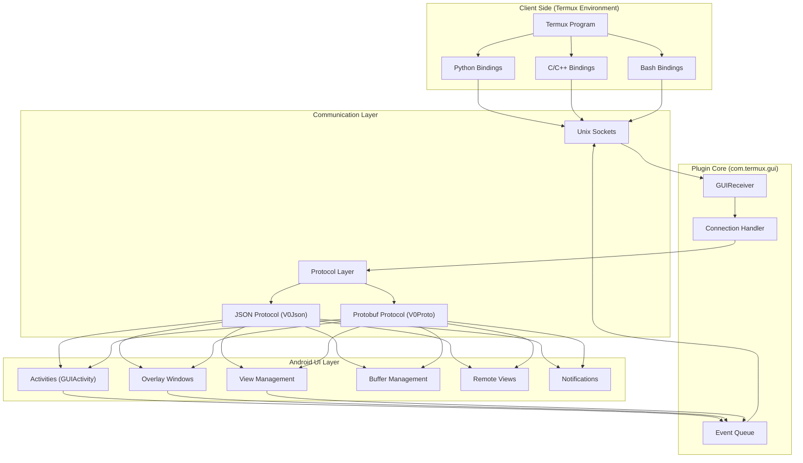
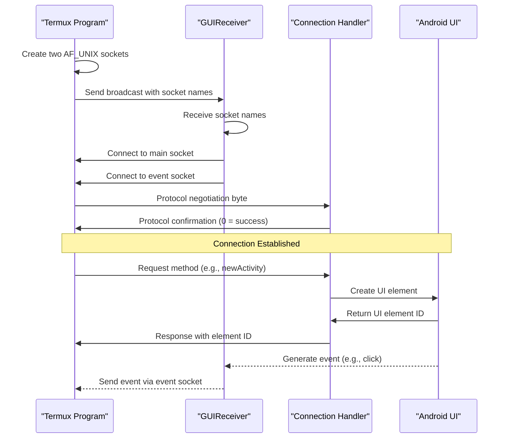
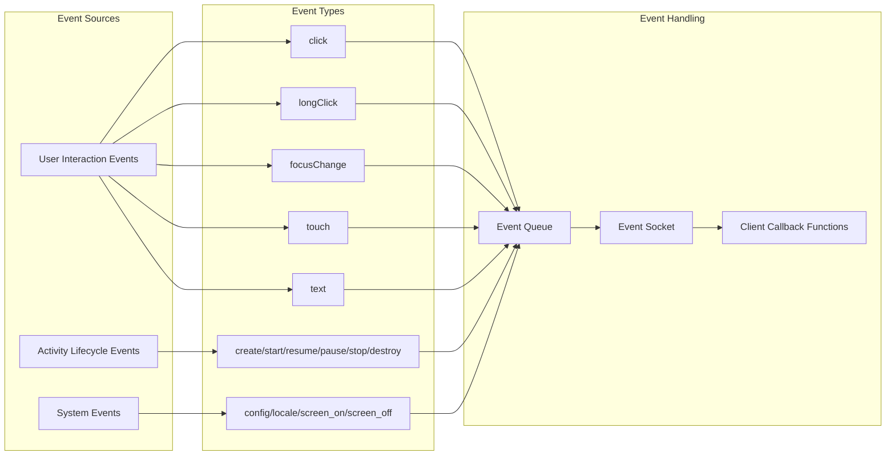

<!-- source: DeepWiki mcp.deepwiki.com · repo termux/termux-gui · page 1 Overview · fetched 2026-10-26 -->

# Overview

Relevant source files

The following files were used as context for generating this wiki page:

- [Developing.md](Developing.md)
- [Protocol.md](Protocol.md)
- [README.md](README.md)
- [TODO](TODO)
- [app/mapping.txt](app/mapping.txt)
- [app/proguard-rules.pro](app/proguard-rules.pro)
- [app/seeds.txt](app/seeds.txt)
- [app/src/main/AndroidManifest.xml](app/src/main/AndroidManifest.xml)
- [app/usage.txt](app/usage.txt)
- [fastlane/metadata/android/en-US/changelogs/8.txt](fastlane/metadata/android/en-US/changelogs/8.txt)

Termux:GUI is a plugin for Termux that enables command-line programs to use the native Android GUI elements. This documentation introduces the Termux:GUI system architecture, key components, and communication protocols that allow terminal programs to create and interact with graphical user interfaces.

For specific installation instructions, see [Installation](#1.1), and for a more detailed architecture breakdown, see [Architecture Overview](#1.2).

## System Architecture

Termux:GUI follows a client-server architecture where Termux programs (clients) communicate with the GUI plugin (server) through Unix sockets using a defined protocol. The system is composed of several core components that work together to enable terminal programs to create and manage Android UI elements.

Sources: [README.md:6-11](), [Protocol.md:9-19](), [app/src/main/AndroidManifest.xml:21-108]()

## Connection Process

The Termux:GUI system uses Unix sockets for bidirectional communication between Termux programs and the Android GUI plugin. Here's how the connection is established:

Sources: [Protocol.md:9-43]()

## Key Components

### Client-Side Libraries

Termux:GUI provides official language bindings to make it easy for different programming languages to use the plugin:

| Language | Repository | Description |
|----------|------------|-------------|
| Python   | termux-gui-python-bindings | Object-oriented API for Python programs |
| C/C++    | termux-gui-c-bindings | C library with low-level access to protocol |
| Bash     | termux-gui-bash | Bash script helpers for GUI creation |

Community-maintained bindings are also available for languages like Rust.

Sources: [README.md:47-60]()

### Plugin Core Components

The core of the Termux:GUI plugin consists of several key components that handle connections and manage the Android UI elements:

1. **GUIReceiver**: Receives connection broadcasts from Termux programs and establishes socket connections
2. **Connection Handler**: Handles protocol messages and routes them to appropriate handlers
3. **Protocol Handlers**: Process specific protocol methods to create and manipulate UI elements
4. **Event System**: Captures UI events and sends them back to the client program

Sources: [app/src/main/AndroidManifest.xml:101-104]()

### Android UI Components

Termux:GUI leverages several Android components to create and display UI elements:

1. **Activities**: Standard Android screen containers that can display UI elements
   - GUIActivity: Regular fullscreen activity
   - GUIActivityDialog: Dialog-style floating activity
   - GUIActivityLockscreen: Activity that can appear on the lockscreen

2. **Views**: UI elements like buttons, text fields, and layouts that can be arranged in a hierarchy

3. **Overlays**: Windows that can be displayed on top of other applications

4. **Buffers**: Shared memory areas for efficient image rendering

5. **Remote Views**: Used for homescreen widgets and custom notifications

Sources: [app/src/main/AndroidManifest.xml:66-89](), [Protocol.md:146-421](), [Protocol.md:436-514]()

## Protocol System

Termux:GUI supports two protocol types for communication between client programs and the plugin:

1. **JSON Protocol**: Text-based protocol using JSON for data serialization
   - Easier to implement in high-level languages
   - Implemented in `V0Json` class

2. **Protobuf Protocol**: Binary protocol using Protocol Buffers
   - Higher throughput and better performance
   - Better for low-level languages
   - Implemented in `V0Proto` class

Both protocols support the same set of methods for creating and manipulating UI elements.

Sources: [Protocol.md:20-43]()

## Feature Categories

Termux:GUI provides several categories of features that allow terminal programs to create rich, interactive user interfaces:

### Activity and Task Management

Methods for creating and controlling Android Activities and Tasks:
- Create standard, dialog, or lockscreen activities
- Picture-in-Picture mode support
- Task management (bring to front, move to back)
- Orientation and theme control

Sources: [Protocol.md:46-145]()

### UI Components

A wide range of UI components can be created and manipulated:
- Layouts (LinearLayout, FrameLayout, GridLayout)
- Basic controls (Button, TextView, EditText)
- Input controls (Checkbox, RadioButton, Switch)
- Advanced components (TabLayout, WebView, ScrollView)

Sources: [Protocol.md:146-421](), [README.md:19-31]()

### Buffer System

The buffer system allows efficient image rendering through shared memory:
- Shared memory buffers for standard images
- Hardware-accelerated buffers for high-performance graphics
- Support for different Android API levels

Sources: [Protocol.md:327-347](), [TODO:12-24]()

### Advanced Features

Additional features extend the functionality:
- Custom notifications with actions
- Homescreen widgets
- WebView for embedded web content
- Overlay windows that can appear above other apps

Sources: [Protocol.md:365-421](), [Protocol.md:436-545](), [README.md:19-31]()

## Event System

Termux:GUI includes a comprehensive event system that allows client programs to receive and respond to user interactions and system events:

Sources: [Protocol.md:551-621]()

## Permissions and Requirements

Termux:GUI requires several Android permissions to function properly:

- **SYSTEM_ALERT_WINDOW**: Required for overlay windows
- **FOREGROUND_SERVICE**: Allows the service to run in the background
- **WAKE_LOCK**: Used to turn on the display
- **POST_NOTIFICATIONS**: Required for notifications on Android 13+

The plugin also declares a requirement for OpenGL ES 2.0 for hardware-accelerated graphics features.

Sources: [app/src/main/AndroidManifest.xml:5-19]()

## Conclusion

Termux:GUI provides a powerful bridge between command-line programs and native Android GUI capabilities. Through its client-server architecture and flexible protocol system, it enables developers to create rich graphical interfaces for Termux applications while maintaining the benefits of command-line programming.

For more detailed information about specific aspects of Termux:GUI, refer to the other sections of this documentation.

---

