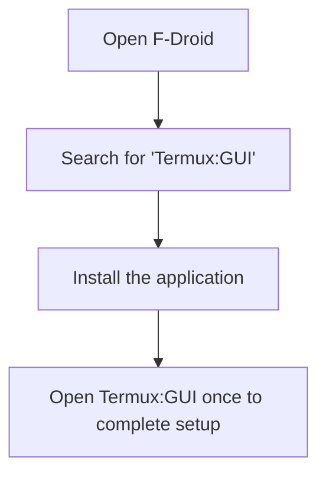
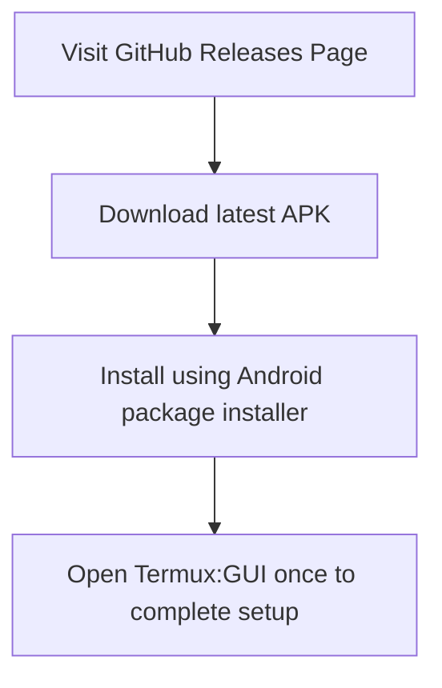
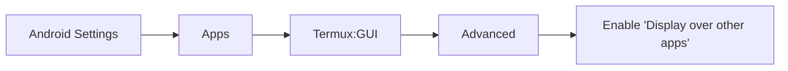
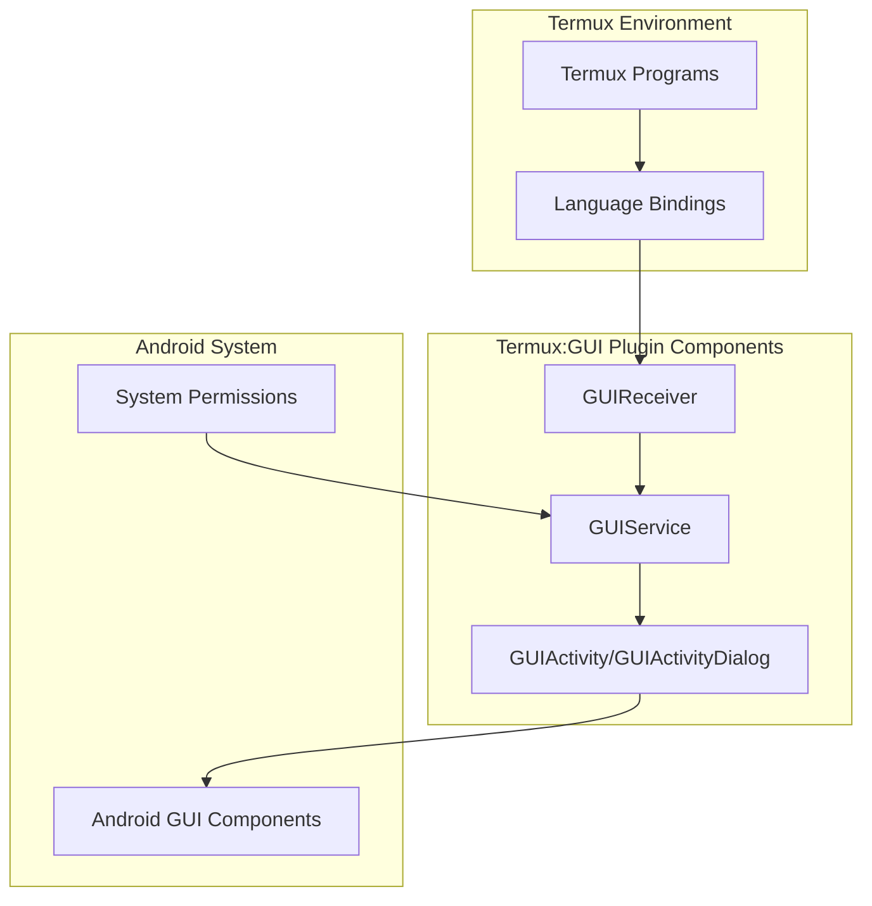
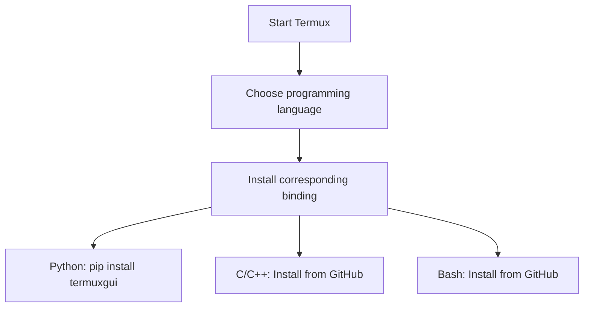

<!-- source: DeepWiki mcp.deepwiki.com · repo termux/termux-gui · page 1.1 Installation · fetched 2026-10-26 -->

# Installation

<details>
<summary>Relevant source files</summary>

The following files were used as context for generating this wiki page:

- [Developing.md](Developing.md)
- [README.md](README.md)
- [app/src/main/AndroidManifest.xml](app/src/main/AndroidManifest.xml)
- [fastlane/metadata/android/en-US/changelogs/6.txt](fastlane/metadata/android/en-US/changelogs/6.txt)
- [fastlane/metadata/android/en-US/changelogs/7.txt](fastlane/metadata/android/en-US/changelogs/7.txt)
- [fastlane/metadata/android/en-US/changelogs/8.txt](fastlane/metadata/android/en-US/changelogs/8.txt)
- [fastlane/metadata/android/en-US/full_description.txt](fastlane/metadata/android/en-US/full_description.txt)

</details>


This page provides instructions for installing and setting up the Termux:GUI plugin, which enables Termux command-line programs to create native Android GUI interfaces. For information about the overall architecture and system design, see [Architecture Overview](#1.2).

## Installation Methods

Termux:GUI can be installed through two primary methods:

### F-Droid Installation
The recommended installation method is through F-Droid, which ensures you receive stable updates.



### GitHub Releases Installation
Alternatively, you can download the APK from the GitHub releases page if you prefer the latest development versions.



Sources: [README.md:12-13]()

## System Requirements

Termux:GUI requires the following:

1. A working installation of the Termux application
2. Android OS (no specific minimum version is mentioned, but newer versions will have more features)

The plugin requires several Android permissions to function properly:

| Permission | Purpose |
|------------|---------|
| `FOREGROUND_SERVICE` | Keeps the app running even when no client has visible activities |
| `SYSTEM_ALERT_WINDOW` | Required for overlay windows functionality |
| `WAKE_LOCK` | Used to turn on the device display when needed |
| `POST_NOTIFICATIONS` | Used for custom notifications (Android 13+) |

Sources: [app/src/main/AndroidManifest.xml:12-19]()

## Post-Installation Setup

After installing Termux:GUI, additional setup steps are necessary to enable full functionality:

### Required Permissions

To use overlay windows or to open windows from the background, follow these steps:

1. Go to Android Settings → Apps → Termux:GUI
2. Open the Advanced section
3. Enable "Display over other apps" permission



Sources: [README.md:15]()

## System Integration

The following diagram illustrates how Termux:GUI integrates with Termux and the Android system:



Sources: [app/src/main/AndroidManifest.xml:37-104](), [README.md:7-8]()

## Installing Language Bindings

To use Termux:GUI effectively, you'll need to install language bindings for your preferred programming language:

### Official Bindings



#### Python Bindings
Install using pip:
```
pip install termuxgui
```

#### C/C++ Bindings
Clone and build from GitHub:
```
git clone https://github.com/tareksander/termux-gui-c-bindings
cd termux-gui-c-bindings
./configure
make
make install
```

#### Bash Bindings
Clone from GitHub:
```
git clone https://github.com/tareksander/termux-gui-bash
```

### Community Bindings

There are also community-maintained bindings:

- Rust: https://github.com/sweetkitty13/tgui-rs

Sources: [README.md:47-60]()

## Verifying Installation

To verify that Termux:GUI is properly installed and working:

1. Install one of the language bindings (Python recommended for beginners)
2. Run a simple test program to create a basic UI

### Example Test (Python)
```python
from termuxgui import Connection, Activity, Button

conn = Connection()
activity = Activity(conn)
button = Button(conn, activity, "Hello Termux:GUI!")
activity.wait_for_finish()
```

If a window appears with a button displaying "Hello Termux:GUI!", your installation is working correctly.

## Prepackaged Applications

For users who want to quickly try Termux:GUI without writing code, there are prepackaged programs available:

```
pkg install termux-gui-package
```

This package contains a collection of small programs that demonstrate Termux:GUI capabilities.

Sources: [README.md:11](), [fastlane/metadata/android/en-US/full_description.txt:17-19]()

## Troubleshooting

If you encounter issues with installation:

1. Ensure Termux is up to date
2. Check that all required permissions are granted
3. Try reinstalling both Termux:GUI and the language bindings
4. Verify that Unix sockets are working properly in your Termux installation

Sources: [README.md:13](), [Developing.md:39-46]()

---

