<!-- source: DeepWiki mcp.deepwiki.com · repo termux/termux-gui · page 1.2 Architecture Overview · fetched 2026-10-26 -->

# Architecture Overview

Relevant source files

The following files were used as context for generating this wiki page:

- [Developing.md](Developing.md)
- [README.md](README.md)
- [app/src/main/AndroidManifest.xml](app/src/main/AndroidManifest.xml)
- [app/src/main/java/com/termux/gui/ConnectionHandler.kt](app/src/main/java/com/termux/gui/ConnectionHandler.kt)
- [app/src/main/java/com/termux/gui/GUIActivity.kt](app/src/main/java/com/termux/gui/GUIActivity.kt)
- [app/src/main/java/com/termux/gui/protocol/protobuf/v0/V0Proto.kt](app/src/main/java/com/termux/gui/protocol/protobuf/v0/V0Proto.kt)
- [fastlane/metadata/android/en-US/changelogs/8.txt](fastlane/metadata/android/en-US/changelogs/8.txt)

This page provides a comprehensive explanation of the Termux:GUI system architecture, detailing how the plugin enables command-line programs to create and interact with native Android UI components. For information about installation, see [Installation](#1.1), and for protocol-specific details, see [Protocol Documentation](#2).

## System Overview

Termux:GUI is built on a client-server architecture that bridges Terminal programs with Android's UI framework. The system enables text-based programs to create fully native Android UI components without requiring the complexity of building a complete Android application.

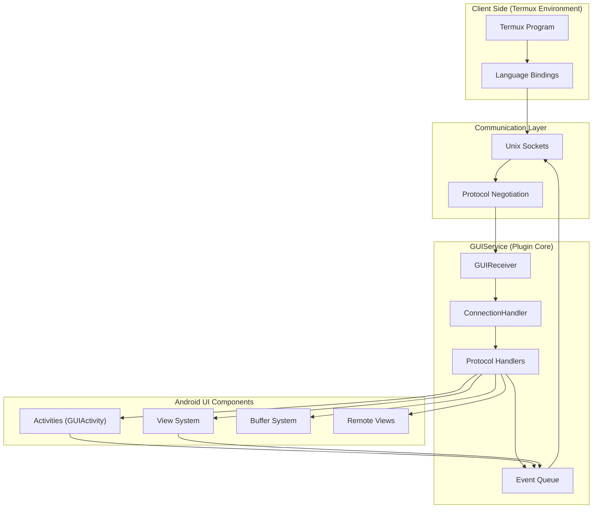

Sources: [README.md:7-11](), [ConnectionHandler.kt:20-25](), [AndroidManifest.xml:95-104]()

## Core Components

### Communication Layer

Termux:GUI uses Unix domain sockets for Inter-Process Communication (IPC) between Termux programs and the plugin. This communication happens through two socket connections:

1. **Main Socket**: Used for sending commands from client to plugin
2. **Event Socket**: Used for sending events from plugin back to client

The `ConnectionHandler` authenticates connections by verifying they originate from the Termux application and negotiates which protocol to use.

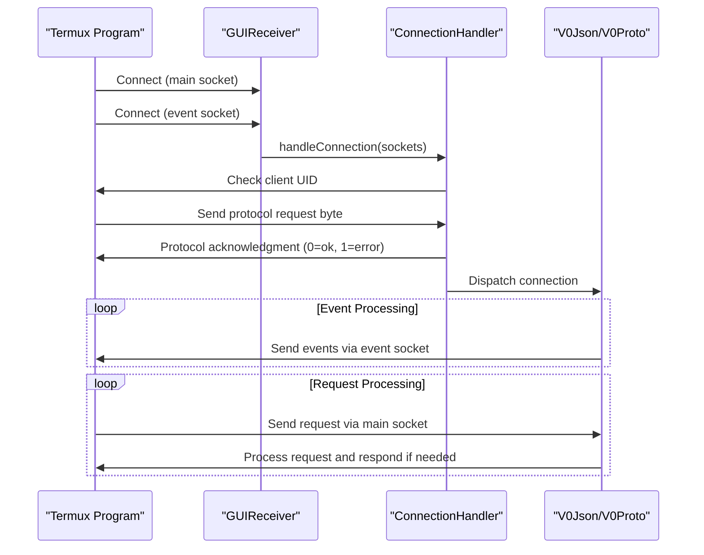

Sources: [ConnectionHandler.kt:53-149]()

### Protocol Handlers

The plugin supports two protocol types:

1. **JSON Protocol** (type=1): Human-readable format, easier for debugging
2. **Protobuf Protocol** (type=0): Binary format, more efficient

The protocol version is specified in the protocol negotiation byte:
- High 4 bits: protocol version (currently only version 0)
- Low 4 bits: protocol type (0=Protobuf, 1=JSON)

Both protocol implementations share common functionality through the base class `V0Shared`, with protocol-specific implementations in `V0Proto` and `V0Json`.

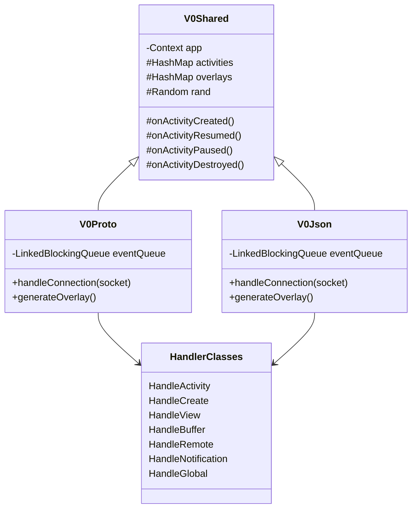

Sources: [V0Proto.kt:28-43](), [ConnectionHandler.kt:94-148]()

### Request Processing

When a client sends a request, the plugin processes it through specialized handler classes:

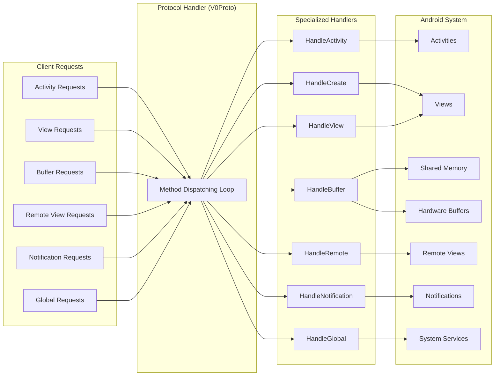

Sources: [V0Proto.kt:50-206]()

## Event System

Events flow from Android UI components back to client applications through an event queue:

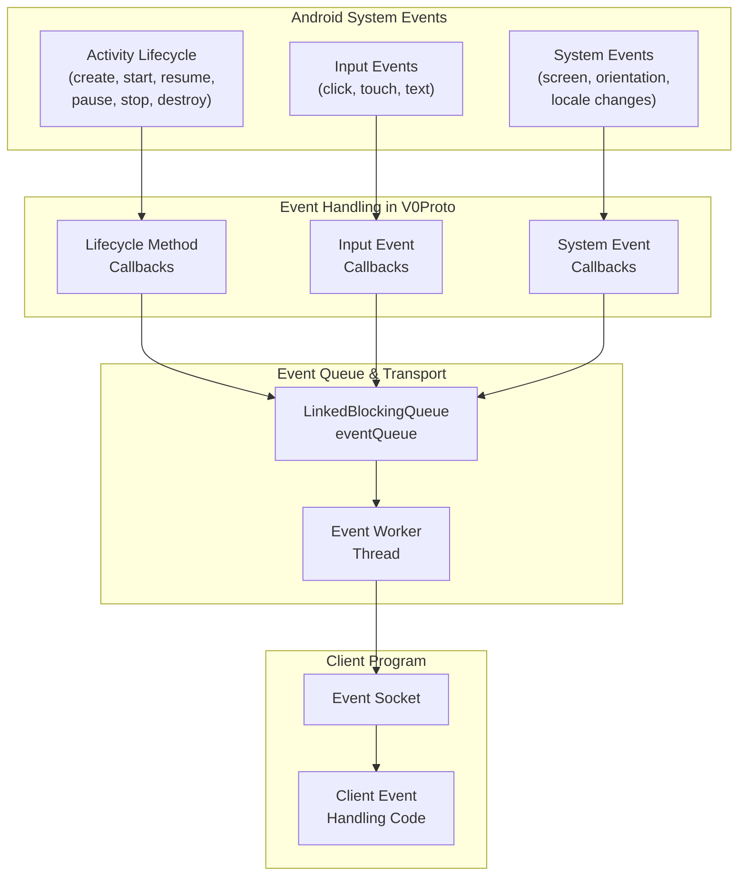

Sources: [V0Proto.kt:208-318](), [ConnectionHandler.kt:114-134]()

## Activity Management

Termux:GUI provides several types of activities to serve different UI needs:

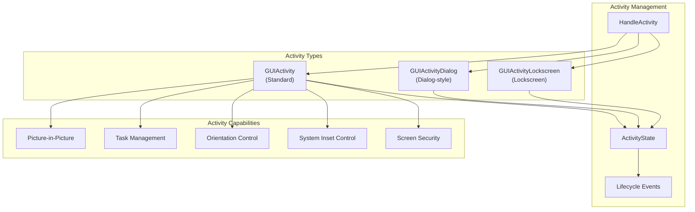

Sources: [GUIActivity.kt:22-237](), [AndroidManifest.xml:67-93]()

## View System

Views are the UI components displayed within activities. Termux:GUI supports a wide range of Android view types:

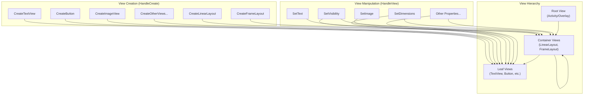

Sources: [V0Proto.kt:101-121](), [V0Proto.kt:123-162]()

## Buffer System

The buffer system provides efficient image rendering through shared memory:

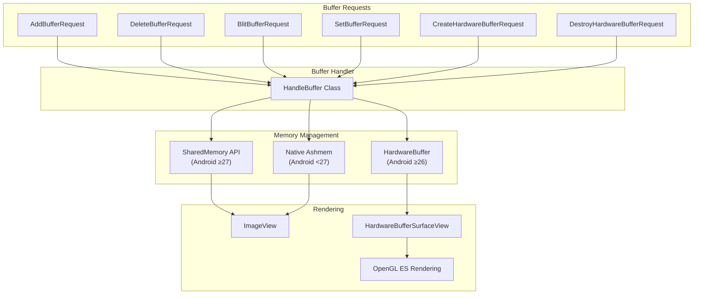

Sources: [ConnectionHandler.kt:39-44](), [V0Proto.kt:149-161]()

## Advanced Features

### Overlay Windows

Termux:GUI supports creating overlay windows that can float above other applications:

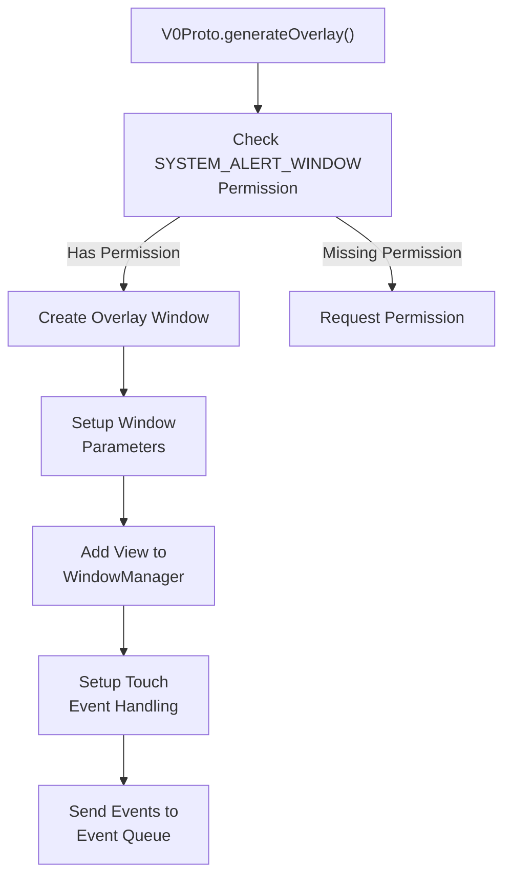

Sources: [V0Proto.kt:321-415](), [AndroidManifest.xml:15]()

### Remote Views and Widgets

Remote views allow creating Android home screen widgets:

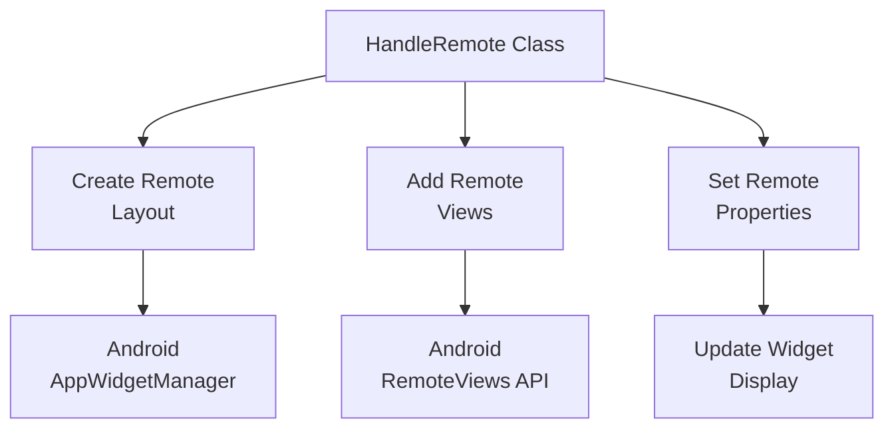

Sources: [V0Proto.kt:164-180](), [AndroidManifest.xml:42-51]()

## Putting It All Together

Here's how all these components interact in a complete system:

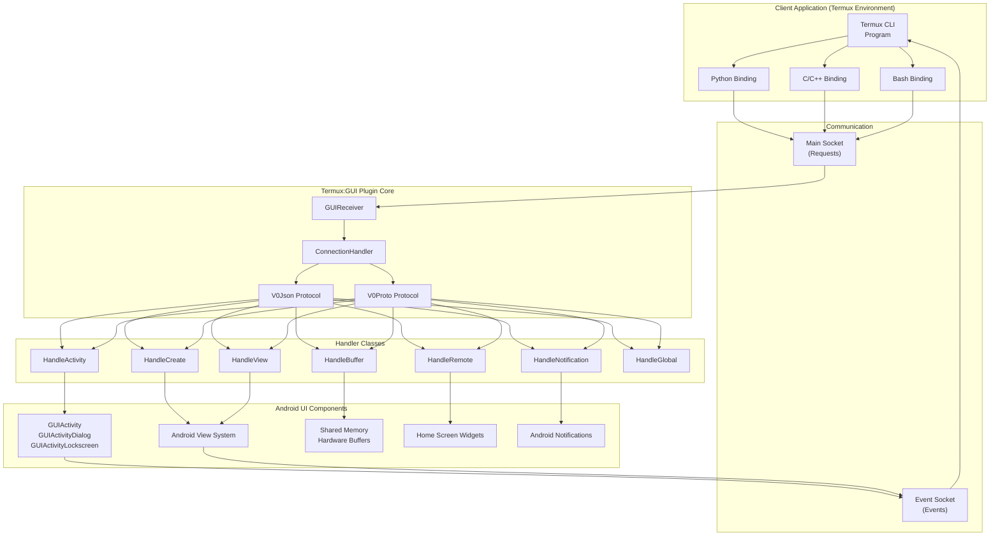

Sources: [ConnectionHandler.kt:25-167](), [V0Proto.kt:28-443](), [GUIActivity.kt:22-237]()

## Conclusion

The Termux:GUI architecture provides a flexible bridge between command-line Termux programs and Android's native UI capabilities. By using a client-server model with Unix sockets and supporting both JSON and Protobuf protocols, the system achieves a balance between ease of use and performance.

The modular design with specialized handlers for different aspects of the UI (activities, views, buffers, etc.) makes the system maintainable and extensible. This architecture enables command-line programs to create rich, native Android UIs without having to be fully-fledged Android applications.

For more detailed information about specific protocols, see [Protocol Documentation](#2), and for specific UI component information, see [Activities and UI Components](#3).

---

