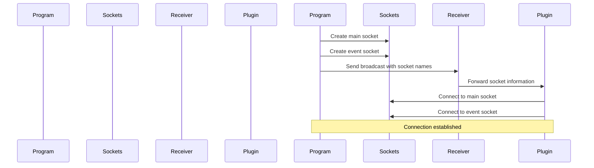
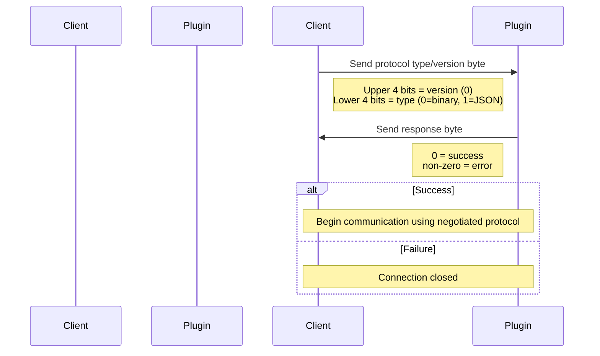
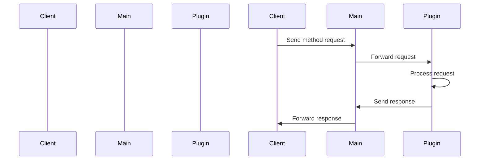
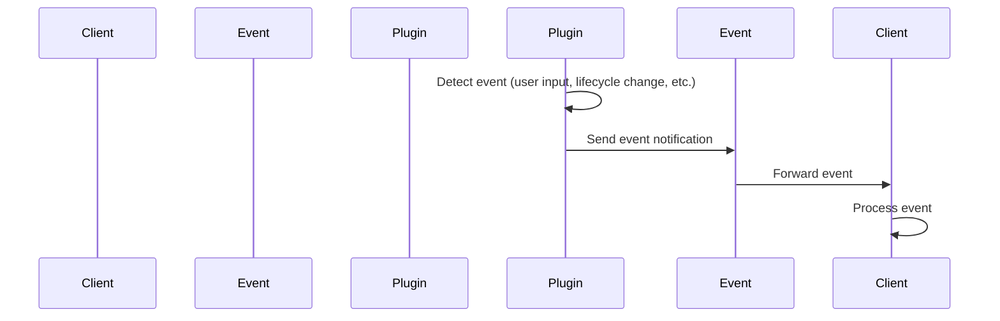
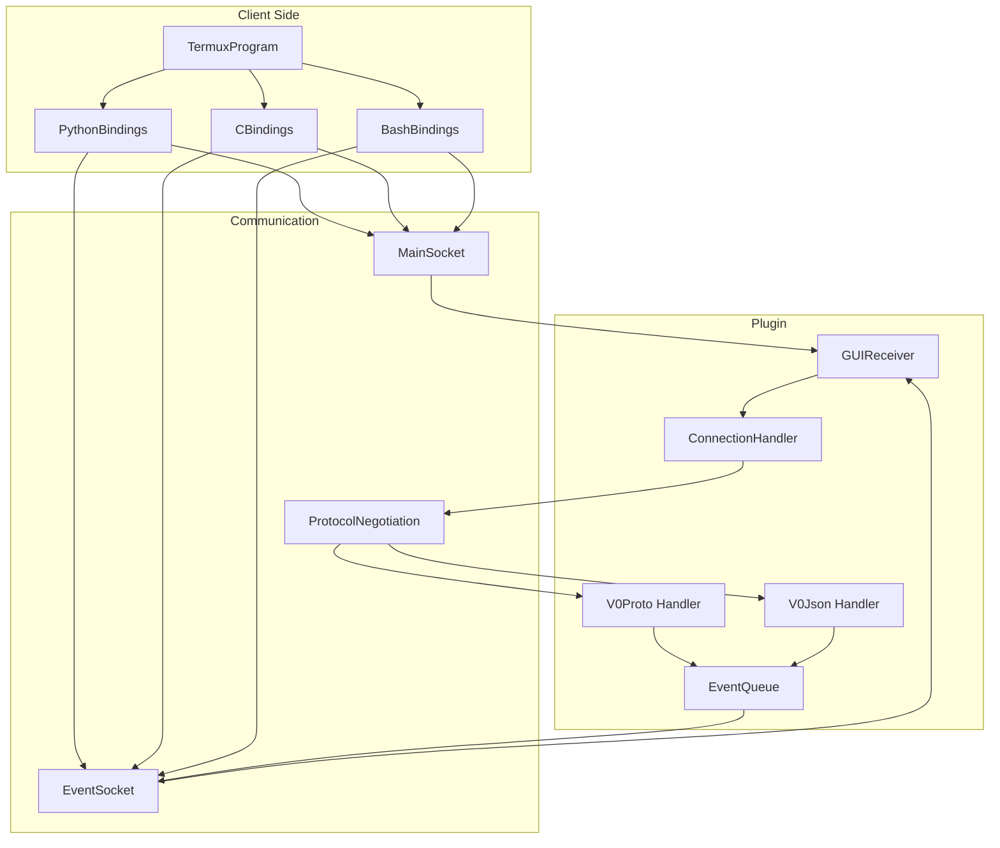
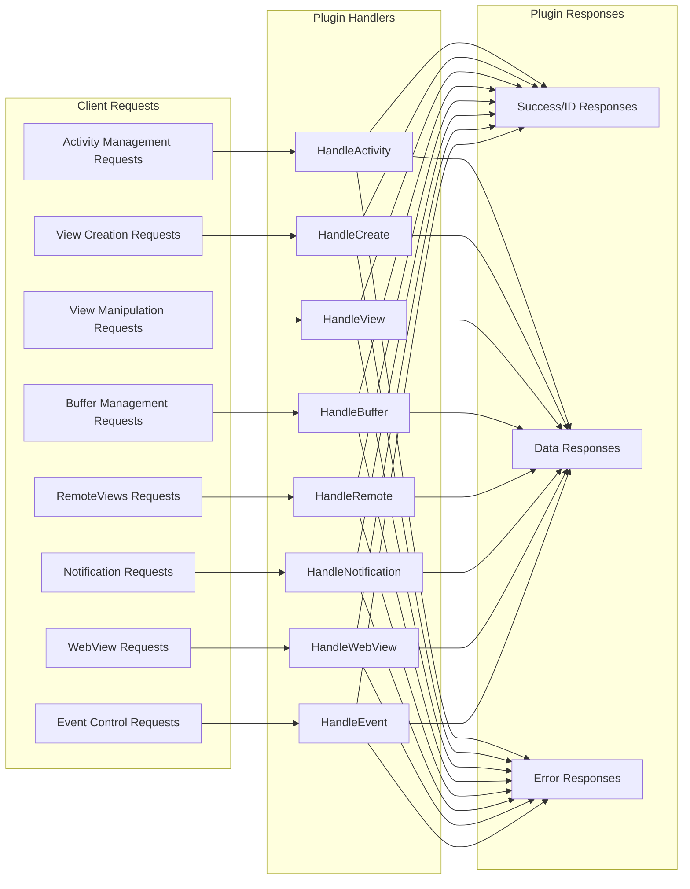

<!-- source: DeepWiki mcp.deepwiki.com · repo termux/termux-gui · page 2 Protocol Documentation · fetched 2026-10-26 -->

# Protocol Documentation

<details>
<summary>Relevant source files</summary>

The following files were used as context for generating this wiki page:

- [Protocol.md](Protocol.md)
- [TODO](TODO)
- [app/src/main/proto/GUIProt0.proto](app/src/main/proto/GUIProt0.proto)

</details>


This document details the communication protocol between Termux programs and the Termux:GUI plugin. It outlines how connections are established, how messages are structured and transmitted, and the overall flow of communication. For specific protocol implementations, see [JSON Protocol](#2.1) and [Protobuf Protocol](#2.2). For information about handling events, see [Event System](#2.3).

## Connection Establishment

To communicate with the Termux:GUI plugin, a Termux program must establish a connection through Unix sockets:

1. The program creates two AF_UNIX SOCK_STREAM server sockets in the abstract Linux namespace:
   - A main socket for bidirectional command communication
   - An event socket for receiving asynchronous events (clicks, lifecycle events, etc.)

2. The program broadcasts these socket names to the plugin:
   ```bash
   am broadcast --user 0 -n com.termux.gui/.GUIReceiver --es mainSocket mainSocketName --es eventSocket eventSocketName
   ```

3. For security, programs should verify that the connected peer has the same user ID.

### Connection Establishment Diagram



Sources: [Protocol.md:9-18]()

## Protocol Types

Termux:GUI supports two protocol formats:

| Protocol Type | Description | Advantages | Recommended For |
|--------------|-------------|------------|-----------------|
| JSON | Messages exchanged in JSON format | Better compatibility with high-level languages | Scripts, prototyping, languages with good JSON support |
| Binary (Protobuf) | Messages encoded using Protocol Buffers | Higher throughput, better efficiency, type safety | Performance-critical applications, low-level languages |

New features will primarily be implemented in the binary protocol, but the JSON protocol remains sufficient for many applications.

Sources: [Protocol.md:21-26](), [Protocol.md:644-655]()

## Protocol Negotiation

Once the connection is established, the protocol type and version must be negotiated:

1. The client sends a single byte specifying the desired protocol:
   - Lower 4 bits: Protocol type (0 = binary, 1 = JSON)
   - Upper 4 bits: Protocol version (currently 0)

2. The plugin responds with a single byte:
   - 0: Success, protocol supported
   - Non-zero: Failure, connection will be closed

### Protocol Negotiation Diagram



Sources: [Protocol.md:33-37]()

## Message Structure

### JSON Protocol

For the JSON protocol:
- Each message is preceded by a 4-byte big-endian unsigned integer indicating the message length
- Requests are JSON objects with:
  - `method`: The name of the method to call
  - `params`: Optional parameters as a JSON object
- Responses are either single JSON values or arrays for multiple return values
- Binary data (like images) must be base64-encoded as JSON strings
- Events are JSON objects with a `type` field indicating the event type and a `value` field with event data

### Binary Protocol

For the binary (Protobuf) protocol:
- Messages follow the schema defined in [app/src/main/proto/GUIProt0.proto]()
- Messages are sent "delimited" (preceded by their size as a varint)
- Requests use the `Method` message with the appropriate request type set
- Responses use the corresponding response message type
- Events are sent as `Event` messages with the event type set in the oneof field

Special case: The `addBuffer` method returns a 32-bit signed integer and a file descriptor instead of a protobuf message. If the integer is negative, buffer creation failed.

Sources: [Protocol.md:28-37](), [app/src/main/proto/GUIProt0.proto:33-40]()

## Message Flow and Communication Pattern

The communication follows two primary patterns:

### Request-Response Flow



### Asynchronous Event Flow



Sources: [Protocol.md:6-7](), [app/src/main/proto/GUIProt0.proto:18-35]()

## Protocol System Architecture

The following diagram shows the overall architecture of the protocol system:



Sources: [app/src/main/proto/GUIProt0.proto:11-41]()

## Request and Response Types

The protocol supports various request types, which can be grouped into several categories:



Sources: [app/src/main/proto/GUIProt0.proto:310-2753]()

## Error Handling

Error handling in the protocol ensures clients can properly respond to failures:

### JSON Protocol
- Failed methods typically return `-1` or other predefined error values
- No explicit error codes or messages are provided

### Binary Protocol
Error codes are standardized in the `Error` enum:
- `0 (OK)`: No error
- Negative values: Non-fatal informational codes
- Positive values: Fatal errors

Common error codes include:
- `ACTIVITY_STOPPED (1)`: Activity temporarily unavailable
- `INVALID_ACTIVITY (2)`: Activity doesn't exist
- `INTERNAL_ERROR (3)`: Exception occurred
- `INVALID_VIEW (4)`: View ID not found
- `INVALID_VIEW_TYPE (5)`: Incorrect view type for operation
- `ANDROID_VERSION_TOO_LOW (13)`: Feature requires newer Android version

Sources: [app/src/main/proto/GUIProt0.proto:240-305]()

## Activity State and Method Queueing

Due to Android's lifecycle constraints, the protocol handles temporarily unavailable activities:

- **JSON Protocol**: Methods that don't return values are queued (up to 100) until the Activity becomes visible again
- **Binary Protocol**: No methods are queued as all methods return a value (with possible error code)
- Methods that return values fail immediately with appropriate error codes when the Activity isn't visible

Sources: [Protocol.md:6-7]()

## Special Protocol Features

### Buffer Management
For efficient image handling, the protocol supports shared memory buffers:
- `addBuffer`: Creates a shared memory region, returns buffer ID and file descriptor
- `deleteBuffer`: Releases buffer resources
- `blitBuffer`: Updates buffer content
- `setBuffer`: Associates buffer with an ImageView

### Hardware Buffer Support
For hardware-accelerated graphics, the protocol supports Android's HardwareBuffer API:
- `createHardwareBuffer`: Creates a GPU-accessible buffer
- `destroyHardwareBuffer`: Releases hardware buffer resources
- `surfaceViewSetBuffer`: Presents buffer content in a SurfaceView

Sources: [app/src/main/proto/GUIProt0.proto:1762-1785](), [app/src/main/proto/GUIProt0.proto:2461-2508]()

---

