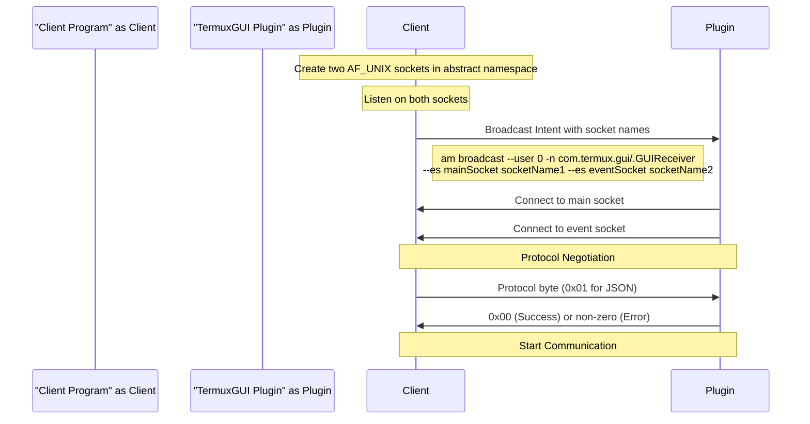
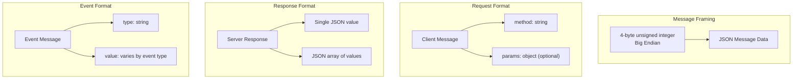
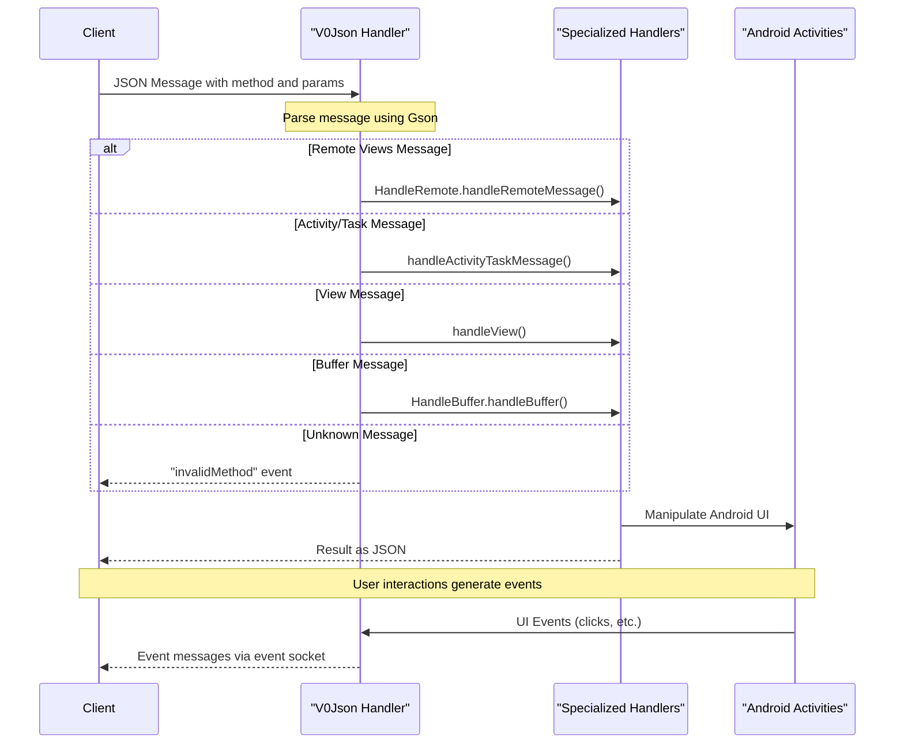
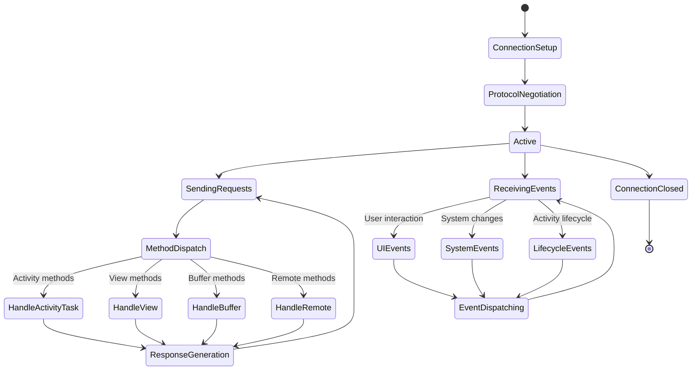

<!-- source: DeepWiki mcp.deepwiki.com · repo termux/termux-gui · page 2.1 JSON Protocol · fetched 2026-10-26 -->

# JSON Protocol

<details>
<summary>Relevant source files</summary>

The following files were used as context for generating this wiki page:

- [Protocol.md](Protocol.md)
- [TODO](TODO)
- [app/src/main/java/com/termux/gui/protocol/json/v0/HandleActivityAndTask.kt](app/src/main/java/com/termux/gui/protocol/json/v0/HandleActivityAndTask.kt)
- [app/src/main/java/com/termux/gui/protocol/json/v0/V0Json.kt](app/src/main/java/com/termux/gui/protocol/json/v0/V0Json.kt)
- [app/src/main/java/com/termux/gui/protocol/shared/v0/V0Shared.kt](app/src/main/java/com/termux/gui/protocol/shared/v0/V0Shared.kt)

</details>


The JSON Protocol is one of two communication protocols supported by Termux:GUI, designed primarily for better compatibility with high-level programming languages. This document details how client applications communicate with the Termux:GUI plugin using JSON-formatted messages, the message structure, and the protocol flow.

For information about the alternative protocol that uses Protocol Buffers, see [Protobuf Protocol](#2.2). For details about handling events sent from the plugin back to clients, see [Event System](#2.3).

## Connection Establishment

The JSON Protocol requires setting up a bidirectional communication channel between the client program and the Termux:GUI plugin.



### Implementation details:

1. The client program must create two AF_UNIX SOCK_STREAM server sockets in the abstract Linux namespace
2. One socket is used for main communication (requests/responses), and the other for receiving asynchronous events
3. The socket names are sent via an Android broadcast Intent
4. After connection, the client must send a protocol negotiation byte:
   - 4 least significant bits = 1 (indicating JSON protocol)
   - 4 most significant bits = 0 (protocol version)
5. The plugin responds with 0x00 for success or another value for error

Sources: [Protocol.md:10-36]()

## Message Format and Structure

All JSON protocol messages follow a consistent format for both requests and responses.



### Request Format

```json
{
  "method": "methodName",
  "params": {
    "param1": value1,
    "param2": value2
  }
}
```

### Response Format

For methods returning a single value:
```json
value
```

For methods returning multiple values:
```json
[value1, value2, ...]
```

### Event Format

```json
{
  "type": "eventType",
  "value": {
    "property1": value1,
    "property2": value2
  }
}
```

### Framing

Every JSON message (for both requests and responses) must be preceded by its length as a 4-byte unsigned integer in big-endian format. This allows the receiver to correctly identify message boundaries.

### Binary Data

Binary data (such as images) must be transmitted as base64-encoded strings in the JSON messages.

Sources: [Protocol.md:28-30](), [Protocol.md:647-654]()

## Protocol Message Flow

The following diagram illustrates the message flow between client and plugin:



The handling of JSON protocol messages is implemented in the `V0Json` class, which:
1. Reads incoming messages from the main socket
2. Dispatches them to appropriate handlers based on method type
3. Returns responses to the client
4. Forwards events from the Android UI to the client via the event socket

Sources: [app/src/main/java/com/termux/gui/protocol/json/v0/V0Json.kt:33-62](), [app/src/main/java/com/termux/gui/protocol/json/v0/V0Json.kt:64-163]()

## Method Categories

The JSON Protocol provides a rich set of methods grouped into several categories:

### Activity and Task Control

Methods to create and manage Android Activities and Tasks:

| Method | Description | Key Parameters |
|--------|-------------|----------------|
| `newActivity` | Creates a new Activity | `tid`, `dialog`, `pip`, `lockscreen`, `overlay` |
| `finishActivity` | Closes an Activity | `aid` (Activity ID) |
| `setTheme` | Sets colors for an Activity | `aid`, `statusBarColor`, `colorPrimary`, etc. |
| `setPiPMode` | Enters/exits Picture-in-Picture mode | `aid`, `pip` |
| `setOrientation` | Sets screen orientation | `aid`, `orientation` |

Sources: [Protocol.md:46-144](), [app/src/main/java/com/termux/gui/protocol/json/v0/HandleActivityAndTask.kt:23-287]()

### View Creation and Manipulation

Methods to create and modify UI elements:

| Method | Description | Key Parameters |
|--------|-------------|----------------|
| `create*` | Creates views (Button, TextView, etc.) | `aid`, `parent`, type-specific parameters |
| `setText` | Sets text for a TextView/Button | `aid`, `id`, `text` |
| `setVisibility` | Shows/hides views | `aid`, `id`, `vis` |
| `deleteView` | Removes a view | `aid`, `id` |
| `setBackgroundColor` | Sets background color | `aid`, `id`, `color` |

Various view types are supported, including:
- LinearLayout, FrameLayout, GridLayout
- TextView, EditText, Button
- ImageView, WebView
- ProgressBar, Spinner, TabLayout
- And many more

Sources: [Protocol.md:146-242]()

### Buffer System

Methods for efficient image handling using shared memory:

| Method | Description | Key Parameters |
|--------|-------------|----------------|
| `addBuffer` | Creates a shared memory buffer | `format`, `w`, `h` |
| `deleteBuffer` | Removes a buffer | `bid` (Buffer ID) |
| `blitBuffer` | Updates buffer contents | `bid` |
| `setBuffer` | Assigns a buffer to an ImageView | `aid`, `id`, `bid` |

Sources: [Protocol.md:327-346]()

### Event Control

Methods to control which UI events are sent to the client:

| Method | Description | Key Parameters |
|--------|-------------|----------------|
| `sendClickEvent` | Enables/disables click events | `aid`, `id`, `send` |
| `sendTouchEvent` | Enables/disables touch events | `aid`, `id`, `send` |
| `sendTextEvent` | Enables/disables text change events | `aid`, `id`, `send` |

Sources: [Protocol.md:421-433](), [app/src/main/java/com/termux/gui/protocol/json/v0/V0Json.kt:89-161]()

### WebView Control

Methods for embedded web browser control:

| Method | Description | Key Parameters |
|--------|-------------|----------------|
| `setData` | Sets HTML content | `aid`, `id`, `doc`, `mime` |
| `loadURI` | Loads from URL | `aid`, `id`, `uri` |
| `evaluateJS` | Runs JavaScript | `aid`, `id`, `code` |

Sources: [Protocol.md:366-416]()

### RemoteViews and Notifications

Methods for Android RemoteViews (widgets) and system notifications:

| Method | Description | Key Parameters |
|--------|-------------|----------------|
| `createRemoteLayout` | Creates a remote layout | - |
| `addRemote*` | Adds views to remote layouts | `rid`, `parent` |
| `createNotification` | Creates Android notification | `id`, `layout`, `title`, etc. |

Sources: [Protocol.md:436-545]()

## Implementation and Handling

The JSON Protocol is implemented in the `V0Json` class, which extends `V0Shared`. The class:

1. Maintains state for active Activities, views, buffers, and notifications
2. Reads and parses incoming JSON messages
3. Dispatches methods to appropriate handlers:
   - `HandleRemote.handleRemoteMessage` for RemoteViews operations
   - `handleActivityTaskMessage` for Activity and Task operations
   - `handleView` for UI view operations
   - `HandleBuffer.handleBuffer` for buffer operations
4. Processes events from the Android system and UI
5. Sends events back to the client via the event socket

The protocol dispatches incoming messages using a series of handler classes, each responsible for a specific category of functionality. This modular design allows for separation of concerns and easier maintenance.

Sources: [app/src/main/java/com/termux/gui/protocol/json/v0/V0Json.kt:33-169](), [app/src/main/java/com/termux/gui/protocol/shared/v0/V0Shared.kt:30-368]()

## Limitations

The JSON Protocol has several limitations due to Android's architecture:

1. Methods that return a value fail when the Activity isn't visible
2. Up to 100 methods that don't return a value will be queued to run when the Activity becomes visible again
3. When an Activity is destroyed, all queued methods for that Activity are lost
4. The JSON protocol has more overhead than the Protobuf protocol due to JSON parsing and serialization

These limitations should be considered when designing applications that use the JSON Protocol.

Sources: [Protocol.md:6-8]()

## Protocol Lifecycle



This diagram illustrates the lifecycle of the JSON Protocol from connection setup through normal operation to connection close, showing both the request-response flow and the asynchronous event flow.

Sources: [app/src/main/java/com/termux/gui/protocol/json/v0/V0Json.kt:36-169](), [app/src/main/java/com/termux/gui/protocol/shared/v0/V0Shared.kt:50-126]()

---

