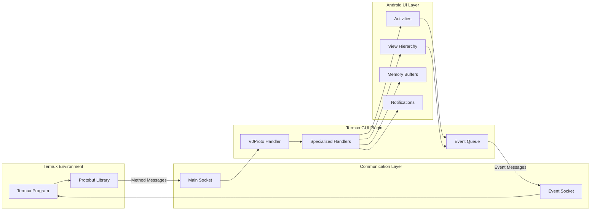
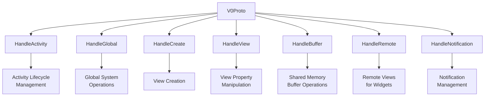
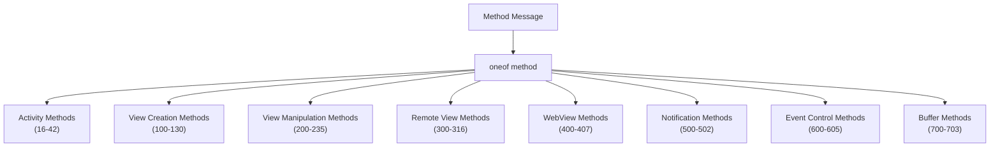
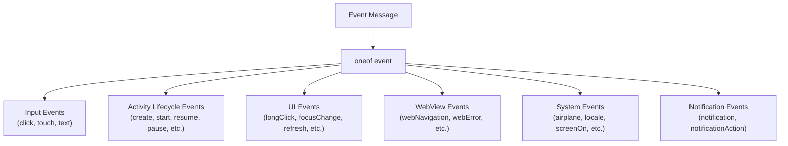
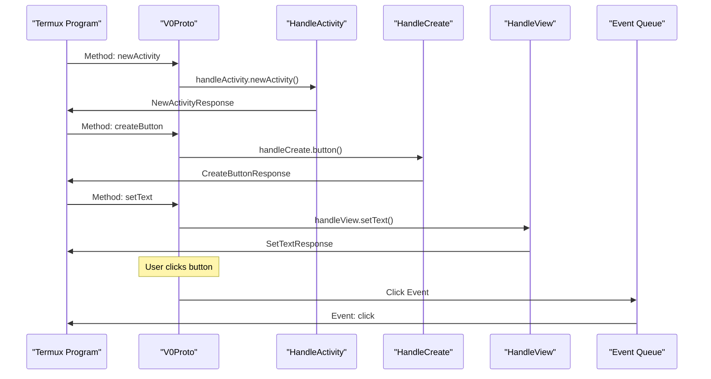

<!-- source: DeepWiki mcp.deepwiki.com · repo termux/termux-gui · page 2.2 Protobuf Protocol · fetched 2026-10-26 -->

# Protobuf Protocol

<details>
<summary>Relevant source files</summary>

The following files were used as context for generating this wiki page:

- [app/src/main/java/com/termux/gui/protocol/protobuf/v0/V0Proto.kt](app/src/main/java/com/termux/gui/protocol/protobuf/v0/V0Proto.kt)
- [app/src/main/proto/GUIProt0.proto](app/src/main/proto/GUIProt0.proto)

</details>


This document details the Protocol Buffers (protobuf) based communication protocol used in Termux:GUI. The protobuf protocol offers a structured, efficient binary serialization mechanism for communication between Termux programs and the Android UI system. For information about the alternative JSON-based communication protocol, see [JSON Protocol](#2.1).

## Overview

The Protobuf Protocol establishes a bidirectional communication channel between Termux applications and the GUI plugin through Unix domain sockets. It provides a strongly-typed, efficient messaging system that enables terminal applications to create and manipulate Android UI components.



Sources: [app/src/main/proto/GUIProt0.proto:19-41](), [app/src/main/java/com/termux/gui/protocol/protobuf/v0/V0Proto.kt:28-50]()

## Connection Establishment

To establish a connection with the Termux:GUI plugin, a Termux program follows these steps:

1. Open two AF_UNIX SO_STREAM server sockets in the abstract Linux namespace
2. One socket handles main communication, the other receives asynchronous events
3. Send a broadcast to `com.termux.gui/.GUIReceiver` with socket names as extras
4. The plugin connects to these sockets to establish bidirectional communication

Example connection using `am` command:
```
am broadcast --user 0 -n com.termux.gui/.GUIReceiver --es mainSocket mainSocketName --es eventSocket eventSocketName
```

For security, the program should verify that connected peers have the same user ID.

Sources: [app/src/main/proto/GUIProt0.proto:19-30]()

## Message Format

All protocol messages are sent in a delimited format:

1. Message size is sent first as a variable-length integer (varint)
2. The serialized protocol buffer message follows
3. All Protocol Buffer implementations support reading varints and delimited messages

The protocol defines two primary message types:
- **Method**: Requests sent from Termux programs to the plugin
- **Event**: Asynchronous events sent from the plugin back to Termux programs

After sending a Method message, the corresponding response is sent back to the client.

Sources: [app/src/main/proto/GUIProt0.proto:34-40]()

## Handler Architecture

The V0Proto class processes incoming messages by dispatching them to specialized handlers, each responsible for a specific domain of functionality:



Sources: [app/src/main/java/com/termux/gui/protocol/protobuf/v0/V0Proto.kt:50-206]()

## Message Types

### Method Messages

The protocol defines numerous request types organized into functional categories:

| Category | Description | Example Methods |
|----------|-------------|-----------------|
| Activity Management | Create and control Activities | `newActivity`, `finishActivity`, `setTheme` |
| View Creation | Create UI components | `createLinearLayout`, `createButton`, `createTextView` |
| View Manipulation | Modify View properties | `setVisibility`, `setText`, `setBackgroundColor` |
| Buffer Management | Manage shared memory | `addBuffer`, `blitBuffer`, `setBuffer` |
| Remote Views | Create widget layouts | `createRemoteLayout`, `addRemoteTextView` |
| Notifications | Create Android notifications | `createChannel`, `createNotification` |
| WebView | Control WebView components | `allowJS`, `loadURI`, `evaluateJS` |
| Event Control | Configure event delivery | `sendClickEvent`, `sendTouchEvent` |

The `Method` message acts as a container with an `oneof` field that can hold any request type:



Sources: [app/src/main/proto/GUIProt0.proto:2599-2754]()

### Event Messages

Events are asynchronous notifications sent from the plugin to Termux programs:

| Category | Description | Example Events |
|----------|-------------|----------------|
| Activity Lifecycle | Activity state changes | `create`, `start`, `resume`, `pause`, `stop`, `destroy` |
| View Events | User interactions | `click`, `longClick`, `touch`, `focusChange` |
| System Events | System state changes | `screenOn`, `screenOff`, `locale`, `airplane` |
| WebView Events | WebView callbacks | `webNavigation`, `webHTTPError`, `webConsoleMessage` |
| Widget Events | Remote view interactions | `remoteClick`, `notification`, `notificationAction` |

The `Event` message also uses an `oneof` field to contain any event type:



Sources: [app/src/main/proto/GUIProt0.proto:3170-3222]()

## Error Handling

The protocol includes a standardized error handling mechanism through the `Error` enum. These codes are returned in response messages to indicate success or failure:

| Error Code | Description | Severity |
|------------|-------------|----------|
| `OK` | Operation successful | Success |
| `ACTIVITY_STOPPED` | Activity temporarily stopped | Retry |
| `INVALID_ACTIVITY` | Activity doesn't exist | Fatal |
| `INTERNAL_ERROR` | Exception during processing | Fatal |
| `INVALID_VIEW` | View ID not found | Fatal |
| `INVALID_VIEW_TYPE` | View of wrong type | Fatal |
| `ANDROID_VERSION_TOO_LOW` | Feature requires newer Android | Fatal |
| `BUFFER_NOT_FOUND` | Referenced buffer not found | Fatal |

Negative error codes are non-fatal information, 0 means success, and positive codes indicate failures.

Sources: [app/src/main/proto/GUIProt0.proto:240-305]()

## Protocol Definition

The protocol is defined using Protocol Buffers syntax in `GUIProt0.proto`. This file specifies all message types, enumerations, and structures used in the protocol. It's organized into sections:

1. Common types (lines 46-245)
2. Activity and task management (lines 312-772)
3. View creation (lines 928-1270)
4. View manipulation (lines 1274-1694)
5. Buffer management (lines 1762-1836)
6. Remote views (lines 1897-2106)
7. Other specialized components (WebView, notifications, etc.)
8. Method and Event container messages (lines 2599-3222)

The file is licensed under the Unlicense, placing it in the public domain for easy reuse.

Sources: [app/src/main/proto/GUIProt0.proto:11-3640]()

## Protocol Implementation

The `V0Proto` class is the core implementation that handles protocol communication:

1. Receives messages from the main socket
2. Dispatches messages to appropriate handlers
3. Processes system events and converts them to protocol events
4. Sends events through the event queue to the event socket



Sources: [app/src/main/java/com/termux/gui/protocol/protobuf/v0/V0Proto.kt:50-206]()

## Buffer System

The Protobuf Protocol includes an efficient shared memory buffer system for graphics operations:

1. Create a buffer with `addBuffer` which returns a file descriptor
2. Map the shared memory region to access the pixels directly
3. Update the memory with new image data
4. Call `blitBuffer` to notify the plugin about updates
5. Use `setBuffer` to associate the buffer with an ImageView

This approach is much more efficient than sending image data through the protocol, especially for frequently updated graphics.

For hardware-accelerated graphics, the protocol provides the `createHardwareBuffer` method which creates a shared GPU-accessible buffer for rendering with OpenGL ES or Vulkan.

Sources: [app/src/main/proto/GUIProt0.proto:1762-1824](), [app/src/main/proto/GUIProt0.proto:2460-2507]()

## Event System

The event system in the Protobuf Protocol enables asynchronous notifications about UI interactions and system changes:

1. The plugin detects events (clicks, lifecycle changes, etc.)
2. Events are converted to protocol Event messages
3. Messages are placed in an event queue
4. Messages are serialized and sent over the event socket
5. The Termux program deserializes and handles these events

Various event control methods like `sendClickEvent` allow configuring which events should be sent to the client.

Sources: [app/src/main/java/com/termux/gui/protocol/protobuf/v0/V0Proto.kt:208-318]()

## Conclusion

The Protobuf Protocol provides a comprehensive, efficient communication mechanism between Termux applications and Android's UI system. Its binary serialization format, strongly-typed messages, and structured design offer advantages in performance, type safety, and error handling compared to text-based protocols.

For detailed information on how to use the protocol with specific types of UI components, refer to the [Activities and UI Components](#3) section of the documentation.

---

