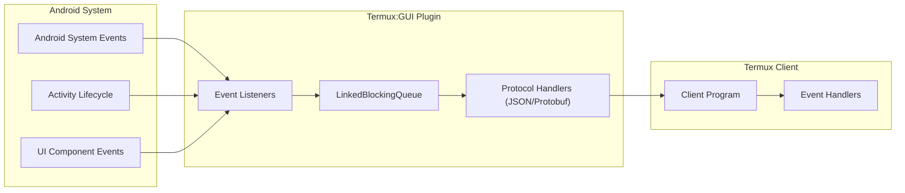
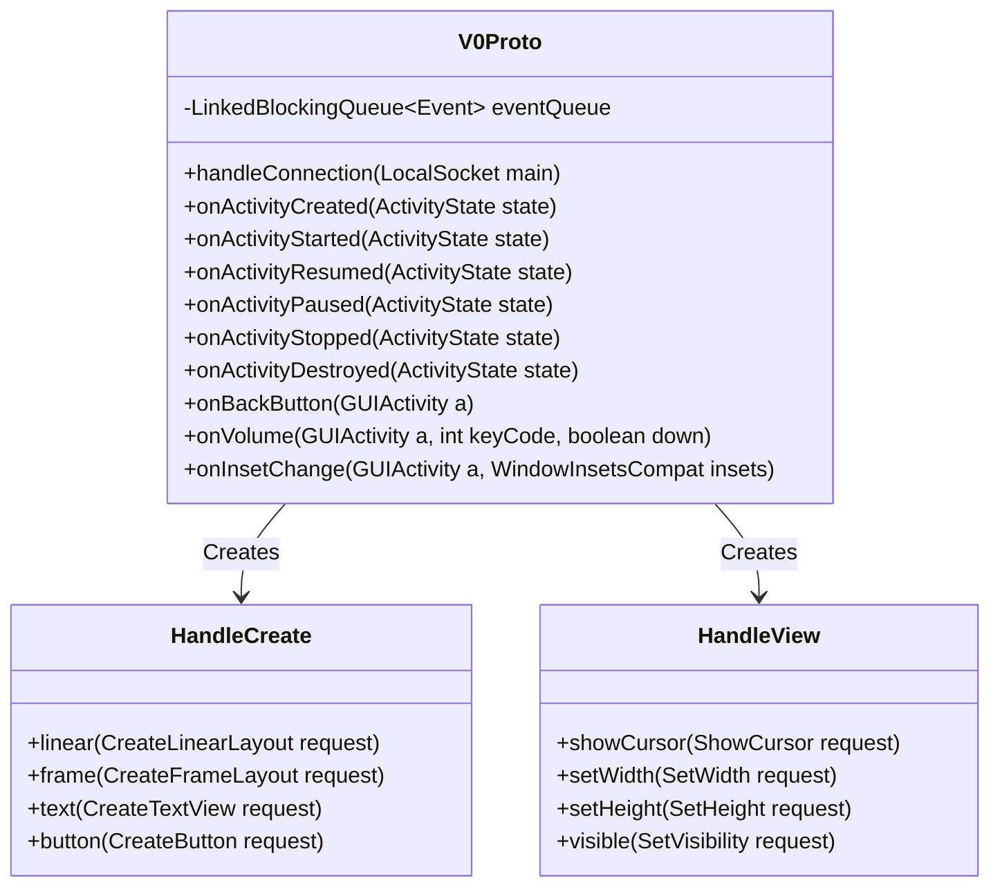
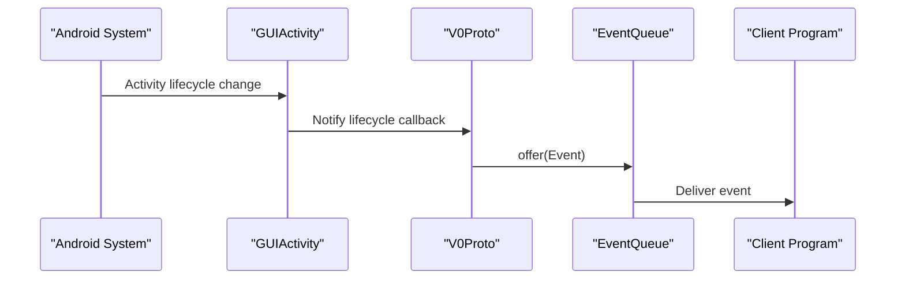
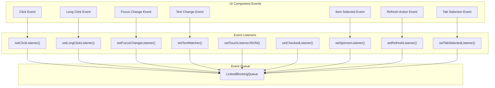
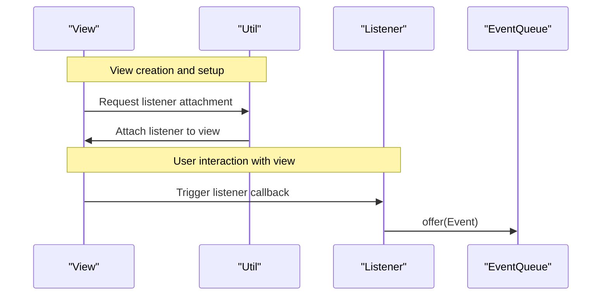
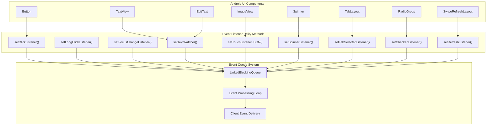

<!-- source: DeepWiki mcp.deepwiki.com · repo termux/termux-gui · page 2.3 Event System · fetched 2026-10-26 -->

# Event System

<details>
<summary>Relevant source files</summary>

The following files were used as context for generating this wiki page:

- [app/src/main/java/com/termux/gui/Util.kt](app/src/main/java/com/termux/gui/Util.kt)
- [app/src/main/java/com/termux/gui/protocol/protobuf/v0/V0Proto.kt](app/src/main/java/com/termux/gui/protocol/protobuf/v0/V0Proto.kt)

</details>


## Purpose and Scope

The Event System in Termux:GUI provides a bidirectional communication mechanism that allows Termux programs to receive feedback from user interactions and system changes. This page documents how events are captured in the Android GUI plugin and communicated back to Termux client programs. For information about sending commands from Termux to the GUI plugin, see [Protocol Documentation](#2).

Sources: [app/src/main/java/com/termux/gui/protocol/protobuf/v0/V0Proto.kt:28-29]()

## Event Architecture Overview

The Event System consists of a centralized event queue that collects events from various sources and delivers them to client programs. Events are generated by UI interactions, activity lifecycle changes, and system-wide events.

### Event Flow Diagram



Sources: [app/src/main/java/com/termux/gui/protocol/protobuf/v0/V0Proto.kt:50-64]()

## Event Queue

The event queue is implemented as a `LinkedBlockingQueue<Event>`, which serves as a thread-safe buffer between event generators and clients. Events are added to the queue using the `offer()` method, which ensures that the queue operations are non-blocking.

### Event Queue Implementation



Sources: [app/src/main/java/com/termux/gui/protocol/protobuf/v0/V0Proto.kt:28-29](), [app/src/main/java/com/termux/gui/protocol/protobuf/v0/V0Proto.kt:57-63]()

## Event Categories

The Event System handles various categories of events, each serving different purposes in the communication between Android and Termux applications.

### Activity Lifecycle Events

Activity lifecycle events inform the client program about the state changes of its associated activities. These include creation, starting, resuming, pausing, stopping, and destruction of activities.



Sources: [app/src/main/java/com/termux/gui/protocol/protobuf/v0/V0Proto.kt:208-232]()

### System Events

System events originate from the Android system and provide information about system-wide changes, such as airplane mode, locale changes, screen state, and timezone updates.

| Event Type | Description | Generated By |
|------------|-------------|--------------|
| Airplane Mode | Notifies when airplane mode is enabled/disabled | `onAirplaneModeChanged()` |
| Locale | Notifies when system language/locale changes | `onLocaleChanged()` |
| Screen State | Notifies when screen turns on/off | `onScreenOff()`, `onScreenOn()` |
| Timezone | Notifies when timezone changes | `onTimezoneChanged()` |
| Configuration | Notifies of system configuration changes | `onConfigurationChanged()` |

Sources: [app/src/main/java/com/termux/gui/protocol/protobuf/v0/V0Proto.kt:234-252](), [app/src/main/java/com/termux/gui/protocol/protobuf/v0/V0Proto.kt:302-307]()

### Input Events

Input events are generated by user interactions with the device, such as pressing buttons or touching the screen.

| Event Type | Description | Generated By |
|------------|-------------|--------------|
| Back Button | Triggered when the back button is pressed | `onBackButton()` |
| Volume Keys | Triggered when volume keys are pressed | `onVolume()` |
| Touch | Triggered by touch screen interactions | View's touch listener |
| System Insets | Reports changes in system UI visibility | `onInsetChange()` |

Sources: [app/src/main/java/com/termux/gui/protocol/protobuf/v0/V0Proto.kt:254-284]()

### UI Component Events

UI component events are generated when users interact with specific UI elements such as buttons, text fields, and other widgets.



Sources: [app/src/main/java/com/termux/gui/Util.kt:191-211](), [app/src/main/java/com/termux/gui/Util.kt:216-226](), [app/src/main/java/com/termux/gui/Util.kt:231-243](), [app/src/main/java/com/termux/gui/Util.kt:333-349](), [app/src/main/java/com/termux/gui/Util.kt:356-411]()

### Special Events

Special events include notifications from remote views, PiP mode changes, and other specialized events.

| Event Type | Description | Generated By |
|------------|-------------|--------------|
| Remote Click | Click on a remote view (widget) | `onRemoteButton()` |
| Notification | Notification interactions | `onNotification()`, `onNotificationDismissed()`, `onNotificationAction()` |
| PiP Mode | Picture-in-Picture mode changes | `onPictureInPictureModeChanged()` |
| User Leave Hint | User is navigating away | `onUserLeaveHint()` |
| Overlay Scale | Scale gesture on overlay | `ScaleGestureDetector.OnScaleGestureListener` |

Sources: [app/src/main/java/com/termux/gui/protocol/protobuf/v0/V0Proto.kt:286-319](), [app/src/main/java/com/termux/gui/protocol/protobuf/v0/V0Proto.kt:354-370]()

## Event Listener Registration

The `Util` class provides helper methods to register event listeners for various UI components. These methods attach appropriate listeners to views and configure them to generate events that are added to the event queue.

### Listener Registration Process



Sources: [app/src/main/java/com/termux/gui/Util.kt:191-311]()

## Event Format and Delivery

Events are formatted according to either the JSON protocol or the Protobuf protocol, depending on which is being used. For Protobuf, events are instances of the `Event` message type that contains different fields based on the event type.

### Event Processing in Client Code

Client programs typically implement an event loop that:

1. Reads events from the protocol socket
2. Parses the event data
3. Dispatches the event to appropriate handlers
4. Performs actions in response to the events

### Example Event Structure (Protobuf)

The structure of Protobuf events can be seen in the event creation methods in `V0Proto`. For example, an activity creation event is constructed as:

```
Event.newBuilder().setCreate(CreateEvent.newBuilder().setAid(it)).build()
```

where `it` is the activity ID.

Sources: [app/src/main/java/com/termux/gui/protocol/protobuf/v0/V0Proto.kt:208-231]()

## System Listeners and Cleanup

The `handleConnection` method in `V0Proto` uses a helper function called `withSystemListenersAndCleanup` to manage the lifecycle of system listeners. This ensures that listeners are properly registered when a connection starts and cleaned up when it ends.

Sources: [app/src/main/java/com/termux/gui/protocol/protobuf/v0/V0Proto.kt:50-206]()

## Integration with UI Components

The Event System integrates tightly with UI components to provide immediate feedback on user interactions. This integration is primarily handled through the utility methods in the `Util` class.

### Component Integration Diagram



Sources: [app/src/main/java/com/termux/gui/Util.kt:191-349]()

## Event Logging

The `V0Proto` class includes a `ProtoLogger` inner class that provides logging functionality for events. This is useful for debugging and diagnostics.

Sources: [app/src/main/java/com/termux/gui/protocol/protobuf/v0/V0Proto.kt:30-48]()

## Conclusion

The Event System in Termux:GUI provides a comprehensive mechanism for bidirectional communication between Termux programs and Android UI components. It handles a wide range of events, from system-level changes to specific user interactions, allowing Termux applications to create responsive and interactive user interfaces.

---

